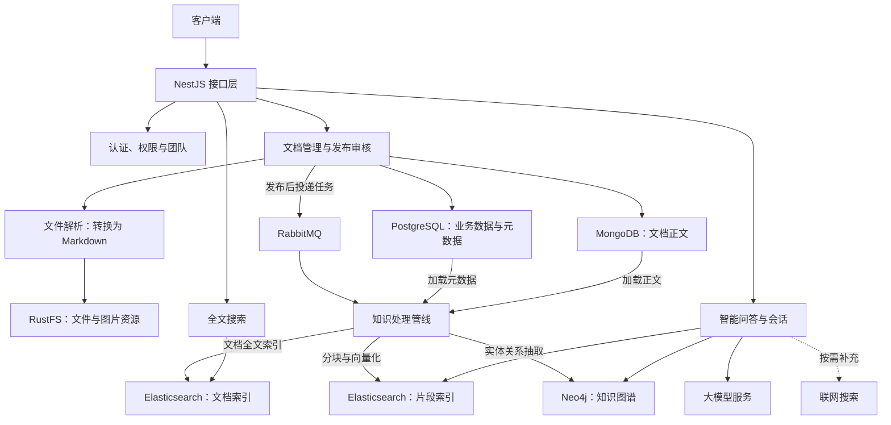

本项目 `knowledge-hub-backend` 是一个基于 **NestJS 与 TypeScript 的知识库后端**：既管理文档、审核和访问权限，也将已发布内容转化为全文索引、向量索引与知识图谱，供搜索和智能问答使用。本页帮助你建立整体认知：系统提供什么能力、数据如何流动，以及从哪里开始阅读代码。Sources: [package.json](package.json#L1-L3) · [package.json](package.json#L24-L43) · [pipeline.orchestrator.ts](src/pipeline/pipeline.orchestrator.ts#L21-L30) · [app.module.ts](src/app.module.ts#L105-L111)

## 一、先理解项目解决的问题

理解本项目，可以抓住一条主线：**把文件变成受控、可检索、可用于回答问题的知识**。文件解析服务将输入转换为 Markdown；文档服务分别保存正文和元数据；发布后，再通过消息队列触发三条知识处理链路。因此，它不只是文件上传接口，也不只是调用大模型的聊天接口。Sources: [file-parser.service.ts](src/document/parser/file-parser.service.ts#L41-L46) · [document.service.ts](src/document/document.service.ts#L48-L53) · [document-pipeline.publisher.ts](src/mq/document-pipeline.publisher.ts#L22-L40)

| 能力领域 | 提供的能力 | 初学者可以怎样理解 |
|---|---|---|
| 文档接入 | PDF、图片、Office 文件解析，以及 TXT、Markdown 本地读取 | 把不同格式的资料转换为统一正文 |
| 内容治理 | 草稿、提交审核、审核通过与驳回 | 管理哪些内容可以发布 |
| 协作与访问 | 用户、角色、权限、团队，以及文档可见范围 | 决定谁可以使用哪些内容 |
| 搜索 | 文档级关键词搜索、片段级混合检索 | 分别用于“找文档”和“找相关段落” |
| 智能问答 | 普通回答、流式回答、会话管理 | 根据问题检索知识并组织回答 |

Sources: [file-parser.service.ts](src/document/parser/file-parser.service.ts#L6-L33) · [document-review.service.ts](src/document/document-review.service.ts#L47-L50) · [document-review.service.ts](src/document/document-review.service.ts#L95-L145) · [app.module.ts](src/app.module.ts#L75-L91) · [document.service.ts](src/document/document.service.ts#L164-L168) · [search.controller.ts](src/search/search.controller.ts#L14-L25) · [ai.controller.ts](src/ai/ai.controller.ts#L39-L85)

## 二、架构全景：业务入口与知识处理相互连接

应用由 `main.ts` 启动，`AppModule` 将认证、团队、文档、搜索、AI、图谱及基础设施模块组装到同一个 NestJS 应用中。初次阅读时，先把它理解为一个**按职责拆分的模块化后端**；模块边界不等于独立部署的微服务边界。Sources: [main.ts](src/main.ts#L6-L24) · [app.module.ts](src/app.module.ts#L39-L63) · [app.module.ts](src/app.module.ts#L105-L116)

下图展示主要业务与数据流，而不是完整依赖图。上半部分负责管理文档，下半部分负责将发布内容转为检索资源，并支持搜索和问答；文件解析、大模型调用等能力还会连接外部服务。Sources: [document.service.ts](src/document/document.service.ts#L58-L72) · [document-pipeline.consumer.ts](src/mq/document-pipeline.consumer.ts#L27-L64) · [ai-chat.service.ts](src/ai/ai-chat.service.ts#L47-L64)



Sources: [file-parser.service.ts](src/document/parser/file-parser.service.ts#L41-L46) · [document.service.ts](src/document/document.service.ts#L48-L72) · [document-pipeline.publisher.ts](src/mq/document-pipeline.publisher.ts#L34-L40) · [pipeline.orchestrator.ts](src/pipeline/pipeline.orchestrator.ts#L21-L30) · [search.controller.ts](src/search/search.controller.ts#L10-L25) · [ai-chat.service.ts](src/ai/ai-chat.service.ts#L47-L90)

### 为什么会同时出现多种存储？

这些组件承担不同职责。**业务记录、正文、文件资源和检索索引不是同一类数据**：文档服务将 PostgreSQL 元数据与 MongoDB 正文关联起来，知识管线再读取这些数据，生成供查询使用的索引。理解这一点，比一开始记住所有连接配置更重要。Sources: [document.service.ts](src/document/document.service.ts#L48-L53) · [document.service.ts](src/document/document.service.ts#L75-L78) · [pipeline.orchestrator.ts](src/pipeline/pipeline.orchestrator.ts#L98-L126)

| 组件 | 在项目中的主要职责 |
|---|---|
| PostgreSQL | 保存文档元数据、用户与授权关系、团队、会话消息等关系数据 |
| MongoDB | 保存文档正文 |
| RustFS | 通过 S3 兼容接口保存文件资源 |
| Elasticsearch | 保存文档级全文索引和片段级向量索引 |
| Neo4j | 保存从文档抽取的实体关系图谱 |
| RabbitMQ | 传递文档发布后的索引与建图任务 |
| Redis | 提供键值读写、过期时间和删除等基础能力 |

Sources: [app.module.ts](src/app.module.ts#L63-L104) · [document.service.ts](src/document/document.service.ts#L48-L53) · [rustfs.service.ts](src/storage/rustfs.service.ts#L24-L26) · [rustfs.service.ts](src/storage/rustfs.service.ts#L85-L110) · [pipeline.orchestrator.ts](src/pipeline/pipeline.orchestrator.ts#L21-L29) · [document-pipeline.publisher.ts](src/mq/document-pipeline.publisher.ts#L22-L40) · [redis.service.ts](src/redis/redis.service.ts#L20-L37)

## 三、贯穿系统的两条主线

### 主线一：从文档创建到知识可用

文档创建默认进入草稿状态。发布审核默认开启：开启时，需要先创建草稿，再提交审核；审核通过后，文档才进入已发布状态并触发后续处理。发布之后，生产者分别投递全文索引、向量索引和图谱构建任务，消费者再调用知识管线执行。Sources: [document.service.ts](src/document/document.service.ts#L80-L95) · [document-review.service.ts](src/document/document-review.service.ts#L40-L44) · [document-review.service.ts](src/document/document-review.service.ts#L95-L115) · [document-pipeline.publisher.ts](src/mq/document-pipeline.publisher.ts#L34-L40) · [document-pipeline.consumer.ts](src/mq/document-pipeline.consumer.ts#L40-L64)

这里最重要的边界是：**已发布不等于索引已经完成**。索引任务通过消息队列执行，而且任务投递失败不会回滚已发布状态。因此，发布成功与能够立即通过搜索或问答找到内容，是两个需要区分的状态。Sources: [document-pipeline.publisher.ts](src/mq/document-pipeline.publisher.ts#L22-L40) · [document-pipeline.publisher.ts](src/mq/document-pipeline.publisher.ts#L59-L66) · [document-pipeline.consumer.ts](src/mq/document-pipeline.consumer.ts#L40-L64)

### 主线二：从问题到回答

本项目中的 **RAG（检索增强生成）**可以先理解为“先找相关资料，再生成回答”。普通问答服务并非简单地检索一次就结束：它包含意图路由、知识库与图谱检索、相关性不足时的查询改写，以及按需联网补充；同时返回回答和来源信息。Sources: [ai-chat.service.ts](src/ai/ai-chat.service.ts#L37-L49) · [ai-chat.service.ts](src/ai/ai-chat.service.ts#L143-L155)

要注意区分三个入口层次：全文搜索用于寻找文档，混合检索用于返回相关片段，而智能问答进一步调用模型组织回答。混合检索接口本身不调用语言模型，适合单独观察“系统找到了什么资料”。Sources: [search.controller.ts](src/search/search.controller.ts#L14-L25) · [ai.controller.ts](src/ai/ai.controller.ts#L39-L67)

## 四、代码导航：先认识这些目录

下面只列出理解主架构所需的目录。建议先定位启动入口和模块装配，再沿“文档 → 消息 → 管线 → 搜索或问答”的顺序阅读，避免一开始就陷入单个解析器或模型参数的细节。Sources: [main.ts](src/main.ts#L1-L8) · [app.module.ts](src/app.module.ts#L8-L27) · [document-pipeline.consumer.ts](src/mq/document-pipeline.consumer.ts#L27-L64)

```text
src/
├── main.ts                  应用启动入口
├── app.module.ts            根模块与基础连接装配
├── auth/                    身份认证与授权
├── user/                    用户、角色与权限
├── team/                    团队协作
├── document/                文档、正文、审核及内容维护
│   └── parser/              文件解析
├── storage/                 RustFS 对象存储
├── mq/                      知识处理任务发布与消费
├── pipeline/                分块、向量化、索引与图谱构建
├── search/                  文档级全文搜索入口
├── graph/                   图谱查询入口
├── ai/                      检索、问答、会话与记忆
├── notification/            通知业务
├── redis/                   Redis 访问封装
└── observability/           模型链路追踪接入
```

Sources: [app.module.ts](src/app.module.ts#L8-L37) · [document.service.ts](src/document/document.service.ts#L28-L46) · [ai.module.ts](src/ai/ai.module.ts#L2-L26) · [pipeline.orchestrator.ts](src/pipeline/pipeline.orchestrator.ts#L14-L19) · [main.ts](src/main.ts#L1-L11)

## 五、接下来怎么读

**当前位置：Get Started → Overview（当前页）**。建议先阅读 [Quick Start](2-quick-start)，了解如何启动项目；再对照 [环境配置指南：数据库、中间件、模型服务与可选能力](3-huan-jing-pei-zhi-zhi-nan-shu-ju-ku-zhong-jian-jian-mo-xing-fu-wu-yu-ke-xuan-neng-li) 梳理外部依赖。本页不展开启动命令与配置项，以免将架构认知和环境操作混在一起。Sources: [package.json](package.json#L8-L14) · [app.module.ts](src/app.module.ts#L39-L104) · [ai-chat.service.ts](src/ai/ai-chat.service.ts#L65-L90)

环境就绪后，继续阅读 [首次知识入库：登录、上传、审核发布与检索问答](4-shou-ci-zhi-shi-ru-ku-deng-lu-shang-chuan-shen-he-fa-bu-yu-jian-suo-wen-da)，通过一次完整操作串起两条主线；需要连接客户端时，再进入 [接口联调入门：认证凭据、参数校验与流式响应](5-jie-kou-lian-diao-ru-men-ren-zheng-ping-ju-can-shu-xiao-yan-yu-liu-shi-xiang-ying)。Sources: [document-review.service.ts](src/document/document-review.service.ts#L95-L115) · [ai.controller.ts](src/ai/ai.controller.ts#L39-L67) · [main.ts](src/main.ts#L13-L23)

希望进一步理解设计时，优先阅读 [模块化后端架构：依赖注入、业务边界与请求生命周期](6-mo-kuai-hua-hou-duan-jia-gou-yi-lai-zhu-ru-ye-wu-bian-jie-yu-qing-qiu-sheng-ming-zhou-qi) 和 [多存储协作：关系数据、文档正文、对象文件与检索索引](7-duo-cun-chu-xie-zuo-guan-xi-shu-ju-wen-dang-zheng-wen-dui-xiang-wen-jian-yu-jian-suo-suo-yin)。先掌握模块边界与数据职责，再研究检索和问答算法，会更容易将实现细节放回整体架构中。Sources: [app.module.ts](src/app.module.ts#L39-L116) · [document.service.ts](src/document/document.service.ts#L48-L72) · [pipeline.orchestrator.ts](src/pipeline/pipeline.orchestrator.ts#L21-L30)