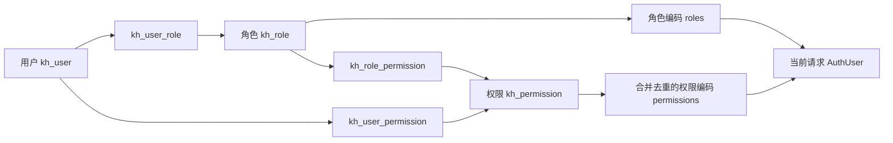
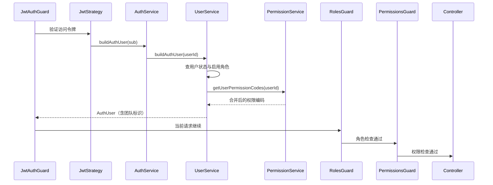

本页位于“身份认证与协作权限”章节，解释系统如何把数据库中的用户、角色和权限关系转换为接口访问决策。核心模型是 **RBAC（基于角色的访问控制）＋用户直接授权**，执行入口是依次注册的 JWT、角色和权限码三个全局守卫。理解这两个层次，才能准确判断“给用户增加权限后，为什么接口仍然返回 403”。Sources: [auth.module.ts](src/auth/auth.module.ts#L31-L48) [permission.service.ts](src/user/permission.service.ts#L208-L251)

## 1. 授权模型：角色与直接权限共同构成能力集合

系统通过三张关联表表达授权：`kh_user_role` 连接用户与角色，`kh_role_permission` 连接角色与权限，`kh_user_permission` 为用户补充直接权限。关联表分别约束组合唯一；角色编码和权限编码也具有唯一约束。**分配关系使用 ID，运行时判断使用编码**，两者不能混用。Sources: [init.sql](init-scripts/postgresql/init.sql#L65-L79) [init.sql](init-scripts/postgresql/init.sql#L105-L136)

下图展示授权关系的两条汇聚路径。用户直接权限与角色权限最终合并、去重，并不是“直接权限覆盖角色权限”；当前计算逻辑没有拒绝项，也没有减去某项继承权限的操作。Sources: [permission.service.ts](src/user/permission.service.ts#L208-L232)

Sources: [init.sql](init-scripts/postgresql/init.sql#L65-L136) [user.service.ts](src/user/user.service.ts#L88-L115)

### 1.1 三类概念各司其职

| 概念 | 关键标识与字段 | 在授权中的作用 |
|---|---|---|
| 用户 | `id`、`status`、`deleted` | 确定主体是否存在、是否可继续访问 |
| 角色 | `roleCode`、`status` | 形成 `AuthUser.roles`，供角色守卫判断 |
| 权限 | `permissionCode`、`status`、`deleted` | 形成 `AuthUser.permissions`，供权限码守卫判断 |
| 权限展示结构 | `parentId`、`permissionType`、`menuUrl`、`icon` | 支持菜单、按钮、接口权限的组织与展示 |
| 接口描述信息 | `apiUrl`、`method` | 权限实体中保存的描述字段，不是权限守卫的匹配依据 |

Sources: [user.entity.ts](src/user/entities/user.entity.ts#L13-L60) [role.entity.ts](src/user/entities/role.entity.ts#L5-L21) [permission.entity.ts](src/user/entities/permission.entity.ts#L10-L57) [permissions.guard.ts](src/auth/permissions.guard.ts#L23-L47)

**权限树不等于权限继承树。** `getTree()` 按 `parentId` 生成展示层级，但权限集合计算只读取显式关联的权限记录，不递归展开父子节点。因此，拥有 `document` 不会自动获得 `document:edit`；拥有 `system:permission` 也不会自动获得 `system:permission:create`。同样，守卫不会根据 `apiUrl` 或 HTTP 方法动态查找权限，而是读取接口上的 `@RequirePermission(...)` 元数据。Sources: [permission.service.ts](src/user/permission.service.ts#L151-L164) [permission.service.ts](src/user/permission.service.ts#L208-L232) [permissions.guard.ts](src/auth/permissions.guard.ts#L23-L47)

### 1.2 预置角色与初始能力

| 角色 | 编码 | 初始化或运行时能力 |
|---|---|---|
| 管理员 | `ROLE_ADMIN` | 运行时追加管理员操作权限，并在权限码守卫中直接放行 |
| 审核员 | `ROLE_REVIEWER` | 初始化关联文档列表、文档审核和搜索权限 |
| 普通用户 | `ROLE_USER` | 初始化关联首页、文档中心、文档列表、创建、编辑、删除、搜索和个人中心权限 |

Sources: [init.sql](init-scripts/postgresql/init.sql#L82-L87) [init.sql](init-scripts/postgresql/init.sql#L138-L178) [permissions.ts](src/common/constants/permissions.ts#L16-L39) [permissions.guard.ts](src/auth/permissions.guard.ts#L38-L40)

注册用户默认分配 `ROLE_USER`；管理员创建用户时，若未提供非空 `roleCodes`，也使用该默认角色。这只是初始角色选择，不代表普通用户可以跳过后续业务服务的资源检查。Sources: [user.service.ts](src/user/user.service.ts#L160-L172) [user.service.ts](src/user/user.service.ts#L180-L203)

## 2. 从数据库关系到当前请求身份

**访问令牌不是角色和权限的持久快照。** 应用签发的令牌业务载荷仅包含 `sub`、`username` 和 `type`；JWT 策略验证访问令牌后，依据 `sub` 调用 `buildAuthUser()`，重新读取用户、角色和权限。因而，后续非公开请求会重新计算授权信息，不需要仅为刷新角色或权限而重新签发令牌。Sources: [auth.service.ts](src/auth/auth.service.ts#L25-L29) [auth.service.ts](src/auth/auth.service.ts#L69-L77) [jwt.strategy.ts](src/auth/jwt.strategy.ts#L27-L31) [user.service.ts](src/user/user.service.ts#L106-L115)

下图展示模块与服务在一次受保护请求中的协作。`AuthUser` 还包含团队标识，但团队和文档可见性属于资源级判断，不由这两个通用授权守卫直接处理。Sources: [auth-user.interface.ts](src/auth/auth-user.interface.ts#L1-L12) [roles.guard.ts](src/auth/roles.guard.ts#L38-L56) [permissions.guard.ts](src/auth/permissions.guard.ts#L23-L47)

Sources: [jwt-auth.guard.ts](src/auth/jwt-auth.guard.ts#L29-L45) [jwt.strategy.ts](src/auth/jwt.strategy.ts#L27-L31) [auth.service.ts](src/auth/auth.service.ts#L194-L196) [user.service.ts](src/user/user.service.ts#L88-L115) [auth.module.ts](src/auth/auth.module.ts#L36-L47)

身份构建先查找 `deleted = false` 的用户，再检查 `status === 1`。禁用用户会抛出 `UnauthorizedException`；已删除或不存在的用户由查询方法抛出 `NotFoundException`。`JwtAuthGuard.handleRequest()` 会原样抛出已有异常，因此不能把所有身份构建失败都概括为固定返回 401。Sources: [user.service.ts](src/user/user.service.ts#L51-L59) [user.service.ts](src/user/user.service.ts#L106-L115) [jwt-auth.guard.ts](src/auth/jwt-auth.guard.ts#L40-L45)

## 3. 接口守卫：内部“或”，层间“且”

三个全局守卫按 **`JwtAuthGuard → RolesGuard → PermissionsGuard`** 注册。未标记公开的接口默认需要登录；角色守卫和权限守卫没有配置要求时，各自直接放行。因此，“没有授权装饰器”表示没有额外的角色或权限码限制，而不是匿名可访问。Sources: [auth.module.ts](src/auth/auth.module.ts#L36-L47) [jwt-auth.guard.ts](src/auth/jwt-auth.guard.ts#L29-L38) [roles.guard.ts](src/auth/roles.guard.ts#L38-L44) [permissions.guard.ts](src/auth/permissions.guard.ts#L23-L30)

| 接口声明 | 判断规则 | 管理员是否自动满足 |
|---|---|---|
| 无 `@Roles` | 角色层放行 | 不需要特殊处理 |
| `@Roles(A, B)` | 至少命中一个角色 | **不自动满足**，必须命中声明中的角色 |
| 无 `@RequirePermission` | 权限码层放行 | 不需要特殊处理 |
| `@RequirePermission(P, Q)` | 非管理员至少拥有一个权限码 | 是，`ROLE_ADMIN` 在此层直接放行 |
| 同时声明角色与权限码 | 角色层与权限码层都必须通过 | 仅能绕过权限码层 |
| 类和方法都声明同类元数据 | 方法级优先，不与类级数组合并 | 遵循相同规则 |

Sources: [roles.guard.ts](src/auth/roles.guard.ts#L38-L56) [permissions.guard.ts](src/auth/permissions.guard.ts#L23-L47)

例如，审核通过接口同时声明 `@Roles(RoleCode.REVIEWER, RoleCode.ADMIN)` 与 `@RequirePermission(PermissionCode.documentReview)`：非管理员必须同时具备相应角色和 `document:review`。只给普通用户直接分配该权限码，不能绕过角色限制。相对地，审核记录查询一次声明 `document:list` 与 `document:review`，含义是任意一个权限即可，不是必须同时拥有。Sources: [document.controller.ts](src/document/document.controller.ts#L117-L140) [roles.guard.ts](src/auth/roles.guard.ts#L52-L55) [permissions.guard.ts](src/auth/permissions.guard.ts#L42-L45)

### 3.1 管理员有两种不同的特殊处理

管理员的第一种特殊处理发生在权限集合构建阶段：系统把 `ADMIN_OPERATION_PERMISSIONS` 加入返回集合，便于调用方获取一组明确的操作码。第二种发生在权限码守卫阶段：只要 `roles` 包含 `ROLE_ADMIN`，就跳过权限码命中检查。**这意味着管理员能通过某个权限码检查，并不要求该码一定出现在返回的 `permissions` 数组里。** Sources: [permission.service.ts](src/user/permission.service.ts#L234-L251) [permissions.ts](src/common/constants/permissions.ts#L16-L39) [permissions.guard.ts](src/auth/permissions.guard.ts#L38-L43)

### 3.2 `@Public()` 不是所有守卫的统一旁路

`JwtAuthGuard` 与 `RolesGuard` 都显式识别 `@Public()`，但 `PermissionsGuard` 不读取公开标记。若公开接口同时配置非空 `@RequirePermission(...)`，且请求上没有用户，权限码守卫仍会返回 403。设计匿名接口时，应把公开元数据与权限要求一起检查，不能仅凭 `@Public()` 推断整个守卫链都会跳过。Sources: [jwt-auth.guard.ts](src/auth/jwt-auth.guard.ts#L29-L38) [roles.guard.ts](src/auth/roles.guard.ts#L31-L36) [permissions.guard.ts](src/auth/permissions.guard.ts#L23-L35)

## 4. 管理接口：读清门槛与替换语义

以下使用控制器相对路径。用户自助接口不额外要求角色；用户、角色和权限管理接口则由管理员角色保护。尤其要注意：**持有 `system:user`、`system:role` 或 `system:permission`，不等于可以进入对应管理接口**，因为角色守卫先于权限码守卫执行。Sources: [user.controller.ts](src/user/user.controller.ts#L26-L138) [role.controller.ts](src/user/role.controller.ts#L18-L20) [permission.controller.ts](src/user/permission.controller.ts#L22-L24) [auth.module.ts](src/auth/auth.module.ts#L36-L47)

| 接口 | 角色要求 | 权限码声明或用途 |
|---|---|---|
| `PUT /users/me`、`GET /users/me/stats`、`PUT /users/password/change` | 无额外角色要求 | 操作当前登录用户 |
| `GET /users/page`、`GET /users/:id`、`POST /users`、`PUT/DELETE /users/:id` | `ROLE_ADMIN` | 未额外声明权限码 |
| `GET /users/:id/roles` | `ROLE_ADMIN` | 返回角色编码 |
| `PUT /users/:id/roles` | `ROLE_ADMIN` | `system:user` |
| `GET/PUT /users/:id/permissions` | `ROLE_ADMIN` | `system:user` |
| `/roles` 下的角色管理接口 | 类级 `ROLE_ADMIN` | 权限关联读写额外声明 `system:role` |
| `/permissions` 下的查询接口 | 类级 `ROLE_ADMIN` | `system:permission` |
| `POST/PUT/DELETE /permissions...` | 类级 `ROLE_ADMIN` | 分别声明 `system:permission:create/edit/delete` |

Sources: [user.controller.ts](src/user/user.controller.ts#L33-L138) [role.controller.ts](src/user/role.controller.ts#L18-L97) [permission.controller.ts](src/user/permission.controller.ts#L22-L74)

### 4.1 角色和权限分配都是全量替换

| 操作 | 请求字段 | 校验与写入语义 |
|---|---|---|
| 替换用户角色 | `roleCodes: string[]` | DTO 要求非空；查询启用角色，校验后删除原关联，再逐条保存 |
| 替换角色权限 | `permissionIds: string[]` | 校验角色存在及权限有效，再删除该角色原权限关联并重建 |
| 替换用户直接权限 | `permissionIds: string[]` | 校验目标用户及权限有效，再删除该用户原直接授权并重建 |

Sources: [assign-roles.dto.ts](src/user/dto/assign-roles.dto.ts#L1-L8) [permission.dto.ts](src/user/dto/permission.dto.ts#L117-L120) [user.service.ts](src/user/user.service.ts#L271-L295) [permission.service.ts](src/user/permission.service.ts#L172-L205) [user.controller.ts](src/user/user.controller.ts#L125-L137)

`permissionIds` 允许空数组，可用于清空对应关联；用户直接权限清空后，角色继承权限仍然保留。`GET /users/:id/permissions` 则分别返回合并计算的 `permissionCodes` 和直接绑定的 `directPermissionIds`：编辑直接授权时应使用后者，不应把合并结果当成直接授权清单。Sources: [permission.dto.ts](src/user/dto/permission.dto.ts#L117-L120) [permission.service.ts](src/user/permission.service.ts#L193-L232) [user.controller.ts](src/user/user.controller.ts#L113-L122)

这些替换方法当前采用“先删除、再逐条保存”，方法中没有事务包装。因此不能把它们理解为已经具备原子性的集合替换；并发授权管理或中途写入失败，需要在扩展实现时单独处理一致性边界。Sources: [user.service.ts](src/user/user.service.ts#L271-L295) [permission.service.ts](src/user/permission.service.ts#L172-L205)

## 5. 必须掌握的实现边界

### 5.1 禁用角色不会一致地移除其继承权限

这是当前实现中最值得注意的差异：`getRoleCodes()` 连接角色表并过滤 `r.status = 1`；但角色继承权限查询只连接用户角色、角色权限和权限表，**没有过滤角色状态**。因此，禁用角色会使其角色编码退出 `AuthUser.roles`，却不一定移除该角色关联的权限码。管理员自动追加权限的判断另有启用角色过滤，不能与这条继承权限查询混为一谈。Sources: [user.service.ts](src/user/user.service.ts#L61-L69) [permission.service.ts](src/user/permission.service.ts#L219-L249)

| 变更 | 当前实现的后续请求行为 |
|---|---|
| 禁用用户 | 身份构建拒绝访问 |
| 禁用某项权限 | 直接权限和角色权限查询均不再返回该记录的编码 |
| 禁用角色 | 角色编码被过滤，但角色关联权限仍可能进入权限集合 |
| 移除用户直接权限 | 若角色仍授予同一码，最终权限仍保留 |
| 修改权限编码 | 后续集合返回新码；若接口仍要求旧码，非管理员无法匹配 |

Sources: [user.service.ts](src/user/user.service.ts#L61-L69) [user.service.ts](src/user/user.service.ts#L106-L115) [permission.service.ts](src/user/permission.service.ts#L84-L107) [permission.service.ts](src/user/permission.service.ts#L208-L251) [permissions.guard.ts](src/auth/permissions.guard.ts#L38-L45)

### 5.2 删除操作不是统一的级联撤权

权限删除会先检查未删除的子权限以及角色、用户关联，存在任意关联就拒绝，随后才软删除。角色删除则先检查用户角色关联，再执行物理删除；初始化 SQL 中角色权限表还有指向角色的外键，而该服务方法没有主动清理角色权限关联。因此，不能把角色删除当作“自动清除全部授权关系”的操作。Sources: [permission.service.ts](src/user/permission.service.ts#L110-L128) [role.service.ts](src/user/role.service.ts#L56-L62) [init.sql](init-scripts/postgresql/init.sql#L122-L128)

### 5.3 快速定位授权问题

| 现象 | 优先核对 |
|---|---|
| 返回 403“权限不足” | 是否先被角色守卫拒绝，再检查权限码；两层都可能抛出相同消息 |
| 拥有权限码却无法进入管理接口 | 控制器或方法是否同时要求 `ROLE_ADMIN` |
| 管理员被角色限制拒绝 | `@Roles(...)` 是否显式包含管理员，或管理员是否拥有其他允许角色 |
| 清空直接权限后仍能访问 | 同一权限是否仍来自角色 |
| 禁用角色后权限仍有效 | 是否命中了未过滤角色状态的继承权限查询 |
| 创建权限记录后接口仍未受保护 | 接口是否声明了 `@RequirePermission(...)`；`apiUrl` 本身不会建立守卫规则 |

Sources: [roles.guard.ts](src/auth/roles.guard.ts#L38-L55) [permissions.guard.ts](src/auth/permissions.guard.ts#L23-L45) [user.controller.ts](src/user/user.controller.ts#L105-L137) [permission.service.ts](src/user/permission.service.ts#L208-L232)

## 6. 阅读衔接

若需要追溯访问令牌如何产生与验证，可阅读[账号安全：注册登录、邮件激活、密码重置与令牌验证](9-zhang-hao-an-quan-zhu-ce-deng-lu-you-jian-ji-huo-mi-ma-zhong-zhi-yu-ling-pai-yan-zheng)。本页之后建议继续阅读[团队协作与文档可见性：业务读取、全文检索和图谱查询的权限一致性](11-tuan-dui-xie-zuo-yu-wen-dang-ke-jian-xing-ye-wu-du-qu-quan-wen-jian-suo-he-tu-pu-cha-xun-de-quan-xian-zhi-xing)：**角色与权限码决定能否进入某类操作，具体资源能否访问还需要业务层判断**，而 `AuthUser.teamIds` 正是该后续判断所需的上下文之一。Sources: [jwt.strategy.ts](src/auth/jwt.strategy.ts#L27-L31) [auth-user.interface.ts](src/auth/auth-user.interface.ts#L1-L12) [user.service.ts](src/user/user.service.ts#L88-L103) [document.controller.ts](src/document/document.controller.ts#L112-L114)