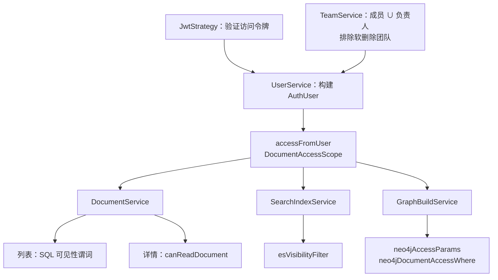
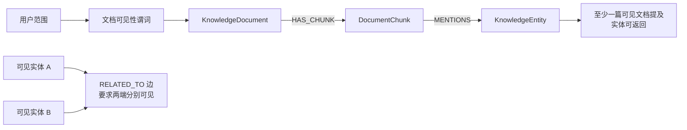

本页位于“身份认证与协作权限”，解释团队身份如何转换为文档读取范围，以及 PostgreSQL 业务读取、Elasticsearch 全文搜索和 Neo4j 图谱查询如何表达这一范围。核心结论是：**三个入口共享授权语义，但不共享同一个实时数据快照，也不具备完全相同的状态校验机制**。判断权限一致性时，必须同时检查用户范围、文档状态和索引可见性字段。Sources: [document-access.ts](src/document/document-access.ts#L6-L32) [document-access.ts](src/document/document-access.ts#L54-L104) [document.service.ts](src/document/document.service.ts#L650-L681)

## 1. 从第一原则区分：接口权限不等于数据可见性

系统存在两道独立边界：权限码决定“能否调用接口”，文档范围决定“调用后能看到哪些数据”。例如，文档详情要求 `documentList`，全文搜索和图谱接口要求 `search`；通过接口守卫后，控制器仍须把当前用户交给业务服务，或转换为 `DocumentAccessScope`。因此，拥有搜索权限并不意味着可以搜索所有团队的文档。Sources: [permissions.guard.ts](src/auth/permissions.guard.ts#L23-L47) [document.controller.ts](src/document/document.controller.ts#L171-L177) [search.controller.ts](src/search/search.controller.ts#L14-L25) [graph.controller.ts](src/graph/graph.controller.ts#L14-L55)

普通用户的业务读取规则可以写为：**作者本人，或“已发布且公开”，或“已发布且属于可访问团队”**。管理员和审核员在文档范围层面不受限制；但审核员并没有因此自动绕过接口权限码守卫。写权限另行判断，仅管理员或作者通过，团队成员身份和审核员身份本身不授予编辑权。Sources: [document-access.ts](src/document/document-access.ts#L13-L40) [permissions.guard.ts](src/auth/permissions.guard.ts#L38-L45)

| 用户与文档的关系 | 读取非发布文档 | 读取已发布文档 | 对象级写权限 |
|---|---|---|---|
| 管理员 | 允许 | 允许 | 允许 |
| 审核员，且不是作者、不是管理员 | 允许 | 允许 | 不允许 |
| 作者本人 | 允许 | 允许 | 允许 |
| 所属团队成员或负责人，且不是作者 | 不允许 | 允许 | 不允许 |
| 非团队用户，文档公开 | 不允许 | 允许 | 不允许 |
| 非团队用户，文档不公开 | 不允许 | 不允许 | 不允许 |

上述矩阵只表达对象级规则，不替代接口权限码、文档是否存在或是否已软删除的检查。特别是“公开”是文档读取规则中的一个分支，不是匿名访问入口的声明。Sources: [document-access.ts](src/document/document-access.ts#L23-L40) [document.service.ts](src/document/document.service.ts#L243-L252) [document.controller.ts](src/document/document.controller.ts#L171-L177)

## 2. 团队身份：成员与负责人取并集，不沿组织树继承

`TeamService.listAccessibleTeamIds()` 是 `AuthUser.teamIds` 的来源。它并行读取成员表和负责人关系，统一把 ID 转成字符串并去重，再排除软删除团队。这意味着负责人即使没有成员记录，仍具备该团队的读取范围；反过来，删除成员记录也不一定移除访问权，如果用户仍是负责人，团队仍会出现在范围中。Sources: [team.service.ts](src/team/team.service.ts#L29-L60)

需要区分**组织结构**与**授权结构**：该方法没有沿 `parentId` 递归，也没有按团队 `status` 过滤；它只计算直接成员关系、直接负责人关系，并检查 `deleted = false`。因此不能把团队树的父子关系理解为文档权限继承，也不能把团队停用等同于移除团队文档访问权。Sources: [team.service.ts](src/team/team.service.ts#L33-L59) [team.service.ts](src/team/team.service.ts#L144-L164)

| 协作操作 | 实现行为 | 对读取范围的影响 |
|---|---|---|
| 添加成员 | 验证团队、用户存在，已有成员跳过 | 后续构建用户范围时纳入团队 |
| 移除成员 | 删除指定成员记录 | 若仍是负责人，仍保留范围 |
| 变更负责人 | 更新 `leaderId` | 后续按新的负责人关系计算 |
| 删除团队 | 有子团队时拒绝；否则软删除并清理成员 | 团队不再进入可访问集合 |
| 查询我的团队 | 复用 `listAccessibleTeamIds()` | 与文档使用同一团队集合来源 |

团队管理接口，包括增删成员，声明了管理员角色和 `system:team` 权限；`GET /teams/mine` 则读取当前登录用户的团队集合。负责人是读取范围的来源，不代表负责人自动拥有团队管理接口权限。Sources: [team.service.ts](src/team/team.service.ts#L85-L113) [team.service.ts](src/team/team.service.ts#L167-L193) [team.controller.ts](src/team/team.controller.ts#L56-L60) [team.controller.ts](src/team/team.controller.ts#L76-L94)

## 3. 请求内的范围构建与模块协作

JWT 校验通过后，策略调用 `buildAuthUser()`；用户服务重新加载账号状态、角色、权限和团队集合，再由 `accessFromUser()` 生成 `{ unrestricted, userId, teamIds }`。团队集合并非直接从 JWT 载荷取出，所以成员变更无需通过重新签发令牌才能被后续正常认证请求识别；已经构建出的请求内范围则不是持续更新的对象。Sources: [jwt.strategy.ts](src/auth/jwt.strategy.ts#L7-L11) [jwt.strategy.ts](src/auth/jwt.strategy.ts#L26-L31) [auth.service.ts](src/auth/auth.service.ts#L194-L195) [user.service.ts](src/user/user.service.ts#L88-L115) [document-access.ts](src/document/document-access.ts#L13-L20)

下图展示实际协作关系。共享的是用户范围及其转换规则：业务列表自己拼接 SQL 谓词，详情调用布尔判定函数，搜索与图谱服务分别把范围转换成查询条件。Sources: [document.service.ts](src/document/document.service.ts#L169-L195) [document.service.ts](src/document/document.service.ts#L243-L252) [search.controller.ts](src/search/search.controller.ts#L17-L25) [graph.controller.ts](src/graph/graph.controller.ts#L19-L55)

Sources: [jwt.strategy.ts](src/auth/jwt.strategy.ts#L26-L31) [user.service.ts](src/user/user.service.ts#L88-L115) [document-access.ts](src/document/document-access.ts#L13-L32) [document-access.ts](src/document/document-access.ts#L59-L104)

## 4. 三条读取路径：相同集合语义，不同执行前提

### 4.1 业务读取：直接检查状态和软删除

文档列表先排除软删除记录，再加入授权谓词，最后叠加标题、团队、作者、状态等业务筛选。因此，客户端传入任意 `teamId` 或 `authorId` 只能缩小结果，不能覆盖已有授权条件。详情也先查找未删除文档，再检查读取权限，通过后才加载 MongoDB 正文。Sources: [document.service.ts](src/document/document.service.ts#L174-L215) [document.service.ts](src/document/document.service.ts#L243-L266)

这里的授权不是完全由同一个函数执行：列表中的 SQL 与 `canReadDocument()` 分别实现相同规则。维护规则时必须同时检查两处。另一个内部调用边界是 `findOne(..., user?)`：只有传入 `user` 才执行对象级检查；当前详情控制器明确传入当前用户，但新增内部调用不能把省略用户参数视为安全默认值。Sources: [document.service.ts](src/document/document.service.ts#L179-L195) [document.service.ts](src/document/document.service.ts#L243-L252) [document.controller.ts](src/document/document.controller.ts#L171-L177)

### 4.2 全文检索：在召回阶段过滤，而非返回后裁剪

全文搜索通过 `esVisibilityFilter()` 生成“公开、作者、团队”三个分支的 OR，设置 `minimum_should_match: 1`，并把它放进 Elasticsearch 的 `bool.filter`。关键词相关性位于 `must`，分类和作者等条件也进入过滤集合。这样权限条件不参与相关性打分，返回命中、高亮和总数均来自已经应用过滤的搜索请求。Sources: [document-access.ts](src/document/document-access.ts#L59-L74) [search-index.service.ts](src/pipeline/search-index.service.ts#L162-L218) [search-index.service.ts](src/pipeline/search-index.service.ts#L220-L242)

ES 可见性条件**不检查 `status`**，其代码明确依赖“未发布文档不进入索引”的前提。管线加载全部文档时只选取已发布且未删除记录，但查询端不是再次对 PostgreSQL 逐条授权。因此，“业务可读”与“全文可搜”不是同一个集合：作者或审核员可以读取未发布文档，并不意味着这些文档应出现在全文索引中。Sources: [document-access.ts](src/document/document-access.ts#L63-L73) [pipeline.orchestrator.ts](src/pipeline/pipeline.orchestrator.ts#L215-L227) [search-index.service.ts](src/pipeline/search-index.service.ts#L200-L245)

### 4.3 图谱查询：由可见文档传播到块与实体

图谱并非简单地给实体加团队过滤。文档节点直接应用可见性谓词；块节点通过所属文档判断；实体节点则要求至少存在一条来自可见文档的 `HAS_CHUNK → MENTIONS` 路径。图谱关键词搜索同时覆盖这些节点类型，授权条件与关键词条件共同执行。Sources: [document-access.ts](src/document/document-access.ts#L90-L103) [graph-build.service.ts](src/pipeline/graph-build.service.ts#L479-L518)

Sources: [graph-build.service.ts](src/pipeline/graph-build.service.ts#L388-L402) [graph-build.service.ts](src/pipeline/graph-build.service.ts#L430-L447) [graph-build.service.ts](src/pipeline/graph-build.service.ts#L490-L500)

全景接口也把范围应用到文档数、实体数、关系数、提及数、实体类型、热门实体和最近文档，而不只是主图节点。其统计与最近文档查询独立于主图的关键词、时间和类型筛选，所以需要区分“当前用户可见范围统计”与“当前筛选结果统计”。Sources: [graph-build.service.ts](src/pipeline/graph-build.service.ts#L731-L825)

| 路径 | 可见性执行位置 | 状态保障 | 关键边界 |
|---|---|---|---|
| 业务列表、详情 | PostgreSQL 条件或详情判定 | 直接检查发布状态，作者及特权角色例外 | 可读取本人非发布文档 |
| 全文搜索 | ES `bool.filter` | 依赖索引只保留应被搜索的文档 | 不回查关系库逐条授权 |
| 图谱查询 | Cypher 文档谓词及路径存在性 | 文档谓词不含发布状态 | 实体由可见文档的提及关系决定 |

Sources: [document.service.ts](src/document/document.service.ts#L169-L195) [document-access.ts](src/document/document-access.ts#L23-L32) [document-access.ts](src/document/document-access.ts#L59-L104) [graph-build.service.ts](src/pipeline/graph-build.service.ts#L388-L402)

## 5. 一致性的两条边界：权限变更与图谱关系来源

### 文档可见性变更不是跨存储事务

团队成员变更影响请求侧的 `teamIds`；文档公开性或所属团队变更则影响索引侧的 `isPublic`、`teamId`、`authorId`。文档更新先保存关系数据，再判断可见性是否变化；仍处于发布状态且可见性变化时，管线并行更新全文、向量和图谱三套索引，不重新执行嵌入或实体抽取。Sources: [user.service.ts](src/user/user.service.ts#L88-L114) [document.service.ts](src/document/document.service.ts#L383-L410) [document.service.ts](src/document/document.service.ts#L652-L681) [pipeline.orchestrator.ts](src/pipeline/pipeline.orchestrator.ts#L78-L95)

**调用中等待同步，不等于同步成功后才允许保存。** ES 更新使用 `refresh: true`，但 ES 不可用时直接跳过，异常时只记录告警；图谱更新异常也被记录而不向外抛出。文档服务同样将同步失败定义为“不影响文档保存”。因此不能把“公开改私有成功”解释为跨存储原子撤权；若索引更新失败，业务详情和索引查询可能基于不同版本的可见性字段。Sources: [search-index.service.ts](src/pipeline/search-index.service.ts#L85-L113) [graph-build.service.ts](src/pipeline/graph-build.service.ts#L330-L338) [document.service.ts](src/document/document.service.ts#L672-L679)

### 图谱边检查的是两端可见，不是关系来源可见

`listEdges()` 对一条 `RELATED_TO` 边的要求是：两端实体分别被某篇可见文档提及。两个存在性条件可以匹配不同文档，查询没有继续要求“这条关系本身由可见文档抽取”。实体查询也直接返回共享实体的 `description`，而不是按可见文档重新投影属性。因此，当前实现应准确描述为**基于文档可见性的节点与端点约束**，不能描述为关系证据和共享属性的完整来源级隔离。Sources: [graph-build.service.ts](src/pipeline/graph-build.service.ts#L388-L408) [graph-build.service.ts](src/pipeline/graph-build.service.ts#L430-L454)

此外，服务内部的范围参数存在宽松默认值：全文服务缺省 `scope` 时不加入可见性过滤，Neo4j 参数构建在缺省 `scope` 时设置 `unrestricted: true`。现有搜索和图谱控制器均显式传入用户范围；新增控制器、定时任务或内部复用时，必须明确区分“全量内部查询”和“面向用户查询”。Sources: [search-index.service.ts](src/pipeline/search-index.service.ts#L145-L166) [document-access.ts](src/document/document-access.ts#L90-L95) [search.controller.ts](src/search/search.controller.ts#L17-L25) [graph.controller.ts](src/graph/graph.controller.ts#L19-L55)

## 6. 开发验收：验证规则，而非要求三个结果集相等

权限回归应以身份、发布状态和索引同步状态为维度。下面是由现有实现推导出的验收检查点，不代表仓库已经具备对应自动化测试；其中图谱关系来源用例用于确认当前边界，而不是假定已有来源级隔离。Sources: [document-access.ts](src/document/document-access.ts#L23-L32) [document-access.ts](src/document/document-access.ts#L59-L104) [graph-build.service.ts](src/pipeline/graph-build.service.ts#L430-L454)

| 检查场景 | 应验证的行为 |
|---|---|
| 团队私有文档处于草稿状态 | 非作者普通成员不能读取；作者可读取；不应因团队身份成为全文命中 |
| 添加或移除普通成员 | 后续认证请求重新计算范围；移除时排除仍任负责人的情况 |
| 父团队用户读取子团队文档 | 不能仅凭父子关系获得访问权 |
| 列表传入他人团队或作者条件 | 业务筛选不能突破既有授权谓词 |
| 已发布文档由公开改为私有 | 同时核对业务详情、全文命中及高亮、图谱节点与统计 |
| 索引更新失败 | 核对文档保存结果与告警，不能仅凭保存成功判定撤权完成 |
| 图谱关系两端可见，但关系来源不可见 | 确认当前端点约束行为，不能按来源级隔离验收 |

Sources: [team.service.ts](src/team/team.service.ts#L29-L60) [document.service.ts](src/document/document.service.ts#L179-L215) [document.service.ts](src/document/document.service.ts#L672-L679) [search-index.service.ts](src/pipeline/search-index.service.ts#L200-L242) [graph-build.service.ts](src/pipeline/graph-build.service.ts#L430-L447)

继续阅读时，接口角色与权限码机制见[用户、角色与权限：授权模型与接口守卫](10-yong-hu-jiao-se-yu-quan-xian-shou-quan-mo-xing-yu-jie-kou-shou-wei)；发布状态如何控制索引生命周期见[文档生命周期：草稿、提审、发布、归档与索引联动](13-wen-dang-sheng-ming-zhou-qi-cao-gao-ti-shen-fa-bu-gui-dang-yu-suo-yin-lian-dong)；可见性字段更新与清理链路见[跨索引同步：发布重建、删除清理与可见性更新](21-kua-suo-yin-tong-bu-fa-bu-zhong-jian-shan-chu-qing-li-yu-ke-jian-xing-geng-xin)。Sources: [permissions.guard.ts](src/auth/permissions.guard.ts#L12-L47) [document.service.ts](src/document/document.service.ts#L650-L681) [pipeline.orchestrator.ts](src/pipeline/pipeline.orchestrator.ts#L78-L95)