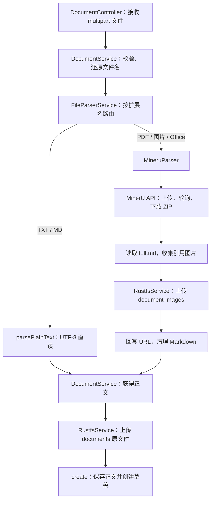
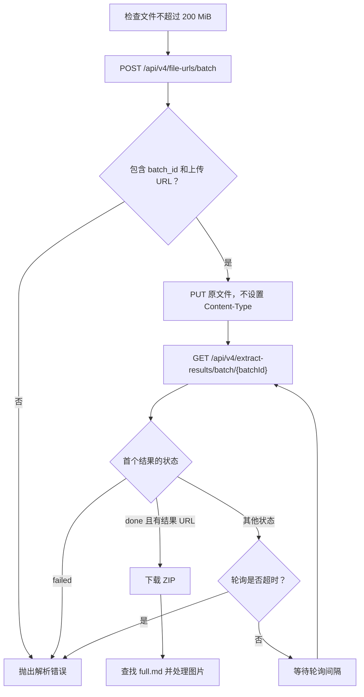

上传文件并不是“保存附件”这么简单：当前实现先将文件转换为正文，再把解析结果中引用的图片迁移到 RustFS，回写图片 URL，随后保存原文件并创建草稿。本文聚焦这一转换链路，解释格式路由、MinerU 调用协议、Markdown 清理、对象存储以及失败边界，帮助开发者定位“文件上传成功但正文或图片不正确”的问题。Sources: [document.service.ts](src/document/document.service.ts#L560-L644), [mineru.parser.ts](src/document/parser/mineru.parser.ts#L204-L245)

## 1. 架构定位：以正文转换为中心，而不是以附件为中心

**统一输出是字符串正文，解析方式由文件扩展名决定。** `FileParserService` 将 PDF、图片与 Office 文件交给 MinerU，TXT、MD 则在本地按 UTF-8 读取。它不根据 MIME 类型选择解析器，也没有在 MinerU 失败时调用本地 PDF、DOCX 等解析器的降级分支；不要仅凭 `parsers/` 目录中的文件名判断生产调用路径。Sources: [file-parser.service.ts](src/document/parser/file-parser.service.ts#L1-L33), [file-parser.service.ts](src/document/parser/file-parser.service.ts#L69-L98), [plain-text.parser.ts](src/document/parser/parsers/plain-text.parser.ts#L1-L8)

下图展示实际服务交互。`DocumentService` 负责上传编排，`FileParserService` 负责格式路由，`MineruParser` 负责远程解析及图片迁移，`RustfsService` 统一处理图片和原文件的对象上传。**图片迁移属于正文解析的一部分，原文件存储则发生在解析完成之后。** Sources: [document.service.ts](src/document/document.service.ts#L583-L627), [file-parser.service.ts](src/document/parser/file-parser.service.ts#L48-L85), [mineru.parser.ts](src/document/parser/mineru.parser.ts#L63-L79), [mineru.parser.ts](src/document/parser/mineru.parser.ts#L230-L244)

Sources: [document.controller.ts](src/document/document.controller.ts#L47-L64), [document.service.ts](src/document/document.service.ts#L560-L627), [mineru.parser.ts](src/document/parser/mineru.parser.ts#L204-L245)

### 格式与依赖对照

| 文件类别 | 支持扩展名 | 转换路径 | 关键限制 |
|---|---|---|---|
| 文本 | `txt`、`md` | UTF-8 原样读取 | 不执行结构转换，也不迁移文本中的图片链接 |
| PDF | `pdf` | MinerU → ZIP → Markdown | 依赖 MinerU；存在引用图片时依赖 RustFS |
| 图片 | `png`、`jpg`、`jpeg`、`jp2`、`webp`、`gif`、`bmp` | MinerU，提交时 `is_ocr=true` | OCR 标志仅由图片扩展名触发 |
| Office | `doc`、`docx`、`ppt`、`pptx`、`xls`、`xlsx` | MinerU → ZIP → Markdown | 当前路由未配置本地解析降级 |

Sources: [file-parser.service.ts](src/document/parser/file-parser.service.ts#L10-L33), [file-parser.service.ts](src/document/parser/file-parser.service.ts#L82-L85), [plain-text.parser.ts](src/document/parser/parsers/plain-text.parser.ts#L1-L8), [mineru.parser.ts](src/document/parser/mineru.parser.ts#L96-L108), [mineru.parser.ts](src/document/parser/mineru.parser.ts#L297-L299)

## 2. 上传入口与返回契约

入口为 `POST /documents/upload/parse`，需要 `documentCreate` 权限，以 `multipart/form-data` 提交，文件字段名必须是 `file`。控制器限制文件大小为 `200 × 1024 × 1024` 字节；服务层继续检查空 Buffer、文件扩展名，解析服务还会拒绝空白正文。**该接口等待解析、资源上传与草稿创建完成后才返回，不是异步任务提交接口。** Sources: [document.controller.ts](src/document/document.controller.ts#L47-L64), [document.service.ts](src/document/document.service.ts#L560-L577), [file-parser.service.ts](src/document/parser/file-parser.service.ts#L69-L98)

| 参数 | 类型或约定 | 用途 |
|---|---|---|
| `file` | 必填文件 | 提供原文件名、字节内容、大小与 MIME 类型 |
| `categoryId` | 可选字符串 | 传入文档创建流程；创建时校验分类可用性 |
| `teamId` | 可选字符串 | 所属团队 |
| `tags` | 可选字符串 | 标签字段，不是数组 |
| `remark` | 可选字符串 | 备注 |
| `isPublic` | 可选布尔值 | 接受 `true`、`false`、`1`、`0` 等表单值转换 |
| 作者、标题、状态 | 不由此表单指定 | 作者来自当前用户；标题取文件名去扩展名；状态固定为草稿 |

Sources: [upload-parse.dto.ts](src/document/dto/upload-parse.dto.ts#L4-L30), [document.controller.ts](src/document/document.controller.ts#L55-L63), [document.service.ts](src/document/document.service.ts#L614-L627), [document.service.ts](src/document/document.service.ts#L684-L689), [markdown.util.ts](src/document/parser/utils/markdown.util.ts#L69-L74)

文件名在解析前经过一次编码修复：代码尝试将可能被按 Latin-1 解读的 multipart 文件名重新还原为 UTF-8；如果还原结果包含替换字符，则保留原值。修复后的文件名用于扩展名判断、原文件上传以及默认标题生成，因此中文文件名问题应先检查这一层，而不是直接归因于 MinerU。Sources: [markdown.util.ts](src/document/parser/utils/markdown.util.ts#L47-L74), [document.service.ts](src/document/document.service.ts#L570-L571), [document.service.ts](src/document/document.service.ts#L597-L618)

成功响应包含 `documentId`、`title`、`fileUrl`、`fileSize`、`fileExtension`、`contentLength`、`contentPreview` 和 `status`。其中 `contentPreview` 是正文前至多 200 个字符串单位，`contentLength` 是 JavaScript 字符串的 `.length`，不是文件字节数；接口不返回完整正文。此上传方法将 `fileUrl` 放入响应，但没有把它传入 `create()` 的文档字段。Sources: [document.service.ts](src/document/document.service.ts#L614-L643)

## 3. MinerU 精准解析：提交、轮询与结果读取

MinerU 路径采用“申请上传地址 → PUT 文件 → 轮询结果 → 下载 ZIP”的协议。申请地址时提交单个文件、随机 `data_id`、模型版本、公式及表格开关和语言；上传 PUT **不设置 `Content-Type`**，代码明确以此适配签名上传链接。该上传地址与 RustFS 原文件地址是两条独立的存储路径。Sources: [mineru.parser.ts](src/document/parser/mineru.parser.ts#L81-L119), [mineru.parser.ts](src/document/parser/mineru.parser.ts#L172-L185), [document.service.ts](src/document/document.service.ts#L597-L604)

下面的流程强调终止条件：只有任务状态为 `done` 且带有 `full_zip_url` 才进入结果处理；`failed`、缺少结果地址或超时均会终止当前请求。Sources: [mineru.parser.ts](src/document/parser/mineru.parser.ts#L121-L169)

Sources: [mineru.parser.ts](src/document/parser/mineru.parser.ts#L71-L169), [mineru.parser.ts](src/document/parser/mineru.parser.ts#L187-L210)

### 影响解析行为的配置

| 配置项 | 默认值 | 作用 |
|---|---|---|
| `MINERU_API_TOKEN` | 无 | 必需；去除首尾空白后仍为空则报错 |
| `MINERU_API_BASE` | `https://mineru.net` | API 基地址 |
| `MINERU_MODEL_VERSION` | `vlm` | 解析模型版本 |
| `MINERU_ENABLE_FORMULA` | `true` | 公式解析开关 |
| `MINERU_ENABLE_TABLE` | `true` | 表格解析开关 |
| `MINERU_LANGUAGE` | `ch` | 解析语言 |
| `MINERU_POLL_INTERVAL_MS` | `3000` | 轮询间隔，单位毫秒 |
| `MINERU_POLL_TIMEOUT_MS` | `600000` | 轮询等待期限，单位毫秒 |

Sources: [mineru.parser.ts](src/document/parser/mineru.parser.ts#L104-L107), [mineru.parser.ts](src/document/parser/mineru.parser.ts#L121-L123), [mineru.parser.ts](src/document/parser/mineru.parser.ts#L269-L294)

**轮询超时并不等于整个上传接口的总超时。** 普通 JSON API 请求默认超时 30 秒，文件 PUT 与 ZIP 下载各自超时 120 秒；轮询期限在文件 PUT 完成后才开始计算。轮询中的非 `BadRequestException` 异常会记录警告并继续尝试，但 API 返回非成功 HTTP 状态、业务 `code` 非零或缺少 `data` 时，会被包装成 `BadRequestException` 并立即退出，不会一概重试。Sources: [mineru.parser.ts](src/document/parser/mineru.parser.ts#L119-L138), [mineru.parser.ts](src/document/parser/mineru.parser.ts#L172-L190), [mineru.parser.ts](src/document/parser/mineru.parser.ts#L247-L266)

## 4. 正文转换与图片链接回写

### 从 ZIP 中确定正文与图片

结果 ZIP 通过 JSZip 在内存中读取。正文选择规则是寻找第一个文件名匹配 `full.md` 的非目录条目，允许位于子目录中且匹配不区分大小写；没有该文件就报错。代码不负责将 PDF 或 Office 的内部结构自行转换成 Markdown，而是读取 MinerU 提供的 Markdown 结果。Sources: [mineru.parser.ts](src/document/parser/mineru.parser.ts#L187-L213)

图片不是整包无差别上传，而是先筛选候选文件，再检查正文是否引用其路径。候选文件必须位于某个 `images/` 目录下的直接文件位置、扩展名属于支持的图片类型，并排除 `__MACOSX/` 等条目；正文引用检查使用字符串包含判断。相对路径通常以 `full.md` 所在目录计算，遇到向上跨目录的结果则回退为 `images/...` 路径或文件名。Sources: [mineru.parser.ts](src/document/parser/mineru.parser.ts#L213-L218), [mineru.parser.ts](src/document/parser/mineru.parser.ts#L301-L320)

### 先上传图片，再替换正文

命中的图片通过 `for...of` 逐张等待上传，使用 `document-images` 前缀；图片 MIME 类型由扩展名映射得出。所有图片上传完成后，代码才使用“相对路径 → 对象 URL”的映射替换正文。**存在引用图片但 RustFS 未启用时，解析直接失败，不会返回仍含本地图片路径的正文。** Sources: [mineru.parser.ts](src/document/parser/mineru.parser.ts#L224-L244), [mineru.parser.ts](src/document/parser/mineru.parser.ts#L17-L25)

链接回写并不是 Markdown AST 转换：它为每个图片路径同时生成 `./images/...` 和 `images/...` 两种替换项，按路径长度降序排列，再进行全局字符串替换。因此 Markdown 图片语法与 HTML 中相同的路径文本都可以被替换；正文或代码块里出现的同一段路径文本也没有语法级排除机制。Sources: [mineru.parser.ts](src/document/parser/mineru.parser.ts#L322-L340)

| 转换前 | 转换后示意 |
|---|---|
| `` | `` |
| `` | `` |
| 文本中的 `images/figure.png` | 同样会替换为对应 URL |
| 未命中图片映射的路径 | 保持原样 |

Sources: [mineru.parser.ts](src/document/parser/mineru.parser.ts#L322-L340), [rustfs.service.ts](src/storage/rustfs.service.ts#L98-L118)

### Markdown 清理的边界

MinerU 正文最后会移除 NUL 字符，将 CRLF 转为 LF，把连续四个及以上换行压缩为三个，并去掉首尾空白。这是文本规范化，而不是 HTML 安全过滤、图片说明生成或表格重建。TXT、MD 本地直读路径不调用该清理函数；它们只在解析服务中接受“结果不能全部为空白”的检查。Sources: [markdown.util.ts](src/document/parser/utils/markdown.util.ts#L1-L16), [mineru.parser.ts](src/document/parser/mineru.parser.ts#L220-L244), [plain-text.parser.ts](src/document/parser/parsers/plain-text.parser.ts#L1-L8), [file-parser.service.ts](src/document/parser/file-parser.service.ts#L82-L98)

## 5. RustFS：图片与原文件共用的存储契约

`RustfsService` 通过 AWS S3 SDK 访问 RustFS，启用 `forcePathStyle`。服务初始化时异步检查桶；每次上传前还会再次检查桶，不存在则尝试创建，并容忍“桶已经存在”类错误。对象上传使用 `PutObjectCommand`，明确设置 `ContentType` 与 `ContentLength`。Sources: [rustfs.service.ts](src/storage/rustfs.service.ts#L60-L78), [rustfs.service.ts](src/storage/rustfs.service.ts#L85-L139)

| 存储配置 | 默认值 | 与资源链接的关系 |
|---|---|---|
| `RUSTFS_ENABLED` | `true` | 值为 `false` 时禁用 |
| `RUSTFS_ENDPOINT` | `http://localhost:9000` | S3 API 地址，也是公开地址的回退值 |
| `RUSTFS_ACCESS_KEY` / `RUSTFS_SECRET_KEY` | 均为 `rustfsadmin` | SDK 认证凭据 |
| `RUSTFS_REGION` | `us-east-1` | SDK 区域 |
| `RUSTFS_BUCKET` | `knowledge-hub` | 所有资源使用的桶名 |
| `RUSTFS_PUBLIC_URL` | 未配置时使用 endpoint | 拼接回写正文的 URL，移除末尾一个 `/` |

Sources: [rustfs.service.ts](src/storage/rustfs.service.ts#L35-L68)

对象 key 采用 `{前缀}/{年}/{月}/{日}/{安全文件名}-{UUID}{扩展名}`。安全文件名保留中英文、数字及部分标点，其他字符替换为下划线，并截断到 64 个字符串单位；扩展名优先取原文件名，没有扩展名才根据有限的 MIME 类型映射推断。图片使用 `document-images`，原文件使用 `documents`，二者不会写到同一个 key。Sources: [rustfs.service.ts](src/storage/rustfs.service.ts#L98-L102), [rustfs.service.ts](src/storage/rustfs.service.ts#L144-L171), [mineru.parser.ts](src/document/parser/mineru.parser.ts#L235-L239), [document.service.ts](src/document/document.service.ts#L600-L604)

**返回 URL 是直接拼接的访问地址，不是预签名 URL。** 上传代码返回 `{publicBaseUrl}/{bucket}/{key}`，没有在该方法中设置公开读取策略或验证浏览器能否访问。因此，“PutObject 成功”和“正文图片可访问”应分别验证：前者检查对象写入，后者检查公开域名、桶路径与存储访问策略。Sources: [rustfs.service.ts](src/storage/rustfs.service.ts#L104-L139)

## 6. 保存顺序、失败边界与排查

解析后的正文传给 `create()` 保存：先写 MongoDB 正文，再写 PostgreSQL 元数据，并记录初始版本。上传方法始终指定草稿状态。需要注意，图片与原文件在调用 `create()` 之前已经上传；该上传方法没有对象存储删除补偿，不能把整条链路理解为一个覆盖对象存储和数据库的原子事务。Sources: [document.service.ts](src/document/document.service.ts#L105-L148), [document.service.ts](src/document/document.service.ts#L597-L627)

| 场景 | 当前行为 | 优先排查位置 |
|---|---|---|
| 文件为空或格式不支持 | 拒绝解析，不创建文档 | 文件字段、Buffer、文件名扩展名 |
| 缺少 MinerU Token | 远程解析直接失败 | `MINERU_API_TOKEN` |
| MinerU ZIP 缺少 `full.md` | 拒绝创建文档 | 结果包内容及目录结构 |
| RustFS 禁用，结果无命中图片 | 可以继续；原文件跳过上传，`fileUrl=null` | 是否接受不保存原文件 |
| RustFS 禁用，结果含命中图片 | 解析失败 | RustFS 启用状态 |
| RustFS 已启用，但原文件上传失败 | 报错，不进入草稿创建 | endpoint、凭据、桶与连接情况 |
| 部分图片已上传，后续步骤失败 | 当前路径没有清理已上传对象的补偿 | 已写入对象及失败发生阶段 |
| 正文图片 URL 已替换但无法显示 | 写入成功不代表访问地址有效 | `RUSTFS_PUBLIC_URL`、网络与读取权限 |

Sources: [document.service.ts](src/document/document.service.ts#L566-L627), [mineru.parser.ts](src/document/parser/mineru.parser.ts#L204-L245), [mineru.parser.ts](src/document/parser/mineru.parser.ts#L269-L274), [rustfs.service.ts](src/storage/rustfs.service.ts#L85-L139)

联调时建议按三个检查点逐层确认：先检查响应中的 `fileExtension`、`contentLength` 与 `contentPreview`，确认解析路径和正文输出；再查看保存的完整正文，确认图片相对路径是否已回写；最后分别访问图片 URL 与原文件 `fileUrl`。日志中可以关联原文件名、MinerU `batch`、解析状态、图片上传数量和最终 `documentId`，以区分远程解析、资源写入与文档保存三个阶段。Sources: [document.service.ts](src/document/document.service.ts#L579-L581), [document.service.ts](src/document/document.service.ts#L629-L643), [document.controller.ts](src/document/document.controller.ts#L171-L177), [mineru.parser.ts](src/document/parser/mineru.parser.ts#L118-L149), [mineru.parser.ts](src/document/parser/mineru.parser.ts#L243-L244)

## 7. 下一步

本文的终点是“可读取正文、图片链接已回写的草稿”。草稿如何进入审核、发布并联动索引，请继续阅读[文档生命周期：草稿、提审、发布、归档与索引联动](13-wen-dang-sheng-ming-zhou-qi-cao-gao-ti-shen-fa-bu-gui-dang-yu-suo-yin-lian-dong)；若要理解正文、元数据和对象文件在整个系统中的职责划分，可阅读[多存储协作：关系数据、文档正文、对象文件与检索索引](7-duo-cun-chu-xie-zuo-guan-xi-shu-ju-wen-dang-zheng-wen-dui-xiang-wen-jian-yu-jian-suo-suo-yin)。Sources: [document.service.ts](src/document/document.service.ts#L48-L53), [document.service.ts](src/document/document.service.ts#L150-L154), [document.service.ts](src/document/document.service.ts#L614-L643)