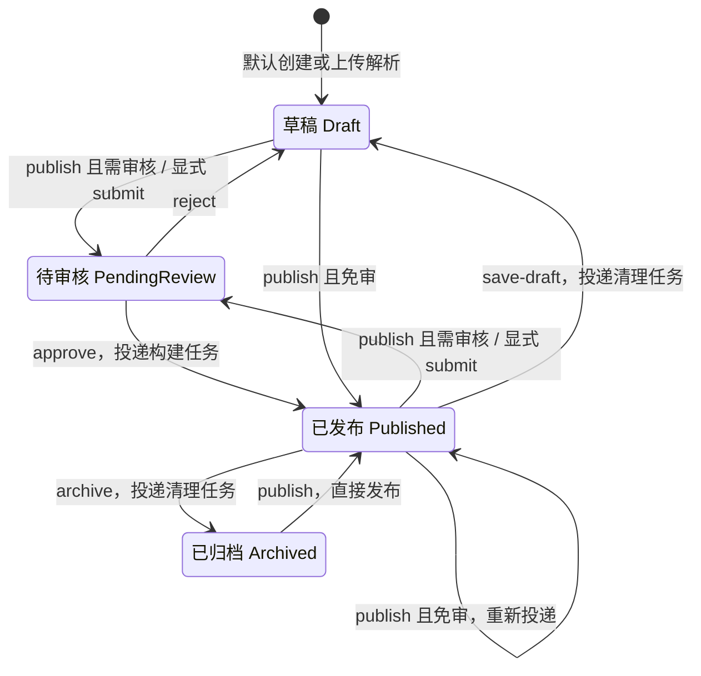
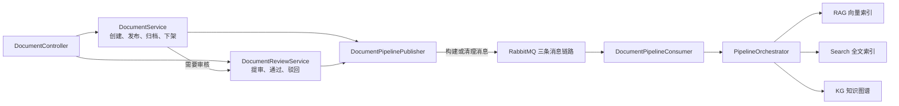

文档生命周期不仅决定列表中的状态，也决定何时创建审核任务、何时投递知识索引任务，以及何时清理已有检索数据。本页聚焦这条业务主线：**草稿准备内容，待审记录决策，发布触发索引，归档保留正文并请求清理索引**。理解时必须区分“文档状态已保存”与“索引处理已完成”：二者不是同一个完成条件。Sources: [document-status.ts](src/document/document-status.ts#L1-L21) [document-pipeline.publisher.ts](src/mq/document-pipeline.publisher.ts#L22-L50)

## 一、状态模型：四个状态，两类业务记录

系统用 `DocumentStatus` 表示文档当前状态，用独立的审核记录保存每一次提审及处理结果。**文档状态回答“现在处于哪个阶段”，审核流水回答“这次审核如何结束”**；审核通过、驳回不会删除历史任务，而是回填结果、审核人和处理时间。Sources: [document-status.ts](src/document/document-status.ts#L12-L29) [document-review.entity.ts](src/document/entities/document-review.entity.ts#L10-L54) [document-review.service.ts](src/document/document-review.service.ts#L95-L147)

| 状态 | 值 | 生命周期含义 | 索引相关行为 |
|---|---:|---|---|
| 草稿 `Draft` | 0 | 内容准备或驳回后的修改阶段 | 创建草稿不投递索引任务 |
| 已发布 `Published` | 1 | 业务发布状态 | 发布、审核通过后投递三类构建任务 |
| 已归档 `Archived` | 2 | 从发布状态退出，保留正文 | 归档时投递三类清理任务 |
| 待审核 `PendingReview` | 3 | 已提交审核，等待决策 | 不主动构建；从已发布提审时请求清理旧索引 |

Sources: [document-status.ts](src/document/document-status.ts#L1-L29) [document.service.ts](src/document/document.service.ts#L150-L154) [document-review.service.ts](src/document/document-review.service.ts#L72-L87) [document.service.ts](src/document/document.service.ts#L486-L505)

下图按**实际服务分支**展示主要状态转换。需要特别注意：归档后的重新发布会进入直接发布路径，即使审核开关开启，也不会转入待审；这是当前实现区别于“所有发布都必须审核”的地方。Sources: [document.service.ts](src/document/document.service.ts#L420-L483)

Sources: [document.service.ts](src/document/document.service.ts#L420-L527) [document.service.ts](src/document/document.service.ts#L614-L643) [document-review.service.ts](src/document/document-review.service.ts#L51-L147)

## 二、创建与提审：发布入口并不总是直接发布

### 创建时的状态限制

普通创建默认使用草稿状态，只允许请求 `Draft` 或 `Published`；不能直接创建归档或待审文档。开启审核时，创建请求中的 `Published` 会被拒绝，调用者必须先创建草稿，再走发布或显式提审接口。上传解析则固定创建草稿，不因免审配置而自动发布。Sources: [document.service.ts](src/document/document.service.ts#L80-L95) [document.service.ts](src/document/document.service.ts#L614-L643)

审核开关由 `DocumentReviewService.isRequireApproval()` 读取：默认值为字符串 `'true'`，只有配置值**严格等于字符串 `'false'`** 时才免审。因此，不能把任意“看起来为假”的配置值都当成关闭审核。Sources: [document-review.service.ts](src/document/document-review.service.ts#L40-L45)

### 发布分支与显式提审

`PUT documents/:id/publish` 先读取未删除文档并校验写权限，再判断状态。待审文档会直接报错；开启审核时，草稿和已发布文档转交 `submitForReview()`；其他允许来源进入 `directPublish()`。因此客户端应以返回的 `status` 判断结果，不能把接口名称中的 `publish` 当作“已经发布”的保证。Sources: [document.service.ts](src/document/document.service.ts#L420-L483)

| 来源状态 | 开启审核时调用 `publish` | 关闭审核时调用 `publish` | 显式调用 `reviews/submit` |
|---|---|---|---|
| 草稿 | 转为待审核 | 直接发布并投递构建 | 转为待审核 |
| 已发布 | 转为待审核，并投递清理 | 保持已发布，刷新发布时间并投递构建 | 转为待审核，并投递清理 |
| 已归档 | **直接发布并投递构建** | 直接发布并投递构建 | 拒绝 |
| 待审核 | 拒绝重复发布 | 拒绝重复发布 | 拒绝 |

Sources: [document.service.ts](src/document/document.service.ts#L431-L483) [document-status.ts](src/document/document-status.ts#L61-L65) [document-review.service.ts](src/document/document-review.service.ts#L55-L87)

显式提审接口不读取免审开关：只要文档处于草稿或已发布状态，就按提审规则处理。服务先检查是否已有 `reviewResult IS NULL` 的任务，再新增审核流水，记录提交前状态 `beforeStatus`，随后把文档保存为待审核；若原状态为已发布，最后再投递索引清理。这里的实际顺序是**先保存待审状态，再请求清理索引**，不是同步删除完索引后才进入待审。Sources: [document.controller.ts](src/document/document.controller.ts#L110-L115) [document-review.service.ts](src/document/document-review.service.ts#L51-L92)

## 三、审核决策：任务结案与文档状态联动

审核通过与驳回都以**审核任务 ID** 为入口，而不是文档 ID。服务会拒绝不存在的任务或已经处理过的任务；通过后记录审核结果 `1`，将文档改为已发布、刷新 `publishTime`，再投递构建任务；驳回后记录结果 `2`，文档统一回到草稿，不恢复 `beforeStatus`。即便文档是从已发布状态提审，驳回后也仍然是草稿。Sources: [document.controller.ts](src/document/document.controller.ts#L137-L169) [document-review.service.ts](src/document/document-review.service.ts#L95-L147) [document-review.service.ts](src/document/document-review.service.ts#L197-L207)

审核人的 ID 与姓名来自当前用户信息，不由请求体指定。`reviewComment` 对通过操作可选，对驳回操作则必须在去除首尾空白后非空。审核相关的任务列表、数量和决策接口同时声明审核员或管理员角色要求以及 `documentReview` 权限要求。Sources: [document.controller.ts](src/document/document.controller.ts#L66-L80) [document.controller.ts](src/document/document.controller.ts#L137-L169) [review.dto.ts](src/document/dto/review.dto.ts#L25-L30) [document-review.service.ts](src/document/document-review.service.ts#L128-L138)

| 接口，以 `documents` 为控制器路径 | 用途 | 关键约束 |
|---|---|---|
| `POST :id/reviews/submit` | 显式提审 | 草稿或已发布；校验文档写权限 |
| `GET reviews/tasks` | 审核任务列表 | 默认待审；支持 `pending / approved / rejected` |
| `GET reviews/tasks/pending-count` | 待审数量 | 统计结果为空的审核记录 |
| `GET :id/reviews/current` | 当前待审记录 | 无记录时返回 `null` |
| `GET :id/reviews/history` | 历史记录 | 按创建时间倒序 |
| `POST reviews/tasks/:taskId/approve` | 审核通过 | 任务必须未处理 |
| `POST reviews/tasks/:taskId/reject` | 审核驳回 | 任务必须未处理；意见不能为空 |

Sources: [document.controller.ts](src/document/document.controller.ts#L66-L80) [document.controller.ts](src/document/document.controller.ts#L110-L169) [document-review.service.ts](src/document/document-review.service.ts#L149-L207)

## 四、归档、下架编辑与删除的区别

**归档与保存草稿都只接受已发布文档**，也都会在保存新状态后请求清理索引。归档将状态改为 `Archived`，保存草稿将状态改为 `Draft`；两者均不修改正文，也不在这些方法中清空 `publishTime`。因此，不能仅凭“存在发布时间”判断文档仍处于发布状态，应读取 `status`。Sources: [document.service.ts](src/document/document.service.ts#L486-L527)

| 操作 | 状态或标记变化 | 正文处理 | 索引处理 |
|---|---|---|---|
| `archive` | 已发布 → 已归档 | 保留 | 投递清理 |
| `save-draft` | 已发布 → 草稿 | 保留 | 投递清理 |
| 已发布文档提审 | 已发布 → 待审核 | 保留 | 投递清理 |
| `remove` | `deleted=true` | Mongo 正文同步软删除 | 仅删除前为已发布时投递清理 |

Sources: [document.service.ts](src/document/document.service.ts#L486-L558) [document-review.service.ts](src/document/document-review.service.ts#L72-L87)

### 编辑约束不能仅按注释理解

当前实现并不是“已发布必须先下架才能修改”。草稿、已发布、已归档都通过 `canEditContent()`；待审期间则仅在请求包含 `title` 或 `content` 时拒绝，其他元数据仍可进入更新流程。虽然状态辅助函数的注释提到归档仅允许改元数据，但函数实际包含 `Archived`，更新服务也未增加归档正文禁改分支。Sources: [document-status.ts](src/document/document-status.ts#L44-L54) [document.service.ts](src/document/document.service.ts#L289-L296) [document.service.ts](src/document/document.service.ts#L315-L318) [document.service.ts](src/document/document.service.ts#L383-L396)

已发布状态下修改正文，免审模式会重新投递构建任务；需审模式则仍保留已发布状态，但不立即重建索引，等待后续再次发布和审核通过。只修改标题不会把 `contentChanged` 设为真，也就不会单凭标题变化触发该重建分支。若业务意图是“修改期间下架”，应显式使用 `save-draft`，而不是依赖内容更新自动改变状态。Sources: [document.service.ts](src/document/document.service.ts#L298-L318) [document.service.ts](src/document/document.service.ts#L383-L410) [document.service.ts](src/document/document.service.ts#L508-L527) [document.service.ts](src/document/document.service.ts#L646-L681)

## 五、索引联动：状态服务负责触发，消费者负责执行

生命周期服务并不在发布请求中完成分块、向量化和建图。`DocumentPipelinePublisher` 将构建或清理请求并行投递到 RAG、Search、KG 三条消息链路，消费者再调用 `PipelineOrchestrator`。消息主要携带任务 ID、文档 ID 和操作类型；例如全文索引由消费者重新读取 PostgreSQL 元数据与 MongoDB 正文，而不是使用发布请求中的正文快照。Sources: [document-pipeline.publisher.ts](src/mq/document-pipeline.publisher.ts#L34-L58) [document-pipeline.publisher.ts](src/mq/document-pipeline.publisher.ts#L78-L120) [document-pipeline.consumer.ts](src/mq/document-pipeline.consumer.ts#L27-L64) [pipeline.orchestrator.ts](src/pipeline/pipeline.orchestrator.ts#L199-L212)

下图展示服务间的职责边界：实线调用最终通向消息投递，索引写入发生在消费端。审核通过自行保存文档并调用发布器，并不调用 `DocumentService.directPublish()`。Sources: [document-review.service.ts](src/document/document-review.service.ts#L95-L118) [document-review.service.ts](src/document/document-review.service.ts#L220-L238) [document-pipeline.consumer.ts](src/mq/document-pipeline.consumer.ts#L27-L64)

Sources: [document.service.ts](src/document/document.service.ts#L439-L451) [document.service.ts](src/document/document.service.ts#L705-L733) [document-pipeline.publisher.ts](src/mq/document-pipeline.publisher.ts#L34-L50) [document-pipeline.consumer.ts](src/mq/document-pipeline.consumer.ts#L27-L64)

| 生命周期事件 | RAG 消息类型 | Search 消息类型 | KG 消息类型 |
|---|---|---|---|
| 直接发布、审核通过 | `BY_DOC_IDS` | `INDEX` | `BUILD_BY_DOC_IDS` |
| 归档、下架、已发布重新提审、删除已发布文档 | `DELETE_BY_DOC_IDS` | `DELETE` | `DELETE_BY_DOC_IDS` |

Sources: [document-pipeline.publisher.ts](src/mq/document-pipeline.publisher.ts#L52-L130) [document.service.ts](src/document/document.service.ts#L475-L546) [document-review.service.ts](src/document/document-review.service.ts#L85-L115)

## 六、必须保留的完成语义与异常边界

**状态保存成功不等于三套索引都成功。** 直接发布、归档和审核通过均先保存业务状态，再调用安全投递方法；投递异常被捕获并记录日志，不回滚状态。发布器又通过 `Promise.all()` 并行投递，因此不能把一次发布视作跨三套索引的原子事务，也不能把接口成功当作索引已经可检索的证明。Sources: [document.service.ts](src/document/document.service.ts#L475-L502) [document.service.ts](src/document/document.service.ts#L705-L733) [document-review.service.ts](src/document/document-review.service.ts#L104-L115) [document-review.service.ts](src/document/document-review.service.ts#L220-L239) [document-pipeline.publisher.ts](src/mq/document-pipeline.publisher.ts#L34-L50)

审核流程也是顺序保存：提审先保存审核记录，再保存文档；通过或驳回先保存审核结果，再读取并保存文档。这些方法没有把上述步骤包在同一个事务调用中；“检查是否已有待审任务”和“新增任务”也是两个独立操作。理解一致性边界时，应把它们视为应用层的顺序流程，而不是由这些方法提供的原子状态转换。Sources: [document-review.service.ts](src/document/document-review.service.ts#L64-L83) [document-review.service.ts](src/document/document-review.service.ts#L102-L143)

按 ID 构建索引的公共加载方法只检查 `deleted=false`，没有限制必须为 `Published`；删除消息则直接按文档 ID 清理。因此，不能把消费端理解为会对每条延迟到达的构建消息自动执行发布状态拦截，也不能假设删除消息带有版本条件。消息时序与跨索引一致性的进一步分析应放到专门的同步章节。Sources: [pipeline.orchestrator.ts](src/pipeline/pipeline.orchestrator.ts#L52-L65) [pipeline.orchestrator.ts](src/pipeline/pipeline.orchestrator.ts#L103-L116) [pipeline.orchestrator.ts](src/pipeline/pipeline.orchestrator.ts#L128-L140) [pipeline.orchestrator.ts](src/pipeline/pipeline.orchestrator.ts#L199-L218)

## 七、联调检查与后续阅读

联调时优先检查返回状态与审核任务，而非只检查请求是否成功；索引缺失或残留则继续检查构建、清理投递日志。下面的现象均对应明确的服务分支。Sources: [document.service.ts](src/document/document.service.ts#L435-L451) [document.service.ts](src/document/document.service.ts#L705-L733) [document-review.service.ts](src/document/document-review.service.ts#L181-L205)

| 现象 | 代码对应原因 | 检查方向 |
|---|---|---|
| 调用发布后返回状态 `3` | 开启审核，转入待审 | 查询当前审核记录并完成决策 |
| 重复发布提示审核中 | 当前已是待审状态 | 等待处理，不重复调用发布 |
| 驳回失败 | 意见为空或仅空白 | 提供非空 `reviewComment` |
| 草稿无法归档 | 归档只接受已发布状态 | 按业务意图选择提审、发布或保留草稿 |
| 归档后重新发布没有生成审核任务 | 归档状态进入直接发布分支 | 按当前实现验证，不假定重新提审 |
| 状态已发布但索引未完成 | 发布只请求异步构建，失败不回滚 | 检查投递和消费链路 |
| 需审模式下正文已变但索引未重建 | 正文更新不自动提审或重建 | 再次发布并审核通过 |

Sources: [document.service.ts](src/document/document.service.ts#L435-L502) [document.service.ts](src/document/document.service.ts#L646-L681) [document.service.ts](src/document/document.service.ts#L705-L714) [document-review.service.ts](src/document/document-review.service.ts#L128-L130)

本页之后，内容变更与快照机制可继续阅读[内容维护：分类管理、正文更新与历史版本快照](14-nei-rong-wei-hu-fen-lei-guan-li-zheng-wen-geng-xin-yu-li-shi-ban-ben-kuai-zhao)；任务投递和消费边界见[消息驱动的知识管线：任务发布、队列消费与异常处理边界](17-xiao-xi-qu-dong-de-zhi-shi-guan-xian-ren-wu-fa-bu-dui-lie-xiao-fei-yu-yi-chang-chu-li-bian-jie)；构建、清理与可见性同步的整体一致性见[跨索引同步：发布重建、删除清理与可见性更新](21-kua-suo-yin-tong-bu-fa-bu-zhong-jian-shan-chu-qing-li-yu-ke-jian-xing-geng-xin)。Sources: [document.service.ts](src/document/document.service.ts#L354-L373) [document.service.ts](src/document/document.service.ts#L646-L681) [document-pipeline.consumer.ts](src/mq/document-pipeline.consumer.ts#L40-L64)