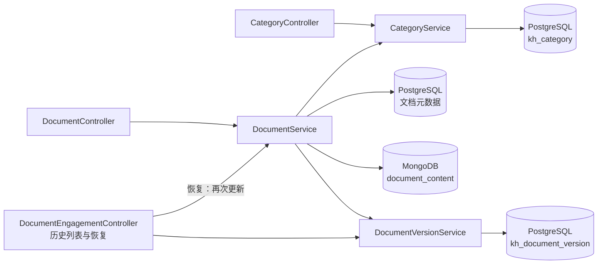
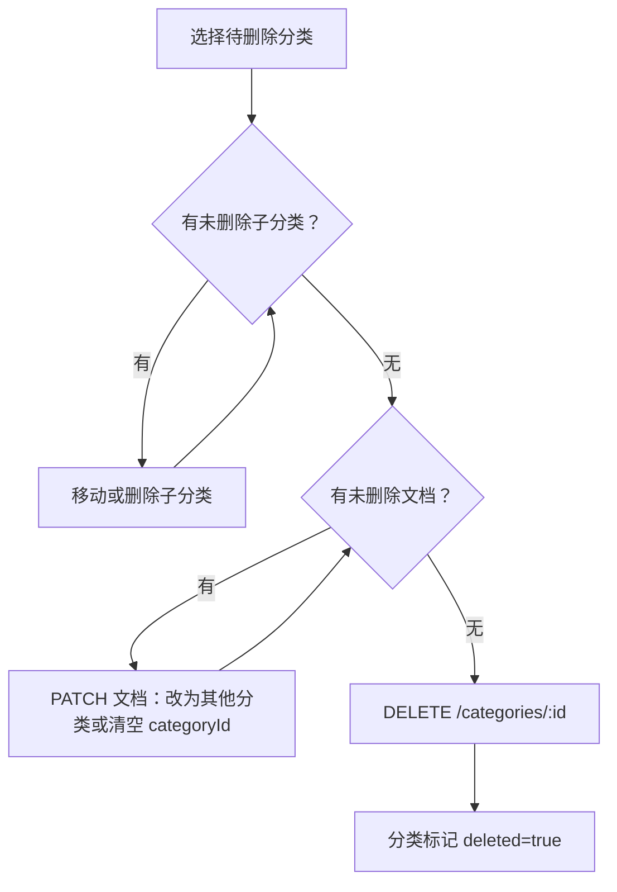
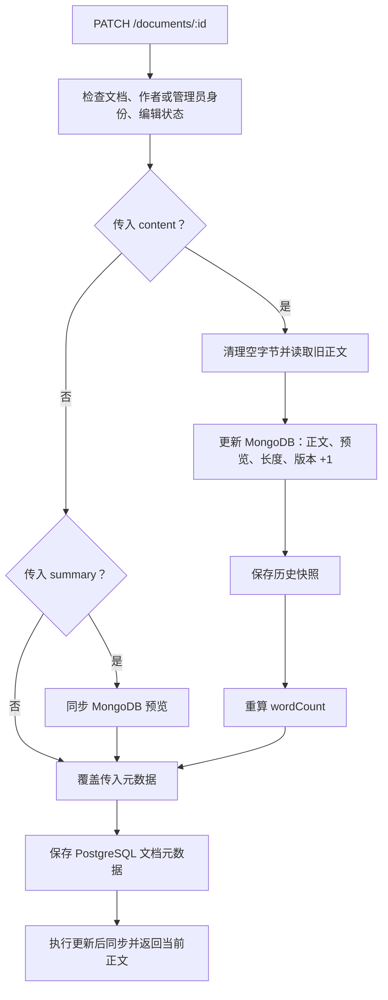
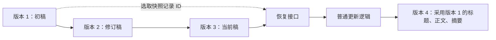

内容维护涉及三种不同粒度的数据：**分类负责组织文档，当前正文负责业务读取，历史快照负责追溯与恢复**。本页聚焦分类树操作、增量更新语义和版本恢复机制，尤其区分“保存了文档”与“生成了新版本”：当前实现只有传入 `content` 才会递增正文版本，单独修改标题、摘要或分类不会生成快照。Sources: [category.service.ts](src/document/category.service.ts#L19-L38) [document.service.ts](src/document/document.service.ts#L315-L396)

## 一、维护模型：当前状态与历史快照分离

`DocumentService` 协调 PostgreSQL 元数据与 MongoDB 当前正文，并调用 `CategoryService` 校验分类、调用 `DocumentVersionService` 保存历史。历史正文不是 MongoDB 内的版本数组，而是 PostgreSQL `kh_document_version` 中的独立记录；因此，当前正文读取与历史版本查询走不同的数据路径。Sources: [document.service.ts](src/document/document.service.ts#L48-L73) [document.service.ts](src/document/document.service.ts#L259-L267) [document-version.entity.ts](src/document/entities/document-version.entity.ts#L5-L38)

下图展示维护相关的模块交互。恢复操作没有独立写入链路，而是读取旧快照后重新调用普通更新逻辑。Sources: [document-engagement.controller.ts](src/document/document-engagement.controller.ts#L116-L139)

Sources: [category.controller.ts](src/document/category.controller.ts#L7-L36) [category.service.ts](src/document/category.service.ts#L61-L101) [document.service.ts](src/document/document.service.ts#L315-L396) [document-engagement.controller.ts](src/document/document-engagement.controller.ts#L116-L139)

| 数据对象 | 主要内容 | 维护方式 | 是否属于历史快照 |
|---|---|---|---|
| 分类 | 名称、父级、排序、描述、删除标记 | 独立增删改 | 否 |
| 文档元数据 | 标题、摘要、分类、团队、标签等 | 仅覆盖传入字段 | 仅标题、摘要随正文保存进入快照 |
| 当前正文 | Markdown、字符长度、预览、版本号 | 原位置更新 | 否，是当前状态 |
| 历史版本 | 文档 ID、版本号、标题、完整正文、摘要、操作人、时间 | 插入新记录 | 是 |

Sources: [category.entity.ts](src/document/entities/category.entity.ts#L10-L40) [document.service.ts](src/document/document.service.ts#L332-L396) [document-content.schema.ts](src/document/schemas/document-content.schema.ts#L19-L41) [document-version.entity.ts](src/document/entities/document-version.entity.ts#L5-L38)

## 二、分类管理：树结构、移动与删除约束

### 分类接口与参数

分类接口以 `/categories` 为控制器路径。树查询允许具有 `document:list` 或 `document:category:query` 的用户访问，写操作使用 `document:category`。这里多个权限码是**命中任意一个即可**，不是必须全部具备；管理员由权限守卫直接放行。Sources: [category.controller.ts](src/document/category.controller.ts#L7-L36) [permissions.ts](src/common/constants/permissions.ts#L4-L12) [permissions.guard.ts](src/auth/permissions.guard.ts#L38-L47)

| 方法与路径 | 用途 | 主要行为 |
|---|---|---|
| `GET /categories/tree` | 获取分类树 | 排除已删除分类，按排序值、创建时间升序组树 |
| `POST /categories` | 新建分类 | 生成 ID，规范化父级与文本 |
| `PUT /categories/:id` | 更新分类 | 只覆盖传入字段，可移动父级 |
| `DELETE /categories/:id` | 删除分类 | 检查子分类及文档引用后软删除 |

Sources: [category.controller.ts](src/document/category.controller.ts#L11-L36) [category.service.ts](src/document/category.service.ts#L19-L38) [category.service.ts](src/document/category.service.ts#L61-L102)

| 参数 | 校验与默认值 | 服务端处理 |
|---|---|---|
| `name` | 创建必填，字符串，长度 1～100 | 保存前 `trim()` |
| `parentId` | 可选字符串 | 未传、空白或 `"0"` 归入根；其他值必须指向有效分类 |
| `sort` | 可选整数，0～9999 | 创建时默认 `0` |
| `description` | 可选字符串，最长 500 | 去除首尾空白，空结果保存为 `null` |

Sources: [category.dto.ts](src/document/dto/category.dto.ts#L12-L57) [category.service.ts](src/document/category.service.ts#L61-L87) [category.service.ts](src/document/category.service.ts#L109-L115)

分类树按 `parentId` 分组并从根 `"0"` 递归构建，每个节点都带 `children`，叶子节点返回空数组。移动分类时，服务沿目标父级向上遍历：既禁止将自己设为父级，也禁止移动到自己的子孙分类下。Sources: [category.service.ts](src/document/category.service.ts#L19-L38) [category.service.ts](src/document/category.service.ts#L105-L133)

### 迁移文档后再删除分类

删除不是级联操作：存在未删除的直接子分类时返回“请先删除子分类”；存在该分类下的未删除文档时返回“该分类下还有文档，不能删除”。文档计数没有状态过滤，因此不能仅通过归档文档来解除分类占用。Sources: [category.service.ts](src/document/category.service.ts#L90-L102)

下面的维护顺序适用于撤销一个仍被使用的分类：先处理子分类，再迁移或解除文档分类，最后执行软删除。文档分类传入空字符串会规范化为 `null`，非空 ID 则必须通过有效分类校验。Sources: [category.service.ts](src/document/category.service.ts#L90-L102) [document.service.ts](src/document/document.service.ts#L383-L388) [document.service.ts](src/document/document.service.ts#L684-L689)

Sources: [category.service.ts](src/document/category.service.ts#L75-L102) [document.controller.ts](src/document/document.controller.ts#L180-L188) [document.service.ts](src/document/document.service.ts#L684-L689)

文档列表按 `categoryId` 做**精确匹配**，不会自动包含子分类；列表和详情中的 `categoryName` 则通过分类服务补充，已删除或不存在的分类不会返回名称。前端实现“父分类包含全部后代”的筛选时，不能把当前单 ID 筛选误认为子树查询。Sources: [document.service.ts](src/document/document.service.ts#L201-L205) [document.service.ts](src/document/document.service.ts#L223-L236) [document.service.ts](src/document/document.service.ts#L691-L695)

## 三、正文更新：按字段触发，而非按内容差异触发

### 更新入口与可编辑条件

更新入口是 `PATCH /documents/:id`，使用 `document:edit` 权限码。服务还会检查文档归属：只有作者或管理员能够修改，单纯拥有读取权限或审核员角色并不等于拥有写入权。更新 DTO 继承创建 DTO 的字段，但将所有字段设为可选。Sources: [document.controller.ts](src/document/document.controller.ts#L180-L188) [document.service.ts](src/document/document.service.ts#L276-L283) [document.service.ts](src/document/document.service.ts#L717-L721) [document-access.ts](src/document/document-access.ts#L34-L40) [update-document.dto.ts](src/document/dto/update-document.dto.ts#L1-L5)

待审核文档只要传入 `content` 或 `title` 就会被拒绝，即使值没有变化也一样；其他元数据仍可走后续更新。草稿、已发布和已归档状态均通过当前 `canEditContent()` 判断。特别注意，虽然该函数附近的注释提到归档仅修改元数据，**实际返回逻辑允许归档文档更新正文**。Sources: [document.service.ts](src/document/document.service.ts#L289-L310) [document-status.ts](src/document/document-status.ts#L44-L53)

| 请求内容 | 当前正文变化 | 元数据变化 | 新版本 |
|---|---|---|---|
| 包含 `content` | 更新正文、长度、预览与版本号 | 重算 `wordCount`，覆盖其他传入字段 | 是 |
| 仅修改 `summary` | 更新 `contentSummary` | 更新摘要 | 否 |
| 仅修改 `title` | 不修改正文 | 更新标题 | 否 |
| 仅修改分类、标签、封面等 | 不修改正文 | 覆盖对应字段 | 否 |
| 再次提交相同 `content` | 仍执行正文更新 | 仍重算字数 | 是 |

Sources: [document.service.ts](src/document/document.service.ts#L315-L396)

### 一次正文保存的顺序

正文更新先去除空字节，再读取当前 MongoDB 正文；旧版本号无效时按 `1` 处理，新版本号为旧值加一。随后依次更新 MongoDB、写历史快照、保存 PostgreSQL 元数据，最后执行更新后的管线同步。判断条件是 `dto.content !== undefined`，没有正文差异比较。Sources: [document.service.ts](src/document/document.service.ts#L315-L410)

Sources: [document.service.ts](src/document/document.service.ts#L276-L412)

正文预览与文档摘要不是同一个字段：传正文但未传 `summary` 时，MongoDB `contentSummary` 会由正文压缩连续空白后截取前 200 个字符，超长追加 `...`；PostgreSQL 的 `summary` 不会因此自动替换。`contentLength` 使用字符串 `.length`，`wordCount` 则按 U+4E00～U+9FFF 汉字数量，加上去除汉字后按空白切分的非空片段数量计算，两者不能混用。Sources: [document.service.ts](src/document/document.service.ts#L320-L340) [document.service.ts](src/document/document.service.ts#L351-L385) [document.service.ts](src/document/document.service.ts#L735-L765)

### 请求前后对照

假设当前正文版本为 `3`，下面展示不同 PATCH 请求的实际差异。选择只包含必要字段的请求，可以避免因重复提交正文而产生无意义的新版本。Sources: [document.service.ts](src/document/document.service.ts#L315-L340) [document.service.ts](src/document/document.service.ts#L375-L396)

| 维护意图 | 请求示例 | 更新后 |
|---|---|---|
| 只改标题 | `{"title":"维护指南（修订）"}` | 标题改变，正文版本仍为 `3`，不新增快照 |
| 只改分类 | `{"categoryId":"7000000000000000002"}` | 校验分类后更新关联，正文版本仍为 `3` |
| 取消分类 | `{"categoryId":""}` | 分类关联变为 `null` |
| 保存正文与摘要 | `{"content":"# 新正文","summary":"修订说明"}` | 正文版本变为 `4`，写入版本 `4` 快照 |
| 只修改摘要 | `{"summary":"新的简介"}` | 文档摘要和 MongoDB 预览同步更新，不生成新版本 |

Sources: [document.service.ts](src/document/document.service.ts#L315-L396) [document.service.ts](src/document/document.service.ts#L684-L689)

内容保存不必然等于索引重建：仍为已发布状态、传入正文且免审时才触发重建投递；只改标题、摘要、分类等不会因这些字段本身触发重建。需要理解改稿后检索结果何时更新，可继续阅读[跨索引同步：发布重建、删除清理与可见性更新](21-kua-suo-yin-tong-bu-fa-bu-zhong-jian-shan-chu-qing-li-yu-ke-jian-xing-geng-xin)。Sources: [document.service.ts](src/document/document.service.ts#L399-L410) [document.service.ts](src/document/document.service.ts#L652-L681)

## 四、历史版本：完整快照与追加式恢复

### 何时记录，记录什么

新建文档会写入版本 `1` 的初始快照。正文编辑时，如果该文档尚无任何历史记录，版本服务先补存编辑前状态，再写入新版本；已有历史时则只插入新版本。这使没有初始历史的文档在第一次编辑时仍保留旧稿。Sources: [document.service.ts](src/document/document.service.ts#L139-L148) [document-version.service.ts](src/document/document-version.service.ts#L29-L50)

快照保存的是完整正文而不是差异补丁，包含标题、摘要、操作人和创建时间，但不包含分类、团队、标签、封面或可见性。虽然内部 `VersionSnapshot` 参数带有 `wordCount`，当前实体和插入逻辑都没有持久化它，不能把它视为版本记录的可查询字段。Sources: [document-version.service.ts](src/document/document-version.service.ts#L15-L23) [document-version.service.ts](src/document/document-version.service.ts#L80-L91) [document-version.entity.ts](src/document/entities/document-version.entity.ts#L5-L38)

数据库通过 `UNIQUE(document_id, version)` 限制同一文档的版本号重复；版本服务遇到 PostgreSQL `23505` 唯一冲突时直接忽略，其他异常继续抛出。这个机制负责避免重复插入，但不是正文更新的并发版本检查。Sources: [init.sql](init-scripts/postgresql/init.sql#L299-L311) [document-version.service.ts](src/document/document-version.service.ts#L80-L97) [document.service.ts](src/document/document.service.ts#L330-L344)

### 查询与恢复接口

历史列表返回该文档全部版本，按版本号倒序排列，没有分页或精简字段投影，因此返回对象包含完整历史正文。查询与恢复前都要求文档未删除，且调用者是作者或管理员；可以读取当前文档，不代表可以查看它的历史。Sources: [document-version.service.ts](src/document/document-version.service.ts#L52-L77) [document-version.entity.ts](src/document/entities/document-version.entity.ts#L17-L38)

| 方法与路径 | 接口权限码，任一命中 | 行为 |
|---|---|---|
| `GET /documents/:id/versions` | `document:list`、`document:version` | 返回全部快照，版本号降序 |
| `POST /documents/:id/versions/:versionId/restore` | `document:edit`、`document:version` | 读取指定快照并走普通更新 |

Sources: [document-engagement.controller.ts](src/document/document-engagement.controller.ts#L116-L139) [permissions.guard.ts](src/auth/permissions.guard.ts#L38-L47) [permissions.ts](src/common/constants/permissions.ts#L4-L12)

恢复路径中的 `versionId` 是**快照记录 ID**，不是 `version` 数字。控制器读取该记录的 `title`、`content`、`summary` 后调用 `DocumentService.update()`；摘要为空时传入空字符串。恢复不会覆盖旧快照，也不会把当前版本号倒退，而是生成一个新的正文版本。Sources: [document-version.service.ts](src/document/document-version.service.ts#L60-L66) [document-engagement.controller.ts](src/document/document-engagement.controller.ts#L122-L138) [document.service.ts](src/document/document.service.ts#L330-L373)

Sources: [document-engagement.controller.ts](src/document/document-engagement.controller.ts#L122-L138) [document.service.ts](src/document/document.service.ts#L330-L373)

因此，恢复是**内容层面的重新保存**，不是整份文档的时间点回滚：当前分类、团队、标签、封面、可见性与状态不会从旧版本恢复；待审核状态也不能借恢复接口绕过标题和正文编辑限制。Sources: [document-engagement.controller.ts](src/document/document-engagement.controller.ts#L129-L138) [document.service.ts](src/document/document.service.ts#L289-L296) [document.service.ts](src/document/document.service.ts#L383-L393)

## 五、一致性边界与联调检查

当前更新链路依次执行 MongoDB 写入、快照插入、分类校验及 PostgreSQL 元数据保存，没有将这些步骤包在一个共同事务或补偿流程中。例如，同时提交正文和无效分类时，分类校验发生在正文与快照写入之后；请求失败不能直接解释为“所有存储均未改变”。联调排错时应分别核查当前正文、版本列表和元数据。Sources: [document.service.ts](src/document/document.service.ts#L315-L396)

并发更新同样需要谨慎：实现先读旧版本，再计算 `oldVersion + 1`，MongoDB 更新条件只包含正文 ID 和删除标记，没有将旧版本号加入条件。结合重复快照插入被忽略的行为，当前机制不能保证并发请求各自获得独立版本；调用端不应把它当成乐观锁接口。Sources: [document.service.ts](src/document/document.service.ts#L322-L344) [document-version.service.ts](src/document/document-version.service.ts#L93-L97)

| 现象或错误 | 核查点 | 处理方向 |
|---|---|---|
| “分类不存在” | 目标分类或父分类是否存在且未删除 | 重新加载分类树，使用有效 ID |
| 分类不能删除 | 是否仍有未删除子分类或文档 | 先迁移引用，再删除 |
| “审核中的文档不可编辑” | 请求是否包含标题或正文；恢复也会包含二者 | 待审核结束后再编辑 |
| 修改标题后历史列表没变化 | 是否只提交了标题，没有 `content` | 这是当前版本触发规则 |
| 相同正文出现多个版本 | 是否重复提交了 `content` | 调用端避免无必要的正文保存 |
| 恢复后分类没改变 | 快照是否包含分类字段 | 恢复仅作用于标题、正文和摘要 |
| 更新报错但正文已变化 | 是否在快照写入、分类校验或元数据保存阶段失败 | 分存储核查，不盲目重试正文请求 |

Sources: [category.service.ts](src/document/category.service.ts#L52-L58) [category.service.ts](src/document/category.service.ts#L90-L102) [document.service.ts](src/document/document.service.ts#L289-L396) [document-engagement.controller.ts](src/document/document-engagement.controller.ts#L129-L138)

对于完整的“下架编辑—重新提审—发布”操作顺序，继续阅读[文档生命周期：草稿、提审、发布、归档与索引联动](13-wen-dang-sheng-ming-zhou-qi-cao-gao-ti-shen-fa-bu-gui-dang-yu-suo-yin-lian-dong)；本页的关键边界是：普通更新仅兼容已发布转草稿这一状态变化，其余流转要求使用专用接口，历史恢复也不例外。Sources: [document.service.ts](src/document/document.service.ts#L298-L310) [document-engagement.controller.ts](src/document/document-engagement.controller.ts#L129-L138)