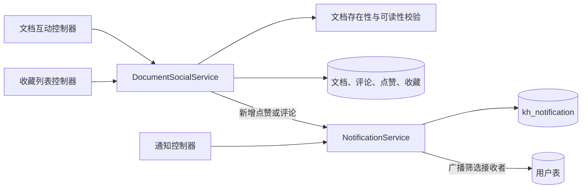
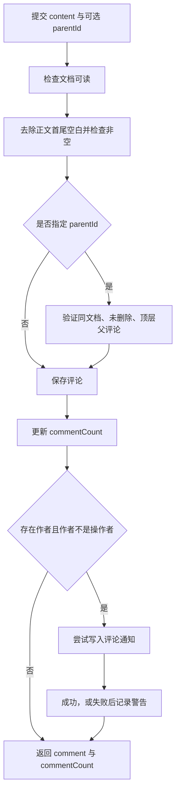

文档互动由 `DocumentSocialService` 负责，站内消息由 `NotificationService` 负责。理解这套实现的关键是：**互动以文档可读权限为前提，点赞与收藏采用状态切换，通知则是独立持久化的附加结果**。本页聚焦这些操作的接口、数据关系、前端接入方式与一致性边界，不展开文档发布、分享链接或对话消息管理。Sources: [document-social.service.ts](src/document/document-social.service.ts#L21-L93) [document-social.service.ts](src/document/document-social.service.ts#L186-L224) [notification.service.ts](src/notification/notification.service.ts#L19-L38)

## 一、架构与数据关系

`DocumentModule` 导入 `NotificationModule`，将互动控制器接入 `DocumentSocialService`；后者通过注入的 `EntityManager` 操作关系数据，并直接调用 `NotificationService` 写入通知。这条互动通知链路是**请求内等待的服务调用**，不是先投递消息队列再消费。下图展示本页涉及的依赖关系。Sources: [document.module.ts](src/document/document.module.ts#L30-L54) [notification.module.ts](src/notification/notification.module.ts#L5-L9) [document-social.service.ts](src/document/document-social.service.ts#L25-L28) [document-social.service.ts](src/document/document-social.service.ts#L186-L213)

Sources: [document-engagement.controller.ts](src/document/document-engagement.controller.ts#L27-L88) [document-social.service.ts](src/document/document-social.service.ts#L42-L183) [notification.controller.ts](src/notification/notification.controller.ts#L9-L48) [notification.service.ts](src/notification/notification.service.ts#L76-L107)

| 数据对象 | 核心关系与约束 | 作用 |
|---|---|---|
| `kh_comment` | `document_id`、`user_id`、可空的 `parent_id` | 顶层评论及一层回复；用 `deleted` 软删除 |
| `kh_document_like` | `(document_id, user_id)` 唯一 | 表示某用户当前是否点赞 |
| `kh_document_favorite` | `(document_id, user_id)` 唯一 | 表示当前收藏关系，记录收藏时间 |
| 文档互动计数 | `likeCount`、`favouriteCount`、`commentCount` | 由互动服务显式更新 |
| `kh_notification` | 接收者、类型、可选文档与发送者、`is_read` | 保存站内通知及已读状态 |

Sources: [init.sql](init-scripts/postgresql/init.sql#L256-L283) [init.sql](init-scripts/postgresql/init.sql#L325-L340) [document-social.service.ts](src/document/document-social.service.ts#L42-L93) [document-social.service.ts](src/document/document-social.service.ts#L140-L183)

## 二、权限前提与接口总览

互动接口与收藏列表均声明 `PermissionCode.documentList`。点赞、收藏、评论查询、评论新增和删除还会执行 `requireReadable`：先检查文档存在且未删除，再复用 `canReadDocument`。因此，**拥有接口权限不等于可以操作任意文档**。通知查询与已读操作使用当前登录用户的 ID，广播额外要求管理员角色；认证、角色与权限守卫由认证模块全局注册。Sources: [document-engagement.controller.ts](src/document/document-engagement.controller.ts#L27-L88) [document-social.service.ts](src/document/document-social.service.ts#L215-L224) [notification.controller.ts](src/notification/notification.controller.ts#L13-L48) [auth.module.ts](src/auth/auth.module.ts#L38-L49)

| 方法与路径 | 行为 | 主要返回字段 |
|---|---|---|
| `POST /documents/:id/likes` | 点赞／取消点赞 | `liked`、`likeCount` |
| `POST /documents/:id/favorites` | 收藏／取消收藏 | `favorited`、`favouriteCount` |
| `GET /favorites` | 当前用户仍可见的收藏文档 | `items`、`total`、`page`、`pageSize` |
| `GET /documents/:id/comments` | 查询未删除评论 | 评论数组 |
| `POST /documents/:id/comments` | 新增评论或回复 | `comment`、`commentCount` |
| `DELETE /documents/:id/comments/:commentId` | 删除评论及其直接回复 | `commentCount` |

Sources: [document-engagement.controller.ts](src/document/document-engagement.controller.ts#L27-L88) [document-social.service.ts](src/document/document-social.service.ts#L42-L183)

可读性规则并非“只有已发布文档才能互动”：管理员、审核员以及文档作者可以直接通过可读性判断；其他用户只能读取已发布且公开或属于自己团队的文档。评论删除的额外管理权限却只授予管理员，审核员不会因此获得删除他人评论的权限。完整可见性模型可参阅[团队协作与文档可见性：业务读取、全文检索和图谱查询的权限一致性](11-tuan-dui-xie-zuo-yu-wen-dang-ke-jian-xing-ye-wu-du-qu-quan-wen-jian-suo-he-tu-pu-cha-xun-de-quan-xian-zhi-xing)。Sources: [document-access.ts](src/document/document-access.ts#L13-L32) [document-social.service.ts](src/document/document-social.service.ts#L161-L170)

## 三、点赞与收藏：切换状态，而非设置状态

两个 `POST` 接口均先查询当前关系：存在则删除，不存在则创建，并据此更新文档计数。取消时使用 `Math.max(0, count - 1)` 防止计数为负。**重复调用会反转状态，因此不能将它们当作“确保已点赞／已收藏”的幂等接口。** 前端应以响应中的布尔值和计数覆盖本地显示，而不是仅根据点击次数自行推导。Sources: [document-social.service.ts](src/document/document-social.service.ts#L42-L93)

| 对比项 | 点赞 | 收藏 |
|---|---|---|
| 状态字段 | `liked` | `favorited` |
| 计数字段 | `likeCount` | `favouriteCount` |
| 新增关系 | 创建点赞记录 | 创建收藏记录 |
| 取消关系 | 删除点赞记录 | 删除收藏记录 |
| 作者通知 | 新增时尝试发送 | 不发送 |

Sources: [document-social.service.ts](src/document/document-social.service.ts#L42-L93)

收藏列表按收藏记录的 `createdAt DESC` 排序，再查询未删除文档、过滤当前不可读文档，最后进行内存切片分页。因此 `total` 是**当前可见的收藏文档数**，不是收藏关系总数；失去访问权限的文档不会出现在返回列表中，但该查询不会删除收藏关系。控制器默认 `page=1`、`pageSize=20`，将页码下限设为 1，并将每页数量限制在 1～100。Sources: [document-social.service.ts](src/document/document-social.service.ts#L95-L117) [document-engagement.controller.ts](src/document/document-engagement.controller.ts#L20-L40)

## 四、评论：两层结构、平铺返回、级联软删除

### 创建与展示规则

评论正文必须是长度 1～2000 的字符串；服务层还会执行 `trim()`，拒绝纯空白内容。回复通过 `parentId` 指定父评论，父评论必须属于同一文档、未删除且为顶层评论。评论显示名在创建时取 `realName || username`，截取前 50 个字符保存到 `userName`。Sources: [social.dto.ts](src/document/dto/social.dto.ts#L12-L22) [document-social.service.ts](src/document/document-social.service.ts#L127-L149)

| 请求字段 | 必填 | 约束 |
|---|---|---|
| `content` | 是 | 字符串，长度 1～2000；去除首尾空白后不能为空 |
| `parentId` | 否 | 字符串；指定时只能指向当前文档的有效顶层评论 |

Sources: [social.dto.ts](src/document/dto/social.dto.ts#L12-L22) [document-social.service.ts](src/document/document-social.service.ts#L127-L139)

评论查询返回按 `createdAt ASC` 排序的**平铺数组**，不是嵌套树，也没有分页。前端可将 `parentId` 为空的记录作为顶层评论，将其余记录挂到对应父评论下。新增顶层评论和回复都会令 `commentCount` 加一，因此该字段表示有效评论与回复的合计，而非仅顶层评论数。Sources: [document-social.service.ts](src/document/document-social.service.ts#L119-L158) [comment.entity.ts](src/document/entities/comment.entity.ts#L31-L43)

新增评论的实际顺序是校验、保存评论、更新计数、尝试写入通知，再返回结果；通知异常在内部捕获，不向上传播。下图可用于定位请求在哪个阶段失败。Sources: [document-social.service.ts](src/document/document-social.service.ts#L127-L158) [document-social.service.ts](src/document/document-social.service.ts#L186-L213)

Sources: [document-social.service.ts](src/document/document-social.service.ts#L127-L158) [document-social.service.ts](src/document/document-social.service.ts#L186-L224)

### 删除规则

删除者必须先能读取文档，然后满足“评论本人或管理员”。文档作者身份本身不授予删除他人评论的权限。删除顶层评论时，服务同时查找其未删除直接回复，将这些记录统一标记为 `deleted=true`，并按实际涉及的记录数减少计数；删除单条回复通常只减少一条。接口返回更新后的 `commentCount`，不返回被删除的 ID 列表。Sources: [document-social.service.ts](src/document/document-social.service.ts#L161-L183)

## 五、互动如何生成作者通知

只有**新增点赞**和**新增评论／回复**会调用作者通知逻辑。通知接收者始终是文档作者，而不是被回复评论的作者；作者缺失或操作者就是作者时跳过。取消点赞、收藏切换和删除评论均不调用该逻辑，也不会撤回此前通知。Sources: [document-social.service.ts](src/document/document-social.service.ts#L42-L93) [document-social.service.ts](src/document/document-social.service.ts#L127-L208)

通知标题使用操作者姓名，正文包含文档标题；评论摘要先将连续空白压缩为空格，再截取前 80 个字符。持久化时，通知服务进一步将标题限制到 100 字符、内容限制到 2000 字符、发送者名称限制到 50 字符，并设置 `isRead=false`。通知保存 `documentId`，但不保存具体 `commentId`。Sources: [document-social.service.ts](src/document/document-social.service.ts#L192-L208) [notification.service.ts](src/notification/notification.service.ts#L23-L37) [notification.entity.ts](src/notification/notification.entity.ts#L22-L45)

**通知写入失败不会使互动请求因该异常失败**：`notifyAuthor` 捕获异常并记录“写入通知失败”警告。需要注意执行顺序差异：点赞在关系保存之后、计数更新之前尝试通知；评论在评论保存与计数更新之后尝试通知。两者都不能视为“互动与通知原子提交”。Sources: [document-social.service.ts](src/document/document-social.service.ts#L51-L66) [document-social.service.ts](src/document/document-social.service.ts#L140-L158) [document-social.service.ts](src/document/document-social.service.ts#L209-L212)

## 六、消息管理：收件箱、未读数与广播

| 方法与路径 | 功能 | 返回与范围 |
|---|---|---|
| `GET /notifications` | 通知分页 | 当前用户的 `items`、`total`、`page`、`pageSize`，时间倒序 |
| `GET /notifications/unread-count` | 未读计数 | `{ count }` |
| `POST /notifications/:id/read` | 单条已读 | 返回该通知；必须属于当前用户 |
| `POST /notifications/read-all` | 全部已读 | 更新当前用户全部未读通知，返回 `{ ok: true }` |
| `POST /notifications/broadcast` | 管理员广播 | 返回生成的通知数 `{ count }` |

Sources: [notification.controller.ts](src/notification/notification.controller.ts#L13-L48) [notification.service.ts](src/notification/notification.service.ts#L40-L107)

通知分页默认值和数量限制与收藏列表一致，但通知使用数据库 `skip/take` 分页。读取列表不会自动标记已读；单条已读按 `{ id, userId }` 查找，找不到时返回“通知不存在”，已读记录再次提交不会重复保存。全部已读只更新当前用户的未读记录。当前控制器未提供删除通知或标记未读接口。Sources: [notification.controller.ts](src/notification/notification.controller.ts#L9-L48) [notification.service.ts](src/notification/notification.service.ts#L40-L74)

广播请求包含 `title`、`content` 和可选 `userIds`。标题和正文分别限制为 1～100、1～2000 字符，服务层还会去除首尾空白并拒绝空值。**省略 `userIds` 或传入空数组意味着发送给全部启用且未删除的用户**；非空数组则只保留指定 ID 中符合该条件的用户，若一个也没有则报错。广播按接收者逐条创建 `system` 类型通知，`documentId=null`，返回实际创建数量。Sources: [notification.dto.ts](src/notification/notification.dto.ts#L3-L18) [notification.service.ts](src/notification/notification.service.ts#L76-L107)

## 七、接入与排障边界

| 现象 | 已验证的规则或实现 | 接入检查 |
|---|---|---|
| 能进入页面，但互动返回禁止访问 | 互动还执行文档级可读性检查 | 检查当前文档的状态、作者、公开性和团队关系 |
| 无法回复某条评论 | 只允许回复未删除的顶层评论 | 传顶层评论 ID，不传回复 ID |
| 文档作者无法删除他人评论 | 删除权限只看评论本人或管理员 | 不把文档写权限等同于评论管理权限 |
| 收藏总数小于历史收藏记录数 | 先过滤当前不可读文档，再计算总数 | 按接口 `total` 展示可见数量 |
| 互动成功但作者没有收到通知 | 自己操作、无作者时跳过；通知异常仅记警告 | 检查操作者与作者，以及通知失败日志 |
| 广播空数组却发送给全部用户 | 空数组与省略接收者都表示全量发送 | 定向发送前确认数组非空 |

Sources: [document-social.service.ts](src/document/document-social.service.ts#L95-L139) [document-social.service.ts](src/document/document-social.service.ts#L161-L224) [notification.service.ts](src/notification/notification.service.ts#L76-L107)

从一致性角度看，互动写入采用“读取旧值—写关系—写回计算后的计数”，这些方法未使用显式事务、行锁或数据库原子增减。数据库唯一约束能阻止同一用户重复建立点赞／收藏关系，但不能替代计数更新的并发控制。因此接入时应避免对切换接口盲目重试；维护时也不应将这些方法解释为具备并发原子性保证。收藏列表则会先载入全部收藏和相关文档再分页，其处理范围并不受 `pageSize` 限制。Sources: [document-social.service.ts](src/document/document-social.service.ts#L42-L117) [document-social.service.ts](src/document/document-social.service.ts#L127-L183) [init.sql](init-scripts/postgresql/init.sql#L268-L283)

需要继续追踪“接口权限为何通过或拒绝”，可阅读[用户、角色与权限：授权模型与接口守卫](10-yong-hu-jiao-se-yu-quan-xian-shou-quan-mo-xing-yu-jie-kou-shou-wei)；需要理解文档状态变化为何影响收藏可见性和互动入口，可阅读[文档生命周期：草稿、提审、发布、归档与索引联动](13-wen-dang-sheng-ming-zhou-qi-cao-gao-ti-shen-fa-bu-gui-dang-yu-suo-yin-lian-dong)。本页接口最终分别依赖全局守卫与文档可读性函数，两者应分层排查。Sources: [auth.module.ts](src/auth/auth.module.ts#L38-L49) [document-engagement.controller.ts](src/document/document-engagement.controller.ts#L31-L87) [document-access.ts](src/document/document-access.ts#L23-L32)