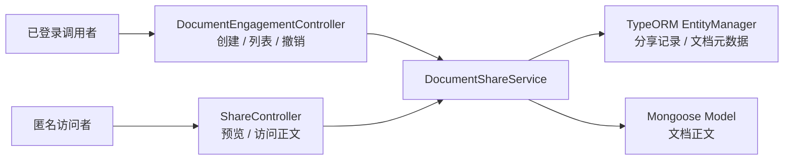
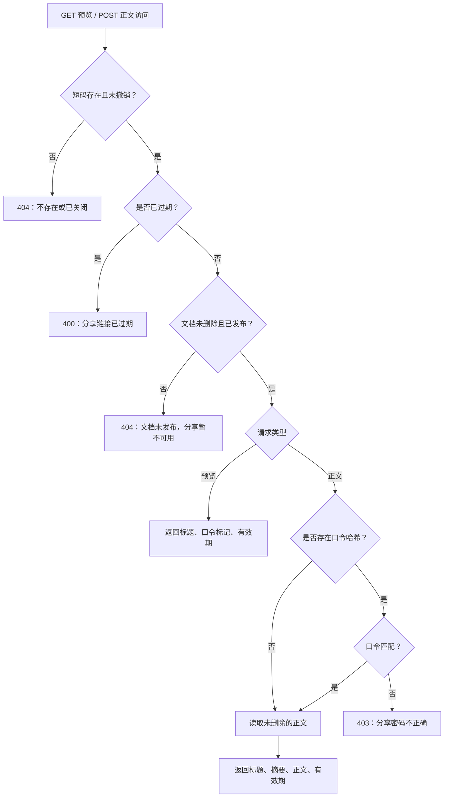

分享链接提供了一条**不要求登录的文档读取通道**：管理端创建分享记录，对外返回短码；访问端根据短码检查撤销状态、有效期和文档发布状态，再按需验证口令。本页聚焦这条通道的授权边界、联调方法及撤销语义，不展开普通文档读取或账号认证流程。Sources: [share.controller.ts](src/document/share.controller.ts#L6-L21) [document-share.service.ts](src/document/document-share.service.ts#L37-L57) [document-share.service.ts](src/document/document-share.service.ts#L85-L129)

## 1. 核心边界：能创建，不一定能管理

分享功能包含两个入口：`DocumentEngagementController` 提供需要登录的创建、列表与撤销接口；`ShareController` 提供标记为 `@Public()` 的预览与正文访问接口。两者复用 `DocumentShareService`，分享记录和文档元数据通过 TypeORM 读取，正文通过 Mongoose 读取。Sources: [document-engagement.controller.ts](src/document/document-engagement.controller.ts#L90-L114) [share.controller.ts](src/document/share.controller.ts#L6-L21) [document-share.service.ts](src/document/document-share.service.ts#L29-L35)

下图展示这两个入口的协作关系。**公开入口并不意味着无校验**，而是将访问凭据从登录身份切换为“分享短码＋可选口令”，并持续检查分享与文档状态。Sources: [document-share.service.ts](src/document/document-share.service.ts#L85-L129)



Sources: [document-engagement.controller.ts](src/document/document-engagement.controller.ts#L90-L114) [share.controller.ts](src/document/share.controller.ts#L6-L21) [document-share.service.ts](src/document/document-share.service.ts#L29-L35) [document-share.service.ts](src/document/document-share.service.ts#L103-L128)

| 操作 | 接口 | 接口级要求 | 服务层要求 |
|---|---|---|---|
| 创建分享 | `POST /documents/:id/shares` | 登录；`documentList` 权限，管理员放行 | 文档未删除、调用者可读、文档已发布 |
| 查看分享列表 | `GET /documents/:id/shares` | 同上 | 文档可读，且调用者为作者或管理员 |
| 撤销分享 | `DELETE /documents/:id/shares/:shareId` | 同上 | 文档可读，且调用者为作者或管理员 |
| 预览分享 | `GET /shares/:code` | 无需登录 | 分享未撤销、未过期，文档未删除且已发布 |
| 读取正文 | `POST /shares/:code/access` | 无需登录 | 预览所需条件，并按需验证口令 |

Sources: [document-engagement.controller.ts](src/document/document-engagement.controller.ts#L90-L114) [permissions.guard.ts](src/auth/permissions.guard.ts#L23-L47) [jwt-auth.guard.ts](src/auth/jwt-auth.guard.ts#L29-L37) [document-share.service.ts](src/document/document-share.service.ts#L37-L129) [document-share.service.ts](src/document/document-share.service.ts#L153-L169)

这里最重要的不对称是：**创建分享只要求“可读且已发布”，并不要求作者身份**；列表和撤销才要求作者或管理员。因此，具有接口权限的团队成员可以为其可读的已发布团队文档创建分享，但如果不是作者或管理员，不能通过管理接口列出或撤销该分享。`createdBy` 会被记录，却不参与撤销授权判断。Sources: [document-share.service.ts](src/document/document-share.service.ts#L37-L82) [document-share.service.ts](src/document/document-share.service.ts#L153-L169) [document-access.ts](src/document/document-access.ts#L13-L40)

匿名访问时，服务不会再次按访问者身份检查 `isPublic` 或团队归属。因此，分享不是普通可见性规则的重复校验，而是一条独立的对外授权通道；对团队文档开放分享创建能力时，应明确接受这一边界。普通读取规则可对照[团队协作与文档可见性：业务读取、全文检索和图谱查询的权限一致性](11-tuan-dui-xie-zuo-yu-wen-dang-ke-jian-xing-ye-wu-du-qu-quan-wen-jian-suo-he-tu-pu-cha-xun-de-quan-xian-zhi-xing)。Sources: [document-share.service.ts](src/document/document-share.service.ts#L95-L129) [document-access.ts](src/document/document-access.ts#L23-L32)

## 2. 短码、口令与有效期如何保存

分享记录存于 `kh_document_share`，以 `documentId` 关联文档。短码保存在唯一字段 `token` 中：每次使用 `randomBytes(9)` 生成随机字节，编码为 12 字符的 Base64URL 字符串；生成逻辑最多尝试五次查重，失败后返回“生成分享码失败，请重试”。这里的唯一约束与应用层查重同时存在，不应将查重步骤理解为数据库事务锁。Sources: [document-share.entity.ts](src/document/entities/document-share.entity.ts#L4-L19) [document-share.service.ts](src/document/document-share.service.ts#L142-L150)

| 参数或字段 | 规则 | 安全含义 |
|---|---|---|
| `password` | 可选字符串，最多 32 字符；创建和访问时均执行 `trim()` | 首尾空格不构成口令的一部分 |
| `passwordHash` | 非空口令使用 bcrypt、成本参数 `10` 保存 | 不保存明文口令，不在接口视图中返回哈希 |
| `requirePassword` | 创建时写入布尔值 | 实际校验及 `needPassword` 均以 `passwordHash` 为准 |
| `expireDays` | 可选，转换为数字后验证为 `1–365` 的整数 | 显式传 `0` 不能表示永久有效 |
| `expireAt` | 不传有效天数时为 `null`，否则为创建时刻加指定天数 | 永久有效只表示无时间截止，仍受撤销和文档状态约束 |
| `revoked` | 创建时为 `false`，撤销时改为 `true` | 不删除记录，通过后续查询排除 |

Sources: [social.dto.ts](src/document/dto/social.dto.ts#L24-L45) [document-share.entity.ts](src/document/entities/document-share.entity.ts#L21-L37) [document-share.service.ts](src/document/document-share.service.ts#L37-L54) [document-share.service.ts](src/document/document-share.service.ts#L95-L100) [document-share.service.ts](src/document/document-share.service.ts#L131-L139)

**省略口令、空字符串或纯空白字符串，都会创建无口令分享。** DTO 没有最小长度或复杂度要求，服务层去除首尾空格后再决定是否生成哈希。如果产品要求所有分享必须使用口令，现有可选参数和校验逻辑不能提供这一保证，需要调整实现，而非仅修改前端提示。Sources: [social.dto.ts](src/document/dto/social.dto.ts#L24-L29) [document-share.service.ts](src/document/document-share.service.ts#L37-L50)

有效期按服务端时间计算，每天固定为 `24 × 60 × 60 × 1000` 毫秒。访问时只有当 `expireAt.getTime() < Date.now()` 才判定过期；这里没有“到期后更新分享记录”的步骤，而是每次请求实时判断。Sources: [document-share.service.ts](src/document/document-share.service.ts#L40-L43) [document-share.service.ts](src/document/document-share.service.ts#L114-L121)

## 3. 访问流程：预览不验口令，正文逐次验证

预览接口也执行分享有效性检查，但**不验证口令**；它返回 `code`、`title`、`needPassword` 和 `expireAt`。因此，为分享设置口令能够保护正文，却不会隐藏有效分享的文档标题或是否设有口令。Sources: [document-share.service.ts](src/document/document-share.service.ts#L85-L93)

下图按实际执行顺序展示公开访问流程。前端可以先预览再提示输入口令，但服务端并不要求先调用预览；直接请求正文接口时，也会执行完整的有效性校验。Sources: [share.controller.ts](src/document/share.controller.ts#L11-L21) [document-share.service.ts](src/document/document-share.service.ts#L85-L129)



Sources: [document-share.service.ts](src/document/document-share.service.ts#L85-L129)

正文接口返回 `title`、`summary`、`content` 和 `expireAt`，不会签发新的访问令牌，也不会返回原文件下载地址。后续每次读取正文都需要再次提交口令；正文查询仅匹配未删除的内容记录，若查不到则返回空字符串，而不是抛出正文不存在错误。Sources: [document-share.service.ts](src/document/document-share.service.ts#L95-L111)

分享绑定的是文档，而不是版本快照：访问时重新读取文档当前的标题、摘要和 `contentId`，再读取对应正文。因此，不应把分享链接理解为“创建时内容的永久副本”。Sources: [document-share.entity.ts](src/document/entities/document-share.entity.ts#L10-L19) [document-share.service.ts](src/document/document-share.service.ts#L103-L128)

## 4. 联调步骤：创建、访问、撤销

### 第一步：创建受口令保护的限时分享

使用有权读取目标已发布文档的登录账号调用下列接口。全局参数管道启用了类型转换和白名单校验，多余字段会被拒绝；创建响应返回 `id`、`documentId`、`code`、`needPassword`、`expireAt`、`createdAt`，不返回完整前端 URL。集成方应保存 `id` 用于撤销，使用 `code` 组装访问入口。Sources: [main.ts](src/main.ts#L17-L23) [document-engagement.controller.ts](src/document/document-engagement.controller.ts#L96-L104) [document-share.service.ts](src/document/document-share.service.ts#L131-L139)

```http
POST /documents/{documentId}/shares
Authorization: Bearer <登录令牌>
Content-Type: application/json

{
  "password": "Share-2026",
  "expireDays": 7
}
```

Sources: [document-engagement.controller.ts](src/document/document-engagement.controller.ts#L96-L104) [social.dto.ts](src/document/dto/social.dto.ts#L24-L38)

### 第二步：匿名预览并提交口令

先请求 `GET /shares/{code}`，根据 `needPassword` 决定是否展示口令输入框；读取正文时调用以下接口。无口令分享可以提交 `{}`；有口令分享如果省略口令、提交空白口令或口令不匹配，均返回 `403`。Sources: [share.controller.ts](src/document/share.controller.ts#L11-L21) [document-share.service.ts](src/document/document-share.service.ts#L85-L111)

```http
POST /shares/{code}/access
Content-Type: application/json

{
  "password": "Share-2026"
}
```

Sources: [social.dto.ts](src/document/dto/social.dto.ts#L40-L45) [document-share.service.ts](src/document/document-share.service.ts#L95-L111)

### 第三步：由作者或管理员撤销

调用 `DELETE /documents/{documentId}/shares/{shareId}`，成功后返回 `{ "id": "<shareId>" }`。这里必须使用创建响应中的记录 `id`，而不是分享 `code`；服务会同时匹配记录 ID、文档 ID 和 `revoked: false`，随后将 `revoked` 置为 `true`。Sources: [document-engagement.controller.ts](src/document/document-engagement.controller.ts#L106-L114) [document-share.service.ts](src/document/document-share.service.ts#L71-L82)

| 状态 | 撤销前 | 撤销后 |
|---|---|---|
| 分享记录 | `revoked: false` | `revoked: true`，记录仍保留 |
| 管理列表 | 未撤销记录可被列出，包含已过期记录 | 不再列出 |
| 后续预览、正文请求 | 继续检查有效期、文档状态及口令 | 因找不到活跃记录而返回 `404` |
| 再次撤销同一记录 | 首次可成功 | 返回 `404`“分享不存在” |

Sources: [document-share.service.ts](src/document/document-share.service.ts#L59-L82) [document-share.service.ts](src/document/document-share.service.ts#L114-L120)

## 5. 撤销语义与安全限制

**撤销控制后续请求，不负责追回已返回的内容。** 每次请求会查询分享记录，但校验与正文读取是顺序执行的独立操作；代码没有在返回正文前再次检查撤销状态。因此，不能承诺撤销会中断已经通过校验的在途请求，更不能承诺清除客户端已经取得的正文。Sources: [document-share.service.ts](src/document/document-share.service.ts#L71-L82) [document-share.service.ts](src/document/document-share.service.ts#L95-L128)

文档状态也会影响链接可用性：只要文档不存在、已删除或不再处于已发布状态，访问就会失败，但这不会自动把分享记录改为已撤销。只要原记录仍未撤销、未过期，且文档重新满足查询条件，同一短码就会重新通过检查。涉及状态流转时，可继续阅读[文档生命周期：草稿、提审、发布、归档与索引联动](13-wen-dang-sheng-ming-zhou-qi-cao-gao-ti-shen-fa-bu-gui-dang-yu-suo-yin-lian-dong)。Sources: [document-share.service.ts](src/document/document-share.service.ts#L114-L128)

当前展示的分享控制器与服务没有实现口令失败次数计数、锁定或验证码。口令哈希保护的是存储中的口令，不等于提供在线尝试限制；部署或扩展时应单独评估公开访问入口的防滥用措施，不能把它们当作现有分享逻辑的内建能力。Sources: [share.controller.ts](src/document/share.controller.ts#L6-L21) [document-share.service.ts](src/document/document-share.service.ts#L95-L129)

## 6. 排障与验收清单

| 现象 | 对应原因或检查点 |
|---|---|
| 创建返回 `400`“只有已发布的文档可以分享” | 文档可读，但状态不是已发布 |
| 创建成功，列表或撤销却返回 `403` | 创建者不是作者或管理员；“可读”不等于“可管理分享” |
| 设置口令后预览仍能看到标题 | 预览设计如此；口令只在正文访问时验证 |
| 正文返回 `403`“分享密码不正确” | 检查口令是否缺失，以及去除首尾空格后的值 |
| 访问返回 `400`“分享链接已过期” | 服务端当前时间已晚于 `expireAt` |
| 访问返回 `404`“分享链接不存在或已关闭” | 短码不存在，或记录已经撤销 |
| 访问返回 `404`“文档未发布，分享暂不可用” | 文档不存在、已删除或不处于已发布状态 |
| 列表仍出现过期分享 | 列表只过滤撤销状态，不过滤有效期 |
| 访问成功但 `content` 为空 | 查询不到未删除正文时，服务使用空字符串作为回退值 |

Sources: [document-share.service.ts](src/document/document-share.service.ts#L59-L129) [document-share.service.ts](src/document/document-share.service.ts#L153-L169)

验收时应重点覆盖：无口令与有口令两条路径、过期链接、撤销后再次访问、重复撤销，以及“可读非作者创建分享但不能撤销”的权限边界。若需要调整谁可以创建或管理分享，应结合[用户、角色与权限：授权模型与接口守卫](10-yong-hu-jiao-se-yu-quan-xian-shou-quan-mo-xing-yu-jie-kou-shou-wei)，同时检查接口权限与服务层判断，避免只修改其中一层。Sources: [document-engagement.controller.ts](src/document/document-engagement.controller.ts#L90-L114) [document-share.service.ts](src/document/document-share.service.ts#L37-L129) [document-access.ts](src/document/document-access.ts#L23-L40)