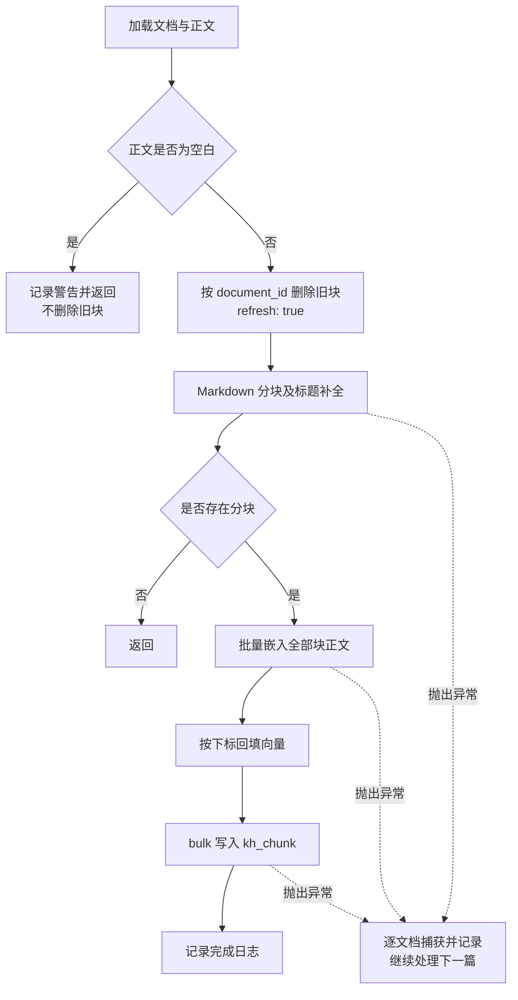

本页位于“异步处理与知识索引”的第 18 页，聚焦一条具体链路：**Markdown 正文如何变成携带章节上下文的分块，再经批量嵌入写入 Elasticsearch `kh_chunk`**。理解这条链路的关键不只是分块大小，还包括标题继承、块标识稳定性、向量维度契约，以及“先删后写”重建的失败窗口。本文不展开消息投递、全文搜索或知识图谱实现。Sources: [pipeline.orchestrator.ts](src/pipeline/pipeline.orchestrator.ts#L47-L76) [pipeline.orchestrator.ts](src/pipeline/pipeline.orchestrator.ts#L152-L187)

## 1. 架构边界：编排、分块、嵌入与存储分离

管线以 `PipelineDocument` 作为文档输入，以 `DocumentChunk[]` 作为中间结果。`PipelineOrchestrator` 负责加载文档、组织执行顺序并回填向量；`ChunkingService` 负责文本与章节上下文；`EmbeddingService` 包装 `OpenAIEmbeddings`；`VectorIndexService` 管理分块索引。这些服务由 `PipelineModule` 注册，编排器不直接实现切分算法或嵌入协议。Sources: [pipeline.types.ts](src/pipeline/types/pipeline.types.ts#L7-L32) [pipeline.types.ts](src/pipeline/types/pipeline.types.ts#L71-L92) [pipeline.module.ts](src/pipeline/pipeline.module.ts#L15-L38)

下图同时展示服务调用和数据形态：**嵌入输入只有块正文 `content`**；文档标题、分类和可见性等信息随块保存，但不会由编排器自动拼入嵌入文本。Sources: [pipeline.orchestrator.ts](src/pipeline/pipeline.orchestrator.ts#L162-L183) [vector-index.service.ts](src/pipeline/vector-index.service.ts#L444-L464)

Sources: [pipeline.orchestrator.ts](src/pipeline/pipeline.orchestrator.ts#L152-L183) [pipeline.orchestrator.ts](src/pipeline/pipeline.orchestrator.ts#L199-L213)

### 输入文档的实际边界

按 ID 重建时，编排器逐个查询未删除的关系库文档，再通过 `contentId` 读取未删除的 MongoDB 正文；正文缺失时使用空字符串。**这条加载路径只检查 `deleted: false`，没有额外检查发布状态**，因此不能把编排器本身当作“只允许已发布文档入库”的校验层。Sources: [pipeline.orchestrator.ts](src/pipeline/pipeline.orchestrator.ts#L199-L213)

## 2. 分块：字符预算与章节上下文是两个阶段

### 2.1 配置名称是 token，执行预算是字符

`RAG_CHUNK_SIZE` 和 `RAG_CHUNK_OVERLAP` 先经过 `Number()` 转换，再乘固定系数 `2.0` 并向下取整。默认配置因此对应约 **1024 字符的块大小、128 字符的重叠预算**。这是粗略换算，不是用嵌入模型 tokenizer 精确计算的 token 限额；服务自身也没有显式执行有限数、正数或重叠比例校验。Sources: [chunking.service.ts](src/pipeline/chunking.service.ts#L32-L60)

| 配置或选项 | 默认值 | 实现语义 |
|---|---:|---|
| `RAG_CHUNK_SIZE` | `512` | 乘以 2 后作为切分器 `chunkSize` |
| `RAG_CHUNK_OVERLAP` | `64` | 乘以 2 后作为切分器 `chunkOverlap` |
| `keepSeparator` | `true` | 保留分隔符 |
| 分隔符集合 | Markdown 内置集合，加前置 `\n# ` | 显式补充一级标题分隔符 |
| 空白输入 | — | 记录警告并返回空数组 |

Sources: [chunking.service.ts](src/pipeline/chunking.service.ts#L41-L60) [chunking.service.ts](src/pipeline/chunking.service.ts#L81-L88)

### 2.2 标题继承不是完整的 Markdown 章节树

切分后，服务按顺序处理每块文本，使用 `/^(#{1,6})\s+(.+)$/m` 提取块内**第一个 ATX 标题**，去掉 `#` 后保存为 `currentHeading`。若后续块没有任何匹配的标题行，就在正文前补上 `currentHeading + "\n\n"`；若尚未遇到标题，`heading` 保持 `null`。Sources: [chunking.service.ts](src/pipeline/chunking.service.ts#L38-L39) [chunking.service.ts](src/pipeline/chunking.service.ts#L88-L115) [chunking.service.ts](src/pipeline/chunking.service.ts#L138-L142)

| 切分后的块 | 上下文处理 | 最终嵌入文本的变化 |
|---|---|---|
| 含 ATX 标题 | 用第一个标题更新当前标题 | 保留原文本，不额外加前缀 |
| 不含标题，已有当前标题 | 继承当前标题 | 前置纯标题文本及两个换行 |
| 不含标题，也无当前标题 | 不补上下文 | 保持裁剪后的正文 |
| 同一块有多个标题 | 只提取第一个标题 | 不维护层级路径，也不改用最后一个标题 |

Sources: [chunking.service.ts](src/pipeline/chunking.service.ts#L90-L115) [chunking.service.ts](src/pipeline/chunking.service.ts#L138-L142)

这意味着当前实现提供的是**单标题状态的跨块继承**，而不是“H1 → H2 → H3”的层级上下文。标题前缀是在切分完成后追加的，因此最终 `content` 可能超过切分器原先的字符预算；前缀也不会重新进入切分阶段。Sources: [chunking.service.ts](src/pipeline/chunking.service.ts#L88-L105)

### 2.3 块身份绑定序号，不绑定内容

每块的标识为 `sha256(documentId + ":" + chunkIndex)` 的 64 位十六进制字符串，其中 `chunkIndex` 从零开始，`totalChunks` 在全部处理完成后统一回填。**相同文档、相同序号具有相同 ID，但不代表正文相同**；正文或切分配置变化后，该序号可能对应不同内容。这个标识服务于索引覆盖，不是内容指纹，也不用于嵌入缓存。Sources: [chunking.service.ts](src/pipeline/chunking.service.ts#L107-L130) [vector-index.service.ts](src/pipeline/vector-index.service.ts#L135-L151)

## 3. 批量嵌入：批次大小不等于管线并发度

`EmbeddingService` 将 `EMBEDDING_BATCH_SIZE` 交给 `OpenAIEmbeddings`，默认值为 10。有限且大于零的配置值最多取 10，其他值回退到 10；配置超过 10 时额外记录警告。这个上限在当前实现中始终生效，并不随自定义模型或服务地址改变；代码没有进一步将小数批大小取整。Sources: [embedding.service.ts](src/pipeline/embedding.service.ts#L21-L35) [embedding.service.ts](src/pipeline/embedding.service.ts#L47-L63)

| 配置项 | 默认值或优先级 | 作用 |
|---|---|---|
| API 密钥 | `EMBEDDING_API_KEY` → `DASHSCOPE_API_KEY` → `OPENAI_API_KEY` | 均未配置时，构造函数抛错 |
| `EMBEDDING_BASE_URL` | `https://dashscope.aliyuncs.com/compatible-mode/v1` | OpenAI 兼容接口地址 |
| `EMBEDDING_MODEL` | `text-embedding-v3` | 嵌入模型 |
| `EMBEDDING_DIMENSION` | `1024` | 请求向量维度，同时被索引服务读取 |
| `EMBEDDING_BATCH_SIZE` | `10`，上限 `10` | 库内部批量切片参数 |
| `stripNewLines` | `false` | 保留 Markdown 文本换行 |

Sources: [embedding.service.ts](src/pipeline/embedding.service.ts#L21-L63) [vector-index.service.ts](src/pipeline/vector-index.service.ts#L33-L37)

`embedBatch([])` 直接返回空数组；非空输入直接委托 `embedDocuments(texts)`，没有在本服务内另写切片循环、并发调度或重试逻辑。编排器则逐文档 `await reindexOne()`，每篇文档一次性提交全部块正文，并按 `embeddings[i]` 回填 `chunks[i].embedding`。因此，**文档处理顺序、嵌入请求切片和 ES 写入批次是三个不同层面的行为**，不能用 `EMBEDDING_BATCH_SIZE` 推断整条管线的并发度。Sources: [embedding.service.ts](src/pipeline/embedding.service.ts#L66-L79) [pipeline.orchestrator.ts](src/pipeline/pipeline.orchestrator.ts#L65-L75) [pipeline.orchestrator.ts](src/pipeline/pipeline.orchestrator.ts#L176-L183)

当前回填逻辑依赖返回向量与输入文本保持顺序对应，没有显式检查向量数量或每条向量长度。与此同时，写入映射只在 `embedding` 非空时包含该字段，因此服务层并未强制保证“每个写入块都携带向量”。Sources: [pipeline.orchestrator.ts](src/pipeline/pipeline.orchestrator.ts#L176-L183) [vector-index.service.ts](src/pipeline/vector-index.service.ts#L444-L464)

## 4. 索引契约：块正文、定位信息与向量共同保存

`kh_chunk` 使用 `dense_vector` 保存嵌入，开启向量索引并指定 `cosine` 相似度；维度来自 `EMBEDDING_DIMENSION`。块正文和文档标题同时保留文本索引能力，但这里的存储单位始终是块，而不是整篇文档。Sources: [vector-index.service.ts](src/pipeline/vector-index.service.ts#L361-L410)

| 字段组 | 主要字段 | 存储职责 |
|---|---|---|
| 身份与归属 | `chunk_id`、`document_id` | 标识块，支持按文档清理；均为 `keyword` |
| 可读文本 | `content`、`document_title` | 使用 `ik_max_word` 建索引、`ik_smart` 查询 |
| 章节与顺序 | `heading`、`chunk_index`、`total_chunks` | 保留标题和文档内位置 |
| 业务元数据 | 分类、作者、团队、公开状态、文档状态 | 随块保存业务上下文 |
| 时间 | `publish_time`、`indexed_at` | 发布时间与本次写入时间 |
| 向量 | `embedding` | 指定维度的 `dense_vector`，使用余弦相似度 |

Sources: [vector-index.service.ts](src/pipeline/vector-index.service.ts#L379-L410) [vector-index.service.ts](src/pipeline/vector-index.service.ts#L444-L464)

写入时，每块生成一条 `index` 操作，ES `_id` 使用 `chunkId`；单篇文档的全部操作组成一次 `bulk` 请求，并指定 `refresh: true`。这里没有按嵌入批大小进一步切分 ES 请求。若 bulk 返回条目级错误，服务记录失败块及原因后抛出异常，但没有回滚已经成功写入的条目。Sources: [vector-index.service.ts](src/pipeline/vector-index.service.ts#L135-L169)

### 维度变更不等于普通内容重建

创建索引前会检查 `kh_chunk` 是否存在，存在便直接返回；启动后的补充 mapping 只涉及可见性字段，不会核对或迁移已有向量维度。因此，**修改 `EMBEDDING_DIMENSION` 后仅重启或重跑文档重建，不能视为完成索引维度迁移**。模型、请求维度和现有 mapping 的一致性需要单独核对，当前代码没有提供自动迁移流程。Sources: [embedding.service.ts](src/pipeline/embedding.service.ts#L21-L22) [embedding.service.ts](src/pipeline/embedding.service.ts#L53-L63) [vector-index.service.ts](src/pipeline/vector-index.service.ts#L365-L369) [vector-index.service.ts](src/pipeline/vector-index.service.ts#L404-L408) [vector-index.service.ts](src/pipeline/vector-index.service.ts#L426-L441)

## 5. 重建语义：先删后写，而非原子替换

RAG 入口支持 `BY_DOC_IDS` 重建与 `DELETE_BY_DOC_IDS` 删除；其他类型或缺少 ID 的请求被忽略。单篇重建先检查正文是否为空，再删除旧块、重新分块、嵌入并写入。删除旧块的目的不仅是防止重复：当新版本块数减少时，单靠相同 `_id` 覆盖无法清除旧版本多出的尾部块。Sources: [pipeline.orchestrator.ts](src/pipeline/pipeline.orchestrator.ts#L47-L76) [pipeline.orchestrator.ts](src/pipeline/pipeline.orchestrator.ts#L152-L183) [vector-index.service.ts](src/pipeline/vector-index.service.ts#L105-L121)

下面的流程特别标出删除与写入之间的窗口：代码没有使用临时索引、版本别名切换或事务提交来替换整篇文档的分块。Sources: [pipeline.orchestrator.ts](src/pipeline/pipeline.orchestrator.ts#L152-L187)

Sources: [pipeline.orchestrator.ts](src/pipeline/pipeline.orchestrator.ts#L65-L75) [pipeline.orchestrator.ts](src/pipeline/pipeline.orchestrator.ts#L152-L187) [vector-index.service.ts](src/pipeline/vector-index.service.ts#L114-L121)

| 情况 | 实际行为 | 对索引状态的含义 |
|---|---|---|
| 正文为空或缺失 | 在删除之前返回 | 已有旧块不会因此被清除 |
| 删除成功，后续嵌入抛错 | 当前文档错误被记录 | 本次流程没有恢复旧块的步骤 |
| 删除旧块失败 | 删除服务记录错误，不再抛出 | 后续仍可继续写入，旧尾部块可能残留 |
| bulk 部分失败 | 抛错，但不撤销成功条目 | 可能留下不完整的新版本块集合 |
| ES 未启用或初始化失败 | 删除、写入方法记录跳过并返回 | 上层不一定获得失败异常 |

Sources: [pipeline.orchestrator.ts](src/pipeline/pipeline.orchestrator.ts#L68-L75) [pipeline.orchestrator.ts](src/pipeline/pipeline.orchestrator.ts#L152-L187) [vector-index.service.ts](src/pipeline/vector-index.service.ts#L39-L61) [vector-index.service.ts](src/pipeline/vector-index.service.ts#L105-L166)

尤其需要区分**流程执行完毕**与**索引确实落盘**：ES 不可用时，`indexChunks()` 可以正常返回，随后编排器仍会记录“RAG 索引完成”。该日志不能单独作为完整性证明，应同时检查向量索引服务的跳过、删除失败和 bulk 部分失败日志。Sources: [vector-index.service.ts](src/pipeline/vector-index.service.ts#L135-L169) [pipeline.orchestrator.ts](src/pipeline/pipeline.orchestrator.ts#L183-L186)

## 6. 修改与验证的决策顺序

调整分块策略时，应先明确改变的是字符预算还是章节上下文，再检查块数量、继承标题和最终 `content`，而不是只观察配置中的 token 数。调整嵌入模型时，应同时核对模型参数、输出维度和现有 ES mapping；正文变更后的重建则需要关注旧块删除与新块完整写入这两个独立结果。上述检查分别对应当前实现的后置标题补全、位置映射和先删后写边界。Sources: [chunking.service.ts](src/pipeline/chunking.service.ts#L41-L60) [chunking.service.ts](src/pipeline/chunking.service.ts#L88-L130) [embedding.service.ts](src/pipeline/embedding.service.ts#L53-L63) [pipeline.orchestrator.ts](src/pipeline/pipeline.orchestrator.ts#L159-L183) [vector-index.service.ts](src/pipeline/vector-index.service.ts#L365-L409)

若下一步要追踪“谁触发重建、异常如何进入消息处理边界”，继续阅读[消息驱动的知识管线：任务发布、队列消费与异常处理边界](17-xiao-xi-qu-dong-de-zhi-shi-guan-xian-ren-wu-fa-bu-dui-lie-xiao-fei-yu-yi-chang-chu-li-bian-jie)；若要理解块如何参与召回，阅读[混合检索与精排：关键词召回、向量召回、倒数排名融合及降级策略](22-hun-he-jian-suo-yu-jing-pai-guan-jian-ci-zhao-hui-xiang-liang-zhao-hui-dao-shu-pai-ming-rong-he-ji-jiang-ji-ce-lue)；涉及可见性变化或多索引协同时，转至[跨索引同步：发布重建、删除清理与可见性更新](21-kua-suo-yin-tong-bu-fa-bu-zhong-jian-shan-chu-qing-li-yu-ke-jian-xing-geng-xin)。Sources: [pipeline.orchestrator.ts](src/pipeline/pipeline.orchestrator.ts#L21-L29) [pipeline.orchestrator.ts](src/pipeline/pipeline.orchestrator.ts#L78-L95) [vector-index.service.ts](src/pipeline/vector-index.service.ts#L16-L24)