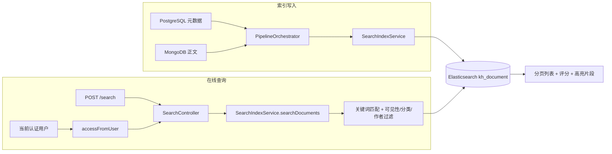
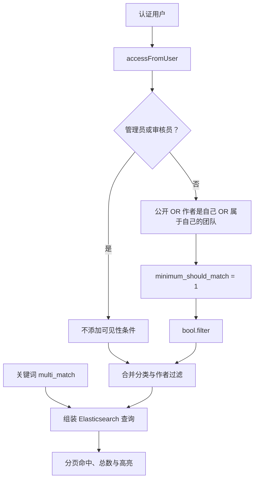

文档级全文搜索面向“根据关键词查找整篇文档”的场景：Elasticsearch 的 `kh_document` 索引以一篇文档为一条记录，匹配标题、摘要和全文，返回分页列表与命中片段。它不负责向量召回或回答生成。本页聚焦三个实现边界：**中文文本如何建立索引、`POST /search` 如何查询、当前用户的可见范围如何参与过滤**。Sources: [search-index.service.ts](src/pipeline/search-index.service.ts#L10-L21)、[search.controller.ts](src/search/search.controller.ts#L14-L25)

## 1. 架构：整篇索引，查询时过滤

全文搜索采用读写分离的职责组织：`PipelineOrchestrator` 加载 PostgreSQL 元数据与 MongoDB 正文，交给 `SearchIndexService` 写入索引；`SearchController` 则将请求参数和当前用户的访问范围传给同一服务。查询路径直接读取 Elasticsearch，不逐条回查业务数据库。`SearchModule` 通过导入 `PipelineModule` 使用其导出的索引服务。Sources: [pipeline.orchestrator.ts](src/pipeline/pipeline.orchestrator.ts#L98-L117)、[pipeline.orchestrator.ts](src/pipeline/pipeline.orchestrator.ts#L199-L213)、[search.controller.ts](src/search/search.controller.ts#L10-L25)、[search.module.ts](src/search/search.module.ts#L1-L9)、[pipeline.module.ts](src/pipeline/pipeline.module.ts#L21-L36)

下图区分索引写入与在线查询两条路径。核心关系是：**正文参与检索，但列表不返回完整正文；可见性参与筛选，但不参与相关性评分**。Sources: [search-index.service.ts](src/pipeline/search-index.service.ts#L174-L217)



Sources: [pipeline.orchestrator.ts](src/pipeline/pipeline.orchestrator.ts#L199-L249)、[search.controller.ts](src/search/search.controller.ts#L17-L25)、[search-index.service.ts](src/pipeline/search-index.service.ts#L145-L247)

### 索引记录的组成

索引写入以文档 ID 作为 Elasticsearch `_id`，使用 `index` 操作覆盖同 ID 记录，并附加 `indexedAt`。写入设置 `refresh: true`；搜索记录的输入包含元数据和全文，而不是分块后的内容。Sources: [search-index.service.ts](src/pipeline/search-index.service.ts#L60-L80)、[pipeline.orchestrator.ts](src/pipeline/pipeline.orchestrator.ts#L230-L249)

| 字段组 | 字段 | 显式映射或用途 |
|---|---|---|
| 全文匹配 | `title`、`summary`、`content` | `text`，使用 IK 分词 |
| 精确筛选 | `categoryId`、`authorId`、`teamId` | `keyword` |
| 标识与标签 | `id`、`tags` | `keyword` |
| 可见性 | `isPublic` | `boolean` |
| 状态 | `status` | `integer`；当前搜索查询不按它过滤 |
| 发布时间 | `publishTime` | `date` |

Sources: [search-index.service.ts](src/pipeline/search-index.service.ts#L162-L198)、[search-index.service.ts](src/pipeline/search-index.service.ts#L268-L284)

## 2. 中文分词：写入细切，查询粗切

`title`、`summary`、`content` 共享同一文本映射：写入分析器为 `ik_max_word`，搜索分析器为 `ik_smart`。此外，关键词查询的 `multi_match` 再次显式指定 `ik_smart`，使当前接口的查询分析器选择清晰可见。这里的实现模式是**写入细切、检索粗切**，并非标题与正文使用不同分析器。Sources: [search-index.service.ts](src/pipeline/search-index.service.ts#L174-L198)、[search-index.service.ts](src/pipeline/search-index.service.ts#L255-L275)

| 阶段 | 配置位置 | 分析器 |
|---|---|---|
| 建立倒排索引 | 文本字段 `analyzer` | `ik_max_word` |
| 字段默认搜索分析 | 文本字段 `search_analyzer` | `ik_smart` |
| 当前接口关键词查询 | `multi_match.analyzer` | `ik_smart` |

Sources: [search-index.service.ts](src/pipeline/search-index.service.ts#L181-L197)、[search-index.service.ts](src/pipeline/search-index.service.ts#L255-L260)

运行环境通过自定义 Docker 镜像安装 IK：基础 Elasticsearch 版本是 `8.17.0`，插件来自仓库中的本地 `elasticsearch-analysis-ik-8.17.0.zip`。Compose 的 `es` 服务使用这个构建目录，因此只替换为不带 IK 的普通镜像，并不能满足代码中的分析器依赖。Sources: [Dockerfile](elasticsearch/Dockerfile#L1-L8)、[docker-compose.yml](docker-compose.yml#L134-L145)

需要特别区分**新建索引**与**已有索引维护**：启动时只有索引不存在才创建上述文本映射；已有索引仅补充 `isPublic`、`teamId`、`authorId` 的可见性映射。当前逻辑不会自动替换已有文本字段的分析器，也不会因为代码配置变化而重建全文索引。Sources: [search-index.service.ts](src/pipeline/search-index.service.ts#L262-L304)

## 3. 查询接口与参数约束

全文搜索入口为 `POST /search`，请求体使用 JSON。接口要求 `search` 权限，当前用户由认证上下文注入；管理员可通过权限守卫的管理员分支放行。JWT 策略从 `Authorization: Bearer ...` 提取访问令牌，接口本身不接受客户端指定可见范围。Sources: [search.controller.ts](src/search/search.controller.ts#L10-L25)、[permissions.ts](src/common/constants/permissions.ts#L3-L14)、[permissions.guard.ts](src/auth/permissions.guard.ts#L32-L46)、[jwt.strategy.ts](src/auth/jwt.strategy.ts#L19-L30)

| 参数 | 必填 | 默认值 | 约束与行为 |
|---|---|---|---|
| `keyword` | 是 | 无 | 非空字符串；服务查询前执行 `trim()` |
| `page` | 否 | `1` | 转换为数字，必须是大于等于 1 的整数 |
| `pageSize` | 否 | `10` | 转换为数字，整数，范围 1～50 |
| `categoryId` | 否 | 无 | 字符串；传入非空值时执行精确过滤 |
| `authorId` | 否 | 无 | 字符串；传入非空值时执行精确过滤 |

Sources: [search.dto.ts](src/search/dto/search.dto.ts#L4-L29)、[search-index.service.ts](src/pipeline/search-index.service.ts#L153-L174)

例如，以下请求查找与“差旅报销”相关的文档。`categoryId` 和 `authorId` 可按需加入请求体；它们只收窄搜索范围，不改变当前用户的授权范围。Sources: [search.controller.ts](src/search/search.controller.ts#L17-L25)、[search-index.service.ts](src/pipeline/search-index.service.ts#L162-L189)

```http
POST /search
Authorization: Bearer <access_token>
Content-Type: application/json

{
  "keyword": "差旅报销",
  "page": 1,
  "pageSize": 10
}
```

Sources: [search.controller.ts](src/search/search.controller.ts#L10-L25)、[search.dto.ts](src/search/dto/search.dto.ts#L4-L29)、[jwt.strategy.ts](src/auth/jwt.strategy.ts#L19-L30)

全局 `ValidationPipe` 开启了类型转换、白名单和未知字段拒绝。因此，请求体不能通过添加 `scope`、`teamIds` 或 `isPublic` 等未声明字段控制查询权限。另一个输入边界是：DTO 使用 `IsNotEmpty`，服务随后才去除首尾空格；代码没有在 `trim()` 后再次检查空串，调用方应避免发送纯空白关键词。Sources: [main.ts](src/main.ts#L17-L23)、[search.dto.ts](src/search/dto/search.dto.ts#L4-L29)、[search-index.service.ts](src/pipeline/search-index.service.ts#L174-L185)

### 相关性与分页如何组合

关键词使用 `multi_match` 同时匹配三个字段，权重为 `title^3`、`summary^2`、`content`。分类、作者和可见性条件放进 `bool.filter`；存在过滤条件时，关键词查询放进 `bool.must`。查询没有显式设置排序字段，接口返回 Elasticsearch 的 `_score`，也没有提供按发布时间排序的请求参数。Sources: [search-index.service.ts](src/pipeline/search-index.service.ts#L162-L217)、[search-index.service.ts](src/pipeline/search-index.service.ts#L224-L244)、[search.dto.ts](src/search/dto/search.dto.ts#L4-L29)

分页采用偏移量方式：`from = (page - 1) × pageSize`，`size = pageSize`。服务还会将 `pageSize` 上限限制为 50，但没有实现游标分页，也没有主动限制最大页码。返回的 `total` 直接提取 Elasticsearch `hits.total` 的数值；代码没有设置 `track_total_hits`，也没有向调用方透传总数关系标记，因此不应将它理解为接口保证的无限量精确计数。Sources: [search-index.service.ts](src/pipeline/search-index.service.ts#L153-L155)、[search-index.service.ts](src/pipeline/search-index.service.ts#L200-L222)

## 4. 可见性过滤：先限定集合，再返回命中

接口权限和数据可见性是两层不同约束：`search` 权限决定用户能否调用搜索；`DocumentAccessScope` 决定允许搜索哪些文档。普通用户的范围是**公开文档 ∪ 自己编写的文档 ∪ 所在团队的文档**；管理员与审核员的范围为不受可见性限制，但审核员角色本身并不会触发权限守卫中的管理员豁免。Sources: [search.controller.ts](src/search/search.controller.ts#L15-L24)、[document-access.ts](src/document/document-access.ts#L6-L20)、[document-access.ts](src/document/document-access.ts#L59-L73)、[permissions.guard.ts](src/auth/permissions.guard.ts#L38-L46)

可见性不是分页之后在内存中删除结果，而是在 Elasticsearch 查询阶段作为过滤条件执行。下面的流程说明了角色范围、关键词相关性和业务筛选的组合位置。Sources: [search-index.service.ts](src/pipeline/search-index.service.ts#L162-L205)



Sources: [document-access.ts](src/document/document-access.ts#L13-L20)、[document-access.ts](src/document/document-access.ts#L59-L73)、[search-index.service.ts](src/pipeline/search-index.service.ts#L162-L247)

| 用户范围 | Elasticsearch 可见性条件 | 分类、作者条件 |
|---|---|---|
| 普通用户，无团队 | `isPublic = true OR authorId = 当前用户` | 继续以 AND 方式收窄 |
| 普通用户，有团队 | 上述条件 OR `teamId` 属于当前用户团队集合 | 继续以 AND 方式收窄 |
| 管理员或审核员 | 不添加可见性过滤 | 仍然生效 |

Sources: [document-access.ts](src/document/document-access.ts#L59-L73)、[search-index.service.ts](src/pipeline/search-index.service.ts#L162-L189)

### 关键安全前提：查询不检查发布状态

虽然接口注释将目标描述为“已发布文档”，可见性过滤函数明确**不判断 `status`**，前提是未发布文档没有进入索引。搜索服务本身也没有追加状态过滤；而按 ID 加载索引输入时，仅检查 `deleted: false`，并不检查发布状态。因此，“索引内只保留允许检索的已发布内容”是上游索引维护必须保证的不变量，不能归因于搜索查询自身的保护。Sources: [search.controller.ts](src/search/search.controller.ts#L14-L17)、[document-access.ts](src/document/document-access.ts#L54-L73)、[search-index.service.ts](src/pipeline/search-index.service.ts#L162-L198)、[pipeline.orchestrator.ts](src/pipeline/pipeline.orchestrator.ts#L199-L213)

另一个内部调用边界是 `searchDocuments` 的 `scope` 为可选参数：未传入时不生成可见性过滤。当前 HTTP 控制器始终传入 `accessFromUser(user)`，但新增服务内调用时应保留这一约束，不能把“不传 scope”当成普通用户默认范围。Sources: [search-index.service.ts](src/pipeline/search-index.service.ts#L145-L166)、[search.controller.ts](src/search/search.controller.ts#L17-L25)

## 5. 返回结构与高亮展示

接口返回 `{ items, total, page, pageSize }`。每个条目包含文档 ID、标题、摘要、分类、标签、作者、团队、公开标记、状态、发布时间、相关性分数和 `highlight`。完整 `content` 被 `_source.excludes` 排除，但正文仍参与匹配和高亮，因此列表可以展示命中上下文而不传输整篇正文。Sources: [search-index.service.ts](src/pipeline/search-index.service.ts#L200-L247)

| 返回内容 | 行为 |
|---|---|
| `id` | 优先取源记录 `id`，否则取 Elasticsearch `_id`，转换为字符串 |
| `title` | 缺失时返回空字符串 |
| 摘要、分类、标签、作者等元数据 | 缺失时返回 `null` |
| `score` | 取 `_score`，缺失时为 `0` |
| `highlight.title` | 整段标题，不切分片段 |
| `highlight.summary` | 片段大小配置为 120，最多 1 段 |
| `highlight.content` | 片段大小配置为 160，最多 3 段 |
| 缺失的高亮字段 | 返回空数组 |

Sources: [search-index.service.ts](src/pipeline/search-index.service.ts#L210-L244)

高亮配置使用 `<em>` 标记命中内容。前端应按片段数组处理，而不要假设每个结果都存在正文高亮；列表标题、摘要与高亮片段也应作为不同字段使用，避免将片段误认为完整正文。Sources: [search-index.service.ts](src/pipeline/search-index.service.ts#L206-L216)、[search-index.service.ts](src/pipeline/search-index.service.ts#L227-L243)

## 6. 降级行为与排查顺序

Elasticsearch 是可降级依赖。`ELASTICSEARCH_ENABLED` 默认值为字符串 `'true'`，只有值为 `'false'` 时禁用；节点地址默认是 `http://localhost:9200`。启动时连接或索引初始化失败，服务将客户端置为 `null`；之后查询返回空分页。在线查询异常也被捕获并转换成相同的空分页结构，而不是透传搜索引擎错误。Sources: [search-index.service.ts](src/pipeline/search-index.service.ts#L28-L53)、[search-index.service.ts](src/pipeline/search-index.service.ts#L153-L160)、[search-index.service.ts](src/pipeline/search-index.service.ts#L248-L251)

| 现象 | 优先核查 | 代码行为依据 |
|---|---|---|
| 所有关键词均无结果 | 开关、节点地址、启动连接日志 | 禁用或初始化失败会跳过查询 |
| 空结果伴随“搜索查询失败”日志 | Elasticsearch 查询异常 | 异常被转换为空分页 |
| 中文查询行为与新环境不同 | 已有索引映射、IK 镜像 | 已有索引不重新创建文本映射 |
| 管理员有结果，普通用户没有 | 索引中的 `isPublic`、`authorId`、`teamId` | 普通用户必须命中至少一个可见性分支 |
| 传入其他作者后仍搜不到私有文档 | 不应将作者参数视为授权 | 作者条件与可见性条件同时成立才命中 |
| 新增或修改可见性后结果不符 | 可见性更新日志及索引字段 | 更新失败只记录警告 |

Sources: [search-index.service.ts](src/pipeline/search-index.service.ts#L28-L53)、[search-index.service.ts](src/pipeline/search-index.service.ts#L85-L113)、[search-index.service.ts](src/pipeline/search-index.service.ts#L162-L189)、[search-index.service.ts](src/pipeline/search-index.service.ts#L248-L304)、[document-access.ts](src/document/document-access.ts#L59-L73)

**空分页不能单独证明“没有匹配文档”**：正常零命中、服务禁用、启动不可用和查询失败都可能表现为 `items: []、total: 0`。联调时应结合服务日志判断，不要仅通过响应体推断索引健康状态。当前服务没有提供上述状态的独立响应标记。Sources: [search-index.service.ts](src/pipeline/search-index.service.ts#L153-L160)、[search-index.service.ts](src/pipeline/search-index.service.ts#L247-L251)

## 7. 后续阅读

若需要追踪“仅已发布内容入索引”的上游保障，继续阅读[文档生命周期：草稿、提审、发布、归档与索引联动](13-wen-dang-sheng-ming-zhou-qi-cao-gao-ti-shen-fa-bu-gui-dang-yu-suo-yin-lian-dong)；若关注可见性更新、下架与删除的传播过程，阅读[跨索引同步：发布重建、删除清理与可见性更新](21-kua-suo-yin-tong-bu-fa-bu-zhong-jian-shan-chu-qing-li-yu-ke-jian-xing-geng-xin)。这些流程负责维护全文查询依赖的索引状态，本页不展开其消息与生命周期实现。Sources: [document-access.ts](src/document/document-access.ts#L64-L73)、[pipeline.orchestrator.ts](src/pipeline/pipeline.orchestrator.ts#L78-L117)

如果目标从“查找文档”转向“为问答召回证据”，则应转到[混合检索与精排：关键词召回、向量召回、倒数排名融合及降级策略](22-hun-he-jian-suo-yu-jing-pai-guan-jian-ci-zhao-hui-xiang-liang-zhao-hui-dao-shu-pai-ming-rong-he-ji-jiang-ji-ce-lue)。这里的 `kh_document` 是整篇文档索引，不应与面向 RAG 的分块索引混为一谈。Sources: [search-index.service.ts](src/pipeline/search-index.service.ts#L13-L20)、[pipeline.orchestrator.ts](src/pipeline/pipeline.orchestrator.ts#L21-L26)