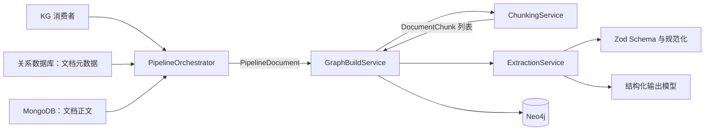
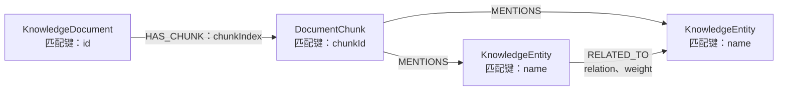
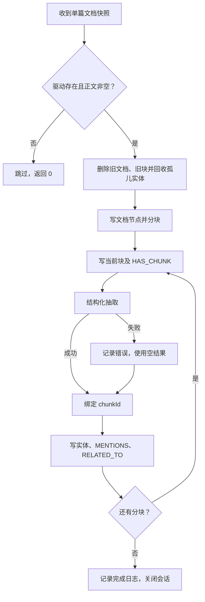

本页位于“异步处理与知识索引”，聚焦知识图谱从文档片段到 Neo4j 的完整构建路径：**结构化抽取、实体规范化、来源关联、先清后建及孤儿实体回收**。理解该实现的关键是区分两类数据：文档与分块构成来源层，跨文档共享的实体与关系构成语义层；两层的身份规则和清理粒度并不相同。Sources: [graph-build.service.ts](src/pipeline/graph-build.service.ts#L111-L128) [graph-build.service.ts](src/pipeline/graph-build.service.ts#L1021-L1095)

## 1. 架构边界与调用链

`PipelineModule` 注册分块、抽取、建图及编排服务。KG 消费者将消息中的 `type`、`documentIds` 交给 `PipelineOrchestrator.handleKgBuild()`；编排器负责装配文档快照，`GraphBuildService` 负责建图和清理，`ExtractionService` 负责调用模型及规范化结果。**图写入不依赖向量嵌入结果**，但与向量索引复用同一个分块服务。Sources: [pipeline.module.ts](src/pipeline/pipeline.module.ts#L15-L38) [document-pipeline.consumer.ts](src/mq/document-pipeline.consumer.ts#L58-L65) [graph-build.service.ts](src/pipeline/graph-build.service.ts#L213-L277)

下图展示建图所需的模块交互；其中 `PipelineDocument` 是关系数据库元数据与 MongoDB 正文组合后的内部快照，而不是模型直接读取的数据库实体。Sources: [pipeline.orchestrator.ts](src/pipeline/pipeline.orchestrator.ts#L199-L227) [pipeline.types.ts](src/pipeline/types/pipeline.types.ts#L71-L92)

消息类型决定的是文档选择范围，而不只是构建动作。尤其需要区分：`BUILD_ALL` 明确筛选已发布文档；按 ID 构建的加载方法只筛选未删除文档，**并未额外限定发布状态**。此外，`BUILD_ALL` 是逐篇重建当前查询到的文档，不是先清空整个图数据库。Sources: [pipeline.orchestrator.ts](src/pipeline/pipeline.orchestrator.ts#L123-L150) [pipeline.orchestrator.ts](src/pipeline/pipeline.orchestrator.ts#L199-L227)

| 消息类型 | 处理方式 | 数据范围 |
|---|---|---|
| `BUILD_BY_DOC_IDS` | 加载指定文档后批量建图 | 指定 ID、`deleted=false` |
| `BUILD_ALL` | 加载全部已发布文档后批量建图 | `deleted=false` 且状态为 `Published` |
| `DELETE_BY_DOC_IDS` | 逐 ID 执行图清理 | 不要求先加载正文 |
| 其他类型或空结果 | 记录警告，不执行建图 | 无 |

Sources: [pipeline.orchestrator.ts](src/pipeline/pipeline.orchestrator.ts#L128-L150) [pipeline.orchestrator.ts](src/pipeline/pipeline.orchestrator.ts#L199-L227)

## 2. 抽取契约：结构约束与语义容错分离

### 2.1 模型输入与片段上下文

每次抽取以一个分块为单位，输入包括文档标题、章节标题和 `content.slice(0, 4000)`。这里的 4000 是 JavaScript 字符串切片边界，**不是 token 预算**。空白内容直接返回空实体与空关系，不调用模型；非空内容若没有配置模型密钥，则抛出明确错误。Sources: [extraction.service.ts](src/pipeline/extraction.service.ts#L79-L115)

分块内容可能已经补充章节标题前缀：`ChunkingService` 从 Markdown 标题推断并继承当前章节，在后续不含标题的块前补上章节名称。因此模型同时获得独立的章节字段和具有章节上下文的正文。具体切分算法可继续阅读[文档分块与向量化：上下文组织、批量嵌入与索引重建](18-wen-dang-fen-kuai-yu-xiang-liang-hua-shang-xia-wen-zu-zhi-pi-liang-qian-ru-yu-suo-yin-zhong-jian)。Sources: [chunking.service.ts](src/pipeline/chunking.service.ts#L88-L124) [extraction.service.ts](src/pipeline/extraction.service.ts#L105-L115)

### 2.2 Schema 为什么不直接使用类型枚举

模型通过 `withStructuredOutput(kgExtractionResultSchema)` 输出包含 `entities`、`relations` 的对象。Schema 要求名称、端点等基础结构，但实体类型和关系类型采用字符串，而不是枚举：实现将“结构是否可解析”和“类型是否属于领域词表”分开处理，避免模型返回额外类型时整块抽取因枚举校验失败而丢失。Sources: [extraction.service.ts](src/pipeline/extraction.service.ts#L57-L70) [kg-extraction.schema.ts](src/pipeline/kg-extraction.schema.ts#L60-L85)

| 对象 | 必需字段 | 可选字段 | 规范化行为 |
|---|---|---|---|
| 实体 | `name` | `type`、`description`、`aliases` | 去除名称首尾空白；未知类型归入 `CONCEPT` |
| 关系 | `source`、`target` | `relation`、兼容字段 `type`、`weight` | 优先读取 `relation`；未知类型归入 `RELATED_TO` |
| 置信度 | 无 | `weight` | Schema 限定为 0～1，缺省时补 `0.5` |

Sources: [kg-extraction.schema.ts](src/pipeline/kg-extraction.schema.ts#L45-L85) [extraction.service.ts](src/pipeline/extraction.service.ts#L123-L154)

实体词表包含 `PERSON`、`ORGANIZATION`、`CONCEPT`、`DOCUMENT`、`PROCESS`、`PRODUCT`、`LOCATION`、`TIME`、`POLICY`、`RESOURCE`。关系词表包含组成、归属、定义、依赖、使用、负责、参与、位置、时间、因果、冲突及通用关联；规范化仅执行首尾去空白和转大写，**不会把中文类型名称翻译为对应英文类型**。Sources: [kg-extraction.schema.ts](src/pipeline/kg-extraction.schema.ts#L8-L58)

### 2.3 提示词约束与代码硬约束

提示词要求只抽取明确出现的有意义实体，排除过于泛化的词，并要求关系在同句或相邻句中有依据。不过，代码后处理直接验证的是名称、数量和端点闭包，并没有再次核验关系对应的原文证据。因此“有文本依据”属于模型任务约束，不能视为独立证据校验器已经验证过的事实。Sources: [kg-extraction.schema.ts](src/pipeline/kg-extraction.schema.ts#L94-L102) [extraction.service.ts](src/pipeline/extraction.service.ts#L123-L154)

后处理先截取实体数组，再清理名称并建立名称集合；随后先截取关系数组，再删除起点或终点不在集合中的关系。**截断发生在过滤之前**，所以前部空实体或无效关系不会由后部条目补足。名称集合用于端点检查，实体结果数组本身没有去重；别名也不会被加入端点集合。Sources: [extraction.service.ts](src/pipeline/extraction.service.ts#L123-L154)

## 3. 图模型：来源层与共享语义层

图中的三类节点分别以文档 ID、分块 ID 和实体名称匹配。实体间统一使用 Neo4j 关系类型 `RELATED_TO`，业务语义放在边属性 `relation` 中，例如 `USES`、`REQUIRES` 或 `RESPONSIBLE_FOR`。**不要将边的物理类型与语义属性混为一谈**。Sources: [graph-build.service.ts](src/pipeline/graph-build.service.ts#L188-L197) [graph-build.service.ts](src/pipeline/graph-build.service.ts#L233-L246) [graph-build.service.ts](src/pipeline/graph-build.service.ts#L1048-L1095)

下图描述实际持久化结构；`MENTIONS` 能定位“哪个块提到了实体”，但实体间关系没有直接指向来源块的边或属性。Sources: [graph-build.service.ts](src/pipeline/graph-build.service.ts#L1068-L1095)

| 图元素 | 匹配规则 | 写入与更新策略 |
|---|---|---|
| `KnowledgeDocument` | `MERGE {id}` | 刷新标题、摘要、分类、状态、标签及可见性字段 |
| `DocumentChunk` | `MERGE {chunkId}` | 保存正文、章节、顺序及总块数 |
| `KnowledgeEntity` | `MERGE {name}` | 跨文档共享同名实体；更新类型及非空描述 |
| `MENTIONS` | 当前块 → 实体 | 同一块与实体之间通过 `MERGE` 复用 |
| `RELATED_TO` | 有向端点对 | 创建时设置语义类型；再次命中时只更新权重 |

Sources: [graph-build.service.ts](src/pipeline/graph-build.service.ts#L188-L209) [graph-build.service.ts](src/pipeline/graph-build.service.ts#L233-L255) [graph-build.service.ts](src/pipeline/graph-build.service.ts#L1048-L1095)

### 3.1 实体身份不是实体消歧

实体按清理后的 `name` 合并，而不是按“名称 + 类型”或“名称 + 文档”合并。别名仅在节点创建时写入，命中现有节点时不会合并新别名；类型可以被后续抽取更新，非空描述也可以覆盖旧描述。因此当前实现提供的是**同名复用**，不是基于别名、上下文或类型的实体消歧。Sources: [extraction.service.ts](src/pipeline/extraction.service.ts#L127-L136) [graph-build.service.ts](src/pipeline/graph-build.service.ts#L1048-L1064)

### 3.2 同端点关系不会按语义类型分别存储

关系的 `MERGE` 模式不包含 `relation` 属性。同一有向端点对先后抽到 `USES` 和 `REQUIRES` 时，写入逻辑会复用已有 `RELATED_TO` 边：保留最初写入的 `relation`，并更新 `weight`，而不是创建两种独立语义关系。权重也没有取最大值或累计的逻辑。Sources: [graph-build.service.ts](src/pipeline/graph-build.service.ts#L1080-L1095)

## 4. 单篇重建：顺序执行，但不是原子替换

单篇构建先判断驱动是否可用、正文是否为空，然后清理旧图，再写文档节点、分块节点及抽取结果。块循环与批量文档循环均使用顺序 `await`；每个块先写入节点和 `HAS_CHUNK`，再调用模型。因此抽取失败时，块正文仍可保留在图中，只是该块没有此次抽取产生的实体引用。Sources: [graph-build.service.ts](src/pipeline/graph-build.service.ts#L172-L185) [graph-build.service.ts](src/pipeline/graph-build.service.ts#L231-L301)

以下流程特别区分“模型抽取失败”和“图写入失败”：只有抽取调用处具备单块降级逻辑，不能把所有块级错误都理解为会被忽略。Sources: [graph-build.service.ts](src/pipeline/graph-build.service.ts#L259-L299)

实现使用多次独立的 `session.run()`，没有将清理和重建包裹在一个整体事务中，也没有版本切换节点。由此可见，**先清后建是全量替换策略，不是原子替换保证**：旧图清理后，新图尚未完成；后续写入失败时，已完成的语句不会由该方法统一回滚。Sources: [graph-build.service.ts](src/pipeline/graph-build.service.ts#L182-L211) [graph-build.service.ts](src/pipeline/graph-build.service.ts#L231-L288) [graph-build.service.ts](src/pipeline/graph-build.service.ts#L344-L374)

构建返回值 `totalEntities` 是各块实体写入处理次数的累计值，不是新增节点数或全库去重实体数。同名实体在多个块中出现会重复计数；已有节点被 `MERGE` 命中也会增加计数。Sources: [graph-build.service.ts](src/pipeline/graph-build.service.ts#L274-L285) [graph-build.service.ts](src/pipeline/graph-build.service.ts#L1045-L1066)

## 5. 删除与回收：文档级清理的真实边界

`deleteForDocument()` 首先按 ID 匹配文档，通过 `HAS_CHUNK` 找到所属块，执行 `DETACH DELETE c, d`；随后执行**全库范围**的孤儿实体清理，删除任何没有入向 `MENTIONS` 的 `KnowledgeEntity`。孤儿判断不要求实体没有其他关系：即使仍连接 `RELATED_TO`，只要无人提及，也会被连同这些关系一起删除。Sources: [graph-build.service.ts](src/pipeline/graph-build.service.ts#L341-L374)

共享实体因此可以跨文档保留：删除一篇文档的块后，只要其他块仍提及同名实体，该实体就不是孤儿。但这也限定了语义关系的清理能力：**如果一条关系的两个端点都仍被其他文档引用，该关系不会仅因原始来源文档被删除而移除**。原因是关系未保存来源标识，清理过程也没有按来源删除关系的步骤。Sources: [graph-build.service.ts](src/pipeline/graph-build.service.ts#L348-L369) [graph-build.service.ts](src/pipeline/graph-build.service.ts#L1080-L1095)

还应注意，正文为空时的提前返回发生在旧图清理之前。因此直接用空正文调用 `buildForDocument()` 不会清除旧图；需要删除语义时，应进入显式的删除路径。类似地，文档节点虽然使用 `coalesce(d.createdAt, $now)`，但普通重建会先删除该节点，所以不能据此认为 `createdAt` 始终保留首次入图时间。Sources: [graph-build.service.ts](src/pipeline/graph-build.service.ts#L172-L197) [pipeline.orchestrator.ts](src/pipeline/pipeline.orchestrator.ts#L128-L134)

## 6. 运行参数与故障定位

### 6.1 抽取与图连接参数

模型配置具有兼容回退链，Neo4j 则在模块初始化阶段验证连接。`NEO4J_ENABLED` 仅在配置值等于字符串 `'false'` 时禁用；连接验证失败后驱动被关闭并置空，该初始化方法没有自动重连循环。Sources: [extraction.service.ts](src/pipeline/extraction.service.ts#L35-L70) [graph-build.service.ts](src/pipeline/graph-build.service.ts#L136-L165)

| 参数 | 默认值或查找顺序 | 对构建的影响 |
|---|---|---|
| 模型密钥 | `OPENAI_API_KEY` → `LLM_API_KEY` → `DASHSCOPE_API_KEY` | 缺失时，非空块抽取报错 |
| 模型地址 | `OPENAI_BASE_URL` → `LLM_BASE_URL` → DashScope 兼容地址 | 设置模型调用入口 |
| 模型名称 | `MODEL_NAME` → `LLM_MODEL` → `qwen-plus` | 选择抽取模型 |
| `KG_MAX_ENTITIES` | `12` | 提示词与后处理的单块实体上限 |
| `KG_MAX_RELATIONS` | `15` | 提示词与后处理的单块关系上限 |
| `KG_LLM_TIMEOUT_MS` | `60000` | 非有限值或非正数回退至 60000 毫秒 |
| `NEO4J_ENABLED` | `'true'` | 控制是否初始化驱动 |
| `NEO4J_URI` | `bolt://localhost:7687` | 图数据库地址 |
| `NEO4J_USER` / `NEO4J_PASSWORD` | `neo4j` / `password` | 图数据库认证 |

Sources: [extraction.service.ts](src/pipeline/extraction.service.ts#L35-L70) [graph-build.service.ts](src/pipeline/graph-build.service.ts#L136-L160)

模型固定使用温度 `0.1`、`maxRetries: 0`，并关闭 Responses API。实体和关系上限只经过 `Number()` 转换，没有像超时时间一样校验有限性和正值；修改配置时，应将合法数值视为部署前提，而不是依赖服务自动纠正。Sources: [extraction.service.ts](src/pipeline/extraction.service.ts#L41-L65)

### 6.2 故障语义速查

| 现象或错误 | 当前处理 | 排查重点 |
|---|---|---|
| 无驱动或初始化连接失败 | 构建返回 `0`，不执行清理 | 检查禁用配置、连接日志与认证 |
| 正文为空 | 返回 `0`，保留旧图 | 检查正文加载结果，区分跳过与删除 |
| 单块模型调用失败 | 记录错误，空结果继续 | 检查密钥、超时、模型调用错误 |
| Neo4j 写入失败 | 当前文档构建中断；批量入口记录后继续下一篇 | 检查是否只写入了部分块 |
| 日志中的实体数偏大 | 同名实体、已有节点都会计数 | 不要将返回值当作新增节点指标 |
| 删除后仍存在实体关系 | 两端实体可能仍被其他块引用 | 检查 `MENTIONS` 与关系来源粒度 |

Sources: [graph-build.service.ts](src/pipeline/graph-build.service.ts#L172-L185) [graph-build.service.ts](src/pipeline/graph-build.service.ts#L259-L301) [graph-build.service.ts](src/pipeline/graph-build.service.ts#L344-L374) [graph-build.service.ts](src/pipeline/graph-build.service.ts#L1045-L1098)

## 7. 验证构建结果与后续阅读

验证时应分别检查来源层和语义层，而不是只看“构建完成”日志：先确认文档及块是否落图，再确认实体及关系。现有图控制器提供 `GET graph/search`、`GET graph/nodes`、`GET graph/edges` 和 `GET graph/overview`，均向服务传递当前用户的访问范围；因此某个调用者看不到节点，不等价于该节点未写入。权限细节见[团队协作与文档可见性：业务读取、全文检索和图谱查询的权限一致性](11-tuan-dui-xie-zuo-yu-wen-dang-ke-jian-xing-ye-wu-du-qu-quan-wen-jian-suo-he-tu-pu-cha-xun-de-quan-xian-zhi-xing)。Sources: [graph.controller.ts](src/graph/graph.controller.ts#L14-L56) [graph-build.service.ts](src/pipeline/graph-build.service.ts#L388-L402)

后续若需要追踪建图消息的发布与消费边界，阅读[消息驱动的知识管线：任务发布、队列消费与异常处理边界](17-xiao-xi-qu-dong-de-zhi-shi-guan-xian-ren-wu-fa-bu-dui-lie-xiao-fei-yu-yi-chang-chu-li-bian-jie)；若需要理解图清理和其他索引如何协同，阅读[跨索引同步：发布重建、删除清理与可见性更新](21-kua-suo-yin-tong-bu-fa-bu-zhong-jian-shan-chu-qing-li-yu-ke-jian-xing-geng-xin)。本页最重要的实现边界是：**实体提及可追溯到块，语义关系尚不具备逐来源生命周期；构建成功日志也不代表所有块抽取成功或整篇原子提交。**Sources: [document-pipeline.consumer.ts](src/mq/document-pipeline.consumer.ts#L58-L65) [pipeline.orchestrator.ts](src/pipeline/pipeline.orchestrator.ts#L78-L95) [graph-build.service.ts](src/pipeline/graph-build.service.ts#L259-L288) [graph-build.service.ts](src/pipeline/graph-build.service.ts#L1068-L1095)