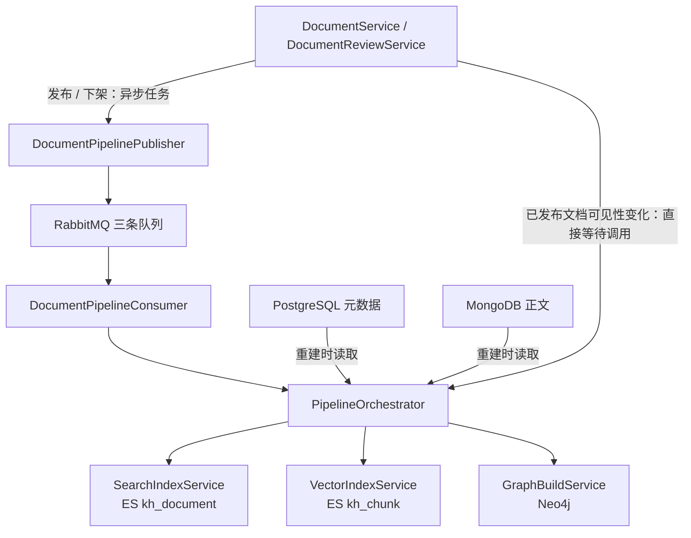

文档的发布状态保存在业务库，但检索能力分布在 Elasticsearch `kh_document`、Elasticsearch `kh_chunk` 与 Neo4j 三套派生数据中。本页聚焦它们如何随业务变更同步：**发布触发异步重建，下架触发异步清理，可见性变化走请求内的轻量更新**。理解这一分工的关键，是区分“业务保存成功”“消息投递成功”和“索引实际更新成功”，三者在当前实现中不是同一个完成条件。Sources: [document.service.ts](src/document/document.service.ts#L475-L480) [document-pipeline.publisher.ts](src/mq/document-pipeline.publisher.ts#L22-L50) [pipeline.orchestrator.ts](src/pipeline/pipeline.orchestrator.ts#L78-L96)

## 1. 架构模型：两条同步路径，而非统一事务

从调用关系看，需要验证三个核心问题：索引是否读取发布时的快照，三套索引是否一起提交，以及权限变化是否必须重新计算知识内容。代码给出的答案分别是：**消费者按 ID 读取当前数据、三套目标独立执行、可见性单独更新**。`DocumentPipelinePublisher` 负责并行投递重建或删除消息；`PipelineOrchestrator` 负责加载业务数据并调用三个索引服务，而可见性更新直接由业务服务调用编排器，不经过消息队列。Sources: [document-pipeline.publisher.ts](src/mq/document-pipeline.publisher.ts#L34-L50) [document-pipeline.consumer.ts](src/mq/document-pipeline.consumer.ts#L40-L65) [pipeline.orchestrator.ts](src/pipeline/pipeline.orchestrator.ts#L82-L118) [document.service.ts](src/document/document.service.ts#L652-L681)

下图将异步内容同步与请求内权限同步分开表示。图中的并行分支表示独立调用，不表示三个存储之间存在原子提交。Sources: [document-pipeline.publisher.ts](src/mq/document-pipeline.publisher.ts#L34-L50) [pipeline.orchestrator.ts](src/pipeline/pipeline.orchestrator.ts#L82-L95)

| 同步路径 | 触发入口 | 工作内容 | 返回所代表的完成边界 |
|---|---|---|---|
| 发布重建 | `afterPublish` | 并行投递 RAG、Search、KG 任务 | 投递调用结束，不等待索引构建 |
| 下架清理 | `afterUnpublish` | 并行投递三套删除任务 | 投递调用结束，不等待目标删除 |
| 可见性更新 | `updateVisibility` | 并行更新三套索引的权限字段 | 等待更新方法返回，但内部错误可能只记录日志 |

Sources: [document-pipeline.publisher.ts](src/mq/document-pipeline.publisher.ts#L34-L50) [pipeline.orchestrator.ts](src/pipeline/pipeline.orchestrator.ts#L82-L95) [search-index.service.ts](src/pipeline/search-index.service.ts#L85-L114) [vector-index.service.ts](src/pipeline/vector-index.service.ts#L68-L103) [graph-build.service.ts](src/pipeline/graph-build.service.ts#L303-L339)

## 2. 业务变更如何选择同步动作

`syncPipelineAfterUpdate` 是更新操作的分流点，其判断具有明确优先级：先处理离开已发布状态，再处理免审模式下的正文变更，最后处理仍为已发布状态的可见性变化。前两个分支都会提前返回，因此**正文与权限同时变化时，免审模式选择完整重建，而不是额外执行一次可见性补丁**。Sources: [document.service.ts](src/document/document.service.ts#L652-L681)

| 业务场景 | 同步动作 | 实现中的关键条件 |
|---|---|---|
| 免审创建即发布、直接发布 | 三套索引重建 | 保存 `Published` 后调用 `safePublish` |
| 审核通过 | 三套索引重建 | 保存审核结果与发布状态后投递 |
| 已发布文档重新提审 | 三套索引清理 | 保存 `PendingReview` 后清理旧索引 |
| 归档、保存为草稿 | 三套索引清理 | 保存新状态后调用 `safeUnpublish` |
| 删除已发布文档 | 三套索引清理 | 先调用清理投递，再软删除业务数据 |
| 删除草稿、待审或归档文档 | 不投递清理 | 删除分支只对 `Published` 投递 |
| 已发布文档修改正文，免审 | 三套索引重建 | `contentChanged && !isRequireApproval()` |
| 已发布文档修改正文，需审 | 不立即重建 | 若同时修改可见性，仍执行权限同步 |
| 已发布文档仅修改公开性或团队 | 三套索引轻量更新 | 不受是否开启审核影响 |

Sources: [document.service.ts](src/document/document.service.ts#L150-L154) [document.service.ts](src/document/document.service.ts#L475-L555) [document.service.ts](src/document/document.service.ts#L652-L681) [document-review.service.ts](src/document/document-review.service.ts#L72-L115)

这里的“内容变更”有严格的代码含义：`contentChanged` 仅在请求携带 `dto.content` 时设为 `true`；可见性变化仅比较保存前后的 `isPublic` 和归一化后的 `teamId`。因此，**只改标题、摘要、分类或标签，不会通过这个分流器触发重建**，不能将“更新了文档元数据”理解为“所有索引已刷新”。Sources: [document.service.ts](src/document/document.service.ts#L312-L319) [document.service.ts](src/document/document.service.ts#L383-L410) [document.service.ts](src/document/document.service.ts#L652-L681)

## 3. 发布重建：以业务 ID 重新生成派生数据

发布消息主要携带 `taskId`、操作类型和文档 ID，而不是正文快照。消费者处理时，编排器按 ID 查询未删除的 PostgreSQL 文档，再通过 `contentId` 读取未删除的 MongoDB 正文。由此，重建使用的是**消费时读取到的业务数据**，而不是消息投递时固定的内容版本。Sources: [document-pipeline.publisher.ts](src/mq/document-pipeline.publisher.ts#L52-L63) [document-pipeline.publisher.ts](src/mq/document-pipeline.publisher.ts#L78-L92) [document-pipeline.publisher.ts](src/mq/document-pipeline.publisher.ts#L107-L118) [pipeline.orchestrator.ts](src/pipeline/pipeline.orchestrator.ts#L199-L213)

| 目标 | 发布消息类型 | 重建策略 | 覆盖或清理单位 |
|---|---|---|---|
| ES `kh_document` | `INDEX` | 合并元数据与全文，以业务 ID 写入整条记录 | 单篇文档 |
| ES `kh_chunk` | `BY_DOC_IDS` | 删除旧块 → 分块 → 批量嵌入 → 批量写入 | `document_id` 对应的全部块 |
| Neo4j | `BUILD_BY_DOC_IDS` | 删除旧文档图数据 → 重建文档、块及实体关系 | 文档及其关联图结构 |

Sources: [pipeline.orchestrator.ts](src/pipeline/pipeline.orchestrator.ts#L103-L149) [pipeline.orchestrator.ts](src/pipeline/pipeline.orchestrator.ts#L152-L186) [search-index.service.ts](src/pipeline/search-index.service.ts#L60-L83) [graph-build.service.ts](src/pipeline/graph-build.service.ts#L111-L126) [graph-build.service.ts](src/pipeline/graph-build.service.ts#L172-L197)

这三种策略只能在各自目标内减少重复数据，并不构成跨索引原子替换。尤其是 RAG 与 KG 的“先清再建”：删除旧数据与生成新数据之间没有统一提交点；RAG 的嵌入或写入失败后，不会在该方法内恢复被删除的旧块。另外，两条路径都在清理之前检查空正文，空内容会直接跳过，**不会借重建动作清除既有数据**。Sources: [pipeline.orchestrator.ts](src/pipeline/pipeline.orchestrator.ts#L152-L186) [graph-build.service.ts](src/pipeline/graph-build.service.ts#L172-L185)

加载条件还有一个重要差异：按 ID 重建只检查 `deleted: false`，并不要求状态为 `Published`；只有 KG 的 `BUILD_ALL` 加载逻辑显式限制已发布状态。当前按 ID 重建处理器因此没有“消费时重新确认仍为已发布”的统一守卫，分析发布与下架交错时不能假定存在这一保护。Sources: [pipeline.orchestrator.ts](src/pipeline/pipeline.orchestrator.ts#L128-L141) [pipeline.orchestrator.ts](src/pipeline/pipeline.orchestrator.ts#L199-L227)

## 4. 删除清理：相同业务键，不同存储语义

下架消息不需要重新加载正文：Search 直接按文档 ID 删除；RAG 与 KG 对传入 ID 列表逐个执行删除。归档、退回草稿和重新提审通常先保存业务状态再投递清理，而已发布文档的软删除则先调用清理投递，再更新 PostgreSQL 与 MongoDB 的删除标记。它们都不等待三套索引实际完成清理。Sources: [pipeline.orchestrator.ts](src/pipeline/pipeline.orchestrator.ts#L52-L58) [pipeline.orchestrator.ts](src/pipeline/pipeline.orchestrator.ts#L103-L106) [pipeline.orchestrator.ts](src/pipeline/pipeline.orchestrator.ts#L128-L134) [document.service.ts](src/document/document.service.ts#L499-L555) [document-review.service.ts](src/document/document-review.service.ts#L81-L87)

| 目标 | 删除方式 | 容错或清理边界 |
|---|---|---|
| ES `kh_document` | `delete(id=documentId)`，`refresh: true` | 按错误消息中的 `404` 忽略不存在情况；其他错误记录警告 |
| ES `kh_chunk` | `deleteByQuery(document_id)`，`refresh: true` | 忽略索引不存在错误；其他删除错误记录日志 |
| Neo4j | 删除文档与下属块，再删除无 `MENTIONS` 引用的实体 | 两次独立 `session.run`；没有包成一次显式事务 |

Sources: [search-index.service.ts](src/pipeline/search-index.service.ts#L116-L139) [vector-index.service.ts](src/pipeline/vector-index.service.ts#L105-L133) [graph-build.service.ts](src/pipeline/graph-build.service.ts#L341-L374)

Neo4j 的清理不是“删除该文档涉及的所有实体”。它先 `DETACH DELETE` 文档及其块，再全局查找没有任何块通过 `MENTIONS` 引用的孤儿实体。仍被其他文档引用的实体会保留；孤儿实体上的关系则随节点删除一起清除。因此，这段实现的清理边界是**文档与块，以及失去全部引用的实体**，而不是对每条共享实体关系执行逐文档来源撤销。Sources: [graph-build.service.ts](src/pipeline/graph-build.service.ts#L348-L370)

## 5. 可见性更新：不重算知识，只修改访问元数据

已发布文档保存后，只要 `isPublic` 或 `teamId` 改变，且没有先命中下架或免审正文重建分支，就会直接调用 `PipelineOrchestrator.updateVisibility`。编排器将 `isPublic` 默认化为 `false`，将缺失的 `teamId`、`authorId` 转为 `null`，再并行更新三套目标；这一过程不重新分块、不计算 embedding，也不重新抽取实体。Sources: [document.service.ts](src/document/document.service.ts#L396-L410) [document.service.ts](src/document/document.service.ts#L652-L681) [pipeline.orchestrator.ts](src/pipeline/pipeline.orchestrator.ts#L78-L95)

| 目标 | 定位方式 | 更新字段 | 是否补建缺失数据 |
|---|---|---|---|
| ES `kh_document` | 文档 `_id` | `isPublic`、`teamId`、`authorId` | 未配置 upsert |
| ES `kh_chunk` | `document_id` 查询全部块 | `is_public`、`team_id`、`author_id` | 仅更新匹配块 |
| Neo4j | `MATCH KnowledgeDocument {id}` | `isPublic`、`teamId`、`authorId`、`updatedAt` | 使用 `MATCH`，不创建节点 |

Sources: [search-index.service.ts](src/pipeline/search-index.service.ts#L85-L114) [vector-index.service.ts](src/pipeline/vector-index.service.ts#L68-L103) [graph-build.service.ts](src/pipeline/graph-build.service.ts#L303-L339)

**轻量更新不是索引修复操作。** 如果完整索引从未建立，权限补丁不会生成正文记录、向量块或图谱节点；如果目标不可用或更新失败，三个服务也主要采取跳过或记录警告的方式。因此，“立刻刷可见性”准确地说是请求内立即尝试同步，而不是三套索引权限原子生效的保证。Sources: [search-index.service.ts](src/pipeline/search-index.service.ts#L90-L113) [vector-index.service.ts](src/pipeline/vector-index.service.ts#L73-L102) [graph-build.service.ts](src/pipeline/graph-build.service.ts#L308-L338)

## 6. 一致性与故障边界

当前实现采用的是**业务状态优先、派生索引尽力同步**。发布与清理投递外层均有异常捕获，不因投递失败回滚业务状态；生产者也没有将三个目标的结果汇总为一份索引完成状态。因此，业务接口成功不能作为三套索引一致的证明。Sources: [document.service.ts](src/document/document.service.ts#L705-L733) [document-review.service.ts](src/document/document-review.service.ts#L220-L239) [document-pipeline.publisher.ts](src/mq/document-pipeline.publisher.ts#L34-L50)

消息确认同样只反映处理函数是否抛错：RabbitMQ 包装层在处理函数返回后 `ack`，异常时执行 `nack(msg, false, false)`，不重新入队。但 RAG 单篇重建和 KG 批量构建都会捕获单篇异常；多个底层删除、可见性更新方法也会吞掉错误。因此，**已确认消费并不等于全部索引写入成功**。Sources: [rabbitmq.service.ts](src/mq/rabbitmq.service.ts#L198-L210) [pipeline.orchestrator.ts](src/pipeline/pipeline.orchestrator.ts#L68-L75) [graph-build.service.ts](src/pipeline/graph-build.service.ts#L291-L300) [vector-index.service.ts](src/pipeline/vector-index.service.ts#L123-L132)

| 排查现象 | 优先核对的代码边界 |
|---|---|
| 已发布，但只有部分检索能力可用 | 三套消息独立投递；逐目标核对消费和写入日志 |
| 标题、摘要或分类仍显示旧值 | 这些字段单独变化不会触发更新分流器中的完整重建 |
| 可见性修改成功，但目标记录不存在 | 权限补丁没有补建语义，应先确认该目标曾完成重建 |
| RAG 重建后块缺失或仅部分存在 | 旧块先删除；bulk 部分失败会抛错，但单篇异常由上层记录 |
| 下架后仍存在派生数据 | 清理异步执行，且部分删除失败只记录日志；非发布状态软删除不再次投递清理 |
| 发布、下架交错后的状态不符合预期 | 按 ID 重建没有发布状态守卫，也没有消息版本比较 |

Sources: [document-pipeline.publisher.ts](src/mq/document-pipeline.publisher.ts#L34-L50) [document.service.ts](src/document/document.service.ts#L544-L546) [document.service.ts](src/document/document.service.ts#L652-L681) [pipeline.orchestrator.ts](src/pipeline/pipeline.orchestrator.ts#L152-L183) [pipeline.orchestrator.ts](src/pipeline/pipeline.orchestrator.ts#L199-L213) [vector-index.service.ts](src/pipeline/vector-index.service.ts#L153-L166)

定位问题时，应以 **`documentId` 作为跨目标关联键**，再使用各分支的 `taskId` 定位具体消息。三个发布分支分别生成 UUID，而不是共享一个全局任务 ID；消费者日志输出这些标识，但调用编排器时只传操作类型和文档 ID，没有将 `taskId` 用作执行去重或版本判定参数。Sources: [document-pipeline.publisher.ts](src/mq/document-pipeline.publisher.ts#L52-L58) [document-pipeline.publisher.ts](src/mq/document-pipeline.publisher.ts#L82-L87) [document-pipeline.publisher.ts](src/mq/document-pipeline.publisher.ts#L108-L113) [document-pipeline.consumer.ts](src/mq/document-pipeline.consumer.ts#L40-L65)

## 7. 延伸阅读

若需要继续追踪同步链路，先阅读[消息驱动的知识管线：任务发布、队列消费与异常处理边界](17-xiao-xi-qu-dong-de-zhi-shi-guan-xian-ren-wu-fa-bu-dui-lie-xiao-fei-yu-yi-chang-chu-li-bian-jie)，了解投递与消费边界；若关注权限补丁为何采用这些字段，再阅读[团队协作与文档可见性：业务读取、全文检索和图谱查询的权限一致性](11-tuan-dui-xie-zuo-yu-wen-dang-ke-jian-xing-ye-wu-du-qu-he-quan-wen-jian-suo-he-tu-pu-cha-xun-de-quan-xian-zhi-xing)。本页对应的实现衔接点分别是消费者调用编排器，以及三个索引服务的可见性更新方法。Sources: [document-pipeline.consumer.ts](src/mq/document-pipeline.consumer.ts#L40-L65) [pipeline.orchestrator.ts](src/pipeline/pipeline.orchestrator.ts#L82-L95)