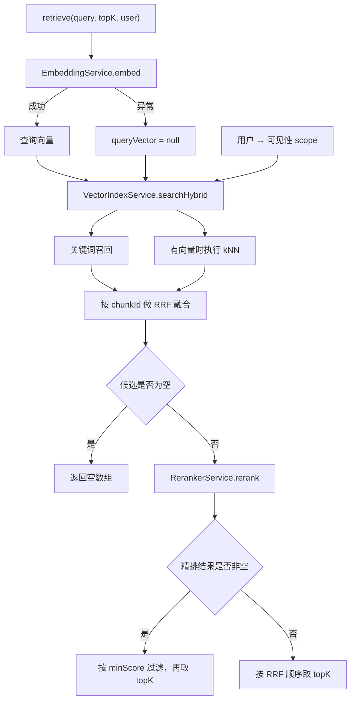

本页位于“智能检索与对话”的检索基础层，解释一次 `HybridRetrievalService.retrieve(query, topK, user)` 如何完成**查询向量化 → 双路召回 → RRF 粗排 → 模型精排 → 阈值过滤**。核心边界是：召回与融合面向 Elasticsearch 的分块索引 `kh_chunk`，而不是文档级全文搜索使用的 `kh_document`；检索后的切题评估与查询改写则属于上层编排。Sources: [hybrid-retrieval.service.ts](src/ai/hybrid-retrieval.service.ts#L10-L66) [vector-index.service.ts](src/pipeline/vector-index.service.ts#L13-L19) [search-index.service.ts](src/pipeline/search-index.service.ts#L10-L20) [agentic-retrieve.ts](src/ai/agentic-retrieve.ts#L76-L85)

## 1. 架构：串行准备、并行召回、分阶段排序

`HybridRetrievalService` 负责流程控制、权限作用域、最终过滤与截断；`VectorIndexService` 负责关键词查询、kNN 查询及本地 RRF 融合；`RerankerService` 负责调用外部文本精排接口。**并行发生在两路 ES 查询之间，而不是向量化与关键词查询之间**：入口先等待嵌入成功或失败，再调用 `searchHybrid()`，后者通过 `Promise.all()` 发起召回。Sources: [hybrid-retrieval.service.ts](src/ai/hybrid-retrieval.service.ts#L22-L44) [vector-index.service.ts](src/pipeline/vector-index.service.ts#L269-L295) [reranker.service.ts](src/ai/reranker.service.ts#L53-L80)

下图同时展示服务交互和失败分支；其中“精排不可用”意味着保留 RRF 顺序，并不意味着终止检索。Sources: [hybrid-retrieval.service.ts](src/ai/hybrid-retrieval.service.ts#L33-L75) [vector-index.service.ts](src/pipeline/vector-index.service.ts#L273-L295)

Sources: [hybrid-retrieval.service.ts](src/ai/hybrid-retrieval.service.ts#L33-L75) [vector-index.service.ts](src/pipeline/vector-index.service.ts#L273-L295)

## 2. 双路召回：同一分块索引，不同相关性信号

两路召回都返回 `ChunkHit[]`，包含块标识、文档标识、标题、正文、章节标题和当前得分。关键词路径使用 `multi_match`，向量路径使用 `embedding` 字段上的 kNN；二者读取相同的正文与元数据，因此融合后可以直接交给同一精排服务。Sources: [pipeline.types.ts](src/pipeline/types/pipeline.types.ts#L34-L45) [vector-index.service.ts](src/pipeline/vector-index.service.ts#L193-L214) [vector-index.service.ts](src/pipeline/vector-index.service.ts#L242-L261)

| 维度 | 关键词召回 | 向量召回 |
|---|---|---|
| 查询入口 | `keywordSearch()` | `knnSearch()` |
| 索引 | `kh_chunk` | `kh_chunk` |
| 相关性输入 | 去除首尾空白后的查询文本 | 查询向量 |
| 匹配字段 | `document_title^2`、`content` | `embedding` |
| 分词或相似度 | 查询使用 `ik_smart` | mapping 使用 `cosine` |
| 每路返回量 | 钳制到 `[1, 50]` 的 `hybridTopK` | 同左 |
| 额外候选参数 | 无 | `num_candidates = max(k × 10, 50)` |
| 空输入行为 | 空白查询返回 `[]` | 空向量返回 `[]` |
| 查询异常行为 | 记录警告并返回 `[]` | 记录警告并返回 `[]` |

Sources: [vector-index.service.ts](src/pipeline/vector-index.service.ts#L172-L267) [vector-index.service.ts](src/pipeline/vector-index.service.ts#L297-L299) [vector-index.service.ts](src/pipeline/vector-index.service.ts#L404-L409)

关键词标题权重为正文的两倍，`heading` 虽然随命中返回，却不在关键词匹配字段中。索引创建时，标题与正文采用 `ik_max_word` 建索引、`ik_smart` 搜索；向量字段则是启用索引的 `dense_vector`。查询向量由同一个 `EmbeddingService` 生成，其单条 `embed()` 实际委托批量接口，并最终调用 `embedDocuments()`。Sources: [vector-index.service.ts](src/pipeline/vector-index.service.ts#L198-L212) [vector-index.service.ts](src/pipeline/vector-index.service.ts#L379-L409) [embedding.service.ts](src/pipeline/embedding.service.ts#L66-L78)

### 权限必须在召回阶段生效

入口把用户转换为 `DocumentAccessScope`，并将同一作用域传给两路召回。关键词查询把可见性条件放入 `bool.filter`，kNN 查询把它放入 `knn.filter`；因此不可见块不会先占用候选名额、再在融合后被剔除。普通用户的条件是“公开 ∪ 作者本人 ∪ 所在团队”，管理员或审核员不附加该过滤。Sources: [hybrid-retrieval.service.ts](src/ai/hybrid-retrieval.service.ts#L33-L44) [vector-index.service.ts](src/pipeline/vector-index.service.ts#L188-L205) [vector-index.service.ts](src/pipeline/vector-index.service.ts#L237-L248) [document-access.ts](src/document/document-access.ts#L13-L20) [document-access.ts](src/document/document-access.ts#L54-L87)

未传用户时，入口仍传入受限作用域，而不是省略过滤；该作用域的用户标识为空、团队列表为空。需要区分这一入口行为与底层可选 `scope` 的行为：直接调用底层且不传 `scope` 时，不添加可见性过滤。此外，ES 过滤器不检查发布状态，代码明确依赖“未发布文档不进入索引”的前提。完整权限语义参见[团队协作与文档可见性：业务读取、全文检索和图谱查询的权限一致性](11-tuan-dui-xie-zuo-yu-wen-dang-ke-jian-xing-ye-wu-du-qu-quan-wen-jian-suo-he-tu-pu-cha-xun-de-quan-xian-zhi-xing)。Sources: [hybrid-retrieval.service.ts](src/ai/hybrid-retrieval.service.ts#L33-L44) [vector-index.service.ts](src/pipeline/vector-index.service.ts#L188-L191) [vector-index.service.ts](src/pipeline/vector-index.service.ts#L237-L240) [document-access.ts](src/document/document-access.ts#L59-L73)

## 3. RRF：融合排名，而非混加原始分数

实现采用等权的倒数排名融合。每一路先按自身原始 `score` 降序排列，排名从 1 开始；某个块在某路不存在，则不获得该路贡献。融合键是 **`chunkId`，不是 `documentId`**，因此同一文档的不同块仍可同时保留。Sources: [vector-index.service.ts](src/pipeline/vector-index.service.ts#L321-L358)

\[
S_{\mathrm{RRF}}(d)
=
\sum_{r\in\{\mathrm{keyword},\mathrm{vector}\},\,d\in r}
\frac{1}{C+\operatorname{rank}_{r}(d)}
\]

Sources: [vector-index.service.ts](src/pipeline/vector-index.service.ts#L321-L351)

默认 `C = 60`。按该公式计算，一个块若在两路均排名第 1，融合分为 `2/61 ≈ 0.03279`；另一个块即使在单路排名第 1，也只有 `1/61 ≈ 0.01639`。这里原始 BM25 分与向量分的绝对大小不会直接相加，只决定各自通道内的排名；实现另外保留 `bm25Score` 和 `vectorScore`，未命中通道记为 `0`。Sources: [hybrid-retrieval.service.ts](src/ai/hybrid-retrieval.service.ts#L28-L30) [vector-index.service.ts](src/pipeline/vector-index.service.ts#L332-L351)

**`RAG_HYBRID_TOP_K` 是每路召回上限，不是融合后上限。** 融合阶段返回两路候选的去重并集，没有再次截断：默认每路 20 个时，最多形成 40 个候选；正常钳制到每路 50 个时，最多形成 100 个候选。这些候选全部进入精排，最后才按调用方 `topK` 截断。Sources: [vector-index.service.ts](src/pipeline/vector-index.service.ts#L280-L298) [vector-index.service.ts](src/pipeline/vector-index.service.ts#L355-L358) [hybrid-retrieval.service.ts](src/ai/hybrid-retrieval.service.ts#L51-L65)

若两路长度分别为 \(K\)、\(V\)，去重后为 \(U\)，本地 RRF 的排序时间复杂度为 \(O(K\log K+V\log V+U\log U)\)，辅助空间为 \(O(K+V+U)\)：代码分别复制并排序两路数组，以 `Map` 聚合，再排序融合结果。该复杂度不包含 ES 查询和模型调用。Sources: [vector-index.service.ts](src/pipeline/vector-index.service.ts#L325-L358)

## 4. 精排：覆盖阶段得分，再执行质量门槛

精排请求为每个候选构造“文档标题 + 可选章节标题 + 正文”，执行 `trim()` 后，超过 2000 个 JavaScript 字符位置的文本截取前 2000 个并追加 `...`。这只限制发送给精排模型的文本，返回命中的原始 `content` 不被截短。请求使用 DashScope 文本精排协议，默认模型为 `qwen3-rerank`，并设置 `return_documents: false`。Sources: [reranker.service.ts](src/ai/reranker.service.ts#L37-L42) [reranker.service.ts](src/ai/reranker.service.ts#L64-L80) [reranker.service.ts](src/ai/reranker.service.ts#L98-L103) [reranker.service.ts](src/ai/reranker.service.ts#L116-L119)

响应支持 `output.results` 或顶层 `results`，通过结果中的 `index` 找回候选，并用 `relevance_score` 覆盖 `score`。代码仅过滤越界索引，**不再对响应结果本地排序**，而是保留服务返回顺序；候选原有的 `bm25Score`、`vectorScore` 继续保留，但 RRF 得分没有独立字段保存。Sources: [reranker.service.ts](src/ai/reranker.service.ts#L82-L108) [pipeline.types.ts](src/pipeline/types/pipeline.types.ts#L34-L45)

| 阶段 | `ChunkHit.score` 的含义 | 是否应用 `RAG_MIN_SCORE` |
|---|---|---|
| 原始召回 | ES `_score` | 否 |
| RRF 粗排 | 倒数排名贡献之和 | 否 |
| 成功精排 | 模型 `relevance_score` | 是，配置值大于 0 时 |
| 精排降级 | 保留 RRF 分 | 否 |

Sources: [vector-index.service.ts](src/pipeline/vector-index.service.ts#L301-L358) [reranker.service.ts](src/ai/reranker.service.ts#L98-L103) [hybrid-retrieval.service.ts](src/ai/hybrid-retrieval.service.ts#L51-L65)

默认阈值为 `0.4`，保留条件是 `score >= minScore`，随后才取 `topK`。**成功精排后全部低于阈值，会返回空数组，不会回退到 RRF 补足条数**；只有精排结果本身为空或不可用时才回退。这一区别把“模型判断不够相关”和“精排能力不可用”分成了两种不同语义。Sources: [hybrid-retrieval.service.ts](src/ai/hybrid-retrieval.service.ts#L28-L30) [hybrid-retrieval.service.ts](src/ai/hybrid-retrieval.service.ts#L51-L65)

## 5. 降级矩阵：保住可用通道，不承诺质量等价

降级以各阶段返回值为边界：嵌入失败转换为 `null`，单路 ES 查询失败转换为 `[]`，精排失败转换为 `null`。因此 `Promise.all()` 的常规查询失败由通道内部吸收，一路失败不会直接丢弃另一路；但两路共用 Elasticsearch，ES 不可用时没有额外的数据库检索后备路径。Sources: [hybrid-retrieval.service.ts](src/ai/hybrid-retrieval.service.ts#L68-L75) [vector-index.service.ts](src/pipeline/vector-index.service.ts#L176-L186) [vector-index.service.ts](src/pipeline/vector-index.service.ts#L215-L265) [vector-index.service.ts](src/pipeline/vector-index.service.ts#L283-L295)

| 情况 | 实际行为 | 最终结果 |
|---|---|---|
| 查询嵌入调用异常 | 记录“仅走关键词”，跳过 kNN | 关键词经 RRF 后仍可进入精排 |
| 关键词查询异常 | 关键词通道返回空数组 | 使用向量候选继续处理 |
| kNN 查询异常 | 向量通道返回空数组 | 使用关键词候选继续处理 |
| 两路均无命中 | 跳过精排 | 返回 `[]` |
| 精排关闭或无 Key | 精排返回 `null` | RRF 顺序取 `topK` |
| 精排 HTTP 失败、解析或调用异常 | 警告日志，返回 `null` | RRF 顺序取 `topK` |
| 精排响应无结果 | 返回 `null` | RRF 顺序取 `topK` |
| 精排索引全部越界 | 映射后为空数组 | RRF 顺序取 `topK` |
| 精排有效，但全部低于阈值 | 不补足、不回退 | 返回 `[]` |

Sources: [hybrid-retrieval.service.ts](src/ai/hybrid-retrieval.service.ts#L46-L75) [vector-index.service.ts](src/pipeline/vector-index.service.ts#L215-L295) [reranker.service.ts](src/ai/reranker.service.ts#L58-L113)

有两个运行边界不能误读。第一，查询嵌入的运行时异常可以降级，但 `EmbeddingService` 构造时如果三个候选 Key 都缺失，会直接抛错，不能据此认为“完全不配置嵌入服务也能启动关键词模式”。第二，精排 `fetch()` 没有显式传入超时或取消信号；捕获异常不等于为该请求提供了确定的超时上限。Sources: [embedding.service.ts](src/pipeline/embedding.service.ts#L37-L45) [hybrid-retrieval.service.ts](src/ai/hybrid-retrieval.service.ts#L68-L75) [reranker.service.ts](src/ai/reranker.service.ts#L65-L80)

## 6. 参数与定位顺序

以下参数分别控制召回广度、排名融合、精排能力和结果门槛。数值配置通过 `Number()` 转换；每路召回数量使用 `Math.min/Math.max` 钳制，未进行有限数校验，不应把该钳制视为完整的配置合法性检查。Sources: [hybrid-retrieval.service.ts](src/ai/hybrid-retrieval.service.ts#L28-L30) [vector-index.service.ts](src/pipeline/vector-index.service.ts#L280-L281) [vector-index.service.ts](src/pipeline/vector-index.service.ts#L297-L299)

| 参数 | 默认值 | 实现语义 |
|---|---|---|
| `RAG_HYBRID_TOP_K` | `20` | 每路召回数量，正常数值钳制至 `[1, 50]` |
| `RAG_RRF_C` | `60` | RRF 分母常数；底层非正值等情况回退为 `60` |
| `RAG_MIN_SCORE` | `0.4` | 仅过滤成功精排结果；值 `<= 0` 时跳过过滤 |
| `RAG_RERANK_ENABLED` | `'true'` | 仅字符串 `'false'` 关闭 |
| `RAG_RERANK_MODEL` | `qwen3-rerank` | 精排请求的模型名称 |
| `RERANK_API_KEY` | 无 | 优先于 `DASHSCOPE_API_KEY`，再回退 `OPENAI_API_KEY` |
| `RERANK_BASE_URL` | `https://dashscope.aliyuncs.com` | 拼接固定文本精排路径，不是完整 endpoint |
| `retrieve()` 的 `topK` | `5` | 最终返回截断值，与每路召回上限不同 |

Sources: [hybrid-retrieval.service.ts](src/ai/hybrid-retrieval.service.ts#L28-L65) [vector-index.service.ts](src/pipeline/vector-index.service.ts#L280-L298) [reranker.service.ts](src/ai/reranker.service.ts#L29-L47)

定位“为何无结果”时，先看 `混合检索 RRF` 日志中的 `keyword/vector/fused` 数量，再检查精排警告或 `Rerank 完成`，最后查看 `检索过滤` 的 `best/kept/return`。这能区分召回为空、精排不可用和阈值淘汰；但这些日志不记录逐候选排名轨迹，不能单独解释某一块的完整排名变化。Sources: [vector-index.service.ts](src/pipeline/vector-index.service.ts#L290-L293) [reranker.service.ts](src/ai/reranker.service.ts#L85-L112) [hybrid-retrieval.service.ts](src/ai/hybrid-retrieval.service.ts#L46-L61)

## 7. 与上层编排的接口边界

本层返回的是经过排序与过滤的块，不直接保证资料足以回答用户问题。上层会继续调用 `gradeHits()`，只有切题评估通过才把原始命中作为可引用资料。因此，理解本页后，可继续阅读[自适应问答编排：意图路由、相关性评估与查询改写重试](23-zi-gua-ying-wen-da-bian-pai-yi-tu-lu-you-xiang-guan-xing-ping-gu-yu-cha-xun-gai-xie-zhong-shi)；若关注另一种整篇文档搜索入口，则阅读[文档级全文搜索：中文分词、查询接口与可见性过滤](19-wen-dang-ji-quan-wen-sou-suo-zhong-wen-fen-ci-cha-xun-jie-kou-yu-ke-jian-xing-guo-lu)，不要将它与这里的分块双路召回混为一谈。Sources: [agentic-retrieve.ts](src/ai/agentic-retrieve.ts#L76-L85) [search-index.service.ts](src/pipeline/search-index.service.ts#L10-L20)