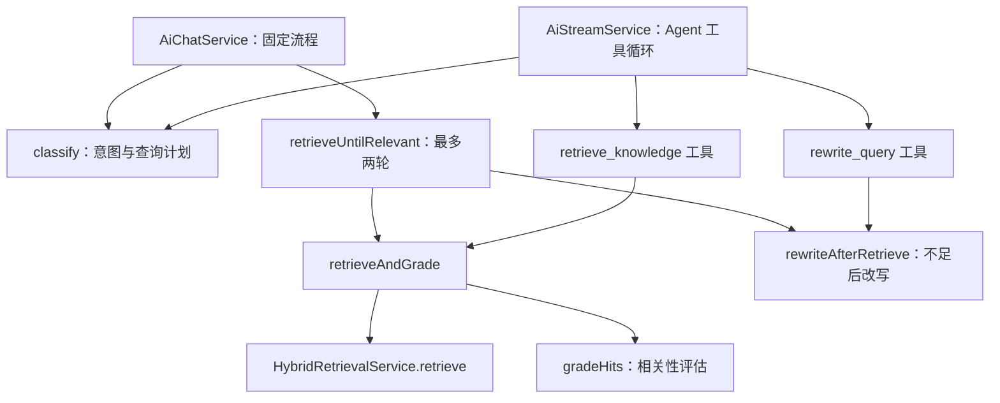
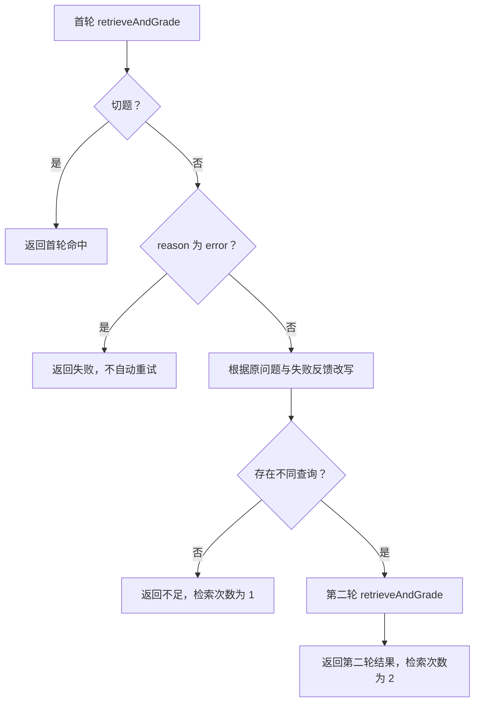

本页位于“智能检索与对话”的自适应编排层，关注三个决策：**本轮允许查什么、召回资料是否切题、检索不足时如何换词再查**。实现并非单一路径：非流式问答使用代码控制的固定流程，流式问答使用按意图装配工具的 Agent；两者共享意图识别、相关性评估与改写服务，但不具备完全相同的执行保证。 Sources: [ai-chat.service.ts](src/ai/ai-chat.service.ts#L143-L181)；[ai-stream.service.ts](src/ai/ai-stream.service.ts#L154-L198)

## 1. 架构边界：共享决策能力，不共享调度器

`ChatQueryRewriteService` 提供 `classify`、`gradeHits` 和 `rewriteAfterRetrieve` 三类模型决策。`agentic-retrieve.ts` 将单次检索与评估封装为 `retrieveAndGrade`，并额外提供非流式使用的 `retrieveUntilRelevant`。流式服务仅复用单次检索函数，将“是否改写、何时再次检索”交给 Agent 工具循环处理。 Sources: [chat-query-rewrite.service.ts](src/ai/chat-query-rewrite.service.ts#L218-L352)；[agentic-retrieve.ts](src/ai/agentic-retrieve.ts#L60-L168)；[ai-stream.service.ts](src/ai/ai-stream.service.ts#L176-L295)

下图区分**决策服务**与**执行编排**：实线表示调用关系，非流式循环与流式工具最终都落到同一个检索评估入口。 Sources: [ai-chat.service.ts](src/ai/ai-chat.service.ts#L146-L166)；[agentic-retrieve.ts](src/ai/agentic-retrieve.ts#L122-L165)；[ai-stream.service.ts](src/ai/ai-stream.service.ts#L176-L267)

| 维度 | 非流式固定流程 | 流式 Agent |
|---|---|---|
| 首次检索词 | 使用 `plan.query` | 计划作为建议词，实际由工具入参决定 |
| 知识库与图谱 | 代码创建任务并 `Promise.all` 等待 | 提示词要求首轮同时调用两个工具 |
| 改写后再查 | 编排函数自动执行 | Agent 调用 `rewrite_query` 后再次调用检索工具 |
| 知识库次数上限 | 函数结构最多两次 | `retrieveCount >= 2` 时拒绝继续检索 |
| 联网时机 | 布尔条件直接控制 | 工具是否存在由路由控制，调用顺序由提示词约束 |

Sources: [ai-chat.service.ts](src/ai/ai-chat.service.ts#L152-L181)；[agentic-retrieve.ts](src/ai/agentic-retrieve.ts#L132-L167)；[ai-stream.service.ts](src/ai/ai-stream.service.ts#L176-L198)；[ai-stream.service.ts](src/ai/ai-stream.service.ts#L336-L377)；[ai-stream.service.ts](src/ai/ai-stream.service.ts#L769-L814)

## 2. 意图路由：一次分类，同时生成查询与能力边界

`classify(question, history)` 的结构化输出包含 `intent`、`standalone_query` 和可选的 `graph_queries`；随后由 `toPlan` 将意图映射为三个工具开关。模型不直接输出开关，因此“允许使用哪些检索能力”由代码按意图统一计算。分类模型缺失或调用失败时，回退为 `kb`，查询保留用户问题。 Sources: [chat-query-rewrite.service.ts](src/ai/chat-query-rewrite.service.ts#L84-L98)；[chat-query-rewrite.service.ts](src/ai/chat-query-rewrite.service.ts#L218-L255)；[chat-query-rewrite.service.ts](src/ai/chat-query-rewrite.service.ts#L354-L371)

| 意图 | 判定范围 | 知识库 | 图谱 | 联网 |
|---|---|---:|---:|---:|
| `chitchat` | 问好、致谢、无关闲聊 | 否 | 否 | 否 |
| `profile` | 用户本人的身份、部门、回答偏好 | 否 | 否 | 否 |
| `kb` | 公司制度、流程、岗位、内部系统 | 是 | 是 | 否 |
| `web` | 公开时效信息 | 否 | 否 | 是 |
| `kb_then_web` | 内部问题与外部时效信息可能交叉 | 是 | 是 | 是 |

Sources: [chat-query-rewrite.service.ts](src/ai/chat-query-rewrite.service.ts#L29-L54)；[chat-query-rewrite.service.ts](src/ai/chat-query-rewrite.service.ts#L135-L148)；[chat-query-rewrite.service.ts](src/ai/chat-query-rewrite.service.ts#L354-L371)

### 上下文消歧与查询分工

路由前的历史压缩只取最近四条消息：用户消息最多保留 200 字符，助手消息最多保留 120 字符。路由提示词要求消解“这个、谁负责、怎么办”等指代，同时避免复述助手已经给出的制度条文；还明确区分“我是哪个部门”和“预算审核员属于哪个部门”，防止将岗位知识问题误判为个人资料问题。 Sources: [chat-memory.util.ts](src/ai/chat-memory.util.ts#L39-L52)；[chat-query-rewrite.service.ts](src/ai/chat-query-rewrite.service.ts#L145-L154)

`query` 是文档检索与联网使用的独立短查询，`graphQueries` 则是图谱使用的短实体名，例如将“发票如何报销”拆为“发票、报销”。需要注意，40 字查询长度、实体长度与数量主要属于提示词或 schema 描述；实际 `toPlan` 只对图谱词执行去首尾空白和空项过滤，并在非知识库意图下清空数组，没有在这里强制执行长度、数量或去重限制。 Sources: [chat-query-rewrite.service.ts](src/ai/chat-query-rewrite.service.ts#L89-L97)；[chat-query-rewrite.service.ts](src/ai/chat-query-rewrite.service.ts#L150-L162)；[chat-query-rewrite.service.ts](src/ai/chat-query-rewrite.service.ts#L360-L370)

## 3. 相关性评估：有召回，不等于可作为依据

`retrieveAndGrade` 先执行混合检索，再使用**用户原问题**而不是本轮检索词评估命中。返回值分离为 `rawHits` 与 `hits`：前者保存原始召回供诊断和改写使用；后者只有在 `grade.ok` 为真时才保留，否则为空。这是阻止“不切题资料继续进入回答上下文”的关键门控。 Sources: [agentic-retrieve.ts](src/ai/agentic-retrieve.ts#L47-L55)；[agentic-retrieve.ts](src/ai/agentic-retrieve.ts#L71-L85)

评估是**整批通过或整批拒绝**，不是逐条过滤。模型默认只看到前五条命中的摘要表示，其中包含标题、可选小标题、分数与正文；只要资料能支撑作答即可通过，不要求覆盖所有细节。一旦通过，代码放行整批 `rawHits`，因此不能将 `hits` 理解为“每条都经过单独相关性认证”。 Sources: [chat-query-rewrite.service.ts](src/ai/chat-query-rewrite.service.ts#L100-L122)；[chat-query-rewrite.service.ts](src/ai/chat-query-rewrite.service.ts#L281-L295)；[chat-query-rewrite.service.ts](src/ai/chat-query-rewrite.service.ts#L375-L383)；[agentic-retrieve.ts](src/ai/agentic-retrieve.ts#L78-L85)

| 情况 | 评估结果 | 是否调用评估模型 | 后续影响 |
|---|---|---:|---|
| 零命中 | `empty`，`ok=false` | 否 | 可进入改写 |
| 命中且模型判定切题 | `relevant`，`ok=true` | 是 | 放行原始命中 |
| 命中但仅关键词相关 | `irrelevant`，`ok=false` | 是 | 隔离命中，供改写参考 |
| 未配置评估模型 | `relevant`，`ok=true` | 否 | 有召回即放行 |
| 评估模型调用失败 | `relevant`，`ok=true` | 已尝试 | 有召回即放行 |
| 检索过程抛出异常 | 对外 `reason=error` | — | 返回空命中 |

Sources: [chat-query-rewrite.service.ts](src/ai/chat-query-rewrite.service.ts#L268-L303)；[agentic-retrieve.ts](src/ai/agentic-retrieve.ts#L96-L113)

因此，**`ok` 是执行策略结果，不总是模型成功确认相关性**。评估缺失和评估失败都采用“有召回则放行”，而检索失败返回 `error`。排障时必须结合 `text` 区分“资料切题”“未配置评估模型”和“评估失败，按有召回处理”。 Sources: [chat-query-rewrite.service.ts](src/ai/chat-query-rewrite.service.ts#L276-L301)；[agentic-retrieve.ts](src/ai/agentic-retrieve.ts#L102-L109)

## 4. 查询改写：利用失败反馈，而不是重复原查询

初始改写发生在意图分类阶段，目的是生成独立查询；不足后的改写则使用四类输入：原问题、上轮检索词、评估原因和上轮命中。存在不切题命中时，改写模型最多看到前三条，提示词要求换同义表达或补全核心实体，同时禁止编造条款号、专有名词。 Sources: [chat-query-rewrite.service.ts](src/ai/chat-query-rewrite.service.ts#L124-L132)；[chat-query-rewrite.service.ts](src/ai/chat-query-rewrite.service.ts#L242-L243)；[chat-query-rewrite.service.ts](src/ai/chat-query-rewrite.service.ts#L311-L335)

改写结果通过 `distinctQuery` 检查：将连续空白归一为空格后，与上轮查询进行字符串相等比较。模型缺失、调用失败或返回重复查询时，尝试回退到用户原问题；如果原问题也与上轮相同，则返回空字符串，表示无法形成不同查询。该检查不进行语义去重，也不强制截断到 40 字。 Sources: [chat-query-rewrite.service.ts](src/ai/chat-query-rewrite.service.ts#L307-L350)；[chat-query-rewrite.service.ts](src/ai/chat-query-rewrite.service.ts#L386-L390)

下面的流程图描述非流式路径的实际终止规则：首轮切题或检索报错直接结束；只有空结果或不切题结果会尝试改写，第二轮完成后无条件返回，不再递归重试。 Sources: [agentic-retrieve.ts](src/ai/agentic-retrieve.ts#L132-L167)

## 5. Agent 循环：区分硬约束与提示词约束

流式工具集按路由装配：知识库意图才注册 `retrieve_knowledge` 和 `rewrite_query`，允许图谱时注册 `retrieve_graph`，允许联网时注册 `web_search`。检索工具不会自动重试；每次调用自行检索并评估，失败或不切题时返回 `insufficient`，并将评估状态发送为 `data-eval`。 Sources: [ai-stream.service.ts](src/ai/ai-stream.service.ts#L176-L295)；[ai-stream.service.ts](src/ai/ai-stream.service.ts#L297-L361)

| 规则 | 实现强度 | 需要注意的边界 |
|---|---|---|
| 未获授权的工具不可用 | 工具注册代码约束 | 不只是提示模型“不要调用” |
| 知识库最多实际检索两次 | 计数器硬约束 | 第三次工具调用返回不足错误，不再执行检索 |
| 改写必须有上次检索 | 工具入口硬约束 | 无 `lastRetrieve` 时拒绝 |
| 已切题时不改写 | 工具入口硬约束 | 返回已切题错误与当前查询 |
| 首轮知识库与图谱并行 | 提示词约束 | 不等同于非流式的 `Promise.all` |
| 第二次检索前必须先改写 | 提示词约束 | 检索入口没有验证改写工具是否已调用 |
| 知识库不足后才联网 | 提示词约束 | 联网工具入口未检查知识库次数与评估状态 |

Sources: [ai-stream.service.ts](src/ai/ai-stream.service.ts#L176-L198)；[ai-stream.service.ts](src/ai/ai-stream.service.ts#L246-L295)；[ai-stream.service.ts](src/ai/ai-stream.service.ts#L336-L361)；[ai-stream.service.ts](src/ai/ai-stream.service.ts#L769-L814)

Agent 还配置了 `modelCallLimitMiddleware({ runLimit: 8, exitBehavior: 'end' })`，这是 Agent 的模型调用预算，不应解读为“最多八次检索”。另外，`rewrite_query` 的 `focus` 参数只被回传，并未传给 `rewriteAfterRetrieve`，因此当前实现不会将它作为改写模型的额外输入。 Sources: [ai-stream.service.ts](src/ai/ai-stream.service.ts#L248-L290)；[ai-stream.service.ts](src/ai/ai-stream.service.ts#L363-L376)

内部分类、评估和改写调用使用空 callbacks，并标记 `kh-internal` 与 `khInternal`，避免继承 Agent 流上下文后将内部结构化 JSON 混入回答正文。这些内部模型统一使用温度 0、默认 15 秒超时和 `maxRetries: 0`；**业务上的查询改写重试，不是模型客户端的网络重试**。 Sources: [chat-query-rewrite.service.ts](src/ai/chat-query-rewrite.service.ts#L11-L26)；[chat-query-rewrite.service.ts](src/ai/chat-query-rewrite.service.ts#L199-L215)

## 6. 结果语义与调试检查点

`RetrieveEval` 对外区分 `ok`、`empty`、`irrelevant`、对应的 `retried_*` 状态，以及 `error`；同时保存首轮 `query` 和可选的 `retryQuery`。非流式循环的 `retried=true` 表示确实进入第二轮；流式路径则直接根据 `retrieveCount > 1` 设置，因此它只证明“这是第二次检索”，不能单凭该字段证明 Agent 已先调用 `rewrite_query`。 Sources: [agentic-retrieve.ts](src/ai/agentic-retrieve.ts#L7-L35)；[agentic-retrieve.ts](src/ai/agentic-retrieve.ts#L155-L167)；[ai-stream.service.ts](src/ai/ai-stream.service.ts#L188-L198)

| 观察到的现象 | 优先检查 |
|---|---|
| 有召回，但供回答使用的命中为空 | `grade.ok` 是否为假；检查 `rawHits` 与 `hits` 的分离 |
| 首轮无结果，却没有第二轮 | 是否无法生成不同查询；非流式首轮是否为 `error` |
| 制度问题没有联网补充 | 是否路由为 `kb`；该意图不会开放联网 |
| 图谱已有结果，仍触发联网 | 非流式联网条件只检查知识库是否不足，不检查图谱是否有结果 |
| `retried=true`，但没有改写工具痕迹 | 流式该字段按检索计数生成，需要另查工具调用顺序 |
| 评估通过，但没有成功的评估模型调用 | 检查是否走“无模型”或“评估失败”放行分支 |

Sources: [agentic-retrieve.ts](src/ai/agentic-retrieve.ts#L78-L85)；[agentic-retrieve.ts](src/ai/agentic-retrieve.ts#L141-L153)；[ai-chat.service.ts](src/ai/ai-chat.service.ts#L170-L181)；[chat-query-rewrite.service.ts](src/ai/chat-query-rewrite.service.ts#L276-L301)；[chat-query-rewrite.service.ts](src/ai/chat-query-rewrite.service.ts#L360-L370)；[ai-stream.service.ts](src/ai/ai-stream.service.ts#L188-L198)

理解本页的编排边界后，可继续阅读[多来源回答生成：知识库、图谱、联网补充与引用溯源](24-duo-lai-yuan-hui-da-sheng-cheng-zhi-shi-ku-tu-pu-lian-wang-bu-chong-yu-yin-yong-su-yuan)，追踪门控后的资料如何进入回答；若要验证 Agent 是否遵守改写与工具顺序，再阅读[问答质量评测：金标数据、工具策略、改写行为与答案可信度](28-wen-da-zhi-liang-ping-ce-jin-biao-shu-ju-gong-ju-ce-lue-gai-xie-xing-wei-yu-da-an-ke-xin-du)。两条路径都提供检索次数、改写标记、评估状态及原始／放行命中快照，但这些字段应结合真实工具痕迹解读。 Sources: [ai-chat.service.ts](src/ai/ai-chat.service.ts#L184-L199)；[ai-stream.service.ts](src/ai/ai-stream.service.ts#L448-L460)