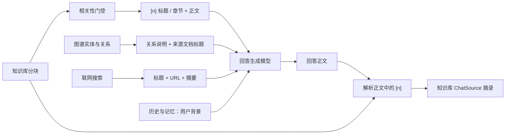
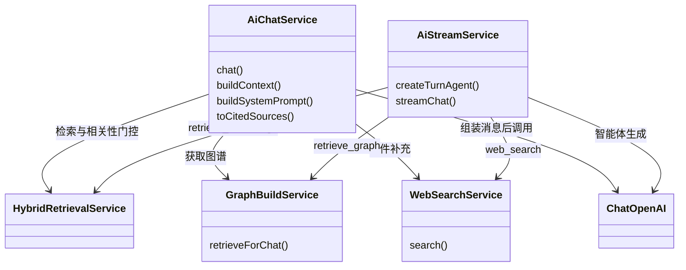

多来源回答的核心不是把所有结果拼进提示词，而是**区分证据用途，并保留可解释的来源边界**。当前实现将知识库分块作为制度与流程的依据，将图谱用于实体关系说明，将网页作为公开信息补充；最终由模型生成正文中的引用标记，再由程序关联知识库来源。本页聚焦这些材料如何进入生成器，以及“返回的来源”究竟能证明什么，不展开召回算法、路由分类或消息流协议。Sources: [ai-chat.service.ts](src/ai/ai-chat.service.ts#L271-L293) [ai-chat.service.ts](src/ai/ai-chat.service.ts#L394-L416) [graph-build.service.ts](src/pipeline/graph-build.service.ts#L25-L54)

## 1. 证据模型：三类来源，不是同一种引用

系统没有统一的“知识库—图谱—网页”引用对象。`ChatSource` 是面向知识库分块的结构，包含编号、文档标识、标题、章节、摘录和检索分数；图谱另用 `GraphChatHit` 返回实体、关系及来源文档；联网结果则保留标题、URL 和摘要。因此，**多来源生成已实现，但统一的多来源引用协议并未体现在这些类型中**。Sources: [chat.types.ts](src/ai/chat.types.ts#L1-L10) [graph-build.service.ts](src/pipeline/graph-build.service.ts#L13-L23) [web-search.service.ts](src/ai/web-search.service.ts#L4-L15)

| 来源 | 输入模型的主要内容 | 允许承担的角色 | 当前溯源载体 |
|---|---|---|---|
| 知识库 | 带 `[n]` 的文档标题、章节和分块正文 | 内部制度、流程等陈述的依据 | `ChatSource[]` 与正文 `[n]` |
| 图谱 | 实体关系，或无关系时的实体名称，以及来源文档标题 | 解释实体关联，不能代替制度原文 | `GraphChatHit.documents`；流式另发送 `data-graph` |
| 联网 | 标题、URL、摘要 | 补充公开信息，不能写成内部规定 | 回答中的标题与链接；搜索结果中的 URL |

Sources: [ai-chat.service.ts](src/ai/ai-chat.service.ts#L377-L416) [graph-build.service.ts](src/pipeline/graph-build.service.ts#L25-L54) [ai-stream.service.ts](src/ai/ai-stream.service.ts#L297-L319)

下图表达的是证据进入生成器后的语义边界，而非三个平权的数据源：知识库编号可以映射到结构化摘录，图谱与网页则通过各自的上下文格式保留来源信息。Sources: [ai-chat.service.ts](src/ai/ai-chat.service.ts#L271-L293) [ai-chat.service.ts](src/ai/ai-chat.service.ts#L346-L391)

Sources: [agentic-retrieve.ts](src/ai/agentic-retrieve.ts#L76-L85) [ai-chat.service.ts](src/ai/ai-chat.service.ts#L271-L293) [ai-chat.service.ts](src/ai/ai-chat.service.ts#L346-L391) [graph-build.service.ts](src/pipeline/graph-build.service.ts#L25-L54)

## 2. 从检索结果到可用证据

### 知识库：有命中不等于可以引用

知识库材料在进入生成阶段前经过相关性判断。`retrieveAndGrade()` 同时保存 `rawHits` 和 `hits`，但只有 `grade.ok` 为真时才把原始命中放进 `hits`；主题不符的命中不会作为正文依据传给生成器。这里的门控作用于整批命中：代码执行的是 `grade.ok ? rawHits : []`，并不是对每个分块逐项筛选。Sources: [agentic-retrieve.ts](src/ai/agentic-retrieve.ts#L47-L55) [agentic-retrieve.ts](src/ai/agentic-retrieve.ts#L76-L85)

非流式生成将通过门控的分块格式化为 `[1] 文档标题 / 章节` 加完整分块内容。返回给客户端的 `excerpt` 才会压缩空白并截取前 200 个字符；**摘录长度不是模型上下文长度限制**。同一文档的不同分块可以拥有不同编号，因为编号依据命中数组的位置生成，而不是依据文档 ID。Sources: [ai-chat.service.ts](src/ai/ai-chat.service.ts#L44-L45) [ai-chat.service.ts](src/ai/ai-chat.service.ts#L360-L383)

### 图谱：关联线索，不是条文替身

`retrieveForChat()` 默认检索最多 8 个实体，内部将实体数量限制在 1～20；关系查询只取本轮命中实体之间的边，不继续扩展其他节点。随后通过“文档—分块—提及实体”路径查询来源文档，最多返回 8 篇。返回结构中的 `documents` 是本次实体集合的来源列表，关系条目本身只有 `source`、`relation`、`target`，没有逐边绑定的文档或分块标识，不能把它解释为每条关系的精确原文出处。Sources: [graph-build.service.ts](src/pipeline/graph-build.service.ts#L546-L565) [graph-build.service.ts](src/pipeline/graph-build.service.ts#L616-L659)

图谱格式化还会进一步收敛信息：存在关系时输出关系，没有关系时输出实体名称，并附来源文档标题；虽然命中对象包含实体类型和描述，`formatGraphContext()` 并不将它们写入这段文本。非流式链路通过独立系统消息明确声明“只能说明实体关系，不能当制度原文”。Sources: [graph-build.service.ts](src/pipeline/graph-build.service.ts#L13-L54) [ai-chat.service.ts](src/ai/ai-chat.service.ts#L271-L285)

### 联网：摘要级公开补充

`WebSearchService` 调用 Bocha 搜索接口，默认请求 5 条，数量限制在 1～10，使用 `freshness: 'noLimit'` 和 `summary: true`。响应仅保留同时具有 URL 与标题的结果，摘要优先取 `summary`，否则取 `snippet`。该服务消费搜索接口提供的摘要，没有在此流程中继续抓取网页全文，也没有设置仅限近期的搜索范围。Sources: [web-search.service.ts](src/ai/web-search.service.ts#L24-L46) [web-search.service.ts](src/ai/web-search.service.ts#L82-L91)

## 3. 非流式生成：程序组装上下文，模型输出引用

`AiChatService` 在路由确定后并行等待知识库与图谱结果，再按 `allowWeb && (!allowRetrieve || kbInsufficient)` 决定是否联网。该条件只检查知识库是否不足，不检查图谱是否充足：图谱有命中并不自动取消允许的联网补充。纯知识库意图下，如果知识库不足且图谱也没有实体或关系，则直接返回“知识库里没有相关内容。”，不进入回答模型。Sources: [ai-chat.service.ts](src/ai/ai-chat.service.ts#L150-L181) [ai-chat.service.ts](src/ai/ai-chat.service.ts#L229-L263)

模型输入按职责分层：基础系统提示规定证据使用规则，长期记忆作为可选系统消息，图谱作为可选系统消息，随后接入历史消息；最后的人类消息包含知识库资料、联网结果和当前用户问题。基础提示明确要求制度与流程以本轮知识库为准，不得用记忆替代文档；有知识库材料时，依资料作出的陈述必须标注对应 `[n]`，网页则用标题与链接说明。Sources: [ai-chat.service.ts](src/ai/ai-chat.service.ts#L271-L286) [ai-chat.service.ts](src/ai/ai-chat.service.ts#L394-L416)

下图展示生成阶段的模块交互。需要区分两种并行：非流式由程序用 `Promise.all()` 明确并行；流式则把检索封装成工具，由智能体选择调用，提示词要求首次并行调用知识库与图谱。Sources: [ai-chat.service.ts](src/ai/ai-chat.service.ts#L150-L181) [ai-stream.service.ts](src/ai/ai-stream.service.ts#L363-L377) [ai-stream.service.ts](src/ai/ai-stream.service.ts#L769-L781)

Sources: [ai-chat.service.ts](src/ai/ai-chat.service.ts#L55-L64) [ai-chat.service.ts](src/ai/ai-chat.service.ts#L271-L293) [ai-stream.service.ts](src/ai/ai-stream.service.ts#L176-L198) [ai-stream.service.ts](src/ai/ai-stream.service.ts#L297-L377)

## 4. 流式生成：工具提供证据，智能体组织回答

流式链路不预先拼出一份统一的人类消息上下文，而是通过工具返回材料。知识库工具返回编号化 `context`，图谱工具返回结构化实体、关系、文档及格式化文本，联网工具直接返回 `WebSearchResult`。系统提示要求知识库切题后使用文档并标 `[n]`，图谱不能作为制度原文，网页不能替代内部规定。Sources: [ai-stream.service.ts](src/ai/ai-stream.service.ts#L297-L343) [ai-stream.service.ts](src/ai/ai-stream.service.ts#L763-L815) [ai-stream.service.ts](src/ai/ai-stream.service.ts#L849-L865)

这里必须区分**程序硬约束**与**模型行为约定**：工具是否挂载由 `allowRetrieve`、`allowGraph`、`allowWeb` 控制，知识库最多调用两次也有计数检查；但联网工具函数本身并未检查“知识库是否已经两次不足”，首次并行检索以及不足后才联网主要由工具描述和系统提示约束。因此，不能将流式执行顺序描述为与非流式条件分支同等强度的程序保证。Sources: [ai-stream.service.ts](src/ai/ai-stream.service.ts#L176-L198) [ai-stream.service.ts](src/ai/ai-stream.service.ts#L297-L347) [ai-stream.service.ts](src/ai/ai-stream.service.ts#L769-L815)

## 5. 引用解析：编号可靠关联，不等于语义验证

非流式的 `toCitedSources()` 用正则提取回答中的数字方括号，只接受 `1 ≤ n ≤ hits.length` 的编号，去重并按编号排序，再映射回分块。若没有任何有效编号，则回退返回全部可用命中的摘录——不仅“完全没写引用”会回退，“只写了越界编号”也会回退。这个过程没有改写回答，也没有逐句判断陈述是否得到对应分块支持。Sources: [ai-chat.service.ts](src/ai/ai-chat.service.ts#L44-L45) [ai-chat.service.ts](src/ai/ai-chat.service.ts#L346-L368)

流式链路则先发布候选来源，再在完成时筛选落库来源。`packRetrieveResult()` 按 `persistSources.length` 分配递增编号，追加来源，并发送累计 `data-sources` 及 `source-document`；完成后从最终正文解析 `[n]`，只将匹配来源写入会话，没有编号时写入空数组。因此，**流式过程中收到的来源列表不等于最终正文实际引用的列表**。Sources: [ai-stream.service.ts](src/ai/ai-stream.service.ts#L819-L847) [ai-stream.service.ts](src/ai/ai-stream.service.ts#L578-L600)

| 引用行为 | 非流式 | 流式 |
|---|---|---|
| 编号分配 | 当前 `hits` 从 1 开始 | 按累计来源数量追加 |
| 候选来源暴露 | 生成后返回 `sources` | 检索时发送累计 `data-sources` |
| 最终存在有效 `[n]` | 返回对应来源，去重排序 | 落库匹配编号的来源 |
| 没有有效引用 | 返回全部可用命中 | 落库来源为空 |
| 文档级去重 | 不按文档 ID 合并 | 追加逻辑不按文档 ID 合并 |
| 图谱、网页进入 `ChatSource[]` | 不进入 | 不进入 |

Sources: [ai-chat.service.ts](src/ai/ai-chat.service.ts#L346-L368) [ai-stream.service.ts](src/ai/ai-stream.service.ts#L578-L600) [ai-stream.service.ts](src/ai/ai-stream.service.ts#L819-L865)

`ChatSource.score` 只是从命中的 `hit.score` 复制而来，引用解析没有用它计算回答可信度；`ChatSource` 也没有分块 ID、页码或正文偏移字段。因此，当前结构支持“编号→文档、章节与摘录”的回溯，不应被解释为精确页内定位或已完成事实验证的证明。Sources: [chat.types.ts](src/ai/chat.types.ts#L1-L10) [ai-chat.service.ts](src/ai/ai-chat.service.ts#L346-L368)

## 6. 失败边界与集成判断

多来源降级并不完全对称。图谱驱动不可用或查询失败时返回空图谱；联网缺少密钥、HTTP 非成功或业务响应异常时返回带 `error` 的空结果，非流式会把该错误文本放入联网上下文。但 `fetch()`、读取响应及 JSON 解析没有外围 `try/catch`，因此不能声称所有联网异常都会自动退化为“无结果”。Sources: [graph-build.service.ts](src/pipeline/graph-build.service.ts#L552-L560) [graph-build.service.ts](src/pipeline/graph-build.service.ts#L660-L665) [web-search.service.ts](src/ai/web-search.service.ts#L24-L80) [ai-chat.service.ts](src/ai/ai-chat.service.ts#L386-L391)

面向客户端或上层服务，最重要的判断是：将知识库编号来源、图谱来源文档和网页 URL 分开处理；将流式候选来源与最终落库引用分开理解；不要把“来源非空”视为“每个结论均已有证据”。这些边界直接来自当前不同的来源类型，以及非流式回退、流式筛选和纯编号匹配的实现。Sources: [chat.types.ts](src/ai/chat.types.ts#L1-L10) [graph-build.service.ts](src/pipeline/graph-build.service.ts#L13-L23) [web-search.service.ts](src/ai/web-search.service.ts#L4-L15) [ai-chat.service.ts](src/ai/ai-chat.service.ts#L346-L358) [ai-stream.service.ts](src/ai/ai-stream.service.ts#L578-L600)

## 7. 延伸阅读

要理解材料为何被允许进入本轮回答，继续阅读[自适应问答编排：意图路由、相关性评估与查询改写重试](23-zi-gua-ying-wen-da-bian-pai-yi-tu-lu-you-xiang-guan-xing-ping-gu-yu-cha-xun-gai-xie-zhong-shi)；要消费候选来源、图谱和工具过程，继续阅读[流式智能体与前端集成：工具调用、过程事件和消息流协议](25-liu-shi-zhi-neng-ti-yu-qian-duan-ji-cheng-gong-ju-diao-yong-guo-cheng-shi-jian-he-xiao-xi-liu-xie-yi)。本页讨论的证据装配与引用处理，分别衔接这两个环节。Sources: [chat-query-rewrite.service.ts](src/ai/chat-query-rewrite.service.ts#L40-L54) [ai-stream.service.ts](src/ai/ai-stream.service.ts#L60-L92) [ai-stream.service.ts](src/ai/ai-stream.service.ts#L819-L865)