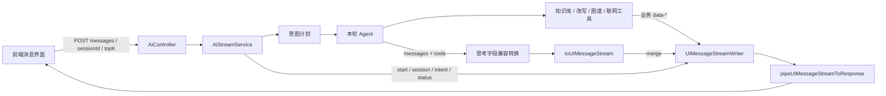
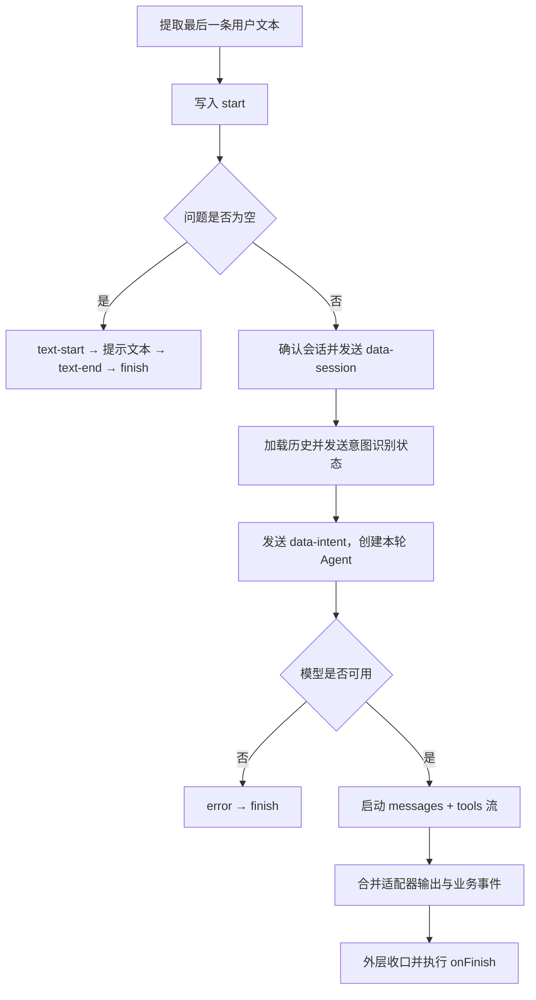

当前页位于“智能检索与对话”章节，聚焦 `POST /ai/chat/stream` 的运行时契约：如何把 LangChain 智能体的模型输出与工具执行转换成 UI Message 流，如何附加业务过程事件，以及前端如何组织回答、过程卡片与引用。核心结论是：**这不是单纯的文本增量接口，而是一条混合承载生命周期、模型输出、工具执行和业务数据的消息流。** Sources: [ai.controller.ts](src/ai/ai.controller.ts#L56-L68) [ai-stream.service.ts](src/ai/ai-stream.service.ts#L464-L575)

## 1. 架构边界：业务编排与协议转换分离

流式路径包含三个职责层：`AiController` 提供接口入口；`AiStreamService` 管理本轮会话、意图、工具注册和业务事件；`@ai-sdk/langchain` 将 LangChain 流转换为 UI Message 流，再由 `ai` 包写入 Express 响应。项目声明依赖 `ai ^7.0.93`、`@ai-sdk/langchain ^3.0.93` 和 `langchain ^1.5.10`，因此协议转换行为应以项目实际安装的 SDK 为准，不应套用其他版本的旧式文本流实现。 Sources: [ai.controller.ts](src/ai/ai.controller.ts#L30-L37) [ai-stream.service.ts](src/ai/ai-stream.service.ts#L1-L18) [ai-stream.service.ts](src/ai/ai-stream.service.ts#L552-L575) [ai-stream.service.ts](src/ai/ai-stream.service.ts#L620-L625) [package.json](package.json#L23-L55)

下图区分两条汇入同一响应的路径：工具函数直接写入业务 `data-*` 事件；模型和工具流经过适配器转换后，通过 `writer.merge` 合并。前端必须同时处理两者，不能把所有数据都追加进回答正文。 Sources: [ai-stream.service.ts](src/ai/ai-stream.service.ts#L200-L227) [ai-stream.service.ts](src/ai/ai-stream.service.ts#L297-L319) [ai-stream.service.ts](src/ai/ai-stream.service.ts#L552-L575)



Sources: [ai-stream.service.ts](src/ai/ai-stream.service.ts#L471-L575) [ai-stream.service.ts](src/ai/ai-stream.service.ts#L624-L625) [ai-stream.service.ts](src/ai/ai-stream.service.ts#L647-L682)

## 2. 请求契约：UI 消息输入不等于客户端控制历史

### 2.1 端点与参数

接口使用 `POST /ai/chat/stream`，要求 `search` 权限。认证策略从 `Authorization: Bearer …` 提取访问令牌，并拒绝非 `access` 类型令牌。流式方法直接接收 Express `Response`，最终输出由流写入函数负责，而不是返回普通 JSON 对象。 Sources: [ai.controller.ts](src/ai/ai.controller.ts#L60-L68) [jwt.strategy.ts](src/auth/jwt.strategy.ts#L19-L30) [ai-stream.service.ts](src/ai/ai-stream.service.ts#L624-L625)

| 字段 | 校验或默认值 | 在本流式路径中的作用 |
|---|---|---|
| `messages` | 必须为数组 | 从后向前查找最后一条 `role: "user"` 消息 |
| `messages[].parts` | DTO 声明文本部件结构 | 只拼接 `type: "text"` 且具有文本的部件 |
| `sessionId` | 可选字符串 | 指定已有会话；不传则创建会话 |
| `topK` | 可选整数，1～10，支持数值转换 | 本轮知识库检索默认条数；缺省为 5 |
| `id` | 可选字符串 | DTO 接受，但流式实现未将其用作会话标识 |
| `trigger`、`messageId` | 可选，放行值 | DTO 接受；本路径未据此实现独立的重生成或编辑分支 |

Sources: [chat-stream.dto.ts](src/ai/dto/chat-stream.dto.ts#L12-L41) [ai-stream.service.ts](src/ai/ai-stream.service.ts#L464-L469) [ai-stream.service.ts](src/ai/ai-stream.service.ts#L684-L698)

请求形态如下。这里的 `id` 是可选的请求兼容字段；**持续会话必须使用服务端返回的 `sessionId`，不能用它替代。** Sources: [chat-stream.dto.ts](src/ai/dto/chat-stream.dto.ts#L20-L41) [ai-stream.service.ts](src/ai/ai-stream.service.ts#L488-L497)

```json
{
  "messages": [
    {
      "role": "user",
      "parts": [
        {
          "type": "text",
          "text": "生产发布失败后应该如何回滚？"
        }
      ]
    }
  ],
  "topK": 5
}
```

Sources: [chat-stream.dto.ts](src/ai/dto/chat-stream.dto.ts#L12-L29)

### 2.2 服务端只提取本轮问题

服务端不把请求中的整个 `messages` 数组直接传给 Agent，而是提取最后一条用户消息的文本；历史上下文由服务端根据会话加载，最终与本轮 `HumanMessage` 组成 Agent 输入。因此，发送旧消息数组不等于覆盖服务端历史，发送 `trigger` 或 `messageId` 也不等于已经具备“重新生成上一条回答”的语义。 Sources: [ai-stream.service.ts](src/ai/ai-stream.service.ts#L499-L500) [ai-stream.service.ts](src/ai/ai-stream.service.ts#L552-L559) [ai-stream.service.ts](src/ai/ai-stream.service.ts#L627-L642) [ai-stream.service.ts](src/ai/ai-stream.service.ts#L684-L698)

全局校验开启 `whitelist`、`transform` 和 `forbidNonWhitelisted`；DTO 对 `messages` 仅声明数组校验，没有声明逐项嵌套校验。因此，不能将 TypeScript 中的嵌套消息类型误认为运行时已完成完整 UI Message 结构验证；前端仍应遵循这里明确使用的文本部件结构。 Sources: [main.ts](src/main.ts#L17-L23) [chat-stream.dto.ts](src/ai/dto/chat-stream.dto.ts#L12-L18)

## 3. 生命周期：外层统一管理开始与结束

正常路径先写入 `start`，随后创建或确认会话并发送 `data-session`，再加载历史、发送意图识别状态和意图卡，最后启动 Agent。适配器设置 `sendStart: false` 和 `sendFinish: false`，将生命周期管理留给外层消息流，避免内外两层重复发送开始、结束事件。 Sources: [ai-stream.service.ts](src/ai/ai-stream.service.ts#L471-L523) [ai-stream.service.ts](src/ai/ai-stream.service.ts#L552-L575)

下面是本轮的主要控制流程。工具执行与后续输出由 Agent 决定，图中不将知识库检索、图谱检索和联网视为每次必经步骤。 Sources: [ai-stream.service.ts](src/ai/ai-stream.service.ts#L176-L178) [ai-stream.service.ts](src/ai/ai-stream.service.ts#L297-L298) [ai-stream.service.ts](src/ai/ai-stream.service.ts#L336-L337) [ai-stream.service.ts](src/ai/ai-stream.service.ts#L464-L575)



Sources: [ai-stream.service.ts](src/ai/ai-stream.service.ts#L464-L575) [ai-stream.service.ts](src/ai/ai-stream.service.ts#L578-L622)

**生命周期完成与持久化成功是两个不同概念。** `onFinish` 从最终消息中提取文本，再尝试保存本轮问答和短期记忆；保存失败只记录日志，没有额外的“落库成功”业务事件。因此，前端不应把流结束提示成“消息已可靠保存”。会话与存储细节参见[会话与消息管理：历史加载、会话归属及持久化](26-hui-hua-yu-xiao-xi-guan-li-li-shi-jia-zai-hui-hua-gui-shu-ji-chi-jiu-hua)。 Sources: [ai-stream.service.ts](src/ai/ai-stream.service.ts#L578-L618)

## 4. 工具调用：区分硬约束与模型策略

工具集合按本轮 `plan.allowRetrieve`、`plan.allowGraph` 和 `plan.allowWeb` 动态注册。知识库检索开启时同时注册查询改写工具；图谱、联网则分别按计划开启。模型配置允许 `parallel_tool_calls`，提示词要求知识库与图谱首次同时调用，但这属于模型调度策略，不是业务代码中固定的 `Promise.all` 并行执行流程。 Sources: [ai-stream.service.ts](src/ai/ai-stream.service.ts#L128-L140) [ai-stream.service.ts](src/ai/ai-stream.service.ts#L176-L178) [ai-stream.service.ts](src/ai/ai-stream.service.ts#L246-L248) [ai-stream.service.ts](src/ai/ai-stream.service.ts#L297-L298) [ai-stream.service.ts](src/ai/ai-stream.service.ts#L336-L337) [ai-stream.service.ts](src/ai/ai-stream.service.ts#L769-L780)

| 工具 | 参数 | 直接产生的业务事件 | 约束性质 |
|---|---|---|---|
| `retrieve_knowledge` | `query`；可选 `topK`，1～10 | `data-eval`；打包结果时发送 `data-sources` 和 `source-document` | 计数器硬限制本轮最多执行两次检索 |
| `rewrite_query` | 可选 `focus` | 真正进入改写时发送 `data-status`，阶段为 `rewrite` | 尚未检索或已有切题资料时直接返回错误结果 |
| `retrieve_graph` | 非空 `query` | `data-graph` | 提示词要求短实体词；查询执行时带用户访问范围 |
| `web_search` | `query`；可选 `count`，1～10，默认 5 | 工具函数内没有专用 `data-web` | 是否注册由计划决定；调用顺序由提示词约束 |

Sources: [ai-stream.service.ts](src/ai/ai-stream.service.ts#L176-L243) [ai-stream.service.ts](src/ai/ai-stream.service.ts#L246-L357) [ai-stream.service.ts](src/ai/ai-stream.service.ts#L819-L848)

“知识库不足后改写再查”“仍不足才联网”主要通过工具说明和系统提示词表达；检索次数上限则有计数器保护，Agent 另有 `runLimit: 8` 的模型调用限制。前端展示应依据实际收到的工具与业务事件，而不是预先假定每轮必定经历完整检索链。关于策略本身，可继续阅读[自适应问答编排：意图路由、相关性评估与查询改写重试](23-zi-gua-ying-wen-da-bian-pai-yi-tu-lu-you-xiang-guan-xing-ping-gu-yu-cha-xun-gai-xie-zhong-shi)。 Sources: [ai-stream.service.ts](src/ai/ai-stream.service.ts#L180-L198) [ai-stream.service.ts](src/ai/ai-stream.service.ts#L363-L376) [ai-stream.service.ts](src/ai/ai-stream.service.ts#L769-L813)

## 5. 业务事件契约与前端状态模型

### 5.1 按事件语义分区，而不是全部拼成文本

`KhUIMessage` 定义业务数据类型，但**类型声明不等于实际发送契约**：其中声明了 `think` 和 `retrieve`，本文件的执行路径却没有对应的 `data-think`、`data-retrieve` 写入；实际思考输出走模型流适配路径，检索结果则通过评估、来源和工具输出表达。 Sources: [ai-stream.service.ts](src/ai/ai-stream.service.ts#L60-L92) [ai-stream.service.ts](src/ai/ai-stream.service.ts#L200-L227) [ai-stream.service.ts](src/ai/ai-stream.service.ts#L552-L575) [ai-stream.service.ts](src/ai/ai-stream.service.ts#L819-L866)

| 事件 | 数据语义 | 前端建议 |
|---|---|---|
| `data-session` | `{ sessionId }` | 更新后续请求使用的会话标识 |
| `data-status` | `{ stage, text }`，显式阶段为 `intent`、`rewrite` | 更新当前过程提示，不作为完整执行状态机 |
| `data-intent` | 意图、标签、检索词、图谱词及工具允许标记 | 渲染本轮计划卡，不将允许调用误认为已执行 |
| `data-eval` | 切题判断、原因、是否重试及查询词 | 展示一次检索评估，可保留多次记录 |
| `data-graph` | `GraphChatHit` | 渲染图谱证据卡，允许空结果 |
| `data-sources` | 累计 `ChatSource[]` | 按整份快照替换当前来源集合 |
| `source-document` | 文档标识、Markdown 媒体类型及带编号标题 | 作为标准来源部件处理 |
| 模型文本、思考及工具事件 | 由适配器从 `messages`、`tools` 转换 | 按 UI Message 协议交给对应部件渲染 |

Sources: [ai-stream.service.ts](src/ai/ai-stream.service.ts#L60-L92) [ai-stream.service.ts](src/ai/ai-stream.service.ts#L258-L261) [ai-stream.service.ts](src/ai/ai-stream.service.ts#L305-L318) [ai-stream.service.ts](src/ai/ai-stream.service.ts#L494-L523) [ai-stream.service.ts](src/ai/ai-stream.service.ts#L552-L575) [ai-stream.service.ts](src/ai/ai-stream.service.ts#L827-L848)

`data-status` 没有显式的 `done` 阶段，知识库检索和联网工具也没有各自写入完整的开始、结束状态。因此，加载指示应结合消息流生命周期及适配器工具状态收口，不能只等待下一条 `data-status`。同样，知识库与图谱被要求并行调用，前端不能依赖 `data-eval` 和 `data-graph` 的固定到达顺序。 Sources: [ai-stream.service.ts](src/ai/ai-stream.service.ts#L200-L227) [ai-stream.service.ts](src/ai/ai-stream.service.ts#L258-L261) [ai-stream.service.ts](src/ai/ai-stream.service.ts#L297-L343) [ai-stream.service.ts](src/ai/ai-stream.service.ts#L502-L505) [ai-stream.service.ts](src/ai/ai-stream.service.ts#L769-L780)

### 5.2 评估卡表达“能否作为依据”，不是“是否有命中”

`data-eval.ok` 表示资料是否切题、是否可作为依据，不是命中数量是否大于零。其原因包括 `ok`、`retried_ok`、`empty`、`retried_empty`、`irrelevant`、`retried_irrelevant` 和 `error`；`retried`、`query`、`retryQuery` 可用于展示首轮与重试的差异。有命中但不切题时，业务逻辑仍返回空的可用资料集合。 Sources: [agentic-retrieve.ts](src/ai/agentic-retrieve.ts#L7-L36) [agentic-retrieve.ts](src/ai/agentic-retrieve.ts#L76-L85) [ai-stream.service.ts](src/ai/ai-stream.service.ts#L212-L219)

### 5.3 引用编号与文档标识承担不同职责

`data-sources` 每次发送的是累计来源集合，编号从已有集合长度继续递增。`ChatSource.index` 对应回答中的 `[n]`，`documentId` 则标识文档；标准 `source-document.sourceId` 也使用文档 ID。因此，同一文档的不同片段可能拥有不同引用编号，前端不能只按 `documentId` 去重后再重排编号。 Sources: [chat.types.ts](src/ai/chat.types.ts#L1-L10) [ai-stream.service.ts](src/ai/ai-stream.service.ts#L827-L847)

来源卡包含标题、章节、分数和摘录；摘录先压缩空白，再截取最多 200 个字符并按需添加省略号。完整检索正文通过工具返回的 `context` 提供给模型，而不是放入 `data-sources`。此外，流中展示的是候选来源，结束回调保存时只保留回答实际出现的 `[n]` 所对应条目；两者不应混为同一集合。 Sources: [ai-stream.service.ts](src/ai/ai-stream.service.ts#L50-L51) [ai-stream.service.ts](src/ai/ai-stream.service.ts#L578-L590) [ai-stream.service.ts](src/ai/ai-stream.service.ts#L757-L760) [ai-stream.service.ts](src/ai/ai-stream.service.ts#L827-L864)

## 6. 思考输出：兼容层不等于业务过程文案

项目针对百炼兼容接口增加了思考字段转换：递归检查事件中的 `additional_kwargs.reasoning_content`，将其转写为适配器识别的 `additional_kwargs.reasoning.summary`；遍历使用 `seen` 集合避免循环引用。转换只针对指定的嵌套位置，包括 `chunk`、`data`、`kwargs` 和 `messages`，然后将原事件继续交给适配器。 Sources: [ai-stream.service.ts](src/ai/ai-stream.service.ts#L647-L682)

因此，前端应区分三类展示：业务过程提示来自 `data-status`，模型思考来自适配后的模型输出，最终回答来自文本部件。**不要依赖 `data-think` 展示思考，也不要把思考内容拼入回答正文。** 服务端结束回调同样只提取 `type: "text"` 的部件形成保存的回答，不会把所有部件直接串联。 Sources: [ai-stream.service.ts](src/ai/ai-stream.service.ts#L60-L66) [ai-stream.service.ts](src/ai/ai-stream.service.ts#L567-L584) [ai-stream.service.ts](src/ai/ai-stream.service.ts#L647-L682)

## 7. 前端接入步骤与故障边界

前端可按以下顺序接入：先构造符合 DTO 的文本消息并携带访问令牌；读取 `data-session` 后维护会话标识；使用与后端匹配的 UI Message 解析方式处理流；将文本、工具、过程卡和来源分区渲染；最后分别处理流结束与错误。后端将 HTTP 封装委托给 `pipeUIMessageStreamToResponse`，本地业务代码没有自行定义完整的响应头、帧格式和结束哨兵，因而不应仅凭业务文件手写一个“每行都是回答文本”的解析器。 Sources: [jwt.strategy.ts](src/auth/jwt.strategy.ts#L19-L30) [chat-stream.dto.ts](src/ai/dto/chat-stream.dto.ts#L12-L41) [ai-stream.service.ts](src/ai/ai-stream.service.ts#L494-L497) [ai-stream.service.ts](src/ai/ai-stream.service.ts#L552-L575) [ai-stream.service.ts](src/ai/ai-stream.service.ts#L624-L625)

| 场景 | 可验证的后端行为 | 前端处理要点 |
|---|---|---|
| 没有可用用户文本 | 发送“请输入问题。”文本后结束 | 不把它当成模型回答成功 |
| 未配置模型密钥 | 写入 `error`，随后 `finish` | 展示配置错误；注意此时可能已收到会话 ID |
| 知识库检索异常 | 发送 `data-eval`，`reason: "error"`；工具返回 `insufficient` | 区分检索失败与整个传输失败 |
| LangChain 流异常 | 适配器错误回调记录日志；外层配置错误文本转换函数 | 处理协议错误，不能只依赖 HTTP 状态 |
| 回答保存失败 | 仅记录警告日志 | 不宣称已确认持久化成功 |
| 浏览器停止读取或主动取消 | 本方法未显式接入断连监听或向 Agent 传递取消信号 | 不承诺前端取消后服务端计算必然立即停止 |

Sources: [ai-stream.service.ts](src/ai/ai-stream.service.ts#L476-L497) [ai-stream.service.ts](src/ai/ai-stream.service.ts#L535-L575) [ai-stream.service.ts](src/ai/ai-stream.service.ts#L594-L625) [ai-stream.service.ts](src/ai/ai-stream.service.ts#L200-L210) [agentic-retrieve.ts](src/ai/agentic-retrieve.ts#L96-L113)

联调时最重要的验收条件不是“文本能逐字出现”，而是：会话标识正确回传、并行事件不会相互覆盖、来源快照不会重复追加、空结果与异常能够区分、正常与错误路径都能停止加载。认证与参数校验的基础联调可参见[接口联调入门：认证凭据、参数校验与流式响应](5-jie-kou-lian-diao-ru-men-ren-zheng-ping-ju-can-shu-xiao-yan-yu-liu-shi-xiang-ying)；引用语义可继续阅读[多来源回答生成：知识库、图谱、联网补充与引用溯源](24-duo-lai-yuan-hui-da-sheng-cheng-zhi-shi-ku-tu-pu-lian-wang-bu-chong-yu-yin-yong-su-yuan)。 Sources: [ai-stream.service.ts](src/ai/ai-stream.service.ts#L476-L523) [ai-stream.service.ts](src/ai/ai-stream.service.ts#L535-L575) [ai-stream.service.ts](src/ai/ai-stream.service.ts#L827-L866)