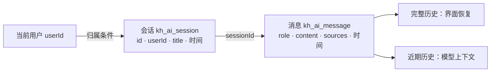
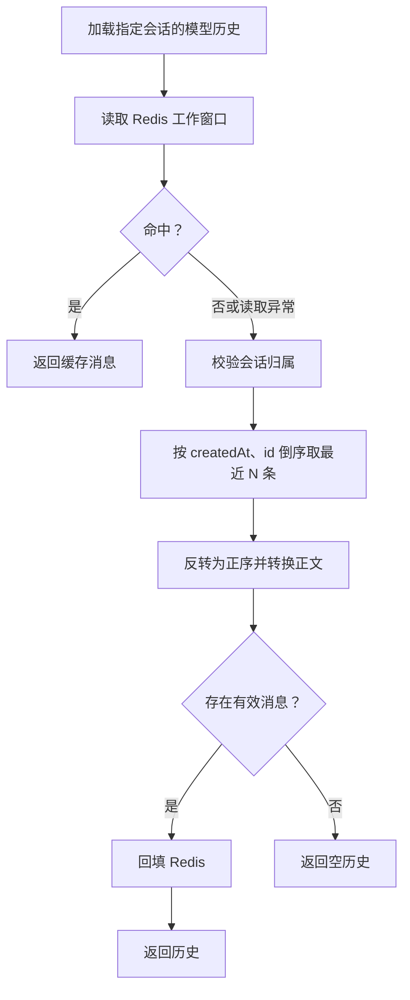
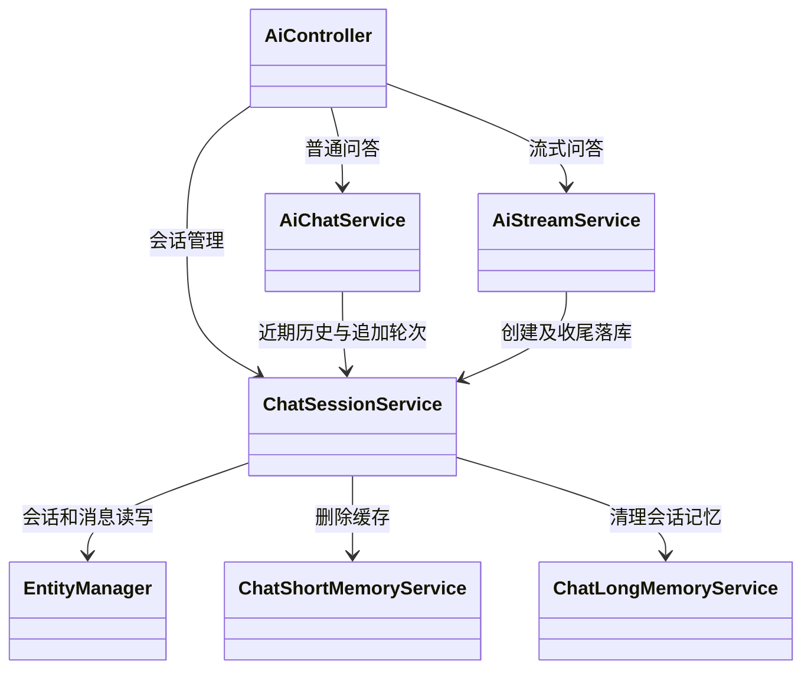

本页位于“智能检索与对话”章节，聚焦三个问题：**消息属于谁、历史从哪里加载、一轮问答何时落库**。当前实现以 PostgreSQL 保存会话和消息，以 Redis 提供模型使用的近期历史；普通问答与流式问答共用 `ChatSessionService`，但创建会话和持久化的时机不同。理解这些差异，是实现会话列表、刷新恢复和连续追问的基础。Sources: [chat-session.service.ts](src/ai/chat-session.service.ts#L30-L139) [ai-chat.service.ts](src/ai/ai-chat.service.ts#L298-L344) [ai-stream.service.ts](src/ai/ai-stream.service.ts#L464-L500)

## 1. 核心模型：用户拥有会话，会话包含消息

归属关系落在会话上：`AiSessionEntity` 保存 `userId`，`AiMessageEntity` 只保存 `sessionId`，不重复保存用户标识。因此，消息读取并不是直接按“消息用户”过滤，而是先确认当前用户拥有会话，再读取该会话的消息。下面的关系图表示实体字段和服务层查询关系，不代表实体中声明了 ORM 关联。Sources: [ai-session.entity.ts](src/ai/entities/ai-session.entity.ts#L10-L30) [ai-message.entity.ts](src/ai/entities/ai-message.entity.ts#L5-L29) [chat-session.service.ts](src/ai/chat-session.service.ts#L76-L93)

Sources: [chat-session.service.ts](src/ai/chat-session.service.ts#L76-L93) [ai-session.entity.ts](src/ai/entities/ai-session.entity.ts#L10-L30) [ai-message.entity.ts](src/ai/entities/ai-message.entity.ts#L5-L29)

| 对象 | 关键字段 | 管理语义 |
|---|---|---|
| 会话 | `id`、`userId`、`title`、`createdAt`、`updatedAt` | 列表按 `updatedAt DESC` 排序 |
| 用户消息 | `sessionId`、`role: user`、`content` | 保存本轮问题 |
| 助手消息 | `sessionId`、`role: assistant`、`content`、`sources` | 保存回答及引用；无引用时存 `null` |
| 标识 | 数据库 `bigint`，应用层 `string` | 使用雪花 ID，避免转成 JavaScript `Number` 丢失精度 |

Sources: [chat-session.service.ts](src/ai/chat-session.service.ts#L30-L49) [chat-session.service.ts](src/ai/chat-session.service.ts#L115-L129) [ai-session.entity.ts](src/ai/entities/ai-session.entity.ts#L10-L30) [bigint.transformer.ts](src/common/transformers/bigint.transformer.ts#L3-L9)

消息的 `sources` 是引用摘录数组，包含编号、文档 ID、标题、章节、摘录与分数。历史接口直接返回消息实体；它没有重新组装检索结果，也没有重放流式过程事件。因此，**历史记录保存的是问答正文与引用，不是完整的智能体执行过程**。Sources: [chat.types.ts](src/ai/chat.types.ts#L1-L10) [chat-session.service.ts](src/ai/chat-session.service.ts#L76-L82) [ai-stream.service.ts](src/ai/ai-stream.service.ts#L578-L600)

## 2. 接口与归属校验

会话接口均要求 `search` 权限，控制器从 `CurrentUser` 取得 `user.userId` 后传入服务，不接受客户端自行指定会话所有者。`getOwned()` 使用 `{ id, userId }` 联合查询；会话不存在或不属于当前用户时，统一抛出 `NotFoundException('会话不存在')`。Sources: [ai.controller.ts](src/ai/ai.controller.ts#L70-L102) [chat-session.service.ts](src/ai/chat-session.service.ts#L132-L139)

| 接口 | 参数 | 返回与行为 |
|---|---|---|
| `GET /ai/sessions` | `page`、`pageSize` | 当前用户的 `{ items, total, page, pageSize }` |
| `POST /ai/sessions` | 可选 `title` | 创建并返回空会话，不写消息 |
| `GET /ai/sessions/:id/messages` | 会话 ID | 验证归属，返回全部消息 |
| `PATCH /ai/sessions/:id` | 必填 `title` | 验证归属，保存并返回会话 |
| `DELETE /ai/sessions/:id` | 会话 ID | 验证归属，执行删除与记忆清理，返回 `{ message: '已删除' }` |

Sources: [ai.controller.ts](src/ai/ai.controller.ts#L70-L102) [chat-session.service.ts](src/ai/chat-session.service.ts#L30-L82)

列表默认 `page=1`、`pageSize=20`，DTO 约束页码至少为 1、页大小为 1～100。创建标题可选、最长 80 字符；服务会去除首尾空白，空值回退为“新对话”。重命名的 DTO 要求原始字符串长度为 1～80，服务随后再执行 `trim()`；因此，这里没有单独拒绝“纯空白标题”的服务层判断。Sources: [session.dto.ts](src/ai/dto/session.dto.ts#L4-L33) [chat-session.service.ts](src/ai/chat-session.service.ts#L42-L55)

**归属校验的时机需要区分路径。** 消息展示、重命名、删除和向已有会话追加消息都会检查归属。流式请求在加载历史前调用 `touchTitle()`，也会检查归属；非流式请求的历史加载则先查 Redis，命中便直接返回，不在该步骤额外调用 `getOwned()`，默认持久化路径随后在 `appendTurn()` 中再次检查归属。不能把这些路径概括成“所有缓存读取前都查数据库归属”。Sources: [chat-session.service.ts](src/ai/chat-session.service.ts#L52-L106) [ai-chat.service.ts](src/ai/ai-chat.service.ts#L298-L344) [ai-stream.service.ts](src/ai/ai-stream.service.ts#L488-L500)

## 3. 历史加载：界面完整记录与模型工作窗口

系统有两种历史读取用途：界面恢复调用 `listMessages()`，读取全部消息；模型上下文调用 `loadWorkingHistory()`，优先读取 Redis，未命中再用 `listRecentMessages()` 从 PostgreSQL 回填。**会话消息接口的完整历史，不等于每次发给模型的历史范围。**Sources: [chat-session.service.ts](src/ai/chat-session.service.ts#L76-L93) [ai-chat.service.ts](src/ai/ai-chat.service.ts#L327-L344) [ai-stream.service.ts](src/ai/ai-stream.service.ts#L627-L643)

| 维度 | 界面历史 | 模型历史 |
|---|---|---|
| 入口 | `GET /ai/sessions/:id/messages` | 两个问答服务的 `loadWorkingHistory()` |
| 数据来源 | PostgreSQL | Redis 优先，PostgreSQL 回填 |
| 范围 | 全部消息，无消息分页参数 | 最近 N 条消息 |
| 排序 | `createdAt ASC, id ASC` | 数据库按时间、ID 倒序取 N 条，再反转 |
| 数据形态 | 消息实体，包含引用和时间 | `HumanMessage`、`AIMessage` 正文 |

Sources: [ai.controller.ts](src/ai/ai.controller.ts#L82-L86) [chat-session.service.ts](src/ai/chat-session.service.ts#L76-L93) [ai-chat.service.ts](src/ai/ai-chat.service.ts#L327-L344) [chat-memory.util.ts](src/ai/chat-memory.util.ts#L28-L36)

下面展示模型历史的加载路径。Redis 读取失败、键不存在或内容不是数组时返回 `null`，由调用方回退到数据库；数据库结果转换时忽略空正文，只将用户和助手正文转换为模型消息，不携带历史 `sources`。Sources: [chat-short-memory.service.ts](src/ai/chat-short-memory.service.ts#L42-L55) [chat-memory.util.ts](src/ai/chat-memory.util.ts#L28-L36)

Sources: [ai-chat.service.ts](src/ai/ai-chat.service.ts#L327-L344) [chat-session.service.ts](src/ai/chat-session.service.ts#L84-L93) [chat-short-memory.service.ts](src/ai/chat-short-memory.service.ts#L42-L71)

默认窗口为 **20 条消息，而不是 20 轮问答**。流式请求虽然接收 `messages` 数组，但只从中倒序寻找最后一条用户消息并拼接其文本部分；真正传给模型的前文来自服务端历史加载。客户端提交的旧助手消息不会替代服务端会话历史。Sources: [chat-short-memory.service.ts](src/ai/chat-short-memory.service.ts#L29-L39) [ai-stream.service.ts](src/ai/ai-stream.service.ts#L552-L558) [ai-stream.service.ts](src/ai/ai-stream.service.ts#L684-L698)

## 4. 一轮问答如何持久化

`appendTurn()` 是两条问答路径共用的持久化入口：有 `sessionId` 就验证归属，没有则创建会话；必要时用首问替换默认标题，更新会话时间并保存，然后生成两条雪花 ID 消息，一次调用 `save([userMsg, assistantMsg])` 保存问题和回答。会话保存与消息保存是两个独立的服务调用，方法中没有显式事务将它们整体包裹。Sources: [chat-session.service.ts](src/ai/chat-session.service.ts#L95-L129)

自动标题会把问题中的连续空白压缩为一个空格，去除首尾空白，超过 30 字符时截取前 30 字符并追加省略号。自动覆盖只针对标题仍然等于“新对话”的会话；不是每轮问答都重命名，因此手动设置的非默认标题会被保留。Sources: [chat-session.service.ts](src/ai/chat-session.service.ts#L58-L65) [chat-session.service.ts](src/ai/chat-session.service.ts#L105-L113) [chat-session.service.ts](src/ai/chat-session.service.ts#L143-L147)

### 普通响应与流式响应的时机差异

| 阶段 | 普通响应 `POST /ai/chat` | 流式响应 `POST /ai/chat/stream` |
|---|---|---|
| 新会话创建 | 得到回答后，在 `appendTurn()` 中创建 | 生成回答前创建 |
| 已有会话处理 | 加载历史，落库时验证归属 | 先 `touchTitle()` 验证归属并保存 |
| 会话 ID 返回 | 最终 JSON 的 `sessionId` | 提前发送 `data-session` |
| 消息保存 | 得到回答后，返回 JSON 前 | `onFinish` 回调中保存 |
| 短期窗口更新 | 数据库保存后追加本轮 | 数据库保存后追加本轮 |
| 落库错误处理 | 该调用处未捕获 | 捕获并记录“流式对话落库失败” |

Sources: [ai.controller.ts](src/ai/ai.controller.ts#L50-L68) [ai-chat.service.ts](src/ai/ai-chat.service.ts#L298-L344) [ai-stream.service.ts](src/ai/ai-stream.service.ts#L488-L500) [ai-stream.service.ts](src/ai/ai-stream.service.ts#L578-L618)

普通响应默认启用持久化；服务内部的 `ChatOptions.persist=false` 可关闭会话及记忆写入，但控制器没有把这个选项暴露为请求参数。“知识库里没有相关内容。”这一业务回答也会按正常轮次保存。纯空白问题则直接返回“请输入问题。”，不进入本轮持久化逻辑。Sources: [ai-chat.service.ts](src/ai/ai-chat.service.ts#L30-L35) [ai-chat.service.ts](src/ai/ai-chat.service.ts#L94-L110) [ai-chat.service.ts](src/ai/ai-chat.service.ts#L229-L262) [ai.controller.ts](src/ai/ai.controller.ts#L50-L54)

流式收尾只拼接 `responseMessage.parts` 中 `type: text` 的内容作为答案，不保存思考、工具调用或状态卡片；引用仅保留答案中实际出现的 `[n]` 对应条目。只要存在问题和持久化会话 ID，回调就尝试保存；答案为空时使用“未能生成回答。”。因此，前端已经收到文本与数据库已经成功落库是两个不同状态，当前回调也没有按中止状态单独分支处理。Sources: [ai-stream.service.ts](src/ai/ai-stream.service.ts#L578-L618)

## 5. 模块协作与删除边界

控制器负责传入认证用户，两个问答服务负责生成与收尾，`ChatSessionService` 负责会话和消息数据库操作。短期与长期记忆服务参与写后更新以及删除清理，但不是历史消息接口的数据来源。下面的交互图只展示与会话管理相关的职责。Sources: [ai.controller.ts](src/ai/ai.controller.ts#L30-L37) [ai.module.ts](src/ai/ai.module.ts#L14-L27) [chat-session.service.ts](src/ai/chat-session.service.ts#L21-L28) [chat-session.service.ts](src/ai/chat-session.service.ts#L67-L82)

Sources: [ai.controller.ts](src/ai/ai.controller.ts#L30-L102) [ai-chat.service.ts](src/ai/ai-chat.service.ts#L298-L344) [ai-stream.service.ts](src/ai/ai-stream.service.ts#L488-L500) [ai-stream.service.ts](src/ai/ai-stream.service.ts#L594-L618) [chat-session.service.ts](src/ai/chat-session.service.ts#L21-L28)

删除按顺序执行：**校验归属 → 删除消息 → 删除会话 → 清理 Redis → 清理会话长期记忆**。这段流程没有显式跨存储事务；Redis 清理和长期记忆清理各自捕获异常并记录警告，因此返回“已删除”不表示所有外部记忆清理都已成功。长期记忆清理传入 `{ userId, runId: sessionId }`，不是删除该用户的全部记忆。Sources: [chat-session.service.ts](src/ai/chat-session.service.ts#L67-L74) [chat-short-memory.service.ts](src/ai/chat-short-memory.service.ts#L88-L99) [chat-long-memory.service.ts](src/ai/chat-long-memory.service.ts#L209-L217)

## 6. 集成与排查要点

推荐的客户端顺序是：先加载会话列表，选择会话后加载完整消息；发起追问时传回该会话的 `sessionId`。若直接发起新问答，普通响应从最终 JSON 取得新 ID，流式响应从 `data-session` 取得新 ID。后续请求应继续携带它，否则服务会按新会话路径处理。所有会话和消息 ID 都应按字符串保存和传递。Sources: [ai.controller.ts](src/ai/ai.controller.ts#L50-L86) [chat-session.service.ts](src/ai/chat-session.service.ts#L105-L107) [ai-stream.service.ts](src/ai/ai-stream.service.ts#L488-L497) [bigint.transformer.ts](src/common/transformers/bigint.transformer.ts#L3-L9)

| 现象 | 对照实现检查 |
|---|---|
| 每次提问都出现新会话 | 后续请求是否携带返回的 `sessionId` |
| 刷新后有完整记录，模型却只记得最近内容 | 界面读全部消息，模型使用最近 N 条窗口 |
| 流式已显示答案，刷新后没有这一轮 | 检查“流式对话落库失败”日志，而不只检查前端流是否结束 |
| 流式生成前已经出现会话 | 会话创建和 `data-session` 发送早于模型生成 |
| 查询或修改返回“会话不存在” | 检查会话 ID，以及当前认证用户是否为所有者 |
| 重试后出现重复问答 | `appendTurn()` 每次生成新消息 ID；请求中的 `messageId` 未用于这里的去重 |

Sources: [ai-chat.service.ts](src/ai/ai-chat.service.ts#L327-L344) [ai-stream.service.ts](src/ai/ai-stream.service.ts#L488-L500) [ai-stream.service.ts](src/ai/ai-stream.service.ts#L594-L611) [chat-session.service.ts](src/ai/chat-session.service.ts#L105-L139) [chat-stream.dto.ts](src/ai/dto/chat-stream.dto.ts#L39-L41)

并发开发时还需注意：本轮缓存更新使用“加载时的历史 + 本轮问答”重新写入窗口，`appendTurn()` 中没有显式会话锁或幂等键检查。当前代码没有提供同一会话多请求串行化的服务层机制，因此不要把一次保存两条消息理解为覆盖了整轮请求的并发控制。Sources: [chat-short-memory.service.ts](src/ai/chat-short-memory.service.ts#L58-L85) [chat-session.service.ts](src/ai/chat-session.service.ts#L98-L129)

## 7. 延伸阅读

若下一步是对接 `data-session` 和消息流事件，请阅读[流式智能体与前端集成：工具调用、过程事件和消息流协议](25-liu-shi-zhi-neng-ti-yu-qian-duan-ji-cheng-gong-ju-diao-yong-guo-cheng-shi-jian-he-xiao-xi-liu-xie-yi)；若需要进一步理解 Redis 窗口、长期记忆及用户事实的作用域，请继续阅读[分层记忆设计：短期上下文、长期记忆与用户事实隔离](27-fen-ceng-ji-yi-she-ji-duan-qi-shang-xia-wen-chang-qi-ji-yi-yu-yong-hu-shi-shi-ge-chi)。本页的关键边界是：**数据库消息负责历史恢复，工作窗口负责近期上下文，流式显示完成不等于持久化成功。**Sources: [ai-stream.service.ts](src/ai/ai-stream.service.ts#L488-L500) [ai-stream.service.ts](src/ai/ai-stream.service.ts#L578-L643) [chat-session.service.ts](src/ai/chat-session.service.ts#L76-L93)