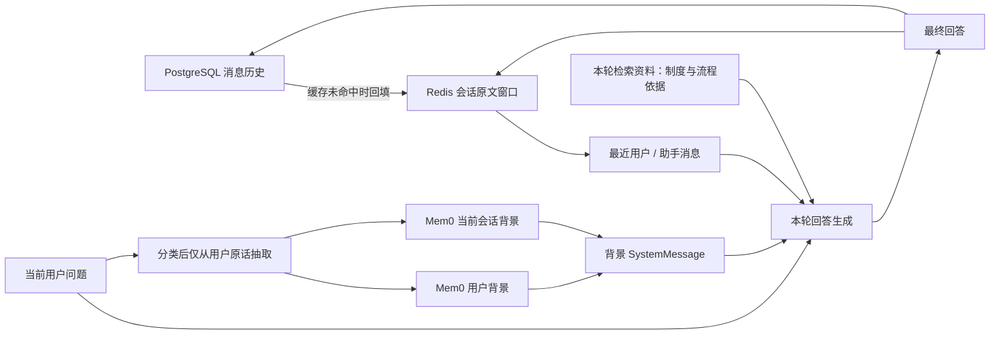
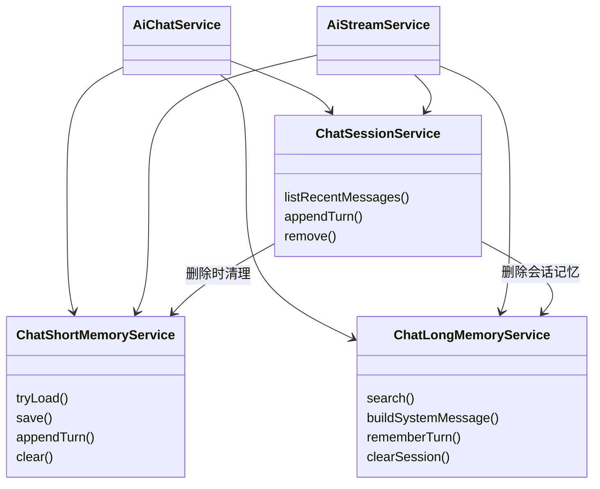

本页位于“智能检索与对话”的分层记忆设计章节，聚焦三个边界：**哪些消息进入工作上下文、哪些用户声明值得长期保存、哪些知识必须仍由本轮文档检索提供**。当前实现以 PostgreSQL 消息记录支撑历史回填，以 Redis 保存会话热窗口，以 Mem0 保存经过分类的用户或会话记忆；长期记忆不是知识库事实的替代来源。Sources: [chat-short-memory.service.ts](src/ai/chat-short-memory.service.ts#L13-L17) · [chat-session.service.ts](src/ai/chat-session.service.ts#L84-L93) · [chat-long-memory.service.ts](src/ai/chat-long-memory.service.ts#L22-L54)

## 1. 分层模型：原文窗口与语义记忆不是一回事

这里的“短期”和“长期”并不只是保存时间不同。短期记忆是最近若干条用户与助手消息的**原文窗口**；长期记忆是针对当前查询检索到的**用户声明与任务背景**。Mem0 内部又按写入意图区分用户层和会话层：前者保存跨会话偏好，后者保存当前任务。会话层虽然存放在长期记忆服务中，语义作用域仍然是当前会话。Sources: [chat-short-memory.service.ts](src/ai/chat-short-memory.service.ts#L58-L85) · [chat-long-memory.service.ts](src/ai/chat-long-memory.service.ts#L8-L44)

| 层次 | 保存内容 | 作用域与读取方式 | 不应承担的职责 |
|---|---|---|---|
| PostgreSQL 消息历史 | 用户问题、助手回答；引用另存于消息字段 | 校验会话归属后，读取最近 N 条回填窗口 | 不等于全部历史都进入模型 |
| Redis 短期窗口 | `HumanMessage`、`AIMessage` | `userId + sessionId` 定位，按消息数截断 | 不单独缓存检索正文、系统记忆消息或工具消息 |
| Mem0 用户层 | 身份自称、岗位、长期偏好、持久约束 | 写入携带 `userId`；检索使用 `user_id` | 不保存制度条文作为用户画像 |
| Mem0 会话层 | 本次任务、进度、待办、临时约定 | 写入携带 `userId + runId`；检索同时过滤两者 | 不应成为新会话的默认任务 |

Sources: [chat-session.service.ts](src/ai/chat-session.service.ts#L84-L93) · [chat-session.service.ts](src/ai/chat-session.service.ts#L115-L128) · [chat-short-memory.service.ts](src/ai/chat-short-memory.service.ts#L58-L66) · [chat-short-memory.service.ts](src/ai/chat-short-memory.service.ts#L98-L100) · [chat-long-memory.service.ts](src/ai/chat-long-memory.service.ts#L109-L135) · [chat-long-memory.service.ts](src/ai/chat-long-memory.service.ts#L179-L198)

下图表达实际的上下文关系：数据库回填和 Mem0 检索是两条独立路径；本轮检索资料进入生成阶段，而不是作为独立消息回写到短期窗口。助手最终回答仍会保存，因此其中已经表述的制度内容也可能随历史回答再次进入上下文。Sources: [ai-chat.service.ts](src/ai/ai-chat.service.ts#L271-L321) · [ai-chat.service.ts](src/ai/ai-chat.service.ts#L327-L343)

Sources: [ai-chat.service.ts](src/ai/ai-chat.service.ts#L271-L343) · [chat-long-memory.service.ts](src/ai/chat-long-memory.service.ts#L145-L198)

## 2. 短期上下文：有界缓存，而非完整对话重放

### 2.1 窗口、序列化与回填

`ChatShortMemoryService` 使用 `${keyPrefix}:${userId}:${sessionId}:messages` 作为缓存键。保存时先过滤消息类型，再取最后 `maxMessages` 条，序列化为 LangChain 存储消息格式，并设置过期时间。因此窗口单位是**消息条数，而不是对话轮数或 token 数**：默认 20 条，在每轮恰好一问一答时约为 10 轮，但代码不保证截断后仍保持完整轮次。Sources: [chat-short-memory.service.ts](src/ai/chat-short-memory.service.ts#L29-L35) · [chat-short-memory.service.ts](src/ai/chat-short-memory.service.ts#L58-L85) · [chat-short-memory.service.ts](src/ai/chat-short-memory.service.ts#L98-L100)

读取时，键不存在、数据不是数组、反序列化失败或 Redis 异常都返回 `null`，由调用方读取数据库最近 N 条消息。数据库先按时间和 ID 倒序取样，再反转为正序；转换时忽略空内容，仅恢复 `user` 和 `assistant`。只有非空历史会回填 Redis；成功读取到空数组则被视为缓存命中，不再查库。Sources: [chat-short-memory.service.ts](src/ai/chat-short-memory.service.ts#L42-L55) · [chat-session.service.ts](src/ai/chat-session.service.ts#L84-L93) · [chat-memory.util.ts](src/ai/chat-memory.util.ts#L28-L37) · [ai-chat.service.ts](src/ai/ai-chat.service.ts#L327-L343)

| 配置 | 默认值 | 实现含义 |
|---|---|---|
| `CHAT_SHORT_MEMORY_TTL_SECONDS` | `86400` | 每次保存窗口时设置的 Redis TTL |
| `CHAT_SHORT_MEMORY_MAX_MESSAGES` | `20` | 缓存截断条数，同时用于数据库回填数量 |
| `CHAT_SHORT_MEMORY_KEY_PREFIX` | `kh:chat` | 缓存命名空间前缀 |

Sources: [chat-short-memory.service.ts](src/ai/chat-short-memory.service.ts#L25-L40) · [chat-short-memory.service.ts](src/ai/chat-short-memory.service.ts#L63-L66) · [ai-chat.service.ts](src/ai/ai-chat.service.ts#L334-L338)

### 2.2 同一历史，两个上下文预算

回答生成接收完整的工作窗口，但意图识别与初始查询改写只接收最后 **4 条消息**：每条用户文本最多 200 个字符，助手文本最多 120 个字符。这里所谓“助手短摘要”实际由 `slice` 截断实现，并非模型生成的语义摘要；其目的在于限制已有回答对新查询的影响，避免把整段制度回答复制为检索词。Sources: [chat-memory.util.ts](src/ai/chat-memory.util.ts#L39-L53) · [chat-query-rewrite.service.ts](src/ai/chat-query-rewrite.service.ts#L230-L240) · [ai-chat.service.ts](src/ai/ai-chat.service.ts#L278-L286)

流式 Agent 另设运行时摘要中间件：触发配置为 12 条消息，保留配置为 6 条消息，摘要要求记录话题、结论与待办，并排除知识库条文。这不是第三种持久化记忆：流结束后回写的仍是先前加载的 `persistHistory` 加本轮问题和最终回答，而非 Agent 内部生成的摘要状态。Sources: [ai-stream.service.ts](src/ai/ai-stream.service.ts#L363-L377) · [ai-stream.service.ts](src/ai/ai-stream.service.ts#L499-L500) · [ai-stream.service.ts](src/ai/ai-stream.service.ts#L594-L607)

## 3. 长期记忆：先分类，再从用户原话抽取

### 3.1 写入决策与抽取输入分离

`rememberTurn` 并不是对整段历史定期压缩，而是在每轮结束后判断是否产生了新事实。分类器输出 `write_user`、`write_session` 和理由，两种写入标志可以同时为真。身份、长期回答偏好进入用户层；“这次先看什么”“下一步做什么”进入会话层；寒暄、无增量复述、知识库条文、联网结果与引用编号均被提示词列为不应保存的内容。Sources: [chat-long-memory.service.ts](src/ai/chat-long-memory.service.ts#L8-L44) · [chat-long-memory.service.ts](src/ai/chat-long-memory.service.ts#L163-L177)

分类器可以看到用户问题和助手回答的前 300 个字符，但传给 Mem0 `add` 的抽取输入只有用户问题。两层写入均附带限制：只从用户说的话中提取身份、岗位、偏好、约束或本轮任务，不保存制度条文、流程、时限、负责人、系统名和引用编号。**助手回答参与分类判断，但不直接作为 Mem0 事实抽取输入。**Sources: [chat-long-memory.service.ts](src/ai/chat-long-memory.service.ts#L169-L198)

| 用户表达类型 | 分类器被要求采用的策略 | 隔离意图 |
|---|---|---|
| “以后回答短一点” | 用户层 | 跨会话保留偏好 |
| “这次先看差旅制度第三节” | 会话层 | 不把一次任务固化为画像 |
| “好的，谢谢” | 均不写入 | 避免无信息记忆 |
| 助手从文档给出的流程、负责人 | 均不写入 | 防止文档事实变成用户事实 |

Sources: [chat-long-memory.service.ts](src/ai/chat-long-memory.service.ts#L22-L44)

上述约束由模型分类和 Mem0 自定义抽取指令实现，服务中没有对提取结果再做字段级确定性校验。因此它是**语义污染防线**，不能等同于硬性的数据类型隔离；用户记忆本身也来自用户自述，不是认证后的岗位或团队归属。Sources: [chat-long-memory.service.ts](src/ai/chat-long-memory.service.ts#L25-L28) · [chat-long-memory.service.ts](src/ai/chat-long-memory.service.ts#L169-L205)

### 3.2 启用条件与查询预算

缺少 `MEM0_API_KEY` 时，Mem0 读写全部跳过；设置该键可以创建客户端，`MEM0_HOST` 可覆盖服务地址。写入还需要 LLM 密钥才能初始化分类器，因此 `enabled` 只代表客户端存在，并不意味着分类写入一定可用。`MEM0_TOP_K` 默认是 5，分别用于用户查询与会话查询，并非两者合并后的总条数上限。Sources: [chat-long-memory.service.ts](src/ai/chat-long-memory.service.ts#L64-L106) · [chat-long-memory.service.ts](src/ai/chat-long-memory.service.ts#L109-L127) · [chat-long-memory.service.ts](src/ai/chat-long-memory.service.ts#L163-L169)

## 4. 隔离边界：用户归属明确，会话作用域仍需审视

### 4.1 身份与会话归属

对话入口从 `CurrentUser` 获取用户身份，而不是由请求体指定记忆的 `userId`。Redis 键同时包含用户和会话标识；数据库回填前通过 `{ id, userId }` 校验会话归属。流式路径在加载窗口之前调用 `touchTitle` 或创建会话，会先完成归属处理；非流式路径缓存命中时直接使用缓存，数据库归属校验发生在回填或后续持久化阶段。Sources: [ai.controller.ts](src/ai/ai.controller.ts#L49-L67) · [chat-short-memory.service.ts](src/ai/chat-short-memory.service.ts#L98-L100) · [chat-session.service.ts](src/ai/chat-session.service.ts#L58-L64) · [chat-session.service.ts](src/ai/chat-session.service.ts#L84-L93) · [chat-session.service.ts](src/ai/chat-session.service.ts#L132-L139) · [ai-chat.service.ts](src/ai/ai-chat.service.ts#L327-L343) · [ai-stream.service.ts](src/ai/ai-stream.service.ts#L488-L499)

### 4.2 不能把返回分组视为互斥集合

Mem0 写入与查询的实际条件如下。会话记忆同样带有用户标识，但用户查询只过滤 `user_id`，没有显式排除带 `run_id` 的记录；返回值也只是分别映射成字符串数组，没有去重或二次作用域校验。因此，**仅凭仓库代码不能证明 `user` 结果必然不包含会话记忆**，也不能把“当前任务绝不影响其他会话”描述为已由代码保证的性质；还需要结合实际 Mem0 服务语义验证。Sources: [chat-long-memory.service.ts](src/ai/chat-long-memory.service.ts#L109-L135) · [chat-long-memory.service.ts](src/ai/chat-long-memory.service.ts#L187-L198)

| 操作 | 用户层 | 会话层 |
|---|---|---|
| 写入参数 | `userId` | `userId`、`runId: sessionId` |
| 搜索过滤 | `{ user_id: userId }` | `AND(user_id, run_id)` |
| 提示词标签 | `【用户长期记忆】` | `【当前会话记忆】` |

Sources: [chat-long-memory.service.ts](src/ai/chat-long-memory.service.ts#L117-L159) · [chat-long-memory.service.ts](src/ai/chat-long-memory.service.ts#L187-L196)

### 4.3 记忆不是制度依据

检索命中被组织为一个 `SystemMessage`，末尾明确声明：“以上仅作背景，制度/流程以本轮检索资料为准，不要用记忆替代文档。”非流式生成将其置于工作历史之前；流式 Agent 也接收相同构造的记忆消息。这里通过提示词区分背景与依据，而不是把 Mem0 文本转换为知识库引用。Sources: [chat-long-memory.service.ts](src/ai/chat-long-memory.service.ts#L145-L161) · [ai-chat.service.ts](src/ai/ai-chat.service.ts#L271-L286) · [ai-stream.service.ts](src/ai/ai-stream.service.ts#L544-L558)

## 5. 模块协作、写入时序与一致性

两个对话编排服务共享短期、长期和会话服务，但读取顺序略有不同：非流式先基于短期历史分类，再用 `plan.query` 搜索 Mem0；流式在加载历史后，用原始问题启动 Mem0 搜索，并与分类过程重叠执行。两条路径的初始分类调用都只传入短期历史，**并未先把 Mem0 命中提供给查询改写器**。Sources: [ai-chat.service.ts](src/ai/ai-chat.service.ts#L143-L149) · [ai-stream.service.ts](src/ai/ai-stream.service.ts#L499-L525)

Sources: [ai-chat.service.ts](src/ai/ai-chat.service.ts#L55-L63) · [ai-stream.service.ts](src/ai/ai-stream.service.ts#L100-L108) · [chat-session.service.ts](src/ai/chat-session.service.ts#L67-L73)

正常非流式回答的写入顺序是：等待数据库保存本轮问答，等待 Redis 更新，然后不等待 Mem0 分类写入完成便返回。流式在 `onFinish` 中提取最终文本，依次尝试数据库与 Redis 更新，随后启动 Mem0 写入；即使前两步进入异常处理，仍会尝试写 Mem0。因此三种存储之间不是一个原子事务，也没有读后立即可见的长期记忆保证。Sources: [ai-chat.service.ts](src/ai/ai-chat.service.ts#L298-L324) · [ai-stream.service.ts](src/ai/ai-stream.service.ts#L578-L618)

短期追加采用“请求开始时读取的历史 + 本轮问答 → 整体覆盖缓存”，未在该路径中实现会话锁或版本比较。同一会话并发请求可能各自基于旧窗口生成并覆盖 Redis，不能把这个缓存视为并发安全的追加日志。数据库仍是缓存未命中后的回填来源，但缓存命中路径不会主动与数据库合并。Sources: [chat-short-memory.service.ts](src/ai/chat-short-memory.service.ts#L58-L85) · [ai-chat.service.ts](src/ai/ai-chat.service.ts#L327-L343)

## 6. 失败与删除：可降级，但不保证跨存储同步成功

| 场景 | 代码行为 | 边界 |
|---|---|---|
| Redis 读取异常 | 警告日志，返回 `null` 后查库 | 回填仍依赖数据库可用 |
| Redis 写入或删除异常 | 记录警告，不抛出 | 操作完成不代表缓存已更新或清理 |
| Mem0 检索异常 | 返回用户、会话均为空的结果 | 两次搜索在同一个 `try` 中，后者失败也会丢弃前者结果 |
| Mem0 分类或写入异常 | 记录警告 | 已完成的前序层写入没有回滚 |
| 删除会话 | 删除数据库消息和会话，再清理 Redis 与 Mem0 会话记录 | 不调用仅按用户删除全部记忆的操作 |

Sources: [chat-short-memory.service.ts](src/ai/chat-short-memory.service.ts#L42-L71) · [chat-short-memory.service.ts](src/ai/chat-short-memory.service.ts#L88-L95) · [chat-long-memory.service.ts](src/ai/chat-long-memory.service.ts#L109-L142) · [chat-long-memory.service.ts](src/ai/chat-long-memory.service.ts#L187-L217) · [chat-session.service.ts](src/ai/chat-session.service.ts#L67-L73)

删除会话时，Mem0 清理参数是 `{ userId, runId: sessionId }`，因此清理目标是该会话的记忆，而不是整个用户画像。与此同时，Mem0 写入未被主请求等待，删除和后台写入之间也没有在这些服务中建立同步屏障；排查清理一致性时，应同时核对删除日志和仍在执行的记忆写入。Sources: [chat-long-memory.service.ts](src/ai/chat-long-memory.service.ts#L209-L217) · [ai-chat.service.ts](src/ai/ai-chat.service.ts#L316-L321) · [chat-session.service.ts](src/ai/chat-session.service.ts#L67-L73)

## 7. 验证重点与阅读衔接

验证应分别覆盖三个维度，而不是只观察“模型是否记得”：同一会话能否复述刚声明的任务、换会话后能否保留长期回答偏好、换会话后是否错误沿用上一会话的临时任务。仓库的手工自测文档已给出对应场景；其中“等待约 30 秒”是测试操作提示，不是代码规定的写入完成时限。尤其应以跨会话临时任务测试核实 Mem0 用户过滤是否满足预期隔离。Sources: [chat-memory.md](chat-memory.md#L41-L78) · [chat-long-memory.service.ts](src/ai/chat-long-memory.service.ts#L117-L127)

若需要继续追踪数据库中的归属校验与消息落库，请阅读[会话与消息管理：历史加载、会话归属及持久化](26-hui-hua-yu-xiao-xi-guan-li-li-shi-jia-zai-hui-hua-gui-shu-ji-chi-jiu-hua)；若关注短期上下文如何影响意图和查询，请转到[自适应问答编排：意图路由、相关性评估与查询改写重试](23-zi-gua-ying-wen-da-bian-pai-yi-tu-lu-you-xiang-guan-xing-ping-gu-yu-cha-xun-gai-xie-zhong-shi)。两者分别承接本页的持久化边界与上下文消费边界。Sources: [chat-session.service.ts](src/ai/chat-session.service.ts#L84-L139) · [chat-query-rewrite.service.ts](src/ai/chat-query-rewrite.service.ts#L219-L255)