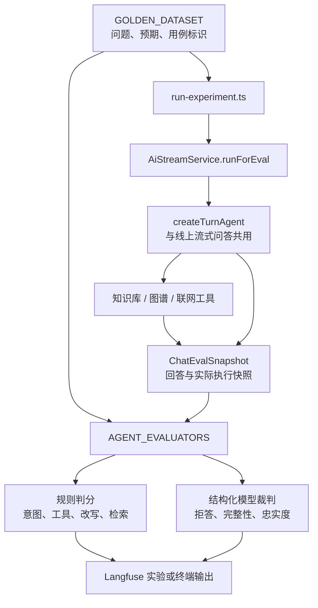
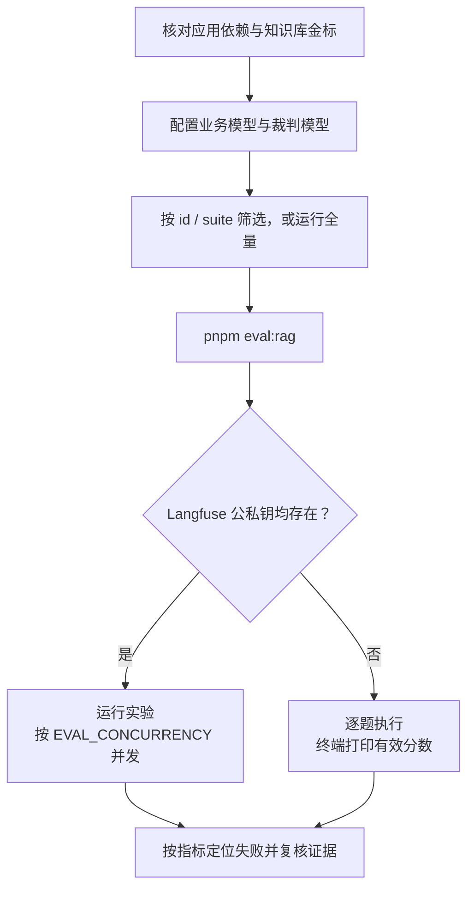

本页位于“质量保障与运行维护”，关注如何把问答质量拆解成**可验证的执行行为、检索结果与回答可信度**。仓库中的 `eval:rag` 不是答案字符串比对脚本：它让真实 Agent 执行金标问题，再分别检查意图、工具策略、改写重试、召回、拒答、要点覆盖和忠实度。本文说明这些分数的实际含义、运行方式及解释边界，不将其视为已经通过的质量结论。Sources: [package.json](package.json#L8-L22)；[run-experiment.ts](src/ai/eval/run-experiment.ts#L48-L83)；[evaluators.ts](src/ai/eval/evaluators.ts#L385-L395)

## 1. 评测架构：同一个 Agent，独立的质量判据

评测入口创建完整 Nest 应用上下文，取得 `AiStreamService`，对每道题调用 `runForEval(question, 5, user)`。该方法与流式问答共用 `createTurnAgent`，但使用静默事件写入器，以 `agent.invoke` 获取最终消息和工具痕迹，不创建会话，也不写入短期或长期记忆。因此，它验证的是**流式问答所用 Agent 的执行逻辑**，不是 HTTP 流协议本身；类型文件中“非流式 chat 快照”的注释不能替代当前调用入口的实际实现。Sources: [run-experiment.ts](src/ai/eval/run-experiment.ts#L33-L69)；[ai-stream.service.ts](src/ai/ai-stream.service.ts#L380-L445)；[ai-stream.service.ts](src/ai/ai-stream.service.ts#L705-L714)；[eval.types.ts](src/ai/eval/eval.types.ts#L13-L17)

以下关系图区分了三类职责：金标定义“应该怎样”，业务 Agent 产生“实际怎样”，评估器将两者转换为独立分数。规则评估器不调用裁判模型；语义评估器通过结构化输出判断回答内容。Sources: [run-experiment.ts](src/ai/eval/run-experiment.ts#L48-L105)；[evaluators.ts](src/ai/eval/evaluators.ts#L47-L111)；[evaluators.ts](src/ai/eval/evaluators.ts#L345-L395)



Sources: [run-experiment.ts](src/ai/eval/run-experiment.ts#L33-L105)；[ai-stream.service.ts](src/ai/ai-stream.service.ts#L384-L461)；[evaluators.ts](src/ai/eval/evaluators.ts#L385-L395)

**不写记忆不等于不读记忆。** `runForEval` 使用空历史进行意图分类，却仍以评测用户 ID 搜索长期记忆，并把结果构造成系统消息。执行用户默认是 `eval-admin`，角色固定为管理员；`EVAL_USER_ID` 只替换用户 ID，不改变角色。因此，当前入口不是普通用户 ACL 回归测试，也不是严格无记忆的纯单轮实验。Sources: [run-experiment.ts](src/ai/eval/run-experiment.ts#L22-L30)；[ai-stream.service.ts](src/ai/ai-stream.service.ts#L389-L445)

## 2. 金标设计：把行为约束与语义事实分开

每条 `GoldenItem` 包含 `input.question`、`expectedOutput` 和 `metadata.id/suite`。金标不提供整段标准答案，而是声明意图、工具限制、是否需要重试或拒答、相关文档标题、必须覆盖的要点及禁止混入的事实。标题采用子串而非文档 ID，以适应本地与 CI 的文档标识差异。Sources: [eval.types.ts](src/ai/eval/eval.types.ts#L39-L63)；[golden-dataset.ts](src/ai/eval/golden-dataset.ts#L3-L9)

| 金标字段 | 约束对象 | 实际含义 |
|---|---|---|
| `intent` | 路由 | 与实际意图精确相等 |
| `requireRetrieve`、`requireWeb` | 执行动作 | 必须发生知识库检索或联网调用 |
| `forbidRetrieve/Graph/Web` | 执行动作 | 禁止相应调用，不检查工具是否仅被允许挂载 |
| `expectRewrite` | 重试行为 | 必须再次检索，且重试查询与首轮查询不同 |
| `expectRefusal` | 无资料回答 | 明确承认依据不足，同时不编造内部事实 |
| `relevantDocTitles` | 文档相关性 | 非空数组用于命中与精度；空数组用于误命中检查 |
| `keyPoints`、`mustNotContain` | 回答事实 | 语义覆盖必要要点，避免错误事实 |
| `judgeGroundedness` | 忠实度裁判 | 只有显式为 `false` 才跳过 |

Sources: [eval.types.ts](src/ai/eval/eval.types.ts#L39-L57)；[evaluators.ts](src/ai/eval/evaluators.ts#L47-L111)；[evaluators.ts](src/ai/eval/evaluators.ts#L125-L150)；[evaluators.ts](src/ai/eval/evaluators.ts#L199-L307)

当前数据集包含九道题，覆盖五个 suite，但并非每题都运行全部指标。例如，“预算审核员属于哪个部门”验证企业知识问题的路由和检索要求，却没有文档相关性或答案要点金标；它不能提供 `hit_at_5` 或 `completeness` 证据。Sources: [golden-dataset.ts](src/ai/eval/golden-dataset.ts#L10-L116)；[evaluators.ts](src/ai/eval/evaluators.ts#L153-L160)；[evaluators.ts](src/ai/eval/evaluators.ts#L231-L239)

| Suite | 数量 | 核心场景 |
|---|---:|---|
| `routing` | 2 | 闲聊禁止调用工具；企业岗位问题应走知识库 |
| `kb-hit` | 3 | 差旅加签、VPN 与账号、发布窗口负责人 |
| `rewrite` | 1 | 加班餐补问题必须改写再查，且不应接受无关文档 |
| `kb-empty` | 2 | 年会规则、实习生答辩材料应承认知识库无依据 |
| `web` | 1 | 汇率问题必须联网，禁止知识库与图谱 |

Sources: [golden-dataset.ts](src/ai/eval/golden-dataset.ts#L10-L116)

**空数组与省略字段具有不同语义。** `relevantDocTitles: []` 明确声明“不应把任何文档当成切题资料”，启用 `false_hit`；省略该字段则不评估误命中。维护数据集时，应同时核对标题、负责人和制度内容，例如差旅题要求“张敏、加签”，发布题要求“李明”且禁止误含“王芳”，这些都是当前数据集的具体事实约束。Sources: [evaluators.ts](src/ai/eval/evaluators.ts#L199-L215)；[golden-dataset.ts](src/ai/eval/golden-dataset.ts#L23-L32)；[golden-dataset.ts](src/ai/eval/golden-dataset.ts#L82-L92)

## 3. 快照语义：记录的是哪一次检索、哪些证据

`ChatEvalSnapshot` 同时保留路由允许项与实际动作。`tool_policy` 使用的是 `retrieveCount`、`graphUsed`、`webUsed`，而不是 `allowRetrieve/Graph/Web`。不过，“使用”表示工具完成了对应执行记录，并不表示找到了有效资料：联网错误或无结果也会生成摘录记录，从而使 `webUsed` 为真；图谱返回空实体和关系时也可以使 `graphUsed` 为真。Sources: [eval.types.ts](src/ai/eval/eval.types.ts#L17-L37)；[evaluators.ts](src/ai/eval/evaluators.ts#L66-L89)；[ai-stream.service.ts](src/ai/ai-stream.service.ts#L300-L342)；[ai-stream.service.ts](src/ai/ai-stream.service.ts#L448-L460)；[ai-stream.service.ts](src/ai/ai-stream.service.ts#L716-L721)

| 快照字段 | 当前 Agent 评测的采样方式 | 解释边界 |
|---|---|---|
| `retrieveCount` | 已记录的检索结果数量 | 检索失败被转换为结果后也会计入 |
| `rawHits` | **最后一次**检索的过滤前结果 | Hit/Precision 不是首轮召回指标 |
| `gradedHits` | 所有检索轮次接受的结果拼接 | 不去重，也不是只保留最终一轮 |
| `rewritten` | 最后一次结果的 `eval.retried` | 本身不证明调用过独立改写工具 |
| `retryQuery` | 最后一次结果的重试查询 | 与 `retrieveEval.query` 比较判定是否换词 |
| `webSnippet` | 各次联网结果拼接 | 包含错误或无结果文本 |
| 命中 `excerpt` | 压缩空白后截取前 400 字符 | 裁判看到的不是完整 chunk |

Sources: [ai-stream.service.ts](src/ai/ai-stream.service.ts#L176-L200)；[ai-stream.service.ts](src/ai/ai-stream.service.ts#L448-L460)；[ai-stream.service.ts](src/ai/ai-stream.service.ts#L716-L732)；[agentic-retrieve.ts](src/ai/agentic-retrieve.ts#L96-L113)

切题评估目前是一次结果集级判断：`grade.ok` 为真就把整组 `rawHits` 作为 `hits`，否则整组清空。因此，`gradedHits` 表示“业务切题判断接受的结果集”，不等于每个 chunk 都经过独立相关性裁判。Sources: [agentic-retrieve.ts](src/ai/agentic-retrieve.ts#L76-L85)

## 4. 九项指标：分数究竟证明什么

评测器将质量分为控制流、检索层和生成层。所有已写出的分数都按“越高越好”设计，尤其要注意：**`false_hit=1` 表示没有误命中**，不是误命中率为 100%。没有适用金标的指标通常返回 `null`，最终适配器将其转换为空数组，不写入实验结果。Sources: [evaluators.ts](src/ai/eval/evaluators.ts#L47-L111)；[evaluators.ts](src/ai/eval/evaluators.ts#L199-L215)；[evaluators.ts](src/ai/eval/evaluators.ts#L368-L395)

| 指标 | 方法 | 判分规则 |
|---|---|---|
| `intent_match` | 规则 | 意图相等为 1，否则 0 |
| `tool_policy` | 规则 | 所有已声明工具约束均满足为 1，否则 0 |
| `rewrite_loop` | 规则 | 已重试、存在重试查询且与首轮查询不同为 1 |
| `hit_at_5` | 标题匹配 | 最后一次检索前五条中任一条匹配任一金标为 1 |
| `precision_at_5` | 标题匹配 | 匹配条数 ÷ 实际前五条数量；无召回为 0 |
| `false_hit` | 规则 | 空金标题的 `gradedHits` 为空则为 1 |
| `refusal_quality` | 模型裁判 | `refused && !fabricated` 为 1，否则 0 |
| `completeness` | 模型裁判 | 命中禁用事实直接为 0，否则按要点覆盖比例计分 |
| `groundedness` | 模型裁判 | `supported=1`、`mixed=0.5`、`fabricated=0` |

Sources: [evaluators.ts](src/ai/eval/evaluators.ts#L47-L111)；[evaluators.ts](src/ai/eval/evaluators.ts#L125-L215)；[evaluators.ts](src/ai/eval/evaluators.ts#L231-L307)

### 4.1 工具策略与改写：验证行为，不验证文案

`tool_policy` 只执行金标中已声明的约束；没有声明 `forbidGraph`，就不会因调用图谱而扣分。当前类型也没有 `requireGraph`。`rewrite_loop` 验证的是重试标记和查询差异，不检查首轮是否确实不足、不检查改写工具是否被调用，也不要求改写后命中。因此，改写得分为 1 只能说明发生了符合该判据的换词重查。Sources: [eval.types.ts](src/ai/eval/eval.types.ts#L39-L46)；[evaluators.ts](src/ai/eval/evaluators.ts#L66-L111)

### 4.2 检索指标：标题级、命中条目级，而非完整召回率

标题匹配采用双向 `includes`：文档标题包含金标，或金标包含文档标题，均视为相关。`hit_at_5` 是任一相关文档出现的二值判断，不要求找齐全部金标；`precision_at_5` 按命中条目计数，不按唯一文档计数，而且分母不足五条时使用实际条数。因此，它们不能直接解释为去重后的文档精度或全部相关文档的召回率。Sources: [evaluators.ts](src/ai/eval/evaluators.ts#L23-L35)；[evaluators.ts](src/ai/eval/evaluators.ts#L152-L193)

### 4.3 可信度：拒答、完整性与忠实度互不替代

拒答裁判要求明确承认没有依据，并且不编造制度、流程、负责人等内部事实；完整性裁判根据给定列表做语义覆盖，并对禁用事实实行零分否决；忠实度裁判则检查制度性断言是否被本轮知识库摘录或联网摘录支持。由此，回答可以“有依据但漏要点”，也可以“覆盖人名却加入无依据流程”，需要组合阅读而非只看单一指标。Sources: [evaluators.ts](src/ai/eval/evaluators.ts#L113-L150)；[evaluators.ts](src/ai/eval/evaluators.ts#L218-L307)

**忠实度证据并不完整覆盖 Agent 可见上下文。** 当前裁判输入只有 `gradedHits` 的压缩摘录与 `webSnippet`，不包含图谱上下文或长期记忆；业务检索工具却向 Agent 提供完整 `hit.content`。解释忠实度低分时，应先核对断言是否位于被截断的正文、图谱或记忆中，而不能直接把所有低分等同于业务模型编造。当前九项评估器也没有独立的引用编号或链接正确性检查。Sources: [evaluators.ts](src/ai/eval/evaluators.ts#L37-L44)；[evaluators.ts](src/ai/eval/evaluators.ts#L282-L307)；[evaluators.ts](src/ai/eval/evaluators.ts#L385-L395)；[ai-stream.service.ts](src/ai/ai-stream.service.ts#L312-L318)；[ai-stream.service.ts](src/ai/ai-stream.service.ts#L430-L442)；[ai-stream.service.ts](src/ai/ai-stream.service.ts#L724-L732)；[ai-stream.service.ts](src/ai/ai-stream.service.ts#L858-L864)

## 5. 运行评测：先固定前提，再选择样本

评测启动的是完整 `AppModule`，不是依赖全部被替换的单元测试；应先准备应用所需服务、待测知识内容与模型配置。尤其要核对金标中“应命中”和“库中没有”的事实仍符合测试知识库现状。模型裁判缺少密钥或调用失败会返回无分数，而业务 Agent 缺少模型密钥会返回“未配置 LLM Key，无法生成回答”的快照。Sources: [run-experiment.ts](src/ai/eval/run-experiment.ts#L33-L38)；[app.module.ts](src/app.module.ts#L39-L111)；[golden-dataset.ts](src/ai/eval/golden-dataset.ts#L23-L55)；[evaluators.ts](src/ai/eval/evaluators.ts#L316-L363)；[ai-stream.service.ts](src/ai/ai-stream.service.ts#L416-L427)



Sources: [run-experiment.ts](src/ai/eval/run-experiment.ts#L33-L109)；[observability/langfuse.ts](src/observability/langfuse.ts#L13-L18)；[package.json](package.json#L21-L21)

| 配置项 | 当前行为 |
|---|---|
| `EVAL_FILTER` | 精确匹配 `metadata.id` 或 `metadata.suite`；不支持模糊匹配 |
| `EVAL_USER_ID` | 默认 `eval-admin`；角色仍固定为管理员 |
| `EVAL_CONCURRENCY` | Langfuse 分支默认 2；终端分支仍逐题执行 |
| `EVAL_JUDGE_MODEL` | 裁判模型优先项，随后依次为 `MODEL_NAME`、`LLM_MODEL`、`qwen-plus` |
| 裁判 API Key | `OPENAI_API_KEY` → `LLM_API_KEY` → `DASHSCOPE_API_KEY` |
| 裁判 Base URL | `OPENAI_BASE_URL` → `LLM_BASE_URL` → DashScope 兼容地址 |
| `AI_QUERY_REWRITE_TIMEOUT_MS` | 同时控制此处裁判超时，默认 20000 毫秒 |
| `LANGFUSE_PUBLIC_KEY`、`LANGFUSE_SECRET_KEY` | 两者均存在时运行 Langfuse 实验；否则输出到终端 |

Sources: [run-experiment.ts](src/ai/eval/run-experiment.ts#L22-L45)；[run-experiment.ts](src/ai/eval/run-experiment.ts#L71-L105)；[evaluators.ts](src/ai/eval/evaluators.ts#L316-L340)；[observability/langfuse.ts](src/observability/langfuse.ts#L13-L18)

在 Windows `cmd.exe` 中，可先运行单条改写题，再清空筛选执行全量。以下命令假定依赖和模型配置已经准备完成；若筛选值没有匹配数据，代码不会主动抛出“未找到用例”错误，因此需要确认实际选中的样本。Sources: [package.json](package.json#L21-L21)；[run-experiment.ts](src/ai/eval/run-experiment.ts#L39-L45)

```bat
set "EVAL_FILTER=kb-overtime-meal"
pnpm eval:rag

set "EVAL_FILTER="
pnpm eval:rag
```

Sources: [golden-dataset.ts](src/ai/eval/golden-dataset.ts#L34-L44)；[run-experiment.ts](src/ai/eval/run-experiment.ts#L39-L45)；[package.json](package.json#L21-L21)

裁判模型使用 `temperature=0`、`maxRetries=0` 和 Zod 结构化输出。调用异常、结构化输出失败或没有评测模型时，评估器返回 `null`；但统一适配器随后会把它变成空数组，**终端分支也使用这个适配后的列表**，所以通常只显示有效分数，而不会显示被跳过指标的原因。缺少一项分数不能直接解释为通过、零分或不适用。Sources: [evaluators.ts](src/ai/eval/evaluators.ts#L316-L395)；[run-experiment.ts](src/ai/eval/run-experiment.ts#L88-L104)

## 6. 结果分析：沿失败层级缩小范围

当前脚本分别输出各项分数，没有实现综合加权分、通过阈值或低分退出门禁；顶层异常才进入 `process.exit(1)`。因此，不能仅凭进程正常结束宣称回归通过，也不宜把不同 suite、不同适用指标直接合成一个未经定义的“总准确率”。Sources: [run-experiment.ts](src/ai/eval/run-experiment.ts#L71-L115)；[evaluators.ts](src/ai/eval/evaluators.ts#L368-L395)

| 观测结果 | 优先核对 |
|---|---|
| `intent_match=0` | 实际路由与该题金标意图 |
| `tool_policy=0` | 具体失败注释，以及实际调用记录，而非回答措辞 |
| `rewrite_loop=0` | 是否重试、`retryQuery` 是否存在、是否与首轮不同 |
| `hit_at_5=0` | 最后一次检索标题及标题子串金标 |
| `false_hit=0` | 空金标题中，哪些结果被业务切题评估接受 |
| `completeness` 低分 | 缺失要点与禁用事实，特别是负责人混淆 |
| `groundedness` 低分 | 制度性断言与裁判实际可见的摘录证据 |
| 某项分数缺失 | 金标是否启用该指标，裁判密钥、超时及结构化输出是否正常 |

Sources: [evaluators.ts](src/ai/eval/evaluators.ts#L47-L111)；[evaluators.ts](src/ai/eval/evaluators.ts#L152-L215)；[evaluators.ts](src/ai/eval/evaluators.ts#L231-L307)；[evaluators.ts](src/ai/eval/evaluators.ts#L345-L395)

下一步可阅读[自适应问答编排：意图路由、相关性评估与查询改写重试](23-zi-gua-ying-wen-da-bian-pai-yi-tu-lu-you-xiang-guan-xing-ping-gu-yu-cha-xun-gai-xie-zhong-shi)，定位控制流与切题判断问题；需要分析实验及执行记录时，转到[链路可观测性：模型调用追踪、检索快照与实验分析](29-lian-lu-ke-guan-ce-xing-mo-xing-diao-yong-zhui-zong-jian-suo-kuai-zhao-yu-shi-yan-fen-xi)。本页的质量判断应始终回到三组独立证据：**是否执行正确、是否找到相关资料、回答是否完整且有依据**。Sources: [agentic-retrieve.ts](src/ai/agentic-retrieve.ts#L60-L115)；[run-experiment.ts](src/ai/eval/run-experiment.ts#L71-L85)；[evaluators.ts](src/ai/eval/evaluators.ts#L385-L395)