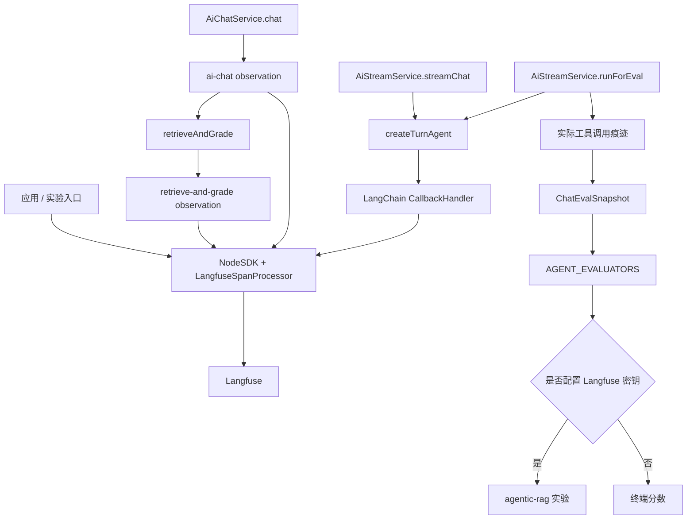
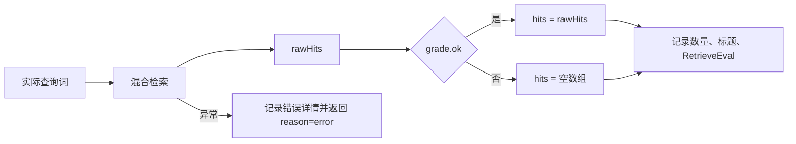
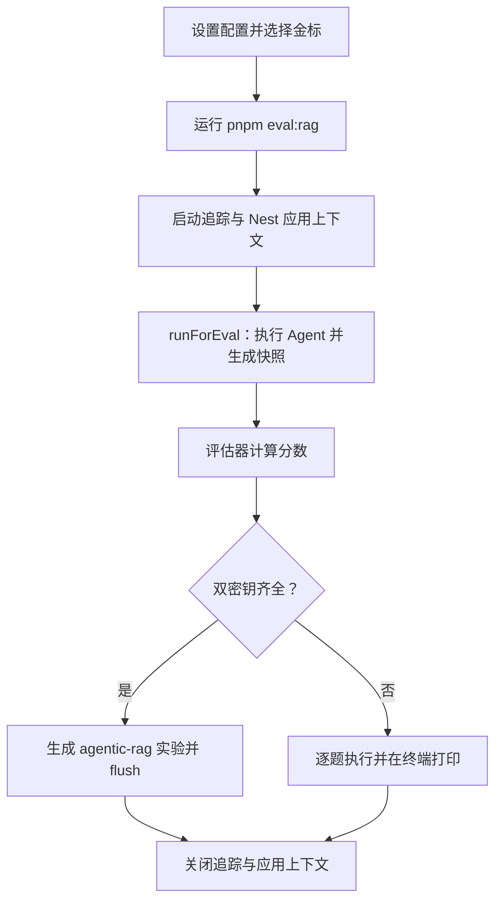

本页位于“质量保障与运行维护”，关注如何把一次问答还原为可检查的证据：**模型与工具执行轨迹、检索切题判断、最终回答快照，以及实验分数**。仓库以 Langfuse/OpenTelemetry 承载追踪，以 `ChatEvalSnapshot` 承载评测输出；二者相互补充，但不能把“已开启追踪”理解为所有业务阶段都已自动记录。Sources: [langfuse.ts](src/observability/langfuse.ts#L1-L61) · [eval.types.ts](src/ai/eval/eval.types.ts#L17-L37) · [ai-stream.service.ts](src/ai/ai-stream.service.ts#L430-L461)

## 1. 架构：追踪、快照与分数是三种不同证据

**追踪回答“执行了什么”，快照回答“本轮留下了什么结果”，分数回答“结果是否符合预期”**。非流式服务使用显式 observation；流式 Agent 使用 LangChain 回调；实验入口复用流式 Agent，收集工具执行痕迹并交给评估器。下图表示代码中的调用与数据关系，不表示每个节点都会自动生成独立 span。Sources: [ai-chat.service.ts](src/ai/ai-chat.service.ts#L112-L130) · [ai-stream.service.ts](src/ai/ai-stream.service.ts#L380-L461) · [run-experiment.ts](src/ai/eval/run-experiment.ts#L48-L85)



Sources: [langfuse.ts](src/observability/langfuse.ts#L20-L48) · [agentic-retrieve.ts](src/ai/agentic-retrieve.ts#L76-L115) · [ai-stream.service.ts](src/ai/ai-stream.service.ts#L384-L461) · [run-experiment.ts](src/ai/eval/run-experiment.ts#L71-L106)

| 证据层 | 实现入口 | 核心内容 | 使用边界 |
|---|---|---|---|
| 非流式业务追踪 | `withObservation('ai-chat')` | 问题、回答、意图、检索次数、命中文档标题 | 显式业务摘要，不等于逐个模型调用记录 |
| 检索阶段追踪 | `withObservation('retrieve-and-grade')` | 实际查询词、重试标记、数量、标题、切题评估或错误 | 一次检索与切题判断共用一个 observation |
| Agent 执行追踪 | `CallbackHandler` | 接入 `agent.stream` 或 `agent.invoke` 的执行过程 | 回调安装在 Agent 执行处 |
| 评测快照 | `ChatEvalSnapshot` | 实际动作、候选命中、切题命中、回答与联网摘录 | 是压缩结果，不是完整事件日志 |
| 实验结果 | `langfuse.experiment.run` | 金标、任务输出、评估分数、模型元数据 | 无密钥时改为终端执行 |

Sources: [ai-chat.service.ts](src/ai/ai-chat.service.ts#L206-L226) · [agentic-retrieve.ts](src/ai/agentic-retrieve.ts#L76-L115) · [ai-stream.service.ts](src/ai/ai-stream.service.ts#L430-L461) · [ai-stream.service.ts](src/ai/ai-stream.service.ts#L544-L564) · [run-experiment.ts](src/ai/eval/run-experiment.ts#L71-L106)

## 2. 启用与生命周期

追踪采用**双密钥开关**：只有 `LANGFUSE_PUBLIC_KEY` 与 `LANGFUSE_SECRET_KEY` 同时为真值才启用。启动函数创建带 `LangfuseSpanProcessor` 的 `NodeSDK`，并通过模块级 `sdk` 防止重复初始化；关闭函数等待 `sdk.shutdown()` 后清空引用。关闭追踪时，`withObservation` 与 `withTraceAttrs` 仍执行原业务函数，只是不附加观测操作。Sources: [langfuse.ts](src/observability/langfuse.ts#L11-L61)

| 配置项 | 代码中的用途 | 默认或缺省行为 |
|---|---|---|
| `LANGFUSE_PUBLIC_KEY` | 与私钥共同决定是否启用 | 缺失则不开启 |
| `LANGFUSE_SECRET_KEY` | 与公钥共同决定是否启用 | 缺失则不开启 |
| `LANGFUSE_BASE_URL` | 启动日志显示的 Langfuse 地址 | 日志回退为 `https://cloud.langfuse.com` |
| `EVAL_FILTER` | 按金标 `metadata.id` 或 `metadata.suite` 精确筛选 | 不设置则执行全部金标 |
| `EVAL_CONCURRENCY` | Langfuse 实验最大并发数 | `2` |
| `EVAL_USER_ID` | 实验管理员用户标识 | `eval-admin` |
| `EVAL_JUDGE_MODEL` | LLM 裁判模型 | 回退到 `MODEL_NAME`、`LLM_MODEL`、`qwen-plus` |

Sources: [langfuse.ts](src/observability/langfuse.ts#L13-L28) · [run-experiment.ts](src/ai/eval/run-experiment.ts#L22-L45) · [run-experiment.ts](src/ai/eval/run-experiment.ts#L71-L83) · [evaluators.ts](src/ai/eval/evaluators.ts#L316-L341)

HTTP 应用在 `NestFactory.create` 之前启动追踪，启用 Nest 关闭钩子，并在 `beforeExit` 回调中调用关闭函数；该回调没有等待返回的 Promise。实验入口则在正常完成后显式等待追踪关闭，再关闭应用上下文。因此，代码中的正常收尾路径不应被解释为异常退出或强制终止时必然完成上报的保证。Sources: [main.ts](src/main.ts#L6-L12) · [run-experiment.ts](src/ai/eval/run-experiment.ts#L108-L115)

## 3. 模型调用追踪：两条问答路径的覆盖不同

### 3.1 非流式：记录一轮业务摘要

`AiChatService.chat` 为非空问题创建名为 `ai-chat` 的 observation，在内部传播 `userId`、传入的 `sessionId` 与标签 `ai-chat`、`agentic-rag`。完成时写入问题、回答、意图、检索评估，以及 `retrieveCount` 和 `hitTitles` 元数据。这里的会话属性取自调用入参，而不是完成后返回的会话 ID；新建会话时，不能假定追踪属性已自动补上新 ID。Sources: [ai-chat.service.ts](src/ai/ai-chat.service.ts#L94-L130) · [ai-chat.service.ts](src/ai/ai-chat.service.ts#L206-L226)

### 3.2 流式 Agent：在模型与工具执行入口安装回调

线上流式路径先取得真实会话，再创建 `CallbackHandler`，传入 `userId`、`session.id` 与标签 `agentic-rag`、当前意图，将其安装到 `agent.stream`。评测路径则在 `agent.invoke` 安装回调，标签额外包含 `eval`，不传会话 ID。两条路径均只在 Langfuse 开关开启时创建回调。Sources: [ai-stream.service.ts](src/ai/ai-stream.service.ts#L488-L511) · [ai-stream.service.ts](src/ai/ai-stream.service.ts#L544-L564) · [ai-stream.service.ts](src/ai/ai-stream.service.ts#L430-L445)

**回调位置就是覆盖边界**：评测中的意图分类与长期记忆读取发生在 `agent.invoke` 之前；线上意图分类也发生在 `agent.stream` 之前。因此，不能仅凭 Agent 回调就宣称这些前置阶段全部纳入同一条模型调用追踪。流式主模型还设置了 `streamUsage: false`，不应把此接入描述成已保证完整 token 用量或成本统计。Sources: [ai-stream.service.ts](src/ai/ai-stream.service.ts#L128-L141) · [ai-stream.service.ts](src/ai/ai-stream.service.ts#L389-L445) · [ai-stream.service.ts](src/ai/ai-stream.service.ts#L506-L564)

## 4. 检索 observation：区分“有命中”与“可作为依据”

每次 `retrieveAndGrade` 都创建 `retrieve-and-grade` observation：先执行检索，再对照用户原问题判断切题性。记录的输入是实际查询词与重试标记，输出是候选数量、文档标题和 `RetrieveEval`。只有整体评估 `grade.ok` 为真时，候选结果才进入 `hits`；否则 `hits` 为空，因此“检索有结果”并不等于“模型获得了可用依据”。Sources: [agentic-retrieve.ts](src/ai/agentic-retrieve.ts#L61-L95)



Sources: [agentic-retrieve.ts](src/ai/agentic-retrieve.ts#L76-L115)

| `RetrieveEval.reason` | 含义 |
|---|---|
| `ok` / `retried_ok` | 首轮／重试后切题 |
| `empty` / `retried_empty` | 首轮／重试后无命中 |
| `irrelevant` / `retried_irrelevant` | 首轮／重试后有命中但不切题 |
| `error` | 检索与评估执行块发生异常 |

Sources: [agentic-retrieve.ts](src/ai/agentic-retrieve.ts#L7-L36) · [agentic-retrieve.ts](src/ai/agentic-retrieve.ts#L76-L114)

异常路径会把错误详情写入 observation 输出，然后返回空命中与 `reason: 'error'`，而不是继续向外抛出该异常。排障时应检查业务输出中的 `error` 和 `RetrieveEval.reason`，不能只依赖“是否出现未捕获异常”来判断检索是否成功。Sources: [agentic-retrieve.ts](src/ai/agentic-retrieve.ts#L96-L114)

## 5. 检索快照：保留结果，但不等同完整上下文

`ChatEvalSnapshot` 同时保存路由许可和实际动作：`allowRetrieve`、`allowGraph`、`allowWeb` 表示允许使用什么；`retrieveCount`、`graphUsed`、`webUsed` 表示本轮实际留下的执行痕迹。评估器依据后者检查工具策略，不以“工具是否被挂载”或回答文案代替实际动作。Sources: [eval.types.ts](src/ai/eval/eval.types.ts#L17-L37) · [evaluators.ts](src/ai/eval/evaluators.ts#L66-L88)

| 字段组 | 主要字段 | 分析用途 |
|---|---|---|
| 请求与回答 | `question`、`answer` | 复核最终输出 |
| 路由计划 | `intent`、三个 `allow*`、`graphQueries` | 对照意图与工具许可 |
| 实际行为 | `retrieveCount`、`graphUsed`、`webUsed` | 检查工具策略 |
| 重试状态 | `rewritten`、`retryQuery`、`retrieveEval` | 检查是否用不同词再次检索 |
| 候选证据 | `rawHits` | 分析精排后、切题过滤前的召回 |
| 采用证据 | `gradedHits` | 分析误命中与回答忠实度 |
| 联网证据 | `webSnippet` | 为回答依据判断提供联网摘录 |

Sources: [eval.types.ts](src/ai/eval/eval.types.ts#L17-L37) · [evaluators.ts](src/ai/eval/evaluators.ts#L91-L110) · [evaluators.ts](src/ai/eval/evaluators.ts#L152-L215) · [evaluators.ts](src/ai/eval/evaluators.ts#L278-L305)

流式评测快照有一个重要聚合规则：`rawHits` 仅取**最后一次检索**，`gradedHits` 则合并所有检索轮次中被判为切题的命中。因此，实验中的 Hit@5 不是“所有轮次候选结果的并集命中率”，快照也无法单独还原每轮候选集；逐轮排查应结合检索 observation 或 Agent 轨迹。Sources: [ai-stream.service.ts](src/ai/ai-stream.service.ts#L448-L461) · [evaluators.ts](src/ai/eval/evaluators.ts#L152-L192)

命中快照只保存文档 ID、标题、标题层级、分数和摘录；摘录压缩空白后最多保留前 400 个字符并追加省略号。实际工具上下文却可包含完整 `hit.content`，所以 **`gradedHits` 是采用证据的压缩表示，不是模型完整上下文副本**。忠实度裁判读取这些摘录与联网片段，快照中没有图谱正文证据字段。Sources: [eval.types.ts](src/ai/eval/eval.types.ts#L4-L11) · [ai-stream.service.ts](src/ai/ai-stream.service.ts#L724-L732) · [ai-stream.service.ts](src/ai/ai-stream.service.ts#L858-L864) · [evaluators.ts](src/ai/eval/evaluators.ts#L37-L44) · [evaluators.ts](src/ai/eval/evaluators.ts#L289-L295)

非流式服务可通过内部 `ChatOptions.includeEval` 返回快照，但当前 `/ai/chat` 控制器未传入该选项。因此，不能把 `includeEval: true` 当作已经开放的 HTTP 调试参数；现成的实验入口使用的是 `AiStreamService.runForEval`。Sources: [ai-chat.service.ts](src/ai/ai-chat.service.ts#L30-L41) · [ai-chat.service.ts](src/ai/ai-chat.service.ts#L221-L226) · [ai.controller.ts](src/ai/ai.controller.ts#L49-L54) · [run-experiment.ts](src/ai/eval/run-experiment.ts#L66-L69)

## 6. 实验执行与结果解读

### 6.1 最小执行流程

实验脚本创建完整 `AppModule` 应用上下文，取得 `AiStreamService`，按 ID 或套件筛选本地金标，并以固定 `topK=5` 调用 `runForEval`。它复用线上 Agent，但不创建会话、不写短期或长期记忆；仍会读取指定用户的长期记忆，所以“不写入”并不等于“完全不受记忆影响”。Sources: [run-experiment.ts](src/ai/eval/run-experiment.ts#L33-L69) · [ai-stream.service.ts](src/ai/ai-stream.service.ts#L380-L393) · [ai-stream.service.ts](src/ai/ai-stream.service.ts#L430-L445)



Sources: [package.json](package.json#L8-L21) · [run-experiment.ts](src/ai/eval/run-experiment.ts#L33-L109)

在 Windows `cmd.exe` 中，可先用金标 ID 做单题检查，再用套件名检查一类行为。下面的 `rewrite` 对应改写套件，`kb-travel-signoff` 对应单题；设置双密钥后相同命令会进入 Langfuse 实验分支，不设置则只打印终端分数。Sources: [golden-dataset.ts](src/ai/eval/golden-dataset.ts#L22-L44) · [run-experiment.ts](src/ai/eval/run-experiment.ts#L39-L45) · [run-experiment.ts](src/ai/eval/run-experiment.ts#L71-L106)

```bat
set EVAL_FILTER=kb-travel-signoff
pnpm eval:rag

set EVAL_FILTER=rewrite
pnpm eval:rag
```

Sources: [package.json](package.json#L21) · [run-experiment.ts](src/ai/eval/run-experiment.ts#L39-L45)

### 6.2 分数应与证据层一起读

| 分数 | 读取的证据 | 关键解释 |
|---|---|---|
| `intent_match` | `intent` | 是否等于金标意图 |
| `tool_policy` | 实际工具动作字段 | 是否违反禁止条件或缺少必需动作 |
| `rewrite_loop` | 重试状态、前后查询词 | 要求重试且查询词不同 |
| `hit_at_5` | 最后一次 `rawHits` 的前五条 | 是否存在标题匹配金标的命中 |
| `precision_at_5` | 同上 | 相关命中数除以实际取到的条数，不固定除以五 |
| `false_hit` | `gradedHits` | 空金标题中没有误用资料得 `1`，误用得 `0` |
| `refusal_quality` | 回答及检索状态 | 裁判检查是否承认无依据且未编造 |
| `completeness` | 回答、要点与禁用事实 | 检查要点覆盖及错误事实 |
| `groundedness` | 回答、切题摘录与联网片段 | 支持／混合／编造分别为 `1`／`0.5`／`0` |

Sources: [evaluators.ts](src/ai/eval/evaluators.ts#L47-L110) · [evaluators.ts](src/ai/eval/evaluators.ts#L125-L215) · [evaluators.ts](src/ai/eval/evaluators.ts#L231-L305)

**缺分不等于零分**。不适用的指标、缺少裁判模型或裁判调用失败都可能返回 `value: null`；适配器将其转换为空结果，不写入 Langfuse 分数。分析实验时应同时检查有效分数数量和跳过条件，避免把没有评估误读为已经通过。Sources: [evaluators.ts](src/ai/eval/evaluators.ts#L129-L142) · [evaluators.ts](src/ai/eval/evaluators.ts#L345-L381)

### 6.3 比较实验时保持哪些条件一致

实验以 `agentic-rag` 为名称，上报的运行元数据只显式包含 `MODEL_NAME` 或 `LLM_MODEL`，并未完整记录检索配置、裁判模型和索引状态。建议比较时自行保留金标筛选条件、模型配置、裁判配置、知识库状态与评测用户标识；否则不能仅凭同名实验断言两次运行具有完全相同条件。Sources: [run-experiment.ts](src/ai/eval/run-experiment.ts#L39-L45) · [run-experiment.ts](src/ai/eval/run-experiment.ts#L71-L83) · [evaluators.ts](src/ai/eval/evaluators.ts#L316-L341)

评测用户固定带管理员角色，其设计目的是避免 ACL 将制度题变成空召回，因此该实验不是普通用户可见性的验证。此外，`graphUsed` 在图谱调用成功返回后置真，即使图谱结果为空；`webUsed` 根据是否收集到字符串片段判断，而片段可能是错误文本或“无结果。”。这些字段证明执行痕迹，不直接证明获得有效外部证据。Sources: [run-experiment.ts](src/ai/eval/run-experiment.ts#L22-L30) · [ai-stream.service.ts](src/ai/ai-stream.service.ts#L305-L318) · [ai-stream.service.ts](src/ai/ai-stream.service.ts#L456-L460) · [ai-stream.service.ts](src/ai/ai-stream.service.ts#L716-L721)

## 7. 排障与数据边界

| 现象 | 优先核查 |
|---|---|
| Langfuse 没有追踪 | 公私钥是否同时存在，启动时是否出现 tracing 启动日志 |
| 线上有回答，实验却没有会话记录 | `runForEval` 本就不创建会话、不写记忆 |
| 命中文档很多，但回答称资料不足 | 比较 `rawHits` 与 `gradedHits`，检查 `RetrieveEval` |
| 检索看似正常结束，但没有资料 | 检查 `reason: error` 及 observation 的错误输出 |
| 重试后 Hit@5 与首轮观察不同 | 快照的 `rawHits` 只保留最后一次检索 |
| 部分指标未出现 | 检查指标适用条件、裁判配置与 `null` 跳过逻辑 |
| 流式回答异常或未落库 | 分别检查“LangChain 流失败”和“流式对话落库失败”日志 |

Sources: [langfuse.ts](src/observability/langfuse.ts#L13-L28) · [ai-stream.service.ts](src/ai/ai-stream.service.ts#L380-L393) · [agentic-retrieve.ts](src/ai/agentic-retrieve.ts#L76-L114) · [ai-stream.service.ts](src/ai/ai-stream.service.ts#L448-L461) · [evaluators.ts](src/ai/eval/evaluators.ts#L345-L381) · [ai-stream.service.ts](src/ai/ai-stream.service.ts#L567-L611)

上报内容并非只有技术指标：非流式 observation 显式写入用户问题与回答；Agent 回调接收的消息可能包含历史和长期记忆；检索工具上下文可包含完整文档片段。**快照摘录被截断，不代表整条追踪已经脱敏**。启用外部追踪前，应按实际消息与工具输出审查数据范围，而不是仅检查 `ChatEvalHit.excerpt`。Sources: [ai-chat.service.ts](src/ai/ai-chat.service.ts#L211-L219) · [ai-stream.service.ts](src/ai/ai-stream.service.ts#L544-L564) · [ai-stream.service.ts](src/ai/ai-stream.service.ts#L724-L732) · [ai-stream.service.ts](src/ai/ai-stream.service.ts#L858-L864)

## 8. 后续阅读

若要进一步理解金标设计和指标判断，阅读[问答质量评测：金标数据、工具策略、改写行为与答案可信度](28-wen-da-zhi-liang-ping-ce-jin-biao-shu-ju-gong-ju-ce-lue-gai-xie-xing-wei-yu-da-an-ke-xin-du)；若要将前端过程卡与后台追踪对应起来，阅读[流式智能体与前端集成：工具调用、过程事件和消息流协议](25-liu-shi-zhi-neng-ti-yu-qian-duan-ji-cheng-gong-ju-diao-yong-guo-cheng-shi-jian-he-xiao-xi-liu-xie-yi)。前者对应实验评估器，后者对应流式服务定义的 `status`、`intent`、`eval` 和工具事件。Sources: [evaluators.ts](src/ai/eval/evaluators.ts#L385-L395) · [ai-stream.service.ts](src/ai/ai-stream.service.ts#L60-L92) · [ai-stream.service.ts](src/ai/ai-stream.service.ts#L560-L575)