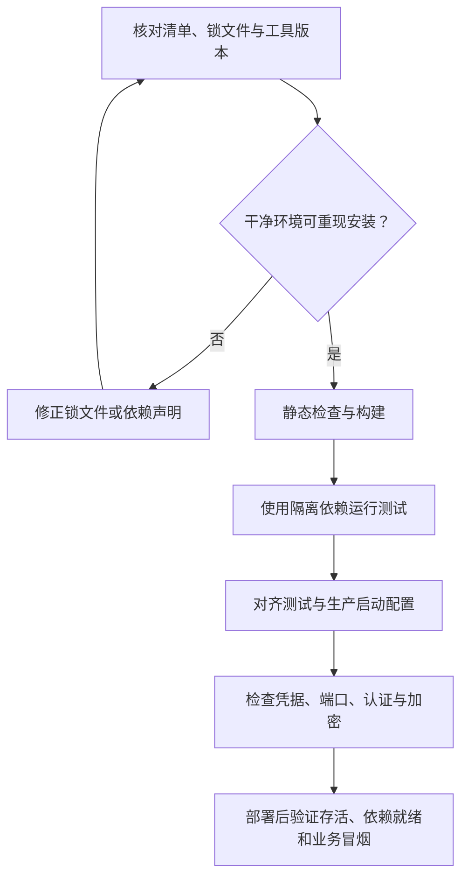

本页位于“质量保障与运行维护”的最后一节，面向准备维护测试、搭建持续集成或部署后端的开发者。检查从三个问题展开：**测试是否复现真实启动行为、构建是否能从依赖清单稳定重现、开发配置是否被误用于生产**。仓库中存在可直接确认的配置差异：测试脚本使用 Jest，而另有未接入脚本的 Vitest 配置；端到端测试绕过 `main.ts`；Compose 中保留多项开发凭据和开放端口。以下区分“当前实现”与“建议整改”，不将静态检查当作测试通过或安全审计结论。Sources: [package.json](package.json#L8-L21) [vitest.config.mts](vitest.config.mts#L1-L13) [app.e2e-spec.ts](test/app.e2e-spec.ts#L10-L24) [main.ts](src/main.ts#L6-L24) [docker-compose.yml](docker-compose.yml#L1-L39)

## 一、先明确发布检查的边界

**编译成功、测试通过和服务就绪是三种不同的保证。** 构建配置排除了测试文件；现有端到端用例只检查根路径；真实启动还会安装全局校验、启用跨域并初始化应用模块。建议按下图建立发布门禁，每一阶段保留独立结果，避免用一个成功信号替代整条链路。Sources: [tsconfig.build.json](tsconfig.build.json#L1-L9) [app.e2e-spec.ts](test/app.e2e-spec.ts#L10-L28) [main.ts](src/main.ts#L6-L24)



该流程是建议的验收顺序，不是仓库已实现的流水线；它对应现有的构建、测试、启动脚本以及基础设施配置。Sources: [package.json](package.json#L8-L21) [docker-compose.yml](docker-compose.yml#L1-L20) [main.ts](src/main.ts#L6-L24)

## 二、测试配置：先修正入口，再讨论覆盖率

### 2.1 Jest 与 Vitest 并不是同一套执行路径

当前 `pnpm test` 调用 Jest，读取 `package.json` 中的内嵌配置；Vitest 配置文件的存在不会自动改变该行为。两份 Vitest 配置还导入了 `vitest/config` 和 `vite-tsconfig-paths`，但这两个工具未在当前 `package.json` 的开发依赖中声明。Sources: [package.json](package.json#L16-L20) [package.json](package.json#L76-L125) [vitest.config.mts](vitest.config.mts#L1-L13) [vitest.config.e2e.mts](vitest.config.e2e.mts#L1-L11)

| 检查项 | Jest 当前入口 | Vitest 配置 | 维护含义 |
|---|---|---|---|
| 执行命令 | `test`、`test:watch`、`test:cov` | 没有对应脚本 | 应先确定唯一主测试工具 |
| 普通测试范围 | `rootDir: "src"`，匹配 `.*\.spec\.ts$` | 仓库根目录，匹配 `**/*.spec.ts` | 搜索范围不同 |
| 端到端入口 | `test:e2e` 指向 `test/jest-e2e.json` | 匹配 `**/*.e2e-spec.ts` | 当前提供的 `test` 目录只有测试文件，没有脚本引用的 JSON 配置 |
| TypeScript 支持 | `ts-jest` 转换 | 引入路径解析插件 | 不能仅改命令名称便视为迁移完成 |
| 覆盖率 | 配置了收集范围与输出目录 | 当前文件未配置覆盖率 | 两套结果不能直接视为等价 |

Sources: [package.json](package.json#L16-L20) [package.json](package.json#L109-L125) [vitest.config.mts](vitest.config.mts#L4-L12) [vitest.config.e2e.mts](vitest.config.e2e.mts#L4-L10) [app.e2e-spec.ts](test/app.e2e-spec.ts#L1-L29)

**建议优先沿用已接入脚本的 Jest，补齐端到端配置；若决定迁移 Vitest，则同时修改脚本、依赖声明和测试类型配置。** TypeScript 当前显式加载 `jest` 类型，因此仅保留 Vitest 的 `globals: true` 并不能说明类型检查也已同步完成。Sources: [package.json](package.json#L16-L20) [package.json](package.json#L85-L106) [tsconfig.json](tsconfig.json#L18-L20) [vitest.config.mts](vitest.config.mts#L8-L12)

### 2.2 端到端测试没有复现完整启动配置

现有用例导入完整 `AppModule`，通过 `createNestApplication()` 和 `app.init()` 创建应用，却没有执行 `bootstrap()`。因此它保留了模块内注册的全局认证、角色和权限守卫，但没有安装 `main.ts` 中的全局 `ValidationPipe`、跨域配置以及追踪启动逻辑。根路径又标记为公开接口，所以该用例不能证明受保护接口或参数校验正常。Sources: [app.e2e-spec.ts](test/app.e2e-spec.ts#L10-L24) [main.ts](src/main.ts#L6-L24) [auth.module.ts](src/auth/auth.module.ts#L32-L49) [app.controller.ts](src/app.controller.ts#L5-L13)

| 当前写法或行为 | 建议调整后 | 验收目标 |
|---|---|---|
| 校验管道只在 `bootstrap()` 中安装 | 提取共享应用配置函数，由正式入口和测试共同调用 | 未知字段拒绝、DTO 转换行为一致 |
| 每个用例初始化完整 `AppModule` | 使用专用测试环境；按测试目标替换外部服务或连接隔离实例 | 不误连开发或生产数据 |
| 仅断言 `GET /` 返回固定文本 | 补充未认证访问、权限拒绝、非法参数与关键业务冒烟 | 区分路由存活与安全规则有效 |
| 每例执行 `app.close()` | 保留关闭逻辑，并验证连接资源能够释放 | 避免测试结束后连接残留 |

Sources: [app.e2e-spec.ts](test/app.e2e-spec.ts#L10-L28) [main.ts](src/main.ts#L17-L23) [app.module.ts](src/app.module.ts#L39-L104) [auth.module.ts](src/auth/auth.module.ts#L38-L49)

测试环境还需要考虑启动副作用：`ConfigModule.forRoot()` 没有在此处指定独立测试文件，应用会初始化 PostgreSQL、MongoDB 等模块；RabbitMQ 默认启用，并在连接超时后抛出初始化错误。设置 `RABBITMQ_ENABLED=false` 可以跳过 MQ 初始化，但只能用于不验证消息链路的测试，不能替代消息集成测试。Sources: [app.module.ts](src/app.module.ts#L39-L104) [rabbitmq.service.ts](src/mq/rabbitmq.service.ts#L38-L60) [rabbitmq.service.ts](src/mq/rabbitmq.service.ts#L92-L113)

## 三、构建与部署：分开管理应用产物和基础设施

### 3.1 构建结果代表什么

仓库通过 `nest build` 构建，通过 `node dist/main` 启动生产进程。TypeScript 使用 `nodenext` 模块解析、`ES2023` 目标、严格检查并生成 source map；构建仅包含 `src`，排除测试文件，Nest 构建前还会清理输出目录。**因此，构建成功不等于测试代码可以执行，也不等于部署运行时兼容。** 应在选定的 Node 运行环境中验证产物，而不能从 `@types/node` 的版本推导生产运行时版本。Sources: [package.json](package.json#L8-L14) [package.json](package.json#L85-L87) [tsconfig.json](tsconfig.json#L2-L20) [tsconfig.build.json](tsconfig.build.json#L1-L9) [nest-cli.json](nest-cli.json#L4-L7)

以下是依赖和测试入口修正后的最小构建检查顺序。`pnpm test:e2e` 当前仍引用缺失的配置文件，应先修正再纳入门禁；生产启动需要另行注入连接信息和密钥。Sources: [package.json](package.json#L8-L21) [app.module.ts](src/app.module.ts#L63-L103) [auth.module.ts](src/auth/auth.module.ts#L22-L27)

```bat
pnpm install --frozen-lockfile
pnpm exec tsc --noEmit -p tsconfig.build.json
pnpm test -- --runInBand
pnpm test:e2e
pnpm build
pnpm start:prod
```

### 3.2 Compose 不是后端应用发布描述

当前 Compose 定义数据库、中间件、检索服务、对象存储和管理界面，没有定义 Nest 后端服务；`elasticsearch/Dockerfile` 也只是 Elasticsearch 与 IK 插件镜像。部署时必须单独安排后端进程或应用镜像，不能把 `docker compose up` 当成完整应用发布。Sources: [docker-compose.yml](docker-compose.yml#L1-L39) [docker-compose.yml](docker-compose.yml#L115-L162) [docker-compose.yml](docker-compose.yml#L164-L210) [Dockerfile](elasticsearch/Dockerfile#L1-L8) [package.json](package.json#L9-L14)

| 部署检查 | 当前证据 | 建议验收方式 |
|---|---|---|
| PostgreSQL 健康检查 | 创建数据库为 `knowledge_hub`，探针却使用 `hello_pg` | 统一数据库名，并增加实际连接和查询检查 |
| 启动顺序 | 部分服务使用 `service_healthy`，Kibana 仅声明依赖 ES 启动 | 不将容器已启动等同于服务可用 |
| 数据持久化 | 多项数据目录绑定到宿主机 `volumes` | 明确备份、恢复及目录权限方案 |
| 数据库结构 | TypeORM 设置 `synchronize: false`，SQL 包含建表语句 | 独立管理存量数据库的结构升级与回滚 |
| 搜索组件 | ES 与 IK 为 8.17.0，Kibana 也为 8.17.0 | 升级时联合验证镜像、插件和客户端 |
| 停机清理 | 启用 shutdown hooks，Redis 和 RabbitMQ 实现关闭逻辑 | 验证部署平台发出的终止信号与连接释放 |

Sources: [docker-compose.yml](docker-compose.yml#L7-L20) [docker-compose.yml](docker-compose.yml#L80-L98) [docker-compose.yml](docker-compose.yml#L134-L162) [docker-compose.yml](docker-compose.yml#L202-L205) [app.module.ts](src/app.module.ts#L93-L94) [init.sql](init-scripts/postgresql/init.sql#L1-L26) [Dockerfile](elasticsearch/Dockerfile#L1-L8) [main.ts](src/main.ts#L8-L12) [redis.service.ts](src/redis/redis.service.ts#L40-L42) [rabbitmq.service.ts](src/mq/rabbitmq.service.ts#L134-L137)

根路径只调用 `AppService.getHello()`，现有测试也只验证该固定响应。它可用于最小路由冒烟，但不能作为 PostgreSQL、MongoDB、RabbitMQ 或索引服务全部就绪的证据；建议将进程存活与依赖就绪设计为不同检查。Sources: [app.controller.ts](src/app.controller.ts#L5-L13) [app.e2e-spec.ts](test/app.e2e-spec.ts#L19-L24) [app.module.ts](src/app.module.ts#L60-L104)

## 四、依赖健康：先保证可重现，再判断升级风险

### 4.1 锁文件格式需要优先核验

当前 `pnpm-lock.yaml` 中可以直接看到两个由 `---` 分隔的 YAML 文档：第一段记录 pnpm 12.4.2，第二段从第 158 行开始记录应用依赖。**不能据此直接断言安装失败，也不能跳过验证认定它是可用锁文件。** 应先固定所用包管理器版本，在干净环境执行冻结安装；若工具不能接受当前结构，再由选定版本重新生成并审查差异。Sources: [pnpm-lock.yaml](pnpm-lock.yaml#L1-L13) [pnpm-lock.yaml](pnpm-lock.yaml#L141-L174)

| 依赖检查项 | 当前状态 | 处理原则 |
|---|---|---|
| 测试工具版本 | Jest `^30.0.0`、`ts-jest` `^29.2.5` | 核对实际解析版本、peer 约束和运行结果，不仅凭主版本判定不兼容 |
| 浮动版本 | 多数使用 `^`，`@nestjs/mapped-types` 使用 `*` | 依靠经验证的锁文件重现安装，审查升级差异 |
| 声明与解析版本 | ES 客户端声明 `^8.17.0`，锁定为 8.19.2 | 排障记录使用实际解析版本 |
| 安装脚本 | `allowBuilds` 允许部分包，拒绝 `tesseract.js` | 维护显式允许策略，变更后验证相关能力 |
| 镜像漂移 | pgAdmin、RustFS、Neo4j 使用 `latest` | 生产固定版本或摘要，单独验证升级 |
| 静态检查入口 | `lint` 调用带 `--fix` 的 ESLint；另有 `oxlint.json` | 区分本地修复与 CI 只读检查，不假定 Oxlint 配置由 ESLint 执行 |

Sources: [package.json](package.json#L15-L20) [package.json](package.json#L26-L39) [package.json](package.json#L98-L107) [pnpm-lock.yaml](pnpm-lock.yaml#L175-L180) [pnpm-workspace.yaml](pnpm-workspace.yaml#L1-L7) [docker-compose.yml](docker-compose.yml#L23-L28) [docker-compose.yml](docker-compose.yml#L164-L179) [docker-compose.yml](docker-compose.yml#L191-L201) [oxlint.json](oxlint.json#L1-L9)

建议在锁文件可正常解析后执行依赖列表、过期检查和漏洞审计，并保留执行日期、工具版本及输出。本页没有执行安装或漏洞数据库查询，因此不提供漏洞数量，也不将上述版本差异认定为已确认漏洞。Sources: [package.json](package.json#L23-L107) [pnpm-lock.yaml](pnpm-lock.yaml#L158-L180)

```bat
pnpm list --depth 0
pnpm outdated
pnpm audit
```

## 五、安全加固：按暴露面排列整改优先级

### 5.1 发布前优先消除开发默认值

下面的优先级是基于仓库配置提出的整改建议，不是现成的安全等级。首先处理可直接影响身份信任和数据访问的默认密钥、公开服务端口及关闭认证的存储服务，再收紧浏览器和文件处理边界。Sources: [auth.module.ts](src/auth/auth.module.ts#L22-L27) [jwt.strategy.ts](src/auth/jwt.strategy.ts#L19-L23) [docker-compose.yml](docker-compose.yml#L85-L98) [docker-compose.yml](docker-compose.yml#L134-L145) [main.ts](src/main.ts#L13-L23)

| 优先级 | 当前实现 | 建议加固与验收 |
|---|---|---|
| 发布前 | JWT 签发和验证均回退到 `dev-secret-change-me` | 生产强制提供高强度密钥，缺失时拒绝启动；同步修改签发与验证配置 |
| 发布前 | Compose 包含数据库、MQ、对象存储和管理界面的固定凭据 | 替换为独立凭据及外部秘密注入，避免跨环境复用 |
| 发布前 | ES 关闭认证与 HTTP、传输层 TLS | 根据部署网络启用认证与加密，并同步验证客户端连接 |
| 发布前 | Redis 映射宿主机端口，未配置服务端密码 | 限制网络暴露并配置服务端认证；应用端已有 `REDIS_PASSWORD` 读取能力 |
| 高 | 多个数据库和管理界面端口直接映射，未限定回环地址 | 使用内网或受控管理通道；不需要的管理界面不对外发布 |
| 高 | `origin: true` 同时允许凭据 | 改为明确的可信来源列表，验证预检与凭据请求 |
| 高 | RustFS 使用通配 CORS，启用磁盘检查绕过开关 | 限制来源并评估移除绕过开关 |
| 高 | Neo4j 配置 unrestricted `apoc.*` | 按实际使用收敛过程权限范围 |

Sources: [auth.module.ts](src/auth/auth.module.ts#L22-L27) [jwt.strategy.ts](src/auth/jwt.strategy.ts#L19-L23) [docker-compose.yml](docker-compose.yml#L7-L37) [docker-compose.yml](docker-compose.yml#L61-L77) [docker-compose.yml](docker-compose.yml#L85-L98) [docker-compose.yml](docker-compose.yml#L115-L145) [docker-compose.yml](docker-compose.yml#L170-L181) [docker-compose.yml](docker-compose.yml#L191-L201) [redis.service.ts](src/redis/redis.service.ts#L9-L17) [main.ts](src/main.ts#L13-L16)

`.gitignore` 已排除 `.env`、若干环境本地文件和运行数据目录，但这只是版本控制过滤规则，不代表密钥已加密，也不会消除 Compose 中现有的明文默认值。审查应覆盖配置文件和发布产物，而不只是检查是否忽略 `.env`。Sources: [.gitignore](.gitignore#L41-L60) [docker-compose.yml](docker-compose.yml#L7-L10) [docker-compose.yml](docker-compose.yml#L173-L181)

### 5.2 保留已有防线，补齐入口一致性

应用已经具备全局 JWT、角色、权限守卫，以及白名单过滤、转换和拒绝未知字段的全局校验配置。这些是应保留并回归验证的防线，但当前端到端测试并未覆盖这些行为；安全整改不应仅停留在修改配置，还应增加拒绝路径测试。Sources: [auth.module.ts](src/auth/auth.module.ts#L38-L49) [main.ts](src/main.ts#L17-L23) [app.e2e-spec.ts](test/app.e2e-spec.ts#L15-L24)

上传接口要求文档创建权限，并设置 **200 MiB** 文件大小上限；该拦截器配置中未设置 `fileFilter`。建议在上传和解析边界核对真实文件类型、大小与并发预算，并增加超限、伪装类型和解析失败测试；DTO 校验不能替代二进制文件检查。这里不据此推断下游解析器没有其他防护。Sources: [document.controller.ts](src/document/document.controller.ts#L47-L64) [main.ts](src/main.ts#L17-L23)

## 六、可交付的验收清单与后续阅读

| 阶段 | 最低验收结果 |
|---|---|
| 测试入口 | 主测试工具明确，端到端配置路径有效，测试依赖完整 |
| 启动一致性 | 正式入口与测试共享必要的应用配置，隔离外部数据与服务 |
| 依赖重现 | 选定工具版本可以冻结安装，锁文件差异经过审查 |
| 构建发布 | 测试与构建分别通过，部署环境能执行 `dist/main` |
| 运行就绪 | 不以根路径响应替代依赖检查，修正 PostgreSQL 探针目标 |
| 安全加固 | 移除生产默认密钥，限制服务暴露，明确认证、加密和 CORS 策略 |
| 关闭与恢复 | 验证连接释放，并为持久化目录与数据库变更准备恢复方案 |

Sources: [package.json](package.json#L8-L20) [app.e2e-spec.ts](test/app.e2e-spec.ts#L10-L28) [pnpm-lock.yaml](pnpm-lock.yaml#L150-L174) [docker-compose.yml](docker-compose.yml#L7-L20) [auth.module.ts](src/auth/auth.module.ts#L22-L27) [main.ts](src/main.ts#L8-L24) [rabbitmq.service.ts](src/mq/rabbitmq.service.ts#L134-L137)

需要补齐部署连接信息时，阅读[环境配置指南：数据库、中间件、模型服务与可选能力](3-huan-jing-pei-zhi-zhi-nan-shu-ju-ku-zhong-jian-jian-mo-xing-fu-wu-yu-ke-xuan-neng-li)；涉及存量数据库升级时，阅读[数据初始化与实体映射：表结构、雪花标识与版本演进](8-shu-ju-chu-shi-hua-yu-shi-ti-ying-she-biao-ji-xue-hua-biao-shi-yu-ban-ben-yan-jin)；需要深入令牌安全时，阅读[账号安全：注册登录、邮件激活、密码重置与令牌验证](9-zhang-hao-an-quan-zhu-ce-deng-lu-you-jian-ji-huo-mi-ma-zhong-zhi-yu-ling-pai-yan-zheng)。本页只保留它们与发布检查直接相关的边界。Sources: [app.module.ts](src/app.module.ts#L63-L103) [init.sql](init-scripts/postgresql/init.sql#L1-L26) [jwt.strategy.ts](src/auth/jwt.strategy.ts#L19-L30)