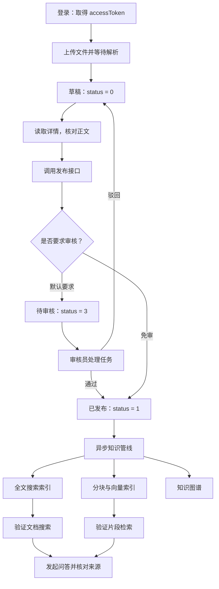

本页带你完成一次最小知识入库闭环：**登录取得令牌 → 上传文件创建草稿 → 提交审核并发布 → 验证全文搜索和知识片段检索 → 发起问答并核对来源**。首先记住两个区别：上传成功不等于发布成功，发布成功也不等于异步索引已经完成。Sources: [document.controller.ts](src/document/document.controller.ts#L47-L64) · [document-status.ts](src/document/document-status.ts#L1-L20) · [document-pipeline.publisher.ts](src/mq/document-pipeline.publisher.ts#L22-L41)

## 一、先认识这条操作链路

上传接口会等待文件解析完成后创建草稿；默认情况下，调用发布接口会进入待审核状态，审核通过后才发布。发布后，系统分别投递全文搜索、RAG 分块向量索引和知识图谱任务，因此首次验证应分层进行，而不是只看问答有没有返回文字。Sources: [document.service.ts](src/document/document.service.ts#L420-L452) · [document.service.ts](src/document/document.service.ts#L560-L589) · [document-review.service.ts](src/document/document-review.service.ts#L95-L118) · [document-pipeline.publisher.ts](src/mq/document-pipeline.publisher.ts#L34-L41)



Sources: [document-status.ts](src/document/document-status.ts#L1-L20) · [document-review.service.ts](src/document/document-review.service.ts#L40-L45) · [document-review.service.ts](src/document/document-review.service.ts#L95-L146) · [pipeline.orchestrator.ts](src/pipeline/pipeline.orchestrator.ts#L21-L29)

本次操作对应的代码入口如下。初次阅读只需沿着控制器、文档服务、发布管线的顺序定位，不必先理解全部检索算法。Sources: [document.controller.ts](src/document/document.controller.ts#L16-L38) · [search.controller.ts](src/search/search.controller.ts#L10-L25) · [ai.controller.ts](src/ai/ai.controller.ts#L30-L54)

```text
src/
├── auth/
│   └── auth.controller.ts              登录与当前用户
├── document/
│   ├── document.controller.ts          上传、发布、详情与审核入口
│   ├── document.service.ts             创建草稿与发布处理
│   └── document-review.service.ts      提审、通过与驳回
├── mq/
│   └── document-pipeline.publisher.ts  发布后投递索引任务
├── pipeline/
│   └── pipeline.orchestrator.ts        执行索引处理
├── search/
│   └── search.controller.ts            文档级全文搜索
└── ai/
    └── ai.controller.ts                片段检索与问答
```

Sources: [auth.controller.ts](src/auth/auth.controller.ts#L11-L25) · [document.controller.ts](src/document/document.controller.ts#L47-L94) · [document-pipeline.publisher.ts](src/mq/document-pipeline.publisher.ts#L22-L41) · [pipeline.orchestrator.ts](src/pipeline/pipeline.orchestrator.ts#L21-L29)

## 二、准备账号、文件与请求地址

以下示例使用 **Windows CMD**，以 `^` 换行，服务地址采用默认的 `http://localhost:3000`；源码中的路由没有额外的 `/api` 前缀。如果尚未启动服务，先完成 [Quick Start](2-quick-start) 和 [环境配置指南：数据库、中间件、模型服务与可选能力](3-huan-jing-pei-zhi-zhi-nan-shu-ju-ku-zhong-jian-jian-mo-xing-fu-wu-yu-ke-xuan-neng-li)。Sources: [main.ts](src/main.ts#L6-L26) · [auth.controller.ts](src/auth/auth.controller.ts#L11-L25)

准备一个具有文档创建、列表、编辑和搜索权限的作者账号；默认审核流程还需要具有审核权限且角色为 `ROLE_REVIEWER` 或 `ROLE_ADMIN` 的账号。作者通常只能修改自己的文档，管理员例外；**拥有审核员角色不等于可以编辑所有作者的文档**。Sources: [document.controller.ts](src/document/document.controller.ts#L40-L49) · [document.controller.ts](src/document/document.controller.ts#L82-L94) · [document.controller.ts](src/document/document.controller.ts#L137-L151) · [document-access.ts](src/document/document-access.ts#L34-L40) · [search.controller.ts](src/search/search.controller.ts#L14-L25)

首次练习建议使用自己创建的 UTF-8 Markdown 文件，例如 `first-knowledge.md`。`.md` 和 `.txt` 本地直读；PDF、图片和 Office 文件走 MinerU。先用 Markdown 可以把“入库流程问题”和“外部解析服务问题”分开排查。Sources: [file-parser.service.ts](src/document/parser/file-parser.service.ts#L6-L33) · [file-parser.service.ts](src/document/parser/file-parser.service.ts#L41-L45) · [file-parser.service.ts](src/document/parser/file-parser.service.ts#L63-L85)

```markdown
# 首次入库验证规范

首次入库验证标识为：蓝鲸入库演练。

验证流程要求先检查文档全文搜索，再检查知识片段检索，
最后发起知识库问答，并核对答案引用的文档来源。
```

Sources: [file-parser.service.ts](src/document/parser/file-parser.service.ts#L41-L45)

## 三、步骤 1：登录并保存访问令牌

登录请求体使用 `username` 和 `password`。成功结果包含 `accessToken`、`refreshToken`、`tokenType`、`expiresIn` 和 `userInfo`；后续业务请求使用 **`accessToken`**，不要把刷新令牌放入认证请求头。Sources: [auth.dto.ts](src/auth/dto/auth.dto.ts#L3-L10) · [auth.service.ts](src/auth/auth.service.ts#L17-L23) · [auth.service.ts](src/auth/auth.service.ts#L91-L98) · [jwt.strategy.ts](src/auth/jwt.strategy.ts#L19-L30)

```bat
set "BASE_URL=http://localhost:3000"

curl.exe -sS -X POST "%BASE_URL%/auth/login" ^
  -H "Content-Type: application/json" ^
  -d "{\"username\":\"你的作者账号\",\"password\":\"你的密码\"}"

rem 将登录结果中的 accessToken 粘贴到这里
set "AUTHOR_TOKEN=粘贴作者的accessToken"

curl.exe -sS "%BASE_URL%/auth/me" ^
  -H "Authorization: Bearer %AUTHOR_TOKEN%"
```

Sources: [auth.controller.ts](src/auth/auth.controller.ts#L21-L25) · [auth.controller.ts](src/auth/auth.controller.ts#L57-L60) · [jwt.strategy.ts](src/auth/jwt.strategy.ts#L19-L30)

检查 `/auth/me` 返回的 `userId`、`roles`、`permissions` 和 `teamIds`，确认当前身份正确。如果没有账号，可以走注册接口；注册不会直接返回登录令牌，开启邮箱验证时还需要先激活。账号准备细节见 [账号安全：注册登录、邮件激活、密码重置与令牌验证](9-zhang-hao-an-quan-zhu-ce-deng-lu-you-jian-ji-huo-mi-ma-zhong-zhi-yu-ling-pai-yan-zheng)。Sources: [auth-user.interface.ts](src/auth/auth-user.interface.ts#L1-L12) · [auth.service.ts](src/auth/auth.service.ts#L100-L130)

## 四、步骤 2：上传文件并确认草稿正文

上传使用 `multipart/form-data`，文件字段必须叫 **`file`**，接口文件大小限制为 200 MiB。不要为这个请求手动添加 JSON 的 `Content-Type`。作者身份从 JWT 获取，上传表单不接收 `authorId`；本次示例不传分类和团队，以减少前置条件。Sources: [document.controller.ts](src/document/document.controller.ts#L47-L64) · [upload-parse.dto.ts](src/document/dto/upload-parse.dto.ts#L4-L29)

```bat
curl.exe -sS -X POST "%BASE_URL%/documents/upload/parse" ^
  -H "Authorization: Bearer %AUTHOR_TOKEN%" ^
  -F "file=@C:\project\vault_project\first-knowledge.md" ^
  -F "isPublic=false" ^
  -F "tags=首次入库"
```

Sources: [document.controller.ts](src/document/document.controller.ts#L47-L64) · [upload-parse.dto.ts](src/document/dto/upload-parse.dto.ts#L14-L29)

| 参数 | 必填 | 首次操作说明 |
|---|---|---|
| `file` | 是 | 非空、受支持格式的文件 |
| `categoryId` | 否 | 首次可省略；传入时会验证分类有效性 |
| `teamId` | 否 | 文档所属团队标识 |
| `tags` | 否 | 字符串，不是数组 |
| `remark` | 否 | 备注字符串 |
| `isPublic` | 否 | 默认 `false`；表单支持 `"true"`、`"false"`、`"1"`、`"0"` |

Sources: [upload-parse.dto.ts](src/document/dto/upload-parse.dto.ts#L4-L29) · [document.service.ts](src/document/document.service.ts#L118-L130) · [document.service.ts](src/document/document.service.ts#L684-L688)

上传成功后，记录返回的 **`documentId`**。响应还包含 `title`、`fileUrl`、`fileSize`、`fileExtension`、`contentLength`、`contentPreview` 和 `status`；其中 `status` 固定为草稿值 `0`，预览最多截取 200 个字符。上传接口不会直接返回完整正文，应继续请求详情核对。Sources: [document.service.ts](src/document/document.service.ts#L629-L643) · [document.service.ts](src/document/document.service.ts#L243-L267)

```bat
set "DOC_ID=粘贴上传响应中的documentId"

curl.exe -sS "%BASE_URL%/documents/%DOC_ID%" ^
  -H "Authorization: Bearer %AUTHOR_TOKEN%"
```

Sources: [document.controller.ts](src/document/document.controller.ts#L171-L177)

确认详情中的 `content` 包含测试标识和完整规则，再提交发布。`fileUrl=null` 本身不代表正文入库失败：RustFS 未启用时会跳过原文件上传，仍继续创建文档；但启用 RustFS 后若原文件上传失败，本次请求会报错。Sources: [document.service.ts](src/document/document.service.ts#L597-L627)

## 五、步骤 3：提交发布并完成审核

使用作者令牌调用发布接口。**默认 `DOCUMENT_REQUIRE_APPROVAL=true`**，因此第一次从草稿发布后应得到 `status=3`，表示待审核，而不是已发布；仅当该配置明确为字符串 `false` 时，本次草稿发布才走免审路径，直接变为 `status=1`。Sources: [document-review.service.ts](src/document/document-review.service.ts#L40-L45) · [document.service.ts](src/document/document.service.ts#L435-L451) · [document.service.ts](src/document/document.service.ts#L475-L483)

```bat
curl.exe -sS -X PUT "%BASE_URL%/documents/%DOC_ID%/publish" ^
  -H "Authorization: Bearer %AUTHOR_TOKEN%"
```

Sources: [document.controller.ts](src/document/document.controller.ts#L89-L94)

| 阶段 | 状态 | 下一步 |
|---|---|---|
| 上传完成 | `0`，草稿 | 核对正文后调用发布 |
| 默认审核流程提交后 | `3`，待审核 | 查询审核任务并由审核员处理 |
| 审核通过或免审发布 | `1`，已发布 | 验证异步索引 |
| 审核驳回 | `0`，草稿 | 根据意见修改后重新提交 |

Sources: [document-status.ts](src/document/document-status.ts#L1-L20) · [document-review.service.ts](src/document/document-review.service.ts#L95-L146)

### 查询当前审核任务

用作者令牌查询该文档当前待审记录，复制记录中的 **`id` 作为 `TASK_ID`**。它与上传响应中的 `documentId` 不是同一个标识；审核通过接口的路径参数要求的是审核任务 ID。免审发布则跳过本节审核步骤。Sources: [document.controller.ts](src/document/document.controller.ts#L117-L125) · [document.controller.ts](src/document/document.controller.ts#L137-L151) · [document-review.service.ts](src/document/document-review.service.ts#L73-L83) · [document-review.service.ts](src/document/document-review.service.ts#L181-L187)

```bat
curl.exe -sS "%BASE_URL%/documents/%DOC_ID%/reviews/current" ^
  -H "Authorization: Bearer %AUTHOR_TOKEN%"

set "TASK_ID=粘贴当前审核记录的id"
```

Sources: [document.controller.ts](src/document/document.controller.ts#L117-L125)

### 使用审核员身份通过审核

使用审核员账号再次调用 `/auth/login`，把得到的访问令牌保存到 `REVIEWER_TOKEN`，不要覆盖作者令牌。审核接口同时检查角色和审核权限；通过后会写入审核结果，将文档置为已发布，并触发索引任务。Sources: [auth.controller.ts](src/auth/auth.controller.ts#L21-L25) · [document.controller.ts](src/document/document.controller.ts#L137-L151) · [document-review.service.ts](src/document/document-review.service.ts#L95-L118)

```bat
set "REVIEWER_TOKEN=粘贴审核员的accessToken"

curl.exe -sS -X POST "%BASE_URL%/documents/reviews/tasks/%TASK_ID%/approve" ^
  -H "Authorization: Bearer %REVIEWER_TOKEN%" ^
  -H "Content-Type: application/json" ^
  -d "{\"reviewComment\":\"正文已核对，同意发布\"}"
```

Sources: [document.controller.ts](src/document/document.controller.ts#L137-L151)

审核期间不要再次发布，也不要修改标题或正文：重复发布会被拒绝，待审状态下更新标题或正文也会报错。如需驳回，使用对应的 `/reject` 接口并提供非空审核意见；驳回后文档返回草稿。Sources: [document.service.ts](src/document/document.service.ts#L289-L293) · [document.service.ts](src/document/document.service.ts#L435-L437) · [document.controller.ts](src/document/document.controller.ts#L154-L168) · [document-review.service.ts](src/document/document-review.service.ts#L121-L146)

## 六、步骤 4：先检索，再问答

**发布响应只证明业务状态已更新，不证明索引已经就绪。** 三类索引分别投递，全文搜索和 RAG 检索可能先后可用；投递异常也不会回滚已发布状态。先使用作者身份逐层验证，可以避免把可见性差异误判为入库失败。Sources: [document-pipeline.publisher.ts](src/mq/document-pipeline.publisher.ts#L22-L41) · [document.service.ts](src/document/document.service.ts#L705-L714) · [document-access.ts](src/document/document-access.ts#L59-L73)

| 接口 | 输入核心字段 | 验证目标 |
|---|---|---|
| `POST /search` | `keyword` | 文档级全文搜索是否可用 |
| `POST /rag/search` | `query` | 是否召回目标文档的知识片段，不生成回答 |
| `POST /ai/chat` | `content` | 是否基于资料作答并返回来源 |

Sources: [search.controller.ts](src/search/search.controller.ts#L14-L25) · [ai.controller.ts](src/ai/ai.controller.ts#L39-L54)

### 4.1 验证全文搜索

使用测试文件中的独特标识搜索。`page` 默认 `1`，`pageSize` 默认 `10`、最大 `50`；第一次不加分类和作者筛选，避免额外过滤条件影响结果。Sources: [search.dto.ts](src/search/dto/search.dto.ts#L4-L29)

```bat
curl.exe -sS -X POST "%BASE_URL%/search" ^
  -H "Authorization: Bearer %AUTHOR_TOKEN%" ^
  -H "Content-Type: application/json" ^
  -d "{\"keyword\":\"蓝鲸入库演练\",\"page\":1,\"pageSize\":10}"
```

Sources: [search.controller.ts](src/search/search.controller.ts#L14-L25)

### 4.2 验证知识片段检索

RAG 检索使用 `query`，不是 `keyword`。检查命中的 `documentId` 是否等于本次的 `%DOC_ID%`，并核对 `content` 是否包含测试规则。该接口不生成答案，但检索链路包含向量召回，不能把它理解成完全不需要模型相关服务。`topK` 默认 `5`，范围为 `1–20`。Sources: [ai.controller.ts](src/ai/ai.controller.ts#L39-L47) · [rag-search.dto.ts](src/ai/dto/rag-search.dto.ts#L4-L16) · [pipeline.types.ts](src/pipeline/types/pipeline.types.ts#L34-L45)

```bat
curl.exe -sS -X POST "%BASE_URL%/rag/search" ^
  -H "Authorization: Bearer %AUTHOR_TOKEN%" ^
  -H "Content-Type: application/json" ^
  -d "{\"query\":\"首次入库验证应该按什么顺序进行？\",\"topK\":5}"
```

Sources: [ai.controller.ts](src/ai/ai.controller.ts#L43-L47)

### 4.3 发起首次问答并核对来源

问答请求使用 `content`；`topK` 默认 `5`、范围为 `1–10`。首次不传 `sessionId`，后续继续该会话时再传返回的会话标识。问答结果结构包含 `sessionId`、`answer` 和 `sources`，不能仅凭“返回了答案”认定本次文档已被使用。Sources: [chat.dto.ts](src/ai/dto/chat.dto.ts#L4-L22) · [ai-chat.service.ts](src/ai/ai-chat.service.ts#L37-L42)

```bat
curl.exe -sS -X POST "%BASE_URL%/ai/chat" ^
  -H "Authorization: Bearer %AUTHOR_TOKEN%" ^
  -H "Content-Type: application/json" ^
  -d "{\"content\":\"请根据《首次入库验证规范》说明验证顺序，并给出资料依据。\",\"topK\":5}"
```

Sources: [ai.controller.ts](src/ai/ai.controller.ts#L49-L54)

验收时核对两件事：答案是否准确描述了文件中的验证顺序，以及 `sources` 是否包含目标文档。来源条目包含 `index`、`documentId`、`documentTitle`、`heading`、`excerpt` 和 `score`，其中 `index` 与回答中的 `[n]` 引用编号对应。Sources: [chat.types.ts](src/ai/chat.types.ts#L1-L10)

### 常见请求写法：修改前后对照

| 容易出错的写法 | 正确写法 | 原因 |
|---|---|---|
| `-F "upload=@文件路径"` | `-F "file=@文件路径"` | 文件字段固定为 `file` |
| `/rag/search` 发送 `{"keyword":"规则"}` | `{"query":"规则"}` | 片段检索字段为 `query` |
| `/ai/chat` 发送 `{"query":"规则"}` | `{"content":"规则"}` | 问答字段为 `content` |
| `/reviews/tasks/%DOC_ID%/approve` | `/reviews/tasks/%TASK_ID%/approve` | 审核接口接收审核任务 ID |

Sources: [document.controller.ts](src/document/document.controller.ts#L47-L64) · [rag-search.dto.ts](src/ai/dto/rag-search.dto.ts#L4-L8) · [chat.dto.ts](src/ai/dto/chat.dto.ts#L11-L14) · [document.controller.ts](src/document/document.controller.ts#L137-L151)

## 七、首次操作排错清单

按“身份 → 正文 → 状态 → 索引 → 回答来源”的顺序排查。尤其不要通过反复调用发布接口判断是否完成：默认审核模式下，已发布文档再次发布会重新进入审核，并触发旧索引清理。Sources: [document.service.ts](src/document/document.service.ts#L439-L447) · [document-review.service.ts](src/document/document-review.service.ts#L48-L49) · [document-review.service.ts](src/document/document-review.service.ts#L81-L87)

| 现象 | 优先检查 | 处理方式 |
|---|---|---|
| 访问令牌被拒绝 | 是否误用刷新令牌、令牌是否过期 | 重新登录，使用 `accessToken` |
| 上传提示“请上传文件” | multipart 字段名 | 改为 `file` |
| 上传提示格式不支持或正文为空 | 文件扩展名与可提取文本 | 先使用非空 UTF-8 `.md` 验证 |
| 发布后得到 `status=3` | 默认审核开关 | 正常进入待审，继续审核任务 |
| 审核接口被拒绝 | 审核员角色与审核权限 | 换用满足两项条件的账号 |
| `status=1` 但搜索不到 | 任务投递、消费与索引日志 | 先确认异步处理情况，不要立即重复发布 |
| 全文搜索能命中，RAG 为空 | RAG 分块、嵌入和写入日志 | 检查 `RAG 索引失败`、`RAG 索引完成` 等日志 |
| 作者能搜到，同事搜不到 | `isPublic`、所属团队与用户团队 | 按预期配置可见性，而不是直接判定索引丢失 |
| 问答返回文字但来源不含目标文档 | 片段检索与回答来源 | 回到 `/rag/search` 核对目标片段 |

Sources: [jwt.strategy.ts](src/auth/jwt.strategy.ts#L19-L30) · [document.controller.ts](src/document/document.controller.ts#L47-L64) · [file-parser.service.ts](src/document/parser/file-parser.service.ts#L69-L95) · [document-review.service.ts](src/document/document-review.service.ts#L40-L45) · [document.controller.ts](src/document/document.controller.ts#L137-L151) · [pipeline.orchestrator.ts](src/pipeline/pipeline.orchestrator.ts#L65-L74) · [pipeline.orchestrator.ts](src/pipeline/pipeline.orchestrator.ts#L152-L186) · [document-access.ts](src/document/document-access.ts#L59-L73) · [chat.types.ts](src/ai/chat.types.ts#L1-L10)

## 八、完成标准与下一步

完成本次练习的标准是：**能读取草稿完整正文、文档最终状态为 `1`、全文搜索能找到目标资料、片段检索能召回目标内容、问答来源能追溯到该文档**。这比单独观察上传成功或问答成功，更能确认首次知识入库闭环已经贯通。Sources: [document.service.ts](src/document/document.service.ts#L243-L267) · [document-status.ts](src/document/document-status.ts#L1-L20) · [search.controller.ts](src/search/search.controller.ts#L14-L25) · [pipeline.types.ts](src/pipeline/types/pipeline.types.ts#L34-L45) · [chat.types.ts](src/ai/chat.types.ts#L1-L10)

接下来建议阅读 [接口联调入门：认证凭据、参数校验与流式响应](5-jie-kou-lian-diao-ru-men-ren-zheng-ping-ju-can-shu-xiao-yan-yu-liu-shi-xiang-ying)，完善客户端请求处理；需要理解审核与状态流转时，继续阅读 [文档生命周期：草稿、提审、发布、归档与索引联动](13-wen-dang-sheng-ming-zhou-qi-cao-gao-ti-shen-fa-bu-gui-dang-yu-suo-yin-lian-dong)；遇到“已发布但未检索到”的问题，再深入 [消息驱动的知识管线：任务发布、队列消费与异常处理边界](17-xiao-xi-qu-dong-de-zhi-shi-guan-xian-ren-wu-fa-bu-dui-lie-xiao-fei-yu-yi-chang-chu-li-bian-jie)。Sources: [main.ts](src/main.ts#L17-L23) · [ai.controller.ts](src/ai/ai.controller.ts#L56-L68) · [document-status.ts](src/document/document-status.ts#L1-L20) · [document-pipeline.publisher.ts](src/mq/document-pipeline.publisher.ts#L22-L41)