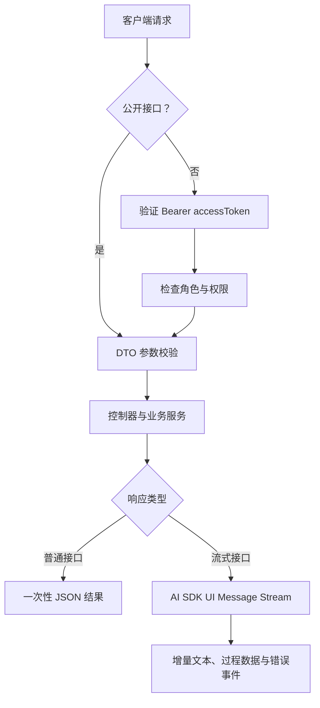
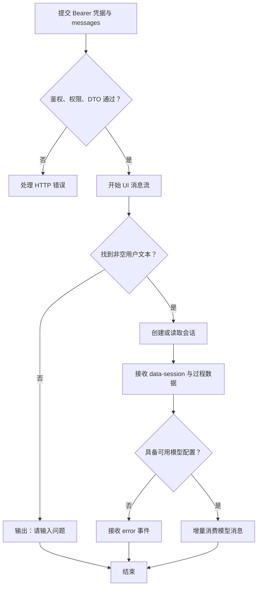

联调的关键是先区分三种契约：**身份凭据放在请求头、业务参数遵循各自 DTO、流式响应按消息协议消费**。本页从登录开始，依次验证受保护接口、参数边界和流式输出；不展开账号安全机制、检索算法或智能体内部编排。服务默认监听 `3000` 端口，启动入口没有设置全局路由前缀，以下示例直接使用 `/auth`、`/rag` 和 `/ai` 路径。Sources: [main.ts](src/main.ts#L6-L24) [auth.controller.ts](src/auth/auth.controller.ts#L11-L31) [ai.controller.ts](src/ai/ai.controller.ts#L30-L68)

## 1. 建立联调地图

请求进入控制器之前，要先通过全局认证、角色与权限守卫，再接受 DTO 校验。控制器随后将请求交给业务服务；普通接口直接返回结果，流式接口则把 Express `Response` 交给 AI SDK 的消息流输出函数。下面的图只展示与客户端联调有关的边界。Sources: [auth.module.ts](src/auth/auth.module.ts#L31-L49) [main.ts](src/main.ts#L17-L23) [ai.controller.ts](src/ai/ai.controller.ts#L43-L68) [ai-stream.service.ts](src/ai/ai-stream.service.ts#L620-L625)



Sources: [jwt-auth.guard.ts](src/auth/jwt-auth.guard.ts#L29-L45) [auth.module.ts](src/auth/auth.module.ts#L38-L49) [main.ts](src/main.ts#L17-L23) [ai-stream.service.ts](src/ai/ai-stream.service.ts#L471-L505)

排查时，优先检查以下文件，而不是从完整业务实现开始阅读。Sources: [main.ts](src/main.ts#L13-L24) [auth.controller.ts](src/auth/auth.controller.ts#L21-L31) [ai.controller.ts](src/ai/ai.controller.ts#L43-L68)

```text
src/
├── main.ts                       # 端口、CORS、全局参数校验
├── auth/
│   ├── auth.controller.ts        # 登录、刷新、当前用户
│   ├── jwt.strategy.ts           # Bearer 提取与令牌类型验证
│   └── permissions.guard.ts      # 权限不足的拒绝边界
└── ai/
    ├── ai.controller.ts          # 检索、普通问答、流式问答路由
    ├── dto/                      # 各接口输入约束
    └── ai-stream.service.ts      # 消息流写出与流内错误
```

Sources: [jwt.strategy.ts](src/auth/jwt.strategy.ts#L14-L31) [permissions.guard.ts](src/auth/permissions.guard.ts#L23-L47) [ai.controller.ts](src/ai/ai.controller.ts#L13-L24) [ai-stream.service.ts](src/ai/ai-stream.service.ts#L464-L505)

### 最小接口清单

| 接口 | 请求内容 | 凭据与权限 | 联调用途 |
|---|---|---|---|
| `POST /auth/login` | `username`、`password` | 公开 | 获取令牌 |
| `POST /auth/refresh` | `refreshToken` | 公开，但服务会验证刷新令牌 | 更新令牌对 |
| `GET /auth/me` | 无请求体 | access token | 单独验证身份链路 |
| `POST /rag/search` | `query`、可选 `topK` | access token，并检查检索权限 | 验证检索输入，不生成回答 |
| `POST /ai/chat` | `content`、可选 `sessionId`、`topK` | 同上 | 普通问答 |
| `POST /ai/chat/stream` | `messages`、可选 `sessionId`、`topK` 等 | 同上 | 验证消息流 |

Sources: [auth.controller.ts](src/auth/auth.controller.ts#L21-L31) [auth.controller.ts](src/auth/auth.controller.ts#L57-L60) [auth.service.ts](src/auth/auth.service.ts#L176-L187) [ai.controller.ts](src/ai/ai.controller.ts#L39-L68)

## 2. 第一步：取得并验证认证凭据

### 登录并保存两个不同用途的令牌

使用已有可登录账号发送以下请求。示例采用 Windows `cmd.exe` 的续行符 `^`；账号密码应替换为实际值。登录 DTO 要求 `username`、`password` 为字符串，不接受额外的顶层字段。Sources: [auth.controller.ts](src/auth/auth.controller.ts#L21-L25) [auth.dto.ts](src/auth/dto/auth.dto.ts#L3-L10) [main.ts](src/main.ts#L17-L23)

```bat
curl.exe -i http://localhost:3000/auth/login ^
  -H "Content-Type: application/json" ^
  -d "{\"username\":\"YOUR_USERNAME\",\"password\":\"YOUR_PASSWORD\"}"
```

登录结果直接包含 `accessToken`、`refreshToken`、`tokenType`、`expiresIn` 和 `userInfo`，不要默认从 `data.accessToken` 读取。访问令牌默认有效期为 `2h`，刷新令牌默认为 `7d`，均可通过配置覆盖；客户端应使用实际返回的 `expiresIn`，而不是写死默认值。Sources: [auth.service.ts](src/auth/auth.service.ts#L17-L23) [auth.service.ts](src/auth/auth.service.ts#L42-L59) [auth.service.ts](src/auth/auth.service.ts#L202-L209)

| 凭据 | 放置位置 | 用途 | 常见误用 |
|---|---|---|---|
| `accessToken` | `Authorization: Bearer <token>` | 访问受保护接口 | 放进 JSON 请求体或查询参数 |
| `refreshToken` | `/auth/refresh` 请求体的同名字段 | 换取新的登录结果 | 当成 access token 使用 |
| `expiresIn` | 客户端读取的响应字段 | 表示访问令牌有效秒数 | 当成绝对时间戳 |

Sources: [jwt.strategy.ts](src/auth/jwt.strategy.ts#L19-L30) [auth.controller.ts](src/auth/auth.controller.ts#L27-L31) [auth.service.ts](src/auth/auth.service.ts#L50-L59)

### 先调用 `/auth/me`，再接业务接口

将登录结果中的 `accessToken` 保存为环境变量，调用当前用户接口。如果这一步失败，先处理凭据问题，不要同时调试检索或模型服务。JWT 策略只从 Bearer 请求头提取令牌，并且只接受 `type: 'access'` 的载荷。Sources: [auth.controller.ts](src/auth/auth.controller.ts#L57-L60) [jwt.strategy.ts](src/auth/jwt.strategy.ts#L19-L30)

```bat
set "ACCESS_TOKEN=替换为实际的accessToken"

curl.exe -i http://localhost:3000/auth/me ^
  -H "Authorization: Bearer %ACCESS_TOKEN%"
```

访问令牌需要更新时，将刷新令牌提交到 `/auth/refresh`。成功后，使用响应中的新令牌对替换客户端保存值。退出接口的实现不吊销令牌，客户端退出时需要自行丢弃本地保存的凭据。Sources: [auth.service.ts](src/auth/auth.service.ts#L176-L187) [auth.service.ts](src/auth/auth.service.ts#L202-L209) [auth.controller.ts](src/auth/auth.controller.ts#L51-L55)

```bat
curl.exe -i http://localhost:3000/auth/refresh ^
  -H "Content-Type: application/json" ^
  -d "{\"refreshToken\":\"替换为实际的refreshToken\"}"
```

## 3. 第二步：按 DTO 验证参数，而不是依赖前端猜测

### 全局校验的实际含义

全局 `ValidationPipe` 同时开启 `whitelist`、`transform` 和 `forbidNonWhitelisted`。因此，**额外字段不是简单忽略，而会被拒绝**；输入转换也应结合字段上的装饰器判断，不能假定所有字符串都会自动转换为正确业务类型。以 `topK` 为例，DTO 明确使用了 `@Type(() => Number)`，转换后还要通过整数和范围检查。Sources: [main.ts](src/main.ts#L17-L23) [rag-search.dto.ts](src/ai/dto/rag-search.dto.ts#L10-L16)

| 参数 | 接口 | 约束与默认值 |
|---|---|---|
| `query` | `/rag/search` | 必填字符串，不能是空字符串 |
| `topK` | `/rag/search` | 转为数字后必须为整数，范围 `1–20`，默认 `5` |
| `content` | `/ai/chat` | 必填字符串，不能是空字符串 |
| `topK` | `/ai/chat`、`/ai/chat/stream` | 转为数字后必须为整数，范围 `1–10`，默认使用 `5` |
| `sessionId` | 两种问答接口 | 可选字符串 |
| `messages` | `/ai/chat/stream` | 必填数组；DTO 没有逐层验证内部消息结构 |
| `page`、`pageSize` | `GET /ai/sessions` | 转为整数；分别最小 `1`、范围 `1–100`；默认 `1`、`20` |

Sources: [rag-search.dto.ts](src/ai/dto/rag-search.dto.ts#L5-L16) [chat.dto.ts](src/ai/dto/chat.dto.ts#L5-L22) [chat-stream.dto.ts](src/ai/dto/chat-stream.dto.ts#L13-L29) [ai-stream.service.ts](src/ai/ai-stream.service.ts#L464-L466) [session.dto.ts](src/ai/dto/session.dto.ts#L4-L17)

流式 DTO 的注释虽然写有“额外字段放行”，但实现只声明了 `id`、`trigger`、`messageId` 等兼容字段，其中 `trigger`、`messageId` 使用 `@Allow()`。这不等于任意顶层扩展字段都可提交；全局禁止未知字段的设置仍然有效。Sources: [chat-stream.dto.ts](src/ai/dto/chat-stream.dto.ts#L12-L42) [main.ts](src/main.ts#L17-L23)

### 用最小请求验证成功，再加入业务字段

先用以下检索请求验证鉴权、权限和参数三条链路。该接口不会生成回答，但仍会调用混合检索服务，因此它不是纯粹的服务健康检查。Sources: [ai.controller.ts](src/ai/ai.controller.ts#L39-L47)

```bat
curl.exe -i http://localhost:3000/rag/search ^
  -H "Authorization: Bearer %ACCESS_TOKEN%" ^
  -H "Content-Type: application/json" ^
  -d "{\"query\":\"报销流程\",\"topK\":5}"
```

下面的前后对比可作为请求构造器的检查用例。注意：**不同接口的 `topK` 上限不同，普通问答与流式问答的消息结构也不同**。Sources: [rag-search.dto.ts](src/ai/dto/rag-search.dto.ts#L10-L16) [chat.dto.ts](src/ai/dto/chat.dto.ts#L11-L22) [chat-stream.dto.ts](src/ai/dto/chat-stream.dto.ts#L13-L29)

| 场景 | 修改前 | 修改后 |
|---|---|---|
| 把凭据塞进检索请求体 | `{"query":"报销","token":"..."}` | 请求体只放 `{"query":"报销"}`，凭据移至 Bearer 请求头 |
| 问答召回数超过上限 | `{"content":"报销流程","topK":20}` | `{"content":"报销流程","topK":5}` |
| 用普通问答结构调用流式接口 | `{"content":"报销流程"}` | `{"messages":[{"role":"user","parts":[{"type":"text","text":"报销流程"}]}]}` |
| 传入空的必填检索词 | `{"query":""}` | `{"query":"报销流程"}` |

Sources: [jwt.strategy.ts](src/auth/jwt.strategy.ts#L19-L23) [main.ts](src/main.ts#L17-L23) [chat.dto.ts](src/ai/dto/chat.dto.ts#L11-L22) [chat-stream.dto.ts](src/ai/dto/chat-stream.dto.ts#L13-L29) [rag-search.dto.ts](src/ai/dto/rag-search.dto.ts#L5-L8)

## 4. 第三步：单独验证流式请求与响应

### 输入不是 `content`，而是消息数组

流式服务从后向前寻找最后一条 `role: "user"` 的消息，只拼接其中 `type: "text"` 的 `parts`，再去掉首尾空白。因此，传入传统的 `{ role, content }` 结构并不能提供本轮问题；只通过数组校验，也不代表已提供可用文本。Sources: [ai-stream.service.ts](src/ai/ai-stream.service.ts#L684-L698) [chat-stream.dto.ts](src/ai/dto/chat-stream.dto.ts#L13-L18)

```bat
curl.exe -N -i http://localhost:3000/ai/chat/stream ^
  -H "Authorization: Bearer %ACCESS_TOKEN%" ^
  -H "Content-Type: application/json" ^
  -d "{\"messages\":[{\"role\":\"user\",\"parts\":[{\"type\":\"text\",\"text\":\"请介绍报销流程\"}]}],\"topK\":5}"
```

这里使用 `-N` 便于直接观察增量输出。服务采用 `createUIMessageStream` 和 `pipeUIMessageStreamToResponse`，不是一次性 JSON 回答，也不是由应用自行定义的纯文本流。生产客户端应使用与该 AI SDK UI Message Stream 兼容的消费方式，不要把整个响应交给 `response.json()`，也不要把所有事件都拼成答案正文。Sources: [ai-stream.service.ts](src/ai/ai-stream.service.ts#L3-L8) [ai-stream.service.ts](src/ai/ai-stream.service.ts#L471-L484) [ai-stream.service.ts](src/ai/ai-stream.service.ts#L624-L625)

### 将连接成功、生成成功和保存成功分开判断

下面的步骤图区分了流建立前的拒绝，以及流建立后的文本或错误输出。尤其要注意：HTTP 请求成功建立，不等于模型已经成功生成答案。Sources: [jwt-auth.guard.ts](src/auth/jwt-auth.guard.ts#L40-L45) [main.ts](src/main.ts#L17-L23) [ai-stream.service.ts](src/ai/ai-stream.service.ts#L472-L541)



Sources: [ai-stream.service.ts](src/ai/ai-stream.service.ts#L464-L541) [ai-stream.service.ts](src/ai/ai-stream.service.ts#L552-L576)

| 输出类别 | 已实现示例 | 客户端处理建议 |
|---|---|---|
| 文本消息片段 | `text-start`、`text-delta`、`text-end` | 更新答案区域 |
| 会话数据 | `data-session`，携带 `sessionId` | 保存会话 ID，后续作为请求顶层字段提交 |
| 过程数据 | `data-status`、`data-intent` | 更新状态提示，不混入答案 |
| 流内错误 | `error`，包含 `errorText` | 显示失败状态，不能只看 HTTP 状态 |
| 结束标记 | `finish` | 收束本轮流消费 |

Sources: [ai-stream.service.ts](src/ai/ai-stream.service.ts#L474-L523) [ai-stream.service.ts](src/ai/ai-stream.service.ts#L535-L541)

服务会在流结束回调中保存问答；如果保存失败，只记录警告，不将该失败重新变成客户端的 HTTP 错误。因此，若联调目标包含“刷新后仍能看到会话”，还应调用消息列表接口验证持久化，而不能仅凭屏幕上出现答案判断保存成功。Sources: [ai-stream.service.ts](src/ai/ai-stream.service.ts#L578-L612) [ai.controller.ts](src/ai/ai.controller.ts#L82-L86)

## 5. 按失败边界排查

| 现象 | 优先检查 | 处理方式 |
|---|---|---|
| 受保护接口返回 `401` | Bearer 头、过期状态、令牌类型 | 先重试 `/auth/me`；确认没有使用刷新令牌 |
| `/auth/me` 成功，检索或问答返回 `403` | 用户权限 | 检查检索权限；权限守卫对管理员直接放行 |
| 返回参数校验错误 | 未声明字段、必填项、整数范围 | 从最小请求开始，逐个恢复字段 |
| 流输出“请输入问题。” | 最后一条用户消息的 `parts` | 使用 `role: "user"` 与 `type: "text"`，不要只发 `content` |
| 流输出“未配置 LLM Key，无法生成回答” | 模型配置 | 这是流内错误，不是登录失败 |
| 答案已展示，但重新加载没有记录 | 流结束后的落库 | 查询会话消息，并检查服务端“流式对话落库失败”日志 |
| 浏览器与命令行表现不同 | 请求头、预检请求和实际响应 | 核对浏览器是否真正发送 Bearer；服务已启用 `origin: true`、`credentials: true`，但凭据提取仍走 Bearer |

Sources: [jwt.strategy.ts](src/auth/jwt.strategy.ts#L19-L30) [permissions.guard.ts](src/auth/permissions.guard.ts#L23-L47) [main.ts](src/main.ts#L13-L23) [ai-stream.service.ts](src/ai/ai-stream.service.ts#L476-L485) [ai-stream.service.ts](src/ai/ai-stream.service.ts#L535-L541) [ai-stream.service.ts](src/ai/ai-stream.service.ts#L608-L611) [ai-stream.service.ts](src/ai/ai-stream.service.ts#L684-L698)

## 6. 联调完成后的阅读顺序

本页位于 **Get Started 的接口联调入口**。如果尚未完成服务准备，先阅读[环境配置指南：数据库、中间件、模型服务与可选能力](3-huan-jing-pei-zhi-zhi-nan-shu-ju-ku-zhong-jian-jian-mo-xing-fu-wu-yu-ke-xuan-neng-li)；需要完整业务样本时，接着阅读[首次知识入库：登录、上传、审核发布与检索问答](4-shou-ci-zhi-shi-ru-ku-deng-lu-shang-chuan-shen-he-fa-bu-yu-jian-suo-wen-da)。本页的联调顺序则保持为：**登录 → `/auth/me` → 最小检索请求 → 流式问答**，避免一次引入身份、检索和模型三类变量。Sources: [main.ts](src/main.ts#L24-L24) [auth.controller.ts](src/auth/auth.controller.ts#L21-L31) [auth.controller.ts](src/auth/auth.controller.ts#L57-L60) [ai.controller.ts](src/ai/ai.controller.ts#L43-L68)

入口验证通过后，认证问题转到[账号安全：注册登录、邮件激活、密码重置与令牌验证](9-zhang-hao-an-quan-zhu-ce-deng-lu-you-jian-ji-huo-mi-ma-zhong-zhi-yu-ling-pai-yan-zheng)，授权问题转到[用户、角色与权限：授权模型与接口守卫](10-yong-hu-jiao-se-yu-quan-xian-shou-quan-mo-xing-yu-jie-kou-shou-wei)，生产级消息流集成转到[流式智能体与前端集成：工具调用、过程事件和消息流协议](25-liu-shi-zhi-neng-ti-yu-qian-duan-ji-cheng-gong-ju-diao-yong-guo-cheng-shi-jian-he-xiao-xi-liu-xie-yi)。Sources: [auth.service.ts](src/auth/auth.service.ts#L91-L139) [permissions.guard.ts](src/auth/permissions.guard.ts#L23-L47) [ai-stream.service.ts](src/ai/ai-stream.service.ts#L552-L575)