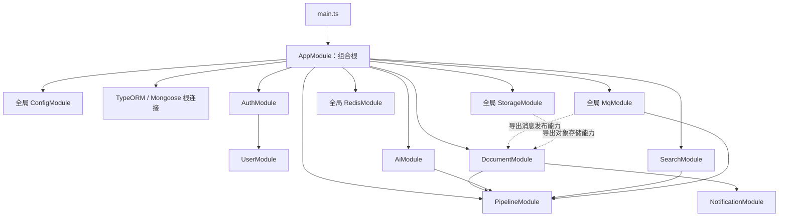
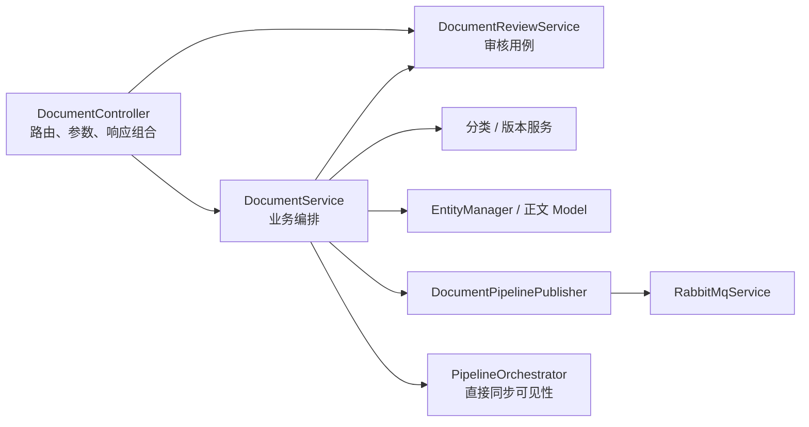
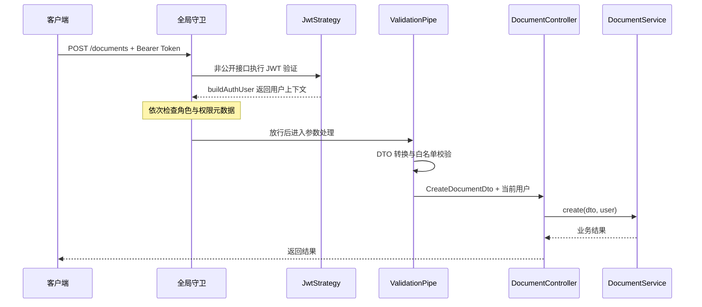

理解这个后端的关键，不是把 `src` 下的目录视为独立服务，而是区分三种边界：**Nest 模块的依赖可见性、业务服务的职责边界，以及 HTTP 请求与消息任务的执行边界**。应用由 `AppModule` 统一装配；文档、认证、检索、对话等模块共享基础设施，知识索引任务则通过消息消费者进入处理管线。本页位于“系统架构与数据设计”，聚焦这些组件如何组合与协作，不展开存储模型、授权规则或索引算法。  
Sources: [app.module.ts](src/app.module.ts#L39-L116) [mq.module.ts](src/mq/mq.module.ts#L7-L17) [document-pipeline.consumer.ts](src/mq/document-pipeline.consumer.ts#L23-L65)

## 1. 从根模块看系统：统一装配，而非按目录独立运行

`main.ts` 通过 `NestFactory.create(AppModule)` 创建应用，`AppModule` 则承担**组合根**的角色：配置全局配置模块、邮件模块、关系数据库与 MongoDB 连接，并导入业务模块及基础设施模块。`UserModule` 没有直接出现在根模块的导入列表中，而是由 `AuthModule` 引入，因此阅读模块架构应沿着 `imports` 继续追踪，而不能只看根目录或根模块的一层列表。  
Sources: [main.ts](src/main.ts#L6-L24) [app.module.ts](src/app.module.ts#L39-L112) [auth.module.ts](src/auth/auth.module.ts#L18-L30)

下图展示主要装配关系。实线表示模块声明中的导入关系；虚线表示全局模块导出的能力可以被业务服务注入。它是依赖装配图，**不代表 HTTP 请求按图中顺序执行**。  
Sources: [app.module.ts](src/app.module.ts#L39-L112) [document.module.ts](src/document/document.module.ts#L30-L55) [auth.module.ts](src/auth/auth.module.ts#L18-L51) [mq.module.ts](src/mq/mq.module.ts#L7-L17) [redis.module.ts](src/redis/redis.module.ts#L4-L9) [storage.module.ts](src/storage/storage.module.ts#L4-L9)

这些模块并不是完全对称的业务包：有些围绕业务用例组织，有些主要提供共享处理能力，还有些只承担接口入口。下表按代码中的实际注册方式区分其角色。  
Sources: [document.module.ts](src/document/document.module.ts#L30-L55) [ai.module.ts](src/ai/ai.module.ts#L14-L29) [pipeline.module.ts](src/pipeline/pipeline.module.ts#L15-L38) [search.module.ts](src/search/search.module.ts#L5-L9) [mq.module.ts](src/mq/mq.module.ts#L7-L17)

| 模块 | 组织方式 | 对外边界 |
|---|---|---|
| `DocumentModule` | 多个控制器与文档、审核、分类、互动、分享、版本服务 | 导出文档服务、审核服务和文件解析服务 |
| `AuthModule` | 认证服务、JWT 策略及全局守卫 | 导出 `AuthService`，并重新导出 `UserModule` |
| `AiModule` | 对话、流式响应、会话、记忆、检索等服务 | 模块声明中没有 `exports` |
| `PipelineModule` | 无控制器，集中注册索引与处理服务 | 导出编排器及部分可复用处理能力 |
| `SearchModule` | 导入管线模块，注册搜索控制器 | 没有单独注册搜索服务 |
| `MqModule` | 注册连接服务、发布者、消费者 | 全局导出连接服务和发布者 |

Sources: [document.module.ts](src/document/document.module.ts#L30-L55) [auth.module.ts](src/auth/auth.module.ts#L18-L51) [ai.module.ts](src/ai/ai.module.ts#L14-L29) [pipeline.module.ts](src/pipeline/pipeline.module.ts#L15-L38) [search.module.ts](src/search/search.module.ts#L5-L9) [mq.module.ts](src/mq/mq.module.ts#L7-L17)

## 2. 依赖注入：声明可见性，再由构造函数表达协作

### 2.1 `providers` 不等于对所有模块公开

在本项目中，模块的 `providers` 列出内部可注入组件，`exports` 则明确可供其他模块使用的能力。例如，`DocumentModule` 注册了分类、分享、互动和版本服务，但只导出 `DocumentService`、`DocumentReviewService` 与 `FileParserService`。同样，`PipelineModule` 内部注册了分块和抽取服务，却没有把它们列入导出项；外部主要通过编排器及导出的索引服务复用能力。  
Sources: [document.module.ts](src/document/document.module.ts#L45-L55) [pipeline.module.ts](src/pipeline/pipeline.module.ts#L21-L36)

**模块边界不是严格的数据所有权边界。** `UserModule` 的 `TypeOrmModule.forFeature()` 不只注册用户、角色和权限实体，还包含 `DocumentEntity`；`DocumentModule` 与 `PipelineModule` 也分别注册了同一个正文模型。因此，代码体现的是模块化组织与依赖可见性控制，而不是每个模块只能访问自己数据的完全隔离设计。  
Sources: [user.module.ts](src/user/user.module.ts#L18-L33) [document.module.ts](src/document/document.module.ts#L30-L37) [pipeline.module.ts](src/pipeline/pipeline.module.ts#L15-L20)

### 2.2 三种注入来源

`DocumentService` 的构造函数集中展示了项目中的三种注入来源：通过 `@InjectEntityManager()` 获取关系数据访问入口，通过 `@InjectModel(DocumentContent.name)` 获取正文模型，以及通过类类型注入解析、存储、消息发布、审核和版本服务。前两者使用框架集成提供的注入标识，后者以服务类作为依赖入口。  
Sources: [document.service.ts](src/document/document.service.ts#L54-L73)

| 注入方式 | 项目实例 | 装配位置 | 阅读时需要确认 |
|---|---|---|---|
| 类服务注入 | `DocumentReviewService` | 当前模块的 `providers` | 是否属于模块内部协作 |
| 导入模块的导出服务 | `PipelineOrchestrator` | `PipelineModule.exports` | 当前模块是否导入了提供方 |
| 全局模块的导出服务 | `RustfsService`、`DocumentPipelinePublisher` | `@Global()` 模块 | 根应用是否加载了该全局模块 |
| 数据访问标识注入 | `EntityManager`、正文 `Model` | 根连接及模型注册 | 连接和模型注册是否齐备 |
| 异步工厂注入 | `ConfigService` 注入数据库配置工厂 | `forRootAsync()` | 配置如何转为连接选项 |

Sources: [document.service.ts](src/document/document.service.ts#L58-L73) [document.module.ts](src/document/document.module.ts#L30-L55) [pipeline.module.ts](src/pipeline/pipeline.module.ts#L30-L36) [storage.module.ts](src/storage/storage.module.ts#L4-L9) [mq.module.ts](src/mq/mq.module.ts#L7-L17) [app.module.ts](src/app.module.ts#L63-L104)

### 2.3 全局能力降低重复声明，也隐藏部分依赖边

`RedisModule`、`StorageModule` 和 `MqModule` 都标记为 `@Global()`，配置模块也通过 `isGlobal: true` 注册。这解释了为什么 `DocumentModule.imports` 中没有 `StorageModule` 或 `MqModule`，其服务仍能在构造函数中注入存储和发布者。阅读代码时，不能仅凭某模块的 `imports` 判断全部外部依赖，还必须检查构造函数与全局模块的 `exports`。  
Sources: [redis.module.ts](src/redis/redis.module.ts#L4-L9) [storage.module.ts](src/storage/storage.module.ts#L4-L9) [mq.module.ts](src/mq/mq.module.ts#L7-L17) [app.module.ts](src/app.module.ts#L39-L43) [document.module.ts](src/document/document.module.ts#L30-L37) [document.service.ts](src/document/document.service.ts#L58-L73)

## 3. 业务边界：控制器接入，服务编排，管线复用

`DocumentController` 负责路由、参数绑定和权限元数据，再调用业务服务：创建请求转给 `DocumentService.create()`，审核请求转给审核服务。控制器也可以做轻量的响应组合，例如文档详情先读取文档，再读取用户互动标记，最后合并返回；因此这里不是“每个接口只调用一个服务”的机械分层。  
Sources: [document.controller.ts](src/document/document.controller.ts#L31-L64) [document.controller.ts](src/document/document.controller.ts#L137-L178)

`DocumentService` 则集中编排业务步骤。创建文档时，它检查状态约束、校验分类、写正文和元数据、记录初始版本，并在满足条件时投递索引任务。业务规则不只存在于 DTO 或守卫中：即使请求参数格式合法，服务仍可能因状态或审核约束拒绝操作。  
Sources: [document.service.ts](src/document/document.service.ts#L80-L161)

下图以文档模块为例区分接入、业务与共享能力。尤其要注意，文档服务同时依赖消息发布者和管线编排器：**索引重建使用消息路径，但并非所有管线调用都经过消息队列**，例如可见性变更会直接调用 `pipeline.updateVisibility()`。  
Sources: [document.controller.ts](src/document/document.controller.ts#L31-L45) [document.service.ts](src/document/document.service.ts#L58-L73) [document.service.ts](src/document/document.service.ts#L652-L680) [document.service.ts](src/document/document.service.ts#L705-L715)

## 4. HTTP 请求生命周期：认证、授权、参数校验与业务执行

应用启动时配置了全局 `ValidationPipe`；认证模块则依次注册 `JwtAuthGuard`、`RolesGuard` 和 `PermissionsGuard` 三个全局守卫。以 `POST /documents` 为例，请求需要先建立身份并满足权限要求，再由 DTO 校验与参数绑定进入控制器，最终调用文档服务。  
Sources: [main.ts](src/main.ts#L17-L23) [auth.module.ts](src/auth/auth.module.ts#L32-L49) [document.controller.ts](src/document/document.controller.ts#L40-L45)

Sources: [jwt-auth.guard.ts](src/auth/jwt-auth.guard.ts#L29-L46) [jwt.strategy.ts](src/auth/jwt.strategy.ts#L19-L30) [roles.guard.ts](src/auth/roles.guard.ts#L31-L56) [permissions.guard.ts](src/auth/permissions.guard.ts#L23-L47) [main.ts](src/main.ts#L17-L23) [current-user.decorator.ts](src/auth/decorators/current-user.decorator.ts#L4-L10) [document.controller.ts](src/document/document.controller.ts#L40-L45)

### 4.1 身份上下文在进入业务服务前建立

JWT 策略从 `Authorization` 头提取 Bearer Token，检查过期时间，并要求载荷类型为 `access`；随后调用 `AuthService.buildAuthUser()` 构造用户上下文。`@CurrentUser()` 只是从 `request.user` 取出结果，并不重新认证。控制器把该用户对象显式传入业务服务，使服务能够使用操作者身份，而不必直接读取 HTTP 请求对象。  
Sources: [jwt.strategy.ts](src/auth/jwt.strategy.ts#L19-L30) [current-user.decorator.ts](src/auth/decorators/current-user.decorator.ts#L4-L10) [document.controller.ts](src/document/document.controller.ts#L40-L45) [document.service.ts](src/document/document.service.ts#L118-L136)

公开标记也要逐个守卫理解：JWT 守卫与角色守卫会读取公开元数据并放行，但权限守卫没有检查该标记，而是检查权限元数据。因此，**公开路由并不意味着自动绕过所有授权逻辑**；若路由仍声明权限要求，权限守卫仍会执行对应检查。  
Sources: [jwt-auth.guard.ts](src/auth/jwt-auth.guard.ts#L29-L38) [roles.guard.ts](src/auth/roles.guard.ts#L31-L44) [permissions.guard.ts](src/auth/permissions.guard.ts#L23-L46)

### 4.2 参数合法与业务允许是两层判断

全局管道启用了 `transform`、`whitelist` 和 `forbidNonWhitelisted`。对于 `CreateDocumentDto`，字段类型与枚举由校验装饰器约束；但“创建时允许哪些状态”“开启审核后能否直接创建已发布文档”等规则由 `DocumentService` 决定。应把两者分别理解为**输入契约校验**与**业务不变量校验**，而不是将所有检查塞入 DTO。  
Sources: [main.ts](src/main.ts#L17-L23) [create-document.dto.ts](src/document/dto/create-document.dto.ts#L5-L52) [document.service.ts](src/document/document.service.ts#L80-L95)

### 4.3 普通返回、文件上传与流式响应存在不同出口

普通接口直接返回服务结果；上传接口通过 `FileInterceptor` 接收文件，并由服务等待解析、可选的原文件上传和草稿创建完成后返回；流式对话接口则注入 Express `Response`，将响应对象交给 `AiStreamService`。因此，不能用“控制器返回一个对象”概括所有请求，也不能把上传解析误认为后台消息任务。  
Sources: [document.controller.ts](src/document/document.controller.ts#L40-L64) [document.service.ts](src/document/document.service.ts#L560-L643) [ai.controller.ts](src/ai/ai.controller.ts#L60-L68)

## 5. 请求与消息任务：等待投递，不等待索引完成

文档创建为已发布状态时，服务会 `await safePublish()`；发布者再通过 `Promise.all()` 并行触发三类消息投递。消费者接到消息后，才调用 `PipelineOrchestrator` 执行对应任务。因此这里准确的边界是：**HTTP 路径等待投递调用结束，但不等待消费者完成索引处理**。  
Sources: [document.service.ts](src/document/document.service.ts#L150-L156) [document.service.ts](src/document/document.service.ts#L705-L715) [document-pipeline.publisher.ts](src/mq/document-pipeline.publisher.ts#L34-L41) [document-pipeline.consumer.ts](src/mq/document-pipeline.consumer.ts#L40-L65)

| 执行路径 | 调用关系 | 对请求完成的含义 |
|---|---|---|
| 上传解析 | 控制器 → 文档服务 → 解析、存储、创建草稿 | 请求等待这些步骤完成 |
| 发布后索引 | 文档服务 → 发布者 → 消息队列；消费者 → 管线 | 投递完成不等于索引完成 |
| 可见性同步 | 文档服务 → 管线编排器 | 请求路径直接等待同步调用 |
| 流式对话 | 控制器 → 流式服务，并传入响应对象 | 使用显式响应处理路径 |

Sources: [document.service.ts](src/document/document.service.ts#L560-L643) [document.service.ts](src/document/document.service.ts#L672-L680) [document.service.ts](src/document/document.service.ts#L705-L715) [document-pipeline.publisher.ts](src/mq/document-pipeline.publisher.ts#L34-L41) [document-pipeline.consumer.ts](src/mq/document-pipeline.consumer.ts#L40-L65) [ai.controller.ts](src/ai/ai.controller.ts#L60-L68)

错误边界同样分离：`safePublish()` 捕获投递异常并记录日志，不回滚文档状态；RabbitMQ 不可用时，底层发布方法也可能直接返回 `false`。这意味着文档业务成功与知识索引可用不是同一个完成条件，不能仅凭文档接口成功就判断所有检索侧处理已经结束。  
Sources: [document.service.ts](src/document/document.service.ts#L705-L715) [rabbitmq.service.ts](src/mq/rabbitmq.service.ts#L144-L154) [document-pipeline.publisher.ts](src/mq/document-pipeline.publisher.ts#L53-L66)

## 6. 应用生命周期：消费者不需要 HTTP 请求也会启动

消费者在构造函数中注册队列处理器；`RabbitMqService.onModuleInit()` 创建连接和通道，在通道配置中声明拓扑并绑定消费者。这表明消息处理是模块装配后的运行能力，而不是由某次 HTTP 请求临时创建。MQ 启用时，初始化连接失败会清理连接并继续抛出异常；显式禁用时则跳过初始化。  
Sources: [document-pipeline.consumer.ts](src/mq/document-pipeline.consumer.ts#L16-L38) [rabbitmq.service.ts](src/mq/rabbitmq.service.ts#L47-L113)

应用入口启用了关闭钩子；RabbitMQ 服务通过 `onModuleDestroy()` 关闭通道和连接。入口还在创建 Nest 应用前启动追踪，并在 `beforeExit` 事件中调用追踪关闭函数。阅读启动与退出行为时，应将这些应用级生命周期与单次请求生命周期分开。  
Sources: [main.ts](src/main.ts#L6-L12) [rabbitmq.service.ts](src/mq/rabbitmq.service.ts#L134-L137)

## 7. 用这套边界定位扩展点

分析或扩展一个接口时，可以沿着“**路由 → 守卫元数据 → DTO → 控制器构造依赖 → 业务服务 → 模块导出 → 数据或消息出口**”逐层确认。文档模块提供了完整样例：控制器声明入口与权限，服务执行业务约束和协作编排，模块声明依赖可见性，发布者与管线承担不同执行出口。这样能避免把参数错误、业务拒绝、注入缺失和异步任务失败混为一类问题。  
Sources: [document.controller.ts](src/document/document.controller.ts#L31-L64) [document.module.ts](src/document/document.module.ts#L30-L55) [document.service.ts](src/document/document.service.ts#L58-L95) [document.service.ts](src/document/document.service.ts#L652-L715)

后续可按关注点继续阅读：[多存储协作：关系数据、文档正文、对象文件与检索索引](7-duo-cun-chu-xie-zuo-guan-xi-shu-ju-wen-dang-zheng-wen-dui-xiang-wen-jian-yu-jian-suo-suo-yin) 深入数据访问出口；[用户、角色与权限：授权模型与接口守卫](10-yong-hu-jiao-se-yu-quan-xian-shou-quan-mo-xing-yu-jie-kou-shou-wei) 深入全局守卫；[消息驱动的知识管线：任务发布、队列消费与异常处理边界](17-xiao-xi-qu-dong-de-zhi-shi-guan-xian-ren-wu-fa-bu-dui-lie-xiao-fei-yu-yi-chang-chu-li-bian-jie) 深入 HTTP 之后的任务处理。它们分别对应本页识别出的持久化、授权与异步执行边界。