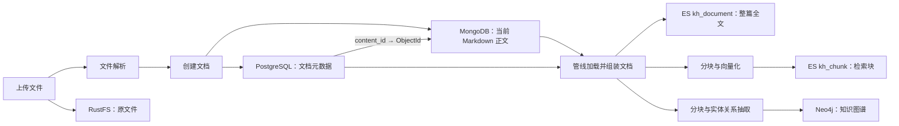
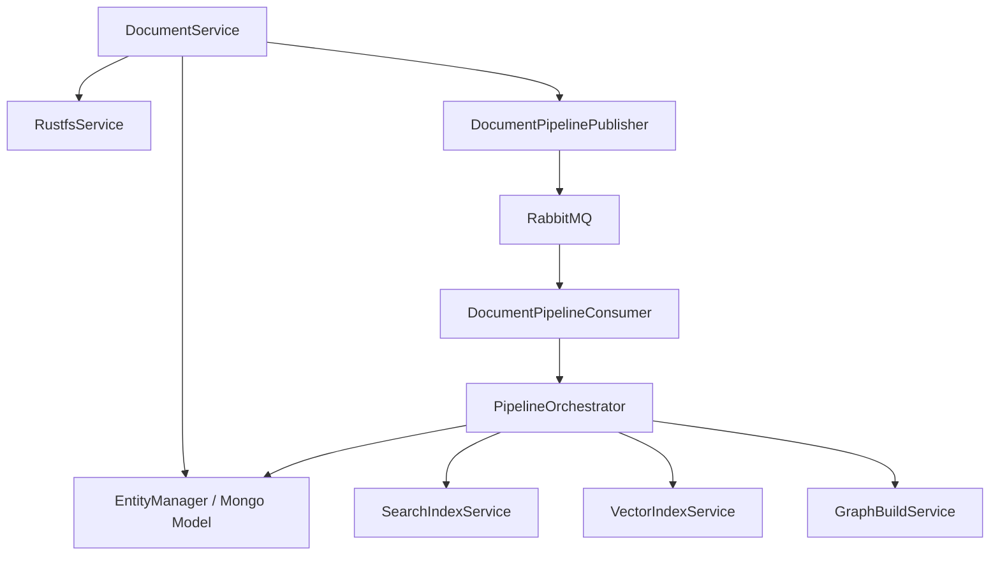

一篇文档在系统中不是一条完整的数据库记录，而是由**关系元数据、当前正文、二进制资源和派生检索数据**共同组成。理解这些数据的归属与关联，是判断“保存成功但搜不到”“正文存在但图片打不开”等问题的基础。本页位于“系统架构与数据设计”，聚焦各存储的职责、读写路径与一致性边界，不展开文件解析算法、审核流程或检索排序。Sources: [document.service.ts](src/document/document.service.ts#L48-L73) · [pipeline.orchestrator.ts](src/pipeline/pipeline.orchestrator.ts#L21-L29) · [rustfs.service.ts](src/storage/rustfs.service.ts#L85-L118)

## 一、先区分业务数据与派生数据

从代码的读写方向看，可以把文档数据分为两层：PostgreSQL 与 MongoDB 提供管线加载所需的元数据和正文，Elasticsearch 与 Neo4j 则接收由它们生成的检索表示。RustFS 独立保存文件字节，通过 URL 与应用数据发生联系。这里的“派生”是指索引可以沿现有管线重新生成，并不表示各存储之间存在统一事务。Sources: [pipeline.orchestrator.ts](src/pipeline/pipeline.orchestrator.ts#L152-L183) · [pipeline.orchestrator.ts](src/pipeline/pipeline.orchestrator.ts#L199-L274) · [graph-build.service.ts](src/pipeline/graph-build.service.ts#L168-L197) · [rustfs.service.ts](src/storage/rustfs.service.ts#L85-L118)

| 存储位置 | 主要数据 | 数据粒度与关联 | 主要用途 |
|---|---|---|---|
| PostgreSQL `kh_document` | 标题、分类、作者、团队、状态、公开标记、统计字段、`content_id` | 每篇文档一条，业务主键为字符串形式的雪花 ID | 文档列表、元数据维护、业务访问判断 |
| MongoDB `document_content` | Markdown 正文、正文长度、预览、版本号、删除标记 | 当前正文一条，含 ObjectId 与业务 `documentId` | 正文详情读取、编辑、管线内容输入 |
| RustFS | 上传的原文件、解析生成的图片等资源 | 每个对象独立生成 key，上传后返回 URL | 二进制资源保存与访问 |
| Elasticsearch `kh_document` | 标题、摘要、全文及元数据副本 | 每篇文档一条，ES `_id` 为业务文档 ID | 文档级关键词搜索 |
| Elasticsearch `kh_chunk` | 文档分块、向量及关联元数据 | 每篇文档多块，ES `_id` 为 `chunkId`，以 `document_id` 关联文档 | 块级关键词召回与向量检索 |
| Neo4j | 文档、分块、实体及其关系 | 文档节点以业务文档 ID 标识 | 图谱关系查询与来源关联 |

Sources: [document.entity.ts](src/document/entities/document.entity.ts#L14-L132) · [document-content.schema.ts](src/document/schemas/document-content.schema.ts#L6-L41) · [mineru.parser.ts](src/document/parser/mineru.parser.ts#L53-L60) · [rustfs.service.ts](src/storage/rustfs.service.ts#L85-L118) · [search-index.service.ts](src/pipeline/search-index.service.ts#L10-L20) · [search-index.service.ts](src/pipeline/search-index.service.ts#L63-L80) · [vector-index.service.ts](src/pipeline/vector-index.service.ts#L13-L24) · [vector-index.service.ts](src/pipeline/vector-index.service.ts#L105-L150) · [graph-build.service.ts](src/pipeline/graph-build.service.ts#L111-L128) · [graph-build.service.ts](src/pipeline/graph-build.service.ts#L188-L197)

下图按数据来源而非部署拓扑展示协作关系。关键是：**索引构建重新读取数据库中的文档，而不是从对象文件重新解析正文**；对象存储与正文存储不是同一层。Sources: [document.service.ts](src/document/document.service.ts#L583-L627) · [pipeline.orchestrator.ts](src/pipeline/pipeline.orchestrator.ts#L199-L210)

Sources: [document.service.ts](src/document/document.service.ts#L97-L139) · [document.service.ts](src/document/document.service.ts#L583-L627) · [pipeline.orchestrator.ts](src/pipeline/pipeline.orchestrator.ts#L103-L149) · [pipeline.orchestrator.ts](src/pipeline/pipeline.orchestrator.ts#L152-L183) · [pipeline.orchestrator.ts](src/pipeline/pipeline.orchestrator.ts#L199-L249)

## 二、关联模型：业务 ID 与正文 ObjectId 各司其职

`kh_document.id` 是贯穿业务与索引的文档标识；`content_id` 则保存 MongoDB 正文的 ObjectId 字符串。MongoDB 同时记录 `documentId`，形成两个方向的关联：`kh_document.content_id → document_content._id`，以及 `document_content.documentId → kh_document.id`。实际详情读取与管线加载都采用前一条路径。Sources: [document.entity.ts](src/document/entities/document.entity.ts#L14-L27) · [document-content.schema.ts](src/document/schemas/document-content.schema.ts#L6-L21) · [document.service.ts](src/document/document.service.ts#L259-L267) · [pipeline.orchestrator.ts](src/pipeline/pipeline.orchestrator.ts#L199-L210)

**逻辑一对一不等于跨库外键约束。** 实体将 PostgreSQL 的 `content_id` 声明为唯一字段；Mongo Schema 将 `documentId` 声明为必填且带普通索引，并未在该声明中设置唯一约束。两个存储的关联由应用代码创建和使用，不能把它理解成一个数据库能够整体维护的外键关系。Sources: [document.entity.ts](src/document/entities/document.entity.ts#L25-L27) · [document-content.schema.ts](src/document/schemas/document-content.schema.ts#L19-L21) · [document.service.ts](src/document/document.service.ts#L105-L139)

“正文在 MongoDB”还需要一个限定：它指的是**当前正文的业务读写位置**。历史版本实体 `kh_document_version` 位于 PostgreSQL，其中也包含 `text` 类型的完整 `content`。因此，不能把 PostgreSQL 概括为“绝不保存正文”，也不能把历史快照与 MongoDB 当前正文混为一谈。Sources: [document.service.ts](src/document/document.service.ts#L259-L267) · [document.service.ts](src/document/document.service.ts#L315-L373) · [document-version.entity.ts](src/document/entities/document-version.entity.ts#L4-L24)

## 三、对象文件与 Markdown 正文为什么要分开看

上传路径先解析文件，再在 RustFS 启用时上传原始字节，最后用解析后的正文创建草稿。原文件对象保存的是上传内容，MongoDB 保存的是用于阅读、编辑和索引的 Markdown；之后修改 Markdown 的代码更新 MongoDB 和版本快照，并不会重新生成上传的原文件。两者不是自动双向同步的副本。Sources: [document.service.ts](src/document/document.service.ts#L315-L373) · [document.service.ts](src/document/document.service.ts#L583-L627)

RustFS 的对象 key 由前缀、日期路径、清理后的文件名和 UUID 组成，上传返回 `{publicBase}/{bucket}/{key}` 形式的 URL。这个 key 并不以文档业务 ID 为核心关联；而且在上传创建流程中，`fileUrl` 出现在返回结果里，没有传入后续的 `create()` 参数。因此，**不能仅凭上传响应包含 `fileUrl`，就假定文档元数据已持久化原文件地址**。Sources: [rustfs.service.ts](src/storage/rustfs.service.ts#L98-L118) · [document.service.ts](src/document/document.service.ts#L597-L643)

图片资源还有另一条联系路径：MinerU 解析流程将结果中的图片上传到 RustFS，再把 Markdown 内的相对图片路径替换为资源链接。此时正文保存的是资源引用，而不是图片字节；详情接口能够返回正文，并不等同于对象资源一定可访问。具体转换细节可继续阅读[文件解析与资源存储：精准解析、正文转换与图片链接回写](12-wen-jian-jie-xi-yu-zi-yuan-cun-chu-jing-zhun-jie-xi-zheng-wen-zhuan-huan-yu-tu-pian-lian-jie-hui-xie)。Sources: [mineru.parser.ts](src/document/parser/mineru.parser.ts#L53-L78) · [document.service.ts](src/document/document.service.ts#L259-L267)

## 四、读取路径与服务协作边界

普通文档列表只查询 PostgreSQL 元数据，不加载正文。详情接口先加载未删除的元数据并执行访问判断，只有 `withContent=true` 时才按 `content_id` 读取 MongoDB；若未找到正文，当前实现返回空字符串。这个读取顺序使元数据列表与正文读取相互独立，也意味着“列表中有文档”不能证明正文关联完整。Sources: [document.service.ts](src/document/document.service.ts#L164-L177) · [document.service.ts](src/document/document.service.ts#L239-L267)

服务层也延续了这种划分：`DocumentService` 负责业务文档读写及触发管线，`PipelineOrchestrator` 负责加载元数据与正文，再委派全文索引、向量索引和图谱服务。文档模块与管线模块分别注册同一个 `DocumentContent` 模型，管线不依赖调用详情接口取得正文。Sources: [document.module.ts](src/document/document.module.ts#L30-L55) · [pipeline.module.ts](src/pipeline/pipeline.module.ts#L15-L36) · [document.service.ts](src/document/document.service.ts#L58-L73) · [pipeline.orchestrator.ts](src/pipeline/pipeline.orchestrator.ts#L35-L45)

下面的交互图强调运行时职责，而不是完整的 NestJS 模块依赖图。文档保存与索引构建之间通过发布器解耦；消费者调用编排器后，编排器再访问数据源并调用各索引服务。Sources: [document.service.ts](src/document/document.service.ts#L705-L714) · [document-pipeline.publisher.ts](src/mq/document-pipeline.publisher.ts#L22-L40) · [pipeline.orchestrator.ts](src/pipeline/pipeline.orchestrator.ts#L21-L45)

Sources: [document.service.ts](src/document/document.service.ts#L58-L73) · [document-pipeline.publisher.ts](src/mq/document-pipeline.publisher.ts#L32-L40) · [document-pipeline.publisher.ts](src/mq/document-pipeline.publisher.ts#L52-L63) · [pipeline.orchestrator.ts](src/pipeline/pipeline.orchestrator.ts#L21-L45)

## 五、索引是三种不同的阅读视角

Elasticsearch 的两个同名业务概念容易混淆：PostgreSQL 的 `kh_document` 是业务元数据表，Elasticsearch 的 `kh_document` 是包含全文的搜索记录；`kh_chunk` 则把一篇文档拆为多个召回单元，既用于关键词检索，也包含向量字段。Neo4j 进一步把内容表达为文档、分块、实体与关系。因此，全文索引、分块索引和图谱并非三个可互换的正文仓库。Sources: [document.entity.ts](src/document/entities/document.entity.ts#L14-L27) · [search-index.service.ts](src/pipeline/search-index.service.ts#L10-L20) · [vector-index.service.ts](src/pipeline/vector-index.service.ts#L13-L24) · [vector-index.service.ts](src/pipeline/vector-index.service.ts#L172-L200) · [graph-build.service.ts](src/pipeline/graph-build.service.ts#L111-L128)

发布器并行投递三类任务，消息携带文档 ID，而不是完整正文快照。消费者处理时，编排器再读取 PostgreSQL 与 MongoDB，并组装 `PipelineDocument`。因此，索引构建输入来自**消费时读取到的数据**，不能把任务消息理解为发布瞬间内容的不可变快照。Sources: [document-pipeline.publisher.ts](src/mq/document-pipeline.publisher.ts#L34-L40) · [document-pipeline.publisher.ts](src/mq/document-pipeline.publisher.ts#L52-L96) · [document-pipeline.publisher.ts](src/mq/document-pipeline.publisher.ts#L107-L120) · [pipeline.orchestrator.ts](src/pipeline/pipeline.orchestrator.ts#L199-L274)

可见性字段也会复制到各检索表示中。编排器把 `isPublic`、`teamId`、`authorId` 并行同步到全文索引、向量索引与图谱，不需要重新执行嵌入或实体抽取。这里需要把握的架构事实是：**检索端持有权限相关元数据副本，权限变化也是跨存储同步的一部分**；具体过滤规则见[团队协作与文档可见性：业务读取、全文检索和图谱查询的权限一致性](11-tuan-dui-xie-zuo-yu-wen-dang-ke-jian-xing-ye-wu-du-qu-quan-wen-jian-he-tu-pu-cha-xun-de-quan-xian-zhi-xing)。Sources: [pipeline.orchestrator.ts](src/pipeline/pipeline.orchestrator.ts#L78-L95)

## 六、一致性边界：保存成功不代表所有副本同步成功

当前实现采用顺序写入、局部补偿和异步索引同步，而不是一次覆盖所有存储的原子提交。创建文档时先写 MongoDB，再保存 PostgreSQL 元数据、记录初始版本；后续 `try` 块发生异常时，会删除刚创建的 MongoDB 正文。需要注意，异常范围不只包含元数据保存，还包含初始版本记录，所以不能把这段补偿等同于“所有业务写入都已回滚”。Sources: [document.service.ts](src/document/document.service.ts#L105-L161)

| 协作场景 | 代码中的处理方式 | 必须保留的边界认识 |
|---|---|---|
| 创建文档 | 先写 MongoDB，再写 PostgreSQL；异常时删除新正文 | 局部补偿，不是跨库事务 |
| 修改正文 | 先更新 MongoDB 与版本快照，再保存元数据 | 该路径没有包围全部步骤的统一提交或统一补偿 |
| 发布后构建索引 | 保存业务数据后投递三类任务；投递失败记录日志 | 发布状态不因索引投递失败而回滚 |
| 检索存储不可用 | ES 或 Neo4j 初始化连接失败时，相关写入可跳过 | 业务成功不能证明检索数据已经存在 |
| 删除文档 | 软删除 PostgreSQL 与 MongoDB；已发布文档另投索引清理任务 | 业务数据删除与派生数据清理不是同一原子动作 |
| 上传对象后创建文档 | 先上传原文件，再创建草稿 | 该流程未实现后续创建失败时的对象删除补偿 |

Sources: [document.service.ts](src/document/document.service.ts#L105-L161) · [document.service.ts](src/document/document.service.ts#L315-L396) · [document.service.ts](src/document/document.service.ts#L530-L557) · [document.service.ts](src/document/document.service.ts#L597-L627) · [document.service.ts](src/document/document.service.ts#L705-L714) · [search-index.service.ts](src/pipeline/search-index.service.ts#L33-L69) · [vector-index.service.ts](src/pipeline/vector-index.service.ts#L39-L61) · [graph-build.service.ts](src/pipeline/graph-build.service.ts#L144-L175)

索引重建本身也并非整体切换：向量管线先删除旧块，再分块、嵌入并写入新块；图谱构建也先清理旧图数据。由此可知，重建期间存在旧数据已清、新数据尚未完成的阶段，不能假设检索副本始终连续可用。详细同步行为可继续阅读[跨索引同步：发布重建、删除清理与可见性更新](21-kua-suo-yin-tong-bu-fa-bu-zhong-jian-shan-chu-qing-li-yu-ke-jian-xing-geng-xin)。Sources: [pipeline.orchestrator.ts](src/pipeline/pipeline.orchestrator.ts#L152-L183) · [graph-build.service.ts](src/pipeline/graph-build.service.ts#L172-L185)

总体上，准确的心智模型是：**业务数据分存、正文按引用加载、对象按 URL 访问、检索数据异步派生，各步骤有各自的失败边界**。代码提供了补偿和非阻断降级，但不能据此宣称系统保证所有存储最终自动一致。接下来可阅读[数据初始化与实体映射：表结构、雪花标识与版本演进](8-shu-ju-chu-shi-hua-yu-shi-ti-ying-she-biao-jie-gou-xue-hua-biao-shi-yu-ban-ben-yan-jin)，进一步核对物理结构与标识映射。Sources: [document.service.ts](src/document/document.service.ts#L105-L161) · [document.service.ts](src/document/document.service.ts#L239-L267) · [rustfs.service.ts](src/storage/rustfs.service.ts#L98-L118) · [document-pipeline.publisher.ts](src/mq/document-pipeline.publisher.ts#L22-L40) · [search-index.service.ts](src/pipeline/search-index.service.ts#L49-L69)