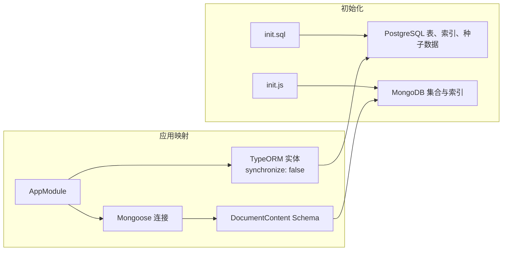
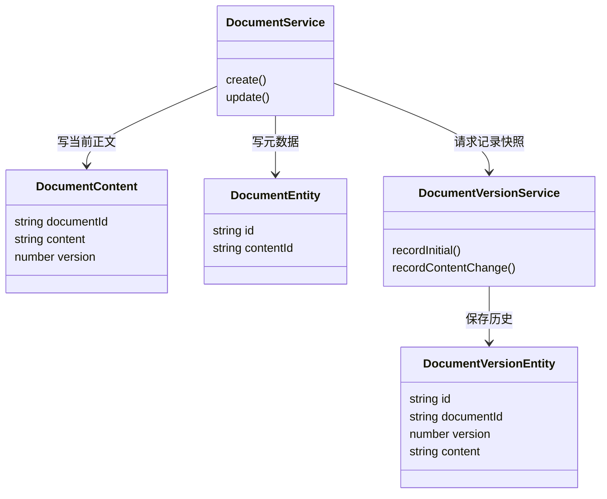

本页位于“系统架构与数据设计”部分，解释三个紧密相关的问题：**数据库结构由谁创建、数据库标识如何映射为应用类型，以及结构变更与正文版本如何分别演进**。当前实现的核心约定是：SQL 定义关系表，TypeORM 映射已有结构；雪花 ID 在 PostgreSQL 中使用 `BIGINT`、在应用中使用字符串；MongoDB 保存当前正文，PostgreSQL 保存历史快照。Sources: [app.module.ts](src/app.module.ts#L63-L104) [snowflake-id.ts](src/common/snowflake-id.ts#L1-L11) [document-content.schema.ts](src/document/schemas/document-content.schema.ts#L6-L41) [document-version.entity.ts](src/document/entities/document-version.entity.ts#L4-L38)

## 一、初始化与实体映射是两条不同的路径

**注册实体不等于创建表。** `AppModule` 显式注册了 19 个 TypeORM 实体，但将 `synchronize` 设置为 `false`。因此，修改实体字段不会让应用启动时自动同步 PostgreSQL 表结构。关系数据库的初始化入口是 `init-scripts/postgresql/init.sql`，Compose 将其所在目录挂载到数据库容器的 `/docker-entrypoint-initdb.d`；MongoDB 使用独立的 `init.js`。Sources: [app.module.ts](src/app.module.ts#L63-L104) [docker-compose.yml](docker-compose.yml#L3-L15) [docker-compose.yml](docker-compose.yml#L41-L54)

下图区分“建立数据库对象”与“应用运行时读写”两种职责。实体与 Schema 描述应用如何理解数据，初始化脚本则明确声明表、集合、约束和种子数据。Sources: [init.sql](init-scripts/postgresql/init.sql#L1-L44) [init.js](init-scripts/mongodb/init.js#L1-L12) [document.entity.ts](src/document/entities/document.entity.ts#L14-L40) [document-content.schema.ts](src/document/schemas/document-content.schema.ts#L10-L25)

### 初始化对象与种子数据

| 数据域 | 主要表 | 初始化时确定的结构特征 |
|---|---|---|
| 文档与审核 | `kh_document`、`kh_document_review` | 元数据、正文引用、审核历史及待审部分索引 |
| 用户与授权 | `kh_user`、`kh_role`、`kh_permission`，以及三个授权关联表 | 用户名部分唯一索引、角色和权限编码唯一、授权组合唯一 |
| 团队 | `kh_team`、`kh_team_member` | 父团队索引、团队成员组合唯一 |
| AI 会话 | `kh_ai_session`、`kh_ai_message` | 用户与更新时间索引；消息外键随会话删除级联清理 |
| 分类与互动 | `kh_category`、`kh_comment`、`kh_document_like`、`kh_document_favorite` | 分类层级、评论索引、点赞与收藏组合唯一 |
| 分享与历史 | `kh_document_share`、`kh_document_version` | 分享短码唯一、文档与版本号组合唯一 |
| 通知 | `kh_notification` | 用户时间索引、未读通知部分索引 |

Sources: [init.sql](init-scripts/postgresql/init.sql#L1-L136) [init.sql](init-scripts/postgresql/init.sql#L183-L206) [init.sql](init-scripts/postgresql/init.sql#L221-L311) [init.sql](init-scripts/postgresql/init.sql#L325-L340)

SQL 还插入了管理员、审核员、普通用户三种角色及对应测试账号，初始化部分权限、两级团队及成员、三个文档分类。这些记录使用脚本中固定的长整型 ID，**并非初始化时调用雪花生成器产生**。多数插入采用 `ON CONFLICT (id) DO NOTHING`，分类管理、分类查询和文档版本权限则按 `permission_code` 忽略冲突。Sources: [init.sql](init-scripts/postgresql/init.sql#L82-L101) [init.sql](init-scripts/postgresql/init.sql#L138-L179) [init.sql](init-scripts/postgresql/init.sql#L208-L217) [init.sql](init-scripts/postgresql/init.sql#L313-L323)

## 二、实体映射：名称、类型与约束不能混为一谈

### 从数据库列名到应用属性

`DocumentEntity` 展示了项目的映射方式：通过 `@Entity('kh_document')` 指定表名，通过 `@Column({ name: ... })` 将数据库的下划线命名映射为 TypeScript 驼峰属性。主键使用 `@PrimaryColumn`，而不是数据库自增主键；业务代码在保存之前分配 ID。Sources: [document.entity.ts](src/document/entities/document.entity.ts#L14-L58) [document.service.ts](src/document/document.service.ts#L97-L121)

| 数据库字段 | TypeScript 属性 | 映射语义 |
|---|---|---|
| `id BIGINT` | `id: string` | 雪花主键，经 `bigintTransformer` 读取 |
| `content_id VARCHAR UNIQUE` | `contentId: string` | MongoDB ObjectId 的字符串形式 |
| `category_id BIGINT` | `categoryId?: string \| null` | 可空关联标识 |
| `status SMALLINT` | `status: DocumentStatus` | 应用枚举映射为小整数 |
| `publish_time TIMESTAMP` | `publishTime?: Date \| null` | 可空发布时间 |
| `created_at`、`updated_at` | `createdAt`、`updatedAt` | 使用 TypeORM 创建和更新时间装饰器 |
| `deleted BOOLEAN` | `deleted: boolean` | 普通布尔列，表达逻辑删除 |

Sources: [init.sql](init-scripts/postgresql/init.sql#L2-L26) [document.entity.ts](src/document/entities/document.entity.ts#L14-L40) [document.entity.ts](src/document/entities/document.entity.ts#L68-L70) [document.entity.ts](src/document/entities/document.entity.ts#L96-L132)

**逻辑删除不是 ORM 自动过滤。** `deleted` 使用普通 `@Column`，文档查询显式追加 `deleted = false`。类似地，SQL 的 `updated_at DEFAULT NOW()` 提供插入默认值，而实体的 `@UpdateDateColumn` 描述 ORM 更新行为；不能把这个 SQL 默认值理解为任意数据库更新都会自动刷新时间。Sources: [document.entity.ts](src/document/entities/document.entity.ts#L104-L132) [document.service.ts](src/document/document.service.ts#L174-L177) [init.sql](init-scripts/postgresql/init.sql#L21-L25)

### 逻辑关联不一定是数据库外键

项目同时使用数据库外键与标量 ID 关联。`kh_user_role` 在 SQL 中声明用户、角色外键和组合唯一约束，但对应实体只声明 `userId`、`roleId` 两个普通列；`kh_document` 的分类、团队、作者 ID，以及版本表的 `document_id`，则没有在初始化 SQL 中声明外键。因此，不能根据 `xxxId` 属性名推断数据库会执行引用完整性检查。Sources: [init.sql](init-scripts/postgresql/init.sql#L2-L26) [init.sql](init-scripts/postgresql/init.sql#L73-L79) [init.sql](init-scripts/postgresql/init.sql#L299-L309) [user-role.entity.ts](src/user/entities/user-role.entity.ts#L9-L22)

索引也体现了不同的数据语义：用户名只对未删除用户保持唯一；待审记录、未读通知使用部分索引；用户角色、点赞、收藏和文档版本使用组合唯一约束。尤其是软删除场景，`username` 的唯一性范围由 SQL 的 `WHERE deleted = false` 决定，而不是简单的全表唯一。Sources: [init.sql](init-scripts/postgresql/init.sql#L41-L44) [init.sql](init-scripts/postgresql/init.sql#L48-L79) [init.sql](init-scripts/postgresql/init.sql#L268-L281) [init.sql](init-scripts/postgresql/init.sql#L299-L311) [init.sql](init-scripts/postgresql/init.sql#L337-L340)

## 三、雪花标识：数据库用 BIGINT，应用全程用字符串

`nextSnowflakeId()` 封装 `snowflake-id`，在模块级创建生成器，并返回 `generate()` 的字符串结果。生成器直接读取 `process.env`：`SNOWFLAKE_WORKER_ID` 默认是 `1`，`SNOWFLAKE_OFFSET` 默认是 `1704067200000`。当前封装没有额外实现参数校验、节点编号分配或时钟处理逻辑；不应把这些能力视为项目代码已经提供的保障。Sources: [snowflake-id.ts](src/common/snowflake-id.ts#L1-L11)

| 环节 | 当前表示方式 | 关键约定 |
|---|---|---|
| ID 生成 | `string` | `nextSnowflakeId(): string` |
| PostgreSQL 保存 | `BIGINT` | 主键不是自增列 |
| TypeORM 读取 | `string` | `from` 对非空值调用 `String(v)` |
| TypeORM 写入 | 原值透传 | `to` 不做数值转换 |
| MongoDB 关联 | `documentId: string` | 保存同一文档的雪花 ID |
| 正文自身标识 | `ObjectId` | 转成字符串存入 PostgreSQL `content_id` |

Sources: [snowflake-id.ts](src/common/snowflake-id.ts#L3-L10) [bigint.transformer.ts](src/common/transformers/bigint.transformer.ts#L3-L10) [document.entity.ts](src/document/entities/document.entity.ts#L17-L27) [document-content.schema.ts](src/document/schemas/document-content.schema.ts#L16-L21) [document.service.ts](src/document/document.service.ts#L105-L115)

**不要先转为 `Number` 再转回字符串。** 转换器的注释明确指出雪花 ID 超出 JavaScript 安全整数范围；`String(v)` 只统一表示形式，无法恢复已经发生的精度损失。实体中的主键和关联 ID 因此使用 `string`，而计数、状态、正文版本号仍分别使用 `number` 或枚举，不能把所有数字字段都按雪花 ID 处理。Sources: [bigint.transformer.ts](src/common/transformers/bigint.transformer.ts#L3-L10) [document.entity.ts](src/document/entities/document.entity.ts#L17-L58) [document.entity.ts](src/document/entities/document.entity.ts#L68-L94) [document-version.entity.ts](src/document/entities/document-version.entity.ts#L7-L18)

### 跨库的一对一关系

文档具有两个不同标识：雪花 ID 标识业务文档，MongoDB ObjectId 标识正文记录。创建时，服务先生成雪花 ID，以 `documentId` 写入 MongoDB，再把正文 `_id` 转为字符串，存入 PostgreSQL 的 `content_id`。SQL 对 `content_id` 声明唯一约束；Mongo 初始化脚本对 `documentId` 创建唯一索引。值得注意的是，Mongoose Schema 的 `documentId` 只写了 `index: true`，**不能仅凭 Schema 推断唯一索引已经建立**。Sources: [document.service.ts](src/document/document.service.ts#L97-L121) [init.sql](init-scripts/postgresql/init.sql#L2-L6) [init.js](init-scripts/mongodb/init.js#L9-L12) [document-content.schema.ts](src/document/schemas/document-content.schema.ts#L16-L21)

## 四、版本演进必须区分“结构版本”与“内容版本”

### 结构演进：初始化脚本不是迁移历史

当前数据库配置关闭了自动同步，也没有在该配置中注册 TypeORM migrations；`package.json` 的脚本列表没有迁移执行命令。`init.sql` 使用 `CREATE TABLE IF NOT EXISTS` 创建目标结构，但这不会给已有表补加新列，也不会修改已有列或约束。因而，**修改初始化脚本和实体，只表达了新目标结构，不代表存量数据库已经升级**。Sources: [app.module.ts](src/app.module.ts#L63-L95) [package.json](package.json#L8-L22) [init.sql](init-scripts/postgresql/init.sql#L1-L26)

| 机制 | 当前代码承担的职责 | 不能替代的工作 |
|---|---|---|
| `CREATE TABLE IF NOT EXISTS` | 表不存在时创建表 | 修改已有表结构 |
| `CREATE INDEX IF NOT EXISTS` | 声明命名索引 | 对同名已有索引进行定义校正 |
| `ON CONFLICT ... DO NOTHING` | 按指定冲突条件跳过种子插入 | 更新已有种子记录 |
| TypeORM 实体 | 映射应用与关系数据 | 在 `synchronize: false` 下自动升级数据库 |
| MongoDB `init.js` | 创建用户、集合和索引 | 作为带迁移记录的结构升级流程 |

Sources: [init.sql](init-scripts/postgresql/init.sql#L2-L44) [init.sql](init-scripts/postgresql/init.sql#L82-L101) [init.sql](init-scripts/postgresql/init.sql#L319-L323) [app.module.ts](src/app.module.ts#L72-L94) [init.js](init-scripts/mongodb/init.js#L1-L12)

据此，维护新字段时需要同时核对初始化 SQL、实体映射和存量库实际结构；涉及 MongoDB 索引时，还要核对初始化脚本与 Schema 是否表达相同约束。这是从当前实现得出的维护检查顺序，并非仓库已经实现了一套自动迁移机制。Sources: [app.module.ts](src/app.module.ts#L63-L94) [document.entity.ts](src/document/entities/document.entity.ts#L14-L40) [init.sql](init-scripts/postgresql/init.sql#L2-L26) [init.js](init-scripts/mongodb/init.js#L9-L12) [document-content.schema.ts](src/document/schemas/document-content.schema.ts#L19-L21)

### 内容演进：当前正文与历史快照分开保存

正文版本与数据库迁移无关。MongoDB `DocumentContent.version` 表示当前正文版本，默认值为 `1`；Schema 设置 `versionKey: false`，因此这里使用的是业务字段 `version`，而非 Mongoose 默认版本键。PostgreSQL 的 `kh_document_version` 则保存标题、完整正文、摘要、操作人和时间，通过 `(document_id, version)` 唯一约束防止同一文档的版本号重复。Sources: [document-content.schema.ts](src/document/schemas/document-content.schema.ts#L10-L37) [init.sql](init-scripts/postgresql/init.sql#L299-L311) [document-version.entity.ts](src/document/entities/document-version.entity.ts#L4-L38)

下面展示版本相关类的协作关系。`DocumentService` 同时访问当前正文与元数据，并委托 `DocumentVersionService` 保存关系库快照；版本服务不负责写入 MongoDB 当前正文。Sources: [document.service.ts](src/document/document.service.ts#L58-L73) [document.service.ts](src/document/document.service.ts#L315-L374) [document-version.service.ts](src/document/document-version.service.ts#L25-L49) [document-version.service.ts](src/document/document-version.service.ts#L80-L98)

创建文档时，MongoDB 正文设为版本 `1`，关系库元数据保存后调用 `recordInitial()` 写入初始快照。更新请求包含 `content` 时，服务读取旧正文，将旧版本规范为正数或回退到 `1`，再计算 `newVersion = oldVersion + 1`；仅修改标题等元数据不会进入这一版本递增分支，仅修改摘要则同步 MongoDB 的预览字段。Sources: [document.service.ts](src/document/document.service.ts#L105-L148) [document.service.ts](src/document/document.service.ts#L315-L396)

对于没有任何历史记录的旧文档，`recordContentChange()` 会先记录修改前的快照，再记录新版本。这是一种**按首次正文修改补齐旧稿**的兼容方式，并不是启动时批量回填全部历史。快照输入虽然包含 `wordCount`，实际版本实体及保存逻辑并未持久化该字段，历史记录也不是完整元数据备份。Sources: [document-version.service.ts](src/document/document-version.service.ts#L15-L49) [document-version.service.ts](src/document/document-version.service.ts#L80-L91) [document-version.entity.ts](src/document/entities/document-version.entity.ts#L17-L38)

### 唯一约束不等于并发版本控制

版本写入遇到 PostgreSQL `23505` 唯一冲突时会直接返回，其他错误继续抛出。该处理没有进一步区分冲突约束；与此同时，正文更新先读取旧版本，再以仅包含 `_id`、`deleted` 的条件执行 `$set`，没有将旧版本号加入更新条件。因此，当前代码不能被解释为乐观锁，也不能仅靠版本表唯一约束保证并发编辑分别获得连续版本。Sources: [document-version.service.ts](src/document/document-version.service.ts#L80-L98) [document.service.ts](src/document/document.service.ts#L322-L345) [init.sql](init-scripts/postgresql/init.sql#L299-L309)

正文更新、历史快照写入和元数据保存也是顺序执行的不同步骤：先更新 MongoDB，再写 PostgreSQL 快照，最后保存 PostgreSQL 元数据。该方法没有把这些操作包入跨库事务，因此排查版本异常时，应分别检查当前正文、历史记录和元数据，而不能只验证其中一处。Sources: [document.service.ts](src/document/document.service.ts#L332-L396)

## 五、阅读与维护入口

维护数据模型时，优先核对三组一致性：**SQL 与实体的字段/约束一致性、BIGINT 与字符串的标识一致性、当前正文与历史快照的版本一致性**。进一步理解正文、元数据和其他存储的职责，可阅读[多存储协作：关系数据、文档正文、对象文件与检索索引](7-duo-cun-chu-xie-zuo-guan-xi-shu-ju-wen-dang-zheng-wen-dui-xiang-wen-jian-yu-jian-suo-suo-yin)；版本查询和正文维护的业务操作则见[内容维护：分类管理、正文更新与历史版本快照](14-nei-rong-wei-hu-fen-lei-guan-li-zheng-wen-geng-xin-yu-li-shi-ban-ben-kuai-zhao)。Sources: [document.entity.ts](src/document/entities/document.entity.ts#L14-L40) [bigint.transformer.ts](src/common/transformers/bigint.transformer.ts#L3-L10) [document.service.ts](src/document/document.service.ts#L315-L396) [document-version.service.ts](src/document/document-version.service.ts#L29-L67)