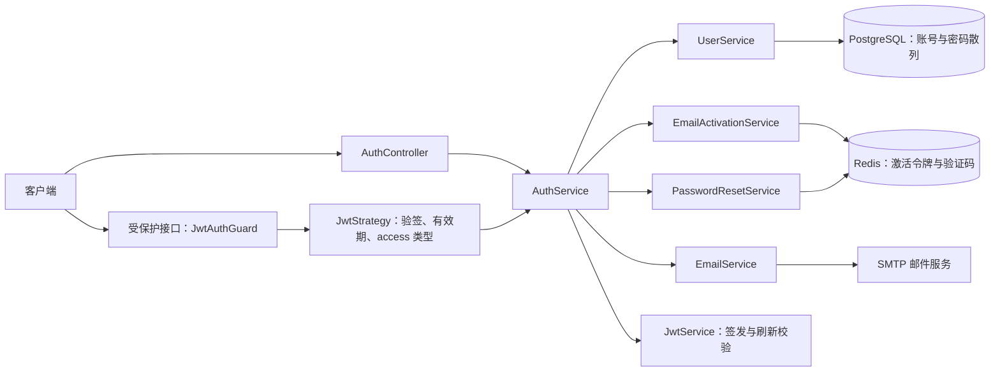
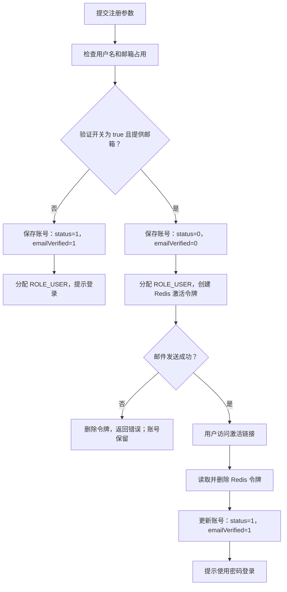
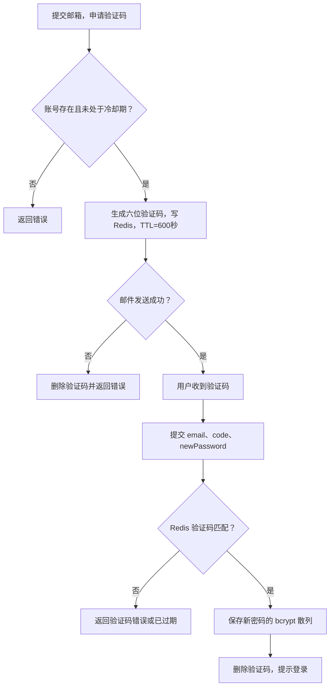

账号认证由三类机制协作完成：**PostgreSQL 保存账号与密码散列，Redis 保存短期激活令牌和重置验证码，JWT 承载访问与刷新凭据**。本页沿注册、激活、登录、访问、刷新和找回密码说明接口契约及安全边界，重点区分“当前代码已经保证的行为”与“尚未实现的安全能力”。Sources: [user.service.ts](src/user/user.service.ts#L117-L178) [email-activation.service.ts](src/auth/email-activation.service.ts#L5-L51) [password-reset.service.ts](src/auth/password-reset.service.ts#L4-L35) [auth.service.ts](src/auth/auth.service.ts#L69-L88)

## 1. 认证架构：凭据校验与账号状态校验分离

`AuthController` 提供认证入口，`AuthService` 编排账号服务、邮件和短期凭据；`UserService` 负责账号查询、bcrypt 密码校验及当前用户信息构建。JWT 守卫以全局守卫注册，未标记 `@Public()` 的接口默认进入 JWT 认证流程。**JWT 验签成功不等于认证完成**：访问令牌还必须通过类型检查，并按 `sub` 重新加载账号。Sources: [auth.controller.ts](src/auth/auth.controller.ts#L11-L59) [auth.module.ts](src/auth/auth.module.ts#L18-L41) [jwt-auth.guard.ts](src/auth/jwt-auth.guard.ts#L29-L38) [jwt.strategy.ts](src/auth/jwt.strategy.ts#L19-L30)

下图按实际调用关系展示模块协作。邮件激活和密码找回使用 Redis 中的短期凭据，不使用访问 JWT；普通受保护请求则通过 JWT 策略进入账号状态检查。Sources: [auth.service.ts](src/auth/auth.service.ts#L100-L188) [jwt.strategy.ts](src/auth/jwt.strategy.ts#L26-L30)



Sources: [auth.module.ts](src/auth/auth.module.ts#L18-L41) [auth.service.ts](src/auth/auth.service.ts#L31-L40) [email.service.ts](src/auth/email.service.ts#L5-L23) [user.service.ts](src/user/user.service.ts#L26-L39) [jwt.strategy.ts](src/auth/jwt.strategy.ts#L13-L31)

### 接口与参数速查

| 接口 | 是否公开 | 请求参数 | 成功结果 |
|---|---|---|---|
| `POST /auth/register` | 是 | `username`、`password`；可选 `email`、`realName` | `userId`、提示消息；需激活时另含 `emailVerificationRequired: true` |
| `GET /auth/verify-email` | 是 | 查询参数 `token` | 激活结果消息 |
| `POST /auth/login` | 是 | `username`、`password` | 访问令牌、刷新令牌、过期秒数、用户信息 |
| `POST /auth/refresh` | 是 | `refreshToken` | 新的一组登录结果 |
| `POST /auth/password/reset/send-code` | 是 | `email` | 验证码已发送消息 |
| `POST /auth/password/reset` | 是 | `email`、`code`、`newPassword` | 密码重置成功消息 |
| `GET /auth/me` | 否 | `Authorization: Bearer <accessToken>` | 当前账号信息 |
| `POST /auth/logout` | 否 | `Authorization: Bearer <accessToken>` | 退出消息，不撤销令牌 |

Sources: [auth.controller.ts](src/auth/auth.controller.ts#L15-L59) [auth.service.ts](src/auth/auth.service.ts#L100-L174) [auth.service.ts](src/auth/auth.service.ts#L202-L209)

请求体由全局 `ValidationPipe` 校验，启用 `whitelist`、`transform` 和 `forbidNonWhitelisted`，因此多余字段会被拒绝。注册密码和重置后的密码至少为 6 个字符；邮箱使用 `IsEmail` 校验；重置验证码只要求字符串，DTO **没有六位数字格式约束**。`verify-email` 的查询参数直接以字符串接收，未使用专门 DTO。Sources: [main.ts](src/main.ts#L17-L23) [auth.dto.ts](src/auth/dto/auth.dto.ts#L3-L34) [extra.dto.ts](src/user/dto/extra.dto.ts#L3-L18) [auth.controller.ts](src/auth/auth.controller.ts#L33-L36)

## 2. 注册与邮件激活：由配置决定的状态转换

注册先检查未删除账号中的用户名和邮箱是否已占用，再生成用户 ID，以 `bcryptjs.hash(password, 10)` 保存密码散列，随后分配 `ROLE_USER`。是否等待激活由两个条件共同决定：`REQUIRE_EMAIL_VERIFICATION` 必须严格等于字符串 `'true'`，且请求必须提供邮箱。**开启邮箱验证并不意味着邮箱必填**；不提供邮箱仍会创建可直接登录的账号。Sources: [auth.service.ts](src/auth/auth.service.ts#L62-L67) [user.service.ts](src/user/user.service.ts#L141-L178)

| 注册条件 | 初始 `status` | 初始 `emailVerified` | 后续行为 |
|---|---:|---:|---|
| 验证开关关闭 | 1 | 1 | 注册后直接登录 |
| 验证开关开启，但未提供邮箱 | 1 | 1 | 注册后直接登录 |
| 验证开关开启，且提供邮箱 | 0 | 0 | 创建激活令牌并发送邮件 |
| 激活成功 | 1 | 1 | 使用用户名和密码登录 |

Sources: [user.service.ts](src/user/user.service.ts#L160-L177) [user.service.ts](src/user/user.service.ts#L374-L380) [auth.service.ts](src/auth/auth.service.ts#L108-L130)

以下流程体现了一个重要顺序：**账号先保存，邮件后发送**。邮件发送失败会删除本次激活令牌并返回错误，但该错误处理不会回滚已经创建的账号。Sources: [user.service.ts](src/user/user.service.ts#L162-L172) [auth.service.ts](src/auth/auth.service.ts#L103-L124)



Sources: [user.service.ts](src/user/user.service.ts#L151-L177) [auth.service.ts](src/auth/auth.service.ts#L108-L139) [email-activation.service.ts](src/auth/email-activation.service.ts#L44-L51) [user.service.ts](src/user/user.service.ts#L374-L380)

### 激活令牌如何失效

激活令牌由 `crypto.randomBytes(32)` 生成并转为十六进制字符串，有效期为 24 小时。Redis 同时保存 `email:activation:token:<token> → userId` 和 `email:activation:user:<userId> → token`；创建新令牌时先删除旧令牌映射，因此服务实现了按用户替换旧令牌的逻辑。不过，当前 `AuthController` 没有暴露独立的重发激活邮件接口。Sources: [email-activation.service.ts](src/auth/email-activation.service.ts#L5-L40) [auth.controller.ts](src/auth/auth.controller.ts#L11-L67)

激活时先读取并删除两个 Redis 键，再更新数据库账号；令牌不存在时返回“激活链接无效或已过期”。因此顺序重复使用同一链接不会再次激活；同时，**令牌消费与数据库更新不在同一事务内**，数据库更新失败时，令牌已经被删除。消费操作本身也是分开的 `GET`、`DEL`，不应将其描述为并发下原子的单次消费。Sources: [email-activation.service.ts](src/auth/email-activation.service.ts#L44-L51) [auth.service.ts](src/auth/auth.service.ts#L133-L139) [user.service.ts](src/user/user.service.ts#L374-L380)

## 3. 登录：检查顺序决定可见错误

登录通过用户名查询 `deleted: false` 的账号，依次检查账号存在、`status === 1`、`emailVerified !== 0`，最后使用 bcrypt 比较密码。成功后加载当前用户信息、更新 `lastLoginAt` 并签发两类 JWT。注意检查顺序：等待激活的普通注册账号是 `status=0`，因此登录时首先得到的是“账户已禁用”，而不是后面的“账户未激活，请先验证邮箱”。Sources: [user.service.ts](src/user/user.service.ts#L45-L49) [user.service.ts](src/user/user.service.ts#L117-L138) [auth.service.ts](src/auth/auth.service.ts#L91-L98) [user.service.ts](src/user/user.service.ts#L316-L318)

登录和刷新共用以下响应结构。`expiresIn` 表示访问令牌的有效秒数，`userInfo` 包含当前用户标识、基本资料、角色、权限和团队 ID；密码散列不在该结构中。Sources: [auth.service.ts](src/auth/auth.service.ts#L17-L23) [auth.service.ts](src/auth/auth.service.ts#L202-L209) [user.service.ts](src/user/user.service.ts#L88-L103)

```json
{
  "accessToken": "<访问令牌>",
  "refreshToken": "<刷新令牌>",
  "tokenType": "Bearer",
  "expiresIn": 7200,
  "userInfo": {
    "userId": "<用户标识>",
    "username": "alice",
    "realName": null,
    "email": "alice@example.com",
    "avatar": null,
    "roles": ["ROLE_USER"],
    "permissions": [],
    "teamIds": []
  }
}
```

Sources: [auth.service.ts](src/auth/auth.service.ts#L42-L59) [auth.service.ts](src/auth/auth.service.ts#L202-L209) [user.service.ts](src/user/user.service.ts#L94-L103)

## 4. JWT 验证与刷新：无会话存储，但仍回查账号

访问令牌和刷新令牌都携带 `sub`、`username`、`type`，通过同一个 `JwtService` 签发，使用同一个 `JWT_SECRET`，由 `type` 区分用途。默认访问有效期为 `2h`，刷新有效期为 `7d`。角色、权限和团队信息不写入这段 JWT 业务载荷，而是在构建 `AuthUser` 时重新读取。Sources: [auth.module.ts](src/auth/auth.module.ts#L22-L28) [auth.service.ts](src/auth/auth.service.ts#L25-L29) [auth.service.ts](src/auth/auth.service.ts#L42-L88) [user.service.ts](src/user/user.service.ts#L88-L114)

| 比较项 | 访问令牌 | 刷新令牌 |
|---|---|---|
| `type` | `access` | `refresh` |
| 默认有效期 | 2 小时 | 7 天 |
| 传递位置 | `Authorization: Bearer …` | `/auth/refresh` 请求体的 `refreshToken` |
| 验证入口 | `JwtStrategy` | `AuthService.refresh` |
| 类型检查后 | 按 `sub` 构建当前用户 | 按 `sub` 构建当前用户，再签发两类令牌 |
| 能否互换 | 刷新令牌不能访问受保护接口 | 访问令牌不能用于刷新 |

Sources: [auth.service.ts](src/auth/auth.service.ts#L42-L88) [auth.service.ts](src/auth/auth.service.ts#L176-L188) [jwt.strategy.ts](src/auth/jwt.strategy.ts#L19-L30) [auth.controller.ts](src/auth/auth.controller.ts#L27-L30)

访问令牌只从 Bearer 请求头提取，策略开启过期检查。通过验签和类型检查后，`buildAuthUser` 查询未删除账号，并要求 `status === 1`；刷新也调用同一构建逻辑。因此禁用或删除账号会影响后续访问与刷新，而不必等待 JWT 自然到期。需要区别的是：**`buildAuthUser` 不检查 `emailVerified`，邮箱激活检查只显式出现在密码登录流程中**。Sources: [jwt.strategy.ts](src/auth/jwt.strategy.ts#L19-L30) [user.service.ts](src/user/user.service.ts#L51-L58) [user.service.ts](src/user/user.service.ts#L106-L138) [auth.service.ts](src/auth/auth.service.ts#L176-L188)

刷新接口虽然返回新的刷新令牌，但没有保存、消费或撤销旧刷新令牌的逻辑，因此它不是带服务端失效记录的刷新令牌轮换。`logout` 也只返回“已退出登录”，由客户端丢弃令牌；邮箱密码重置仅更新密码散列并删除验证码，没有修改 JWT 版本或撤销记录。**在账号仍可用的前提下，退出或重置密码不会主动使已有 JWT 失效。** Sources: [auth.service.ts](src/auth/auth.service.ts#L165-L188) [auth.service.ts](src/auth/auth.service.ts#L202-L209) [auth.controller.ts](src/auth/auth.controller.ts#L51-L55) [user.service.ts](src/user/user.service.ts#L367-L371)

## 5. 邮箱找回密码：验证码存储、冷却与消费顺序

发送验证码前，服务先按邮箱查找未删除账号，不存在则返回“该邮箱未注册”。验证码是使用 `Math.random()` 生成的六位数字字符串；Redis 键为 `password:reset:code:<小写邮箱>`，有效期 600 秒。同一邮箱再次发送时会覆盖旧值；若当前 TTL 大于 540 秒，则拒绝发送，对应基于剩余 TTL 实现的约 60 秒冷却。Sources: [auth.service.ts](src/auth/auth.service.ts#L142-L162) [password-reset.service.ts](src/auth/password-reset.service.ts#L4-L31) [user.service.ts](src/user/user.service.ts#L41-L43)

验证码先写 Redis，再发送邮件；发送失败时删除验证码。提交重置请求时，服务先比较验证码，再查找邮箱账号、以 bcrypt cost 10 写入新密码，最后删除验证码。因此验证码错误不会删除已有验证码，而密码成功保存后才会清理验证码。该流程没有修改账号的启用或邮箱验证状态，不能用密码重置替代激活。Sources: [auth.service.ts](src/auth/auth.service.ts#L154-L173) [password-reset.service.ts](src/auth/password-reset.service.ts#L29-L35) [user.service.ts](src/user/user.service.ts#L367-L380)

下面的流程图标出发送与重置两个入口。校验验证码和删除验证码是独立操作，并非原子“校验并消费”；发送冷却的 TTL 检查与写入也不是原子限流操作。Sources: [auth.service.ts](src/auth/auth.service.ts#L142-L173) [password-reset.service.ts](src/auth/password-reset.service.ts#L17-L35)



Sources: [auth.service.ts](src/auth/auth.service.ts#L142-L173) [user.service.ts](src/user/user.service.ts#L367-L371)

### 已实现与未实现的防护边界

| 维度 | 当前实现 | 集成时应注意 |
|---|---|---|
| 邮箱存在性 | 不存在返回明确错误 | 发送验证码接口会暴露邮箱是否注册 |
| 验证码随机源 | `Math.random()` | 不同于激活令牌采用的 `crypto.randomBytes` |
| 发送频率 | 按邮箱 Redis TTL 检查 | 不能等同于原子限流或全局请求限流 |
| 验证失败 | 返回错误，保留验证码 | 该校验路径没有失败次数累计或锁定逻辑 |
| 消费顺序 | 保存密码后删除验证码 | 并发请求不具备原子单次消费保证 |
| 邮箱大小写 | Redis 键转小写；账号查询直接使用传入邮箱 | 两处没有统一执行相同的邮箱规范化步骤 |

Sources: [auth.service.ts](src/auth/auth.service.ts#L142-L173) [password-reset.service.ts](src/auth/password-reset.service.ts#L13-L35) [email-activation.service.ts](src/auth/email-activation.service.ts#L28-L28) [user.service.ts](src/user/user.service.ts#L41-L43)

## 6. 配置与联调检查

认证配置集中在 JWT 签发、账号注册策略和邮件发送三个位置。特别注意 `JWT_SECRET` 的开发默认值，以及 `APP_PUBLIC_URL` 直接参与激活链接拼接：它应指向外部实际能够访问 `/auth/verify-email` 的服务地址。Sources: [auth.module.ts](src/auth/auth.module.ts#L22-L28) [auth.service.ts](src/auth/auth.service.ts#L42-L67) [email.service.ts](src/auth/email.service.ts#L17-L21)

| 配置项 | 默认值或读取方式 | 作用 |
|---|---|---|
| `JWT_SECRET` | `dev-secret-change-me` | 两类 JWT 的签发与验证密钥；部署时应显式替换 |
| `JWT_ACCESS_EXPIRES` | `2h` | 访问令牌有效期 |
| `JWT_REFRESH_EXPIRES` | `7d` | 刷新令牌有效期 |
| `REQUIRE_EMAIL_VERIFICATION` | `false`；严格比较 `'true'` | 控制提供邮箱的注册账号是否等待激活 |
| `APP_PUBLIC_URL` | `http://localhost:3000` | 激活邮件链接前缀 |
| `MAIL_HOST`、`MAIL_PORT` | 从配置读取；端口转为数字 | SMTP 服务器 |
| `MAIL_SECURE` | 严格比较 `'true'` | SMTP `secure` 参数 |
| `MAIL_USER`、`MAIL_PASS`、`MAIL_FROM` | 从配置读取 | SMTP 认证和默认发件人 |

Sources: [auth.module.ts](src/auth/auth.module.ts#L22-L28) [auth.service.ts](src/auth/auth.service.ts#L42-L67) [email.service.ts](src/auth/email.service.ts#L17-L21) [app.module.ts](src/app.module.ts#L43-L58)

`expiresIn` 响应字段另有一套秒数转换逻辑，只识别整数加 `s`、`m`、`h`、`d`，匹配失败时回退为 7200；签发时则直接将配置交给 JWT 库。为避免客户端倒计时与实际有效期不一致，配置应使用该转换逻辑支持的格式。Sources: [auth.service.ts](src/auth/auth.service.ts#L42-L59) [auth.service.ts](src/auth/auth.service.ts#L69-L88) [auth.service.ts](src/auth/auth.service.ts#L202-L208)

建议按以下顺序验证一条完整认证链路，每一步都观察账号状态或凭据变化，而不只检查响应成功：Sources: [auth.controller.ts](src/auth/auth.controller.ts#L15-L59) [auth.service.ts](src/auth/auth.service.ts#L100-L188)

1. **注册**：关闭验证开关测试直接登录；开启开关并提供邮箱，确认返回 `emailVerificationRequired: true`。
2. **激活**：打开邮件中的链接后登录；再次打开同一链接，确认返回无效或过期。
3. **访问**：将 `accessToken` 放入 Bearer 请求头调用 `/auth/me`，再换成刷新令牌验证类型隔离。
4. **刷新**：将 `refreshToken` 放入 `/auth/refresh` 的 JSON 请求体，确认返回两类令牌和当前用户信息。
5. **重置**：申请验证码、测试短时间重复发送、提交新密码，再用新密码登录。
6. **边界验证**：确认客户端退出会清理两类令牌；不要将退出成功或密码重置成功解释为已有 JWT 已被服务端撤销。

Sources: [auth.service.ts](src/auth/auth.service.ts#L108-L188) [jwt.strategy.ts](src/auth/jwt.strategy.ts#L26-L30) [auth.controller.ts](src/auth/auth.controller.ts#L51-L59)

### 常见故障定位

| 现象 | 代码原因 | 排查方向 |
|---|---|---|
| 刚注册就提示“账户已禁用” | 待激活账号的 `status=0`，且状态检查先于邮箱验证检查 | 完成邮件激活，确认两个状态字段 |
| 注册报邮件失败，再注册提示用户名已存在 | 邮件失败只清理激活令牌，未回滚账号 | 检查 SMTP 和已创建账号；不要期待重新注册自动补发 |
| 激活链接重复访问失败 | 首次激活已消费 Redis 令牌 | 用密码登录，不要复用链接 |
| 收到新验证码后旧验证码失效 | 同邮箱 Redis 值被覆盖 | 使用最新邮件中的验证码 |
| 将刷新令牌放入 Bearer 请求头被拒绝 | 策略要求 `type === 'access'` | 通过刷新接口换取访问令牌 |
| 禁用账号后刷新失败 | 刷新会重新执行 `buildAuthUser` | 检查账号是否存在、未删除且启用 |

Sources: [user.service.ts](src/user/user.service.ts#L106-L133) [auth.service.ts](src/auth/auth.service.ts#L108-L188) [email-activation.service.ts](src/auth/email-activation.service.ts#L44-L51) [password-reset.service.ts](src/auth/password-reset.service.ts#L13-L18) [jwt.strategy.ts](src/auth/jwt.strategy.ts#L26-L30)

## 7. 后续阅读

完成身份认证链路后，可继续阅读[用户、角色与权限：授权模型与接口守卫](10-yong-hu-jiao-se-yu-quan-xian-shou-quan-mo-xing-yu-jie-kou-shou-wei)，理解当前用户信息如何进入授权判断；需要统一请求头、参数校验和客户端调用方式时，参考[接口联调入门：认证凭据、参数校验与流式响应](5-jie-kou-lian-diao-ru-men-ren-zheng-ping-ju-can-shu-xiao-yan-yu-liu-shi-xiang-ying)。本页止于账号与凭据验证，不展开角色或业务资源授权规则。Sources: [auth.module.ts](src/auth/auth.module.ts#L38-L49) [user.service.ts](src/user/user.service.ts#L106-L114) [main.ts](src/main.ts#L17-L23)